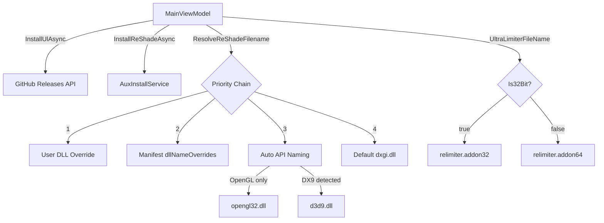

# Design Document: 32-bit OGL/DX9 Support

## Overview

This feature adds three functional enhancements to RHI and a release housekeeping set:

1. **32-bit ReLimiter support** — The existing ReLimiter install/uninstall/update pipeline is extended to select `relimiter.addon32` for 32-bit games. The same GitHub releases endpoint is used; only the asset filename changes. A separate cache file is maintained so 32-bit and 64-bit addons don't overwrite each other.

2. **Automatic OpenGL ReShade DLL naming** — When a game's `DetectedApis` set contains *only* `OpenGL`, and no user or manifest DLL override exists, ReShade is installed as `opengl32.dll` instead of the default `dxgi.dll`.

3. **Automatic DX9 ReShade DLL naming** — When a game's `DetectedApis` set contains `DirectX9` (regardless of other APIs), and no user or manifest DLL override exists, ReShade is installed as `d3d9.dll`.

4. **Version bump** to 1.6.4, **patch notes**, and **documentation updates**.

The priority chain for ReShade DLL naming becomes:
```
User DLL override (DllOverrideEnabled) > Manifest dllNameOverrides > Automatic API-based naming > Default "dxgi.dll"
```

## Architecture

The changes are localised to existing components with no new services or models:



### Key Design Decisions

1. **No new service classes** — All changes fit within `MainViewModel` (ReLimiter bitness) and the `InstallReShadeAsync` call site (DLL naming). The `AuxInstallService.InstallReShadeAsync` already accepts `filenameOverride` and needs no modification.

2. **Separate cache files for 32/64-bit ReLimiter** — Using distinct filenames (`relimiter.addon32` / `relimiter.addon64`) in the download cache avoids cross-contamination when the user has both 32-bit and 64-bit games.

3. **API-based naming as a fallback, not an override** — Automatic naming only kicks in when neither user nor manifest overrides are set. This preserves existing behaviour for games like Terraria (`dbghelp.dll` via manifest) and Morrowind (`opengl32.dll` via manifest).

4. **DX9 takes precedence over OpenGL in auto-naming** — If a game somehow imports both `d3d9.dll` and `opengl32.dll`, `d3d9.dll` wins because DX9 is the more common rendering path on Windows for such games.

## Components and Interfaces

### MainViewModel Changes

#### ReLimiter Bitness

Current constants:
```csharp
private const string UltraLimiterFileName = "relimiter.addon64";
private static readonly string UlCachePath = Path.Combine(
    ModInstallService.DownloadCacheDir, UltraLimiterFileName);
```

These become methods/properties that accept or derive bitness from the card:

```csharp
private const string UltraLimiterFileName64 = "relimiter.addon64";
private const string UltraLimiterFileName32 = "relimiter.addon32";

private static string GetUlFileName(bool is32Bit) =>
    is32Bit ? UltraLimiterFileName32 : UltraLimiterFileName64;

private static string GetUlCachePath(bool is32Bit) =>
    Path.Combine(ModInstallService.DownloadCacheDir, GetUlFileName(is32Bit));
```

Affected methods:
- `InstallUlAsync(card)` — passes `card.Is32Bit` to select filename and cache path
- `EnsureUlCachedAsync(bool is32Bit, ...)` — gains `is32Bit` parameter to cache the correct asset
- `FetchLatestUlReleaseInfoAsync()` — fetches download URLs for both assets (or the requested one)
- `UninstallUl(card)` — uses `GetUlFileName(card.Is32Bit)` for deletion
- `CheckUlUpdateAsync` — checks both 32-bit and 64-bit cache files
- Card building (`BuildCards`) — sets `UlInstalledFile` based on which addon file is found

#### ReShade Filename Resolution

A new helper method is added to `MainViewModel`:

```csharp
internal static string? ResolveAutoReShadeFilename(HashSet<GraphicsApiType> detectedApis)
{
    if (detectedApis.Contains(GraphicsApiType.DirectX9))
        return "d3d9.dll";
    if (detectedApis.Count == 1 && detectedApis.Contains(GraphicsApiType.OpenGL))
        return "opengl32.dll";
    return null; // fall through to default dxgi.dll
}
```

The `InstallReShadeAsync` call site changes from:

```csharp
filenameOverride: card.DllOverrideEnabled
    ? (GetDllOverride(card.GameName)?.ReShadeFileName)
    : (GetManifestDllNames(card.GameName)?.ReShade is { Length: > 0 } mRs ? mRs : null),
```

To:

```csharp
filenameOverride: card.DllOverrideEnabled
    ? (GetDllOverride(card.GameName)?.ReShadeFileName)
    : (GetManifestDllNames(card.GameName)?.ReShade is { Length: > 0 } mRs
        ? mRs
        : ResolveAutoReShadeFilename(card.DetectedApis)),
```

The same change is applied in `UpdateOrchestrationService` where it also calls `InstallReShadeAsync`.

### AuxInstallService

No changes needed. `InstallReShadeAsync` already handles:
- `filenameOverride` → uses it as `destName` if non-null
- Record-aware cleanup of old DLL names when `InstalledAs` differs
- `Uninstall(record)` deletes whatever `record.InstalledAs` points to

### GameCardViewModel

No model changes needed. `Is32Bit` and `DetectedApis` already exist and are populated during card building.

## Data Models

### Existing Models (No Changes)

| Model | Relevant Fields | Notes |
|-------|----------------|-------|
| `GameCardViewModel` | `Is32Bit`, `DetectedApis`, `DllOverrideEnabled`, `UlInstalledFile`, `UlStatus` | All fields already exist |
| `DllOverrideConfig` | `ReShadeFileName` | User-set override, highest priority |
| `ManifestDllNames` | `ReShade` | Manifest override, second priority |
| `AuxInstalledRecord` | `InstalledAs` | Tracks actual installed filename for cleanup |
| `GraphicsApiType` | `DirectX9`, `OpenGL`, etc. | Enum already has all needed values |

### Constants Changes

| Constant | Old Value | New Value |
|----------|-----------|-----------|
| `UltraLimiterFileName` | `"relimiter.addon64"` | Split into `UltraLimiterFileName64` / `UltraLimiterFileName32` |
| `UlCachePath` | Single path | `GetUlCachePath(bool is32Bit)` method |
| `AssemblyVersion` | `1.6.3.0` | `1.6.4.0` |
| `FileVersion` | `1.6.3.0` | `1.6.4.0` |


## Correctness Properties

*A property is a characteristic or behavior that should hold true across all valid executions of a system — essentially, a formal statement about what the system should do. Properties serve as the bridge between human-readable specifications and machine-verifiable correctness guarantees.*

### Property 1: ReLimiter filename matches game bitness

*For any* boolean `is32Bit` value, `GetUlFileName(is32Bit)` shall return `"relimiter.addon32"` when `is32Bit` is true and `"relimiter.addon64"` when `is32Bit` is false. Furthermore, `GetUlCachePath(true)` and `GetUlCachePath(false)` shall always produce distinct paths.

**Validates: Requirements 1.1, 1.2, 1.4, 1.7**

### Property 2: Automatic ReShade DLL naming by detected graphics APIs

*For any* set of `GraphicsApiType` values representing a game's detected APIs:
- If the set contains `DirectX9`, `ResolveAutoReShadeFilename` shall return `"d3d9.dll"` (DX9 takes precedence).
- If the set contains *only* `OpenGL`, `ResolveAutoReShadeFilename` shall return `"opengl32.dll"`.
- If the set contains `OpenGL` alongside other non-DX9 APIs, `ResolveAutoReShadeFilename` shall return `null` (default `dxgi.dll`).
- For all other API sets (DX11, DX12, Vulkan, etc.), `ResolveAutoReShadeFilename` shall return `null`.

**Validates: Requirements 2.1, 2.2, 2.5, 3.1, 3.2**

### Property 3: User DLL override takes priority over automatic naming

*For any* game card where `DllOverrideEnabled` is true and a `DllOverrideConfig` with a non-empty `ReShadeFileName` exists, the resolved `filenameOverride` passed to `InstallReShadeAsync` shall equal the user's `ReShadeFileName`, regardless of the game's `DetectedApis`.

**Validates: Requirements 2.3, 3.3**

### Property 4: Manifest DLL override takes priority over automatic naming

*For any* game card where `DllOverrideEnabled` is false and a manifest `dllNameOverrides` entry exists with a non-empty `ReShade` value, the resolved `filenameOverride` passed to `InstallReShadeAsync` shall equal the manifest's `ReShade` value, regardless of the game's `DetectedApis`.

**Validates: Requirements 2.4, 3.4**

## Error Handling

| Scenario | Handling |
|----------|----------|
| GitHub release has no `relimiter.addon32` asset | `FetchLatestUlReleaseInfoAsync` returns null URL for 32-bit; `EnsureUlCachedAsync` throws `InvalidOperationException` with descriptive message; card shows `❌ Install failed` |
| Cache file missing after download | Same as existing 64-bit flow — `File.Copy` throws `FileNotFoundException`, caught by `InstallUlAsync` try/catch |
| `ResolveAutoReShadeFilename` returns unexpected filename | Not possible — the function is a pure mapping from enum set to string. Invalid API sets return `null`, falling through to default `dxgi.dll` |
| Foreign DLL at `opengl32.dll` or `d3d9.dll` destination | Existing `BackupForeignDll` in `AuxInstallService.InstallReShadeAsync` handles this — backs up the foreign file before overwriting |
| Uninstall targets wrong filename | `AuxInstalledRecord.InstalledAs` tracks the actual filename used at install time; `Uninstall(record)` deletes that exact file |

## Testing Strategy

### Property-Based Tests

Use **FsCheck** (already available in the test project) with minimum **100 iterations** per property.

Each property test must be tagged with a comment referencing the design property:

```
// Feature: 32bit-ogl-dx9-support, Property 1: ReLimiter filename matches game bitness
// Feature: 32bit-ogl-dx9-support, Property 2: Automatic ReShade DLL naming by detected graphics APIs
// Feature: 32bit-ogl-dx9-support, Property 3: User DLL override takes priority over automatic naming
// Feature: 32bit-ogl-dx9-support, Property 4: Manifest DLL override takes priority over automatic naming
```

**Property 1** — Generate random booleans for `is32Bit`. Assert filename and cache path correctness. This is a pure function test requiring no mocking.

**Property 2** — Generate random subsets of `GraphicsApiType` enum values. Call `ResolveAutoReShadeFilename` and assert the return value matches the expected DLL name based on the rules (DX9 → `d3d9.dll`, OpenGL-only → `opengl32.dll`, otherwise → `null`).

**Property 3** — Generate random `DetectedApis` sets and random non-empty `ReShadeFileName` strings. Simulate the resolution chain with `DllOverrideEnabled = true` and assert the user override always wins.

**Property 4** — Generate random `DetectedApis` sets and random non-empty manifest `ReShade` strings. Simulate the resolution chain with `DllOverrideEnabled = false` and a manifest entry, and assert the manifest value always wins over auto-naming.

### Unit Tests

Unit tests complement property tests for specific examples and edge cases:

- **Version bump**: Assert `AssemblyVersion` and `FileVersion` in `.csproj` are `1.6.4.0`
- **Patch notes structure**: Assert `RHI_PatchNotes.md` contains `## v1.6.4` before `## v1.6.3`
- **Patch notes content**: Assert patch notes mention "32-bit ReLimiter", "OpenGL", and "DX9"/"DirectX 9"
- **Edge case — empty DetectedApis**: `ResolveAutoReShadeFilename({})` returns `null`
- **Edge case — DX9 + OpenGL together**: `ResolveAutoReShadeFilename({DirectX9, OpenGL})` returns `"d3d9.dll"` (DX9 wins)
- **Legacy filename cleanup**: Verify `UninstallUl` also removes legacy `ultra_limiter.addon64` / `ultra_limiter.addon32` files
