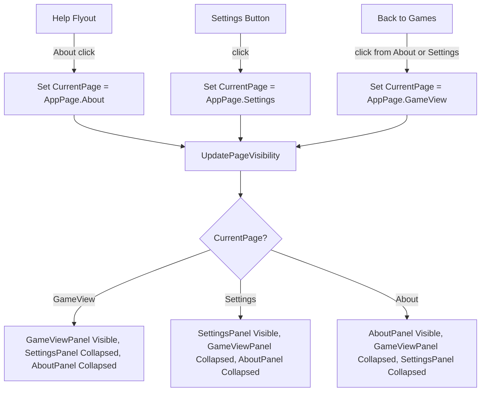

# Design Document: About Page Separation

## Overview

This feature extracts all informational "About" content from the Settings panel into a dedicated About page. The About page becomes a third top-level page alongside GameView and Settings, accessible via a new "About" menu item in the Help flyout. The Settings page retains only actionable configuration sections.

The change is structurally simple: add an `About` value to the `AppPage` enum, define a new `AboutPanel` grid in `MainWindow.xaml`, extend `UpdatePageVisibility()` to handle three pages, wire a click handler from the Help flyout, and remove the About/Credits/Links XAML blocks from the Settings panel.

## Architecture



### Component Interaction

1. **`Models/AppPage.cs`** — Add `About` enum value.
2. **`MainWindow.xaml`** — Add `AboutPanel` grid (same structural pattern as `SettingsPanel`: back-button bar + scrollable content). Remove the About, Credits, and Links `Border` sections from `SettingsPanel`.
3. **`MainWindow.xaml`** — Add an "About" `MenuFlyoutItem` as the last item in the Help flyout.
4. **`MainWindow.UISync.cs`** — Extend `UpdatePageVisibility()` to handle three-way visibility (GameView / Settings / About).
5. **`MainWindow.Events.cs`** — Add `AboutButton_Click` handler that sets `CurrentPage = AppPage.About`.
6. **`ViewModels/MainViewModel.Install.cs`** — Add `NavigateToAbout` relay command.

## Components and Interfaces

### AppPage Enum (modified)

```csharp
public enum AppPage
{
    GameView,
    Settings,
    About
}
```

### MainViewModel (modified)

```csharp
// New relay command alongside existing NavigateToSettings / NavigateToGameView
[RelayCommand]
public void NavigateToAbout() => CurrentPage = AppPage.About;
```

### MainWindow.Events.cs (modified)

```csharp
private void AboutButton_Click(object sender, RoutedEventArgs e)
    => ViewModel.NavigateToAboutCommand.Execute(null);
```

### MainWindow.UISync.cs — UpdatePageVisibility (modified)

```csharp
private void UpdatePageVisibility()
{
    GameViewPanel.Visibility  = ViewModel.CurrentPage == AppPage.GameView  ? Visibility.Visible : Visibility.Collapsed;
    SettingsPanel.Visibility  = ViewModel.CurrentPage == AppPage.Settings  ? Visibility.Visible : Visibility.Collapsed;
    AboutPanel.Visibility     = ViewModel.CurrentPage == AppPage.About     ? Visibility.Visible : Visibility.Collapsed;

    if (GameList.SelectedItem == null && ViewModel.DisplayedGames.Count > 0)
        GameList.SelectedItem = ViewModel.DisplayedGames[0];
}
```

### MainWindow.xaml — AboutPanel (new)

The `AboutPanel` is a `Grid` placed inside Row 1 of the main content area, alongside `GameViewPanel` and `SettingsPanel`. It follows the same structural pattern as `SettingsPanel`:
- Row 0: Back button bar with "← Back to Games" button and "About" title
- Row 1: `ScrollViewer` containing a `StackPanel` with all the About content

Content moved from Settings:
- App icon + name + version (`AboutVersionText`)
- Description text
- "What RHI does" info block
- Disclaimer block
- Single-player warning block
- Credits & Acknowledgements section (all entries)
- Links section (all hyperlinks)
- Patch Notes link (if previously in Settings)

### MainWindow.xaml — Help Flyout (modified)

```xml
<MenuFlyout Placement="Bottom">
    <MenuFlyoutItem Text="Discord" Click="SupportDiscord_Click"/>
    <MenuFlyoutItem Text="Guide" Click="SupportGuide_Click"/>
    <MenuFlyoutItem Text="Ko-fi" Click="SupportKofi_Click"/>
    <MenuFlyoutItem Text="About" Click="AboutButton_Click"/>
</MenuFlyout>
```

## Data Models

No new data models are required. The only model change is adding the `About` value to the existing `AppPage` enum.

The `AboutVersionText` named element moves from the Settings panel to the About panel. It continues to be set in code-behind the same way it is today — no binding changes needed.


## Correctness Properties

*A property is a characteristic or behavior that should hold true across all valid executions of a system — essentially, a formal statement about what the system should do. Properties serve as the bridge between human-readable specifications and machine-verifiable correctness guarantees.*

Most acceptance criteria for this feature are UI content/structure requirements (which panel shows what text) and are not amenable to automated property testing. The testable behavior centers on the page visibility state machine.

### Property 1: Page visibility exclusivity

*For any* `AppPage` value (GameView, Settings, or About), computing the visibility state must produce exactly one visible panel and two collapsed panels. Specifically:
- `AppPage.GameView` → GameViewPanel=Visible, SettingsPanel=Collapsed, AboutPanel=Collapsed
- `AppPage.Settings` → GameViewPanel=Collapsed, SettingsPanel=Visible, AboutPanel=Collapsed
- `AppPage.About` → GameViewPanel=Collapsed, SettingsPanel=Collapsed, AboutPanel=Visible

**Validates: Requirements 5.1, 5.2, 5.3**

### Property 2: Navigation idempotence

*For any* `AppPage` value, navigating to that page twice in succession produces the same visibility state as navigating once. That is, the visibility function is idempotent with respect to repeated navigation.

**Validates: Requirements 5.1, 5.2, 5.3, 3.2**

## Error Handling

This feature introduces minimal new error surface:

- **Invalid AppPage value**: The `UpdatePageVisibility()` method handles all three enum values explicitly. If the enum were ever extended without updating the method, the default behavior would leave all panels collapsed. No crash risk.
- **AboutVersionText binding**: The `AboutVersionText` element moves panels but retains the same `x:Name` and code-behind assignment. If the element is missing at runtime (e.g., XAML parse error), the existing null-check pattern in the version-setting code prevents crashes.
- **Help flyout click**: The `AboutButton_Click` handler delegates to a relay command. If the command fails to execute, no exception propagates — same pattern as existing `SettingsButton_Click`.

No new exception types, error dialogs, or retry logic are needed.

## Testing Strategy

### Property-Based Tests (FsCheck + xUnit)

The project uses **FsCheck.Xunit 2.16.6** for property-based testing. Each property test runs a minimum of 100 iterations.

**Property 1 test**: Generate all `AppPage` enum values, call the visibility computation function, and assert exactly one panel is Visible while the other two are Collapsed. To keep this testable without a XAML host, extract the visibility logic into a pure function (similar to the existing `GetVisibilityState` pattern in `MainWindow.Skeleton.cs`) that returns a struct with three `Visibility` values.

**Property 2 test**: For each `AppPage` value, compute visibility twice in sequence and assert the results are identical.

Tag format: `Feature: about-page-separation, Property {N}: {title}`

Each correctness property is implemented by a single property-based test.

### Unit Tests (xUnit)

Unit tests cover specific examples and edge cases:
- `AppPage` enum contains exactly three values: `GameView`, `Settings`, `About`.
- `NavigateToAbout` command sets `CurrentPage` to `AppPage.About`.
- `NavigateToGameView` from About page sets `CurrentPage` to `AppPage.GameView`.

### Test Configuration

- Minimum 100 iterations per property test (`[Property(MaxTest = 100)]`)
- Each test references its design document property in a comment tag
- Pure visibility function extracted to enable headless testing (no WinUI host required)
