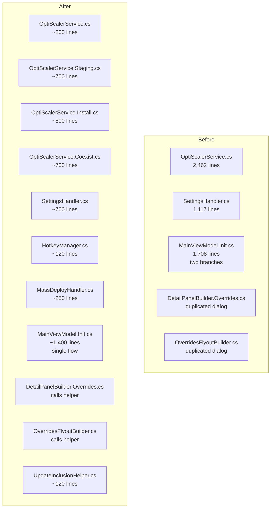

# Design Document: Codebase Refactor

## Overview

This design covers a structural refactoring of the RenoDX Commander (RHI) WinUI3 C# codebase. The refactoring targets five large files that have accumulated too much responsibility, plus one dead code removal. No functional changes are introduced — the application must behave identically before and after.

The refactoring follows patterns already established in the codebase:
- **Partial classes** for service splits (as seen in `ShaderPackService.cs` / `ShaderPackService.Deploy.cs` / `ShaderPackService.Download.cs`, `AuxInstallService.cs` / `AuxInstallService.Install.cs`, and `GameCardViewModel` split across 10 files)
- **Helper class extraction** for cross-cutting concerns (as seen in `DialogService`, `UIFactory`, `PresetPopupHelper`)
- **Static utility classes** for stateless operations (as seen in `CrashReporter`, `ResourceKeys`)

### Refactoring Targets

| File | Lines | Action |
|------|-------|--------|
| `OptiScalerService.cs` | 2,462 | Split into 4 partial class files |
| `SettingsHandler.cs` | 1,117 | Extract `HotkeyManager` and `MassDeployHandler` |
| `MainViewModel.Init.cs` | 1,708 | Merge two near-identical init branches |
| `DetailPanelBuilder.Overrides.cs` + `OverridesFlyoutBuilder.cs` | 1,591 + 1,389 | Extract shared `UpdateInclusionHelper` |
| `ShaderPackService.Deploy.cs` | — | Remove dead `MigrateLegacyDcShaders` |

## Architecture

The refactoring preserves the existing architecture. No new layers, services, or dependency injection registrations are introduced. The changes are purely structural:



### Dependency Direction

All new classes follow the existing dependency patterns:

- `HotkeyManager` — static, no dependencies (pure functions)
- `MassDeployHandler` — depends on `MainWindow` (same as `SettingsHandler`)
- `UpdateInclusionHelper` — static methods accepting `MainViewModel` via delegate/accessor, `XamlRoot`, game name, and RE Engine flag

No circular dependencies are introduced. No new interfaces are needed since these are internal implementation details, not DI-registered services.

## Components and Interfaces

### Component 1: OptiScalerService Partial Class Split

**Current state:** Single 2,462-line file with four distinct concerns mixed together.

**Target split:**

| File | Responsibility | Methods |
|------|---------------|---------|
| `OptiScalerService.cs` | Constructor, constants, properties, DI fields, hotkey VK map | Constructor, `ResolveHotkeyToVkCode`, constants, `HotkeyNameToVkCode` dictionary |
| `OptiScalerService.Staging.cs` | Download, extract, version check for OptiScaler + OptiPatcher + DLSS | `EnsureStagingAsync`, `CheckForUpdateAsync`, `ClearStaging`, `EnsureOptiPatcherStagingAsync`, `CheckOptiPatcherUpdateAsync`, `EnsureDlssStagingAsync`, `CheckDlssUpdateAsync`, `GetStagedDlssPath`, `GetStagedDlssdPath`, `GetStagedDlssgPath`, `GetStagedDlssVersion`, `Find7ZipExe` |
| `OptiScalerService.Install.cs` | Install, uninstall, update, INI management, detection, records, hotkey application | `GetBundledIniPath`, `InstallAsync`, `Uninstall`, `UpdateAsync`, `CopyIniToGame`, `BackupOriginalIfExists`, `RestoreOriginalIfExists`, `EnforceLoadReshade`, `EnforceLoadAsiPlugins`, `EnforceNvngxDlssPath`, `DetectInstallation`, `IsOptiScalerFile`, `IsOptiScalerFileStatic`, `ContainsSequence`, `LoadAllRecords`, `FindRecord`, `GetEffectiveOsDllName`, `SetHotkey`, `ApplyHotkeyToAllGames`, `WriteShortcutKey`, `ReadShortcutKey` |
| `OptiScalerService.Coexist.cs` | ReShade coexistence logic, DLL renaming resolution | `ResolveReShadeFilename` (both overloads) |

**Design rationale:** The split follows the same `{Service}.{Concern}.cs` naming convention used by `ShaderPackService.Deploy.cs`, `ShaderPackService.Download.cs`, `AuxInstallService.Install.cs`, etc. The Coexist file is smaller but represents a distinct concern (ReShade interaction) that is likely to grow as more coexistence scenarios are added.

**Implementation notes:**
- Each file starts with `namespace RenoDXCommander.Services;` and `public partial class OptiScalerService`
- Private fields and constants in the root file are accessible from all partials (C# partial class semantics)
- The `IOptiScalerService` interface is unchanged
- `using` directives are duplicated per file as needed (each file only includes what it references)

### Component 2: HotkeyManager Extraction

**Current state:** `SettingsHandler` contains static hotkey utility methods (`ParseHotkeyString`, `BuildHotkeyString`, `FormatHotkeyDisplay`, `IsDefaultHotkey`, `BuildUlHotkeyString`) and the `VkNames` dictionary. These are pure functions with no dependency on `SettingsHandler` instance state.

**Target:**

```csharp
namespace RenoDXCommander;

/// <summary>
/// Shared hotkey parsing, formatting, and building utilities.
/// Extracted from SettingsHandler — all methods are pure/static.
/// </summary>
public static class HotkeyManager
{
    // VkNames dictionary (moved from SettingsHandler)
    private static readonly Dictionary<int, string> VkNames = new() { ... };

    public static (int vk, bool shift, bool ctrl, bool alt) ParseHotkeyString(string value);
    public static string BuildHotkeyString(int vk, bool shift, bool ctrl, bool alt);
    public static string FormatHotkeyDisplay(int vk, bool shift, bool ctrl, bool alt);
    public static string FormatHotkeyDisplay(string keyOverlayValue);
    public static bool IsDefaultHotkey(string keyOverlayValue);
    public static string BuildUlHotkeyString(int vk, bool shift, bool ctrl, bool alt);
}
```

**Callers to update:**
- `SettingsHandler` — replace `ParseHotkeyString(...)` calls with `HotkeyManager.ParseHotkeyString(...)`
- All `PreviewKeyDown` handlers in `SettingsHandler` that call `BuildHotkeyString` and `FormatHotkeyDisplay`
- Existing tests (`HotkeyStringRoundTripPropertyTests`, `HotkeyDisplayFormatPropertyTests`, `HotkeyHelperUnitTests`, `ApplyOverlayHotkeyPropertyTests`) — update references from `SettingsHandler.ParseHotkeyString` to `HotkeyManager.ParseHotkeyString`, etc.

**Design rationale:** Static class because all methods are pure functions with no instance state. Placed in the `RenoDXCommander` namespace (same as `SettingsHandler`) to minimize using-directive changes.

### Component 3: MassDeployHandler Extraction

**Current state:** `SettingsHandler` contains five mass deployment methods (`MassDeployRsIni_Click`, `MassDeployUlIni_Click`, `MassDeployDcIni_Click`, `MassDeployOsIni_Click`, `MassPresetInstall_ClickAsync`) and the private `ShowDeployResult` helper. These are a distinct concern from settings UI toggle handling.

**Target:**

```csharp
namespace RenoDXCommander;

/// <summary>
/// Handles mass INI deployment and preset installation across all games.
/// Extracted from SettingsHandler to isolate the deployment concern.
/// </summary>
public class MassDeployHandler
{
    private readonly MainWindow _window;

    public MassDeployHandler(MainWindow window);

    public async void MassDeployRsIni_Click(object sender, RoutedEventArgs e);
    public async void MassDeployUlIni_Click(object sender, RoutedEventArgs e);
    public async void MassDeployDcIni_Click(object sender, RoutedEventArgs e);
    public async void MassDeployOsIni_Click(object sender, RoutedEventArgs e);
    public async Task MassPresetInstall_ClickAsync(XamlRoot xamlRoot);

    private async Task ShowDeployResult(string iniName, int count);
}
```

**Callers to update:**
- `SettingsHandler.SettingsButton_Click` (or wherever the mass deploy buttons are wired) — delegate to `MassDeployHandler` instance
- `MainWindow` or `SettingsHandler` needs to hold a `MassDeployHandler` instance, created with the same `MainWindow` reference

**Design rationale:** Non-static class because it needs the `MainWindow` reference for `_window.ViewModel`, `_window.Content.XamlRoot`, and `_window.BuildScreenshotSavePath`. Same constructor pattern as `SettingsHandler`.

### Component 4: Init Branch Deduplication

**Current state:** `MainViewModel.InitializeAsync` has two branches (`if (savedLib != null && !forceRescan)` and `else`) that each:
1. Set `StatusText` and `SubStatusText`
2. Launch the same 10 background tasks with identical `Task.Run` + try/catch wrappers
3. Await `detectTask` first
4. Await network tasks individually with the same error handling
5. Extract wiki/luma results with the same pattern

The only differences:
- Status messages differ
- The cached branch sets `addonCache = savedLib.AddonScanCache` before tasks; the fresh branch sets `addonCache = new Dictionary<>()` after tasks
- The cached branch merges fresh + cached games after detection; the fresh branch uses fresh results directly

**Target design:**

```csharp
// 1. Set status messages based on whether cache exists
bool hasCachedLibrary = savedLib != null && !forceRescan;
if (hasCachedLibrary)
{
    StatusText    = $"Library loaded ({savedLib!.Games.Count} games, scanned {FormatAge(savedLib.LastScanned)})";
    SubStatusText = "Checking for new games and fetching latest mod info...";
    addonCache    = savedLib.AddonScanCache;
}
else
{
    StatusText    = "Scanning game library...";
    SubStatusText = "Running store scans + wiki fetch simultaneously...";
    addonCache    = new Dictionary<string, bool>(StringComparer.OrdinalIgnoreCase);
}

// 2. Launch all background tasks (identical for both paths)
var wikiTask     = _wikiService.FetchAllAsync();
var lumaTask     = _lumaService.FetchCompletedModsAsync();
var manifestTask = _manifestService.FetchAsync();
var detectTask   = DetectAllGamesDedupedAsync();
var osWikiTask   = Task.Run(async () => { ... });
var hdrDbTask    = Task.Run(async () => { ... });
rsTask           = Task.Run(async () => { ... });
normalRsTask     = Task.Run(async () => { ... });
osTask           = Task.Run(async () => { ... });
dlssTask         = Task.Run(async () => { ... });

// 3. Await detection first
var freshGames = await detectTask;

// 4. Await network tasks individually (identical error handling)
try { await wikiTask; } catch (...) { ... }
try { await lumaTask; } catch (...) { ... }
try { _manifest = await manifestTask; } catch (...) { ... }
try { await osWikiTask; } catch (...) { ... }
try { await hdrDbTask; } catch (...) { ... }

// 5. Extract wiki/luma results (identical)
var wikiResult = !wikiFetchFailed ? await wikiTask : default;
_allMods      = wikiResult.Mods ?? new();
_genericNotes = wikiResult.GenericNotes ?? new();
try { _lumaMods = lumaTask.IsCompletedSuccessfully ? await lumaTask : new(); } catch (...) { ... }

// 6. Merge or use directly based on cache
ApplyGameRenames(freshGames);
if (hasCachedLibrary)
{
    var cachedGames = _gameLibraryService.ToDetectedGames(savedLib!);
    // Existing deduplication logic: fresh wins, cached added if no match by name or path
    var freshNorms = freshGames.Select(g => _gameDetectionService.NormalizeName(g.Name))
        .ToHashSet(StringComparer.OrdinalIgnoreCase);
    var freshPaths = freshGames
        .Where(g => !string.IsNullOrEmpty(g.InstallPath))
        .Select(g => g.InstallPath.TrimEnd(Path.DirectorySeparatorChar))
        .ToHashSet(StringComparer.OrdinalIgnoreCase);
    detectedGames = freshGames
        .Concat(cachedGames.Where(g =>
            !freshNorms.Contains(_gameDetectionService.NormalizeName(g.Name))
            && (string.IsNullOrEmpty(g.InstallPath)
                || !freshPaths.Contains(g.InstallPath.TrimEnd(Path.DirectorySeparatorChar)))))
        .ToList();
    _crashReporter.Log($"[...] Merged library: {freshGames.Count} detected + {cachedGames.Count} cached → {detectedGames.Count} total");
}
else
{
    detectedGames = freshGames;
    _crashReporter.Log($"[...] Wiki fetch complete: {_allMods.Count} mods. Store scan complete: {detectedGames.Count} games.");
}
```

**Key design decisions:**
- The `addonCache` assignment for the fresh path is moved before the task launch (it's just `new Dictionary<>()`, no dependency on task results)
- The `ApplyGameRenames(freshGames)` call is unified — in the original cached branch it was called on `freshGames` before merge, and in the fresh branch it was called on `detectedGames` after assignment. Since `detectedGames = freshGames` in the fresh path, these are equivalent. In the merged version, we call it on `freshGames` before the merge/assignment.
- The log messages differ between paths, which is preserved in the `if/else` at the end

### Component 5: UpdateInclusionHelper Extraction

**Current state:** `DetailPanelBuilder.Overrides.cs` and `OverridesFlyoutBuilder.cs` each contain ~80 lines of identical Update Inclusion dialog code. The only difference is the ViewModel access pattern:
- `DetailPanelBuilder`: `_window.ViewModel.IsUpdateAllExcludedReShade(capturedName)`
- `OverridesFlyoutBuilder`: `ViewModel.IsUpdateAllExcludedReShade(capturedName)` (where `ViewModel` is a local variable set to `_window.ViewModel`)

Both ultimately access the same `MainViewModel` instance.

**Target:**

```csharp
namespace RenoDXCommander;

/// <summary>
/// Shared Update Inclusion dialog logic used by both DetailPanelBuilder
/// and OverridesFlyoutBuilder.
/// </summary>
public static class UpdateInclusionHelper
{
    /// <summary>
    /// Creates the Update Inclusion button and summary text block.
    /// Returns (button, summaryTextBlock) for the caller to add to its layout.
    /// </summary>
    public static (Button button, TextBlock summary) CreateUpdateInclusionControls(
        MainViewModel viewModel,
        string gameName,
        bool isREEngineGame,
        XamlRoot xamlRoot);
}
```

**Abstraction approach:** Instead of a delegate/accessor, the helper accepts `MainViewModel` directly. Both callers already have access to the ViewModel — `DetailPanelBuilder` via `_window.ViewModel` and `OverridesFlyoutBuilder` via `_window.ViewModel` (assigned to a local `ViewModel` variable). Passing the concrete `MainViewModel` is simpler than introducing a delegate and matches the existing codebase style where ViewModel is passed directly.

**The helper encapsulates:**
1. `RefreshUpdateSummary(TextBlock summaryTb)` — the inline local function that builds the On/Off summary
2. Button creation with the standard blue styling
3. The `Click` handler that builds the checkbox dialog, shows it via `DialogService.ShowSafeAsync`, and applies toggle changes
4. Initial summary refresh

**Callers after refactoring:**
```csharp
// In DetailPanelBuilder.Overrides.cs:
var (updateInclusionBtn, updateSummaryText) = UpdateInclusionHelper.CreateUpdateInclusionControls(
    _window.ViewModel, capturedName, card.IsREEngineGame, _window.Content.XamlRoot);

// In OverridesFlyoutBuilder.cs:
var (updateInclusionBtn, updateSummaryText) = UpdateInclusionHelper.CreateUpdateInclusionControls(
    ViewModel, capturedName, card.IsREEngineGame, _window.Content.XamlRoot);
```

### Component 6: Dead Code Removal

**Target:** Remove from `ShaderPackService.Deploy.cs`:
- `public static void MigrateLegacyDcShaders()` (public, marked `[Obsolete]`)
- `internal static void MigrateLegacyDcShaders(string shadersDir, string texturesDir)` (testable overload)
- The `[Obsolete("DC has been removed...")]` attribute

**Pre-condition verified:** Zero callers exist in the codebase. The method was retained for one release cycle (per the Obsolete message) and that cycle has passed.

**Cleanup:** After removal, check for any `using` directives in `ShaderPackService.Deploy.cs` that become unused and remove them.

## Data Models

No data model changes. All existing models (`DetectedGame`, `AuxInstalledRecord`, `GameCardViewModel`, `MainViewModel`, `SettingsViewModel`, etc.) remain unchanged.

The only new "data" is the parameter signature of `UpdateInclusionHelper.CreateUpdateInclusionControls`, which accepts existing types (`MainViewModel`, `string`, `bool`, `XamlRoot`) and returns existing WinUI types (`Button`, `TextBlock`).

## Correctness Properties

*A property is a characteristic or behavior that should hold true across all valid executions of a system — essentially, a formal statement about what the system should do. Properties serve as the bridge between human-readable specifications and machine-verifiable correctness guarantees.*

This refactoring is primarily structural (code moves, not logic changes), so most acceptance criteria are verified by compilation and the existing test suite. However, the init branch deduplication introduces a merge of two code paths into one, and the deduplication logic is a meaningful property that varies with input.

### Property 1: Cache merge deduplication preserves fresh games and excludes duplicates

*For any* list of fresh detected games and any list of cached games, merging them using the deduplication logic SHALL produce a result where: (a) all fresh games are present, (b) cached games appear only if they don't match any fresh game by normalized name or by install path, and (c) the total count equals fresh count plus the count of non-duplicate cached games.

**Validates: Requirements 4.4**

### Property 2: Hotkey round-trip preservation after extraction

*For any* VK code (1–254) and any combination of modifier booleans (shift, ctrl, alt), `HotkeyManager.ParseHotkeyString(HotkeyManager.BuildHotkeyString(vk, shift, ctrl, alt))` SHALL return the original (vk, shift, ctrl, alt) tuple.

**Validates: Requirements 2.1, 2.7**

*Note: This property already exists in `HotkeyStringRoundTripPropertyTests.cs` referencing `SettingsHandler`. After extraction, the test references must be updated to `HotkeyManager` and the property must still hold, confirming behavioral equivalence.*

### Property 3: Hotkey display format consistency after extraction

*For any* VK code (1–254) and any combination of modifier booleans, `HotkeyManager.FormatHotkeyDisplay(vk, shift, ctrl, alt)` SHALL produce a string that contains "Ctrl" if and only if ctrl is true, "Shift" if and only if shift is true, "Alt" if and only if alt is true, and ends with the key name.

**Validates: Requirements 2.1, 2.7**

*Note: This property already exists in `HotkeyDisplayFormatPropertyTests.cs`. After extraction, references update to `HotkeyManager`.*

## Error Handling

No changes to error handling. All existing try/catch patterns, `CrashReporter.Log` calls, and error dialog flows are preserved exactly as-is.

The init branch deduplication preserves the individual `try { await task; } catch { ... }` pattern for each network task, ensuring that one failed fetch doesn't block others.

## Testing Strategy

### Approach

This refactoring relies on a **dual testing strategy**:

1. **Existing test suite (190+ tests):** The primary validation. All existing property-based and unit tests must pass unchanged (except for reference updates from `SettingsHandler` → `HotkeyManager`). The test suite uses **FsCheck.Xunit** for property-based testing and **xunit** for unit tests.

2. **New structural smoke tests:** Verify that the refactoring produced the expected file structure and that extracted classes exist with the correct signatures.

3. **Property-based tests:** The cache merge deduplication property (Property 1) is the only new PBT candidate. The hotkey properties (Properties 2 and 3) are covered by existing tests that need reference updates.

### Property-Based Testing Configuration

- **Library:** FsCheck.Xunit 2.16.6 (already in use)
- **Minimum iterations:** 100 per property (`[Property(MaxTest = 100)]`)
- **Tag format:** `Feature: codebase-refactor, Property {number}: {property_text}`

### Test Plan

| Category | Tests | Action |
|----------|-------|--------|
| Existing PBT (hotkey) | `HotkeyStringRoundTripPropertyTests`, `HotkeyDisplayFormatPropertyTests`, `HotkeyHelperUnitTests`, `ApplyOverlayHotkeyPropertyTests`, `HotkeyIniIdempotencePropertyTests`, `HotkeyIniPreservationPropertyTests`, `HotkeySettingsRoundTripPropertyTests` | Update `SettingsHandler.` references to `HotkeyManager.` |
| Existing PBT (other) | All other 180+ property and unit tests | Run unchanged — must all pass |
| New PBT | Cache merge deduplication property | New test: generate random fresh/cached game lists, verify merge invariants |
| Structural | File existence, partial class declarations, method presence | New smoke tests verifying the refactoring structure |
| Build | Zero new errors/warnings | CI build verification |

### What Is NOT Tested via PBT

- **OptiScaler partial class split** — Pure code move; verified by compilation and existing tests
- **MassDeployHandler extraction** — UI event handlers with file I/O; verified by compilation and manual testing
- **UpdateInclusionHelper extraction** — UI dialog construction; verified by compilation and manual testing
- **Dead code removal** — Verified by compilation (no callers exist)

These are structural refactorings where the compiler is the primary correctness guarantee. PBT adds no value for code moves.
