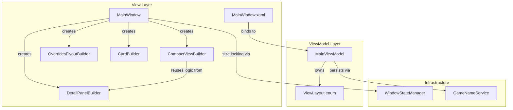
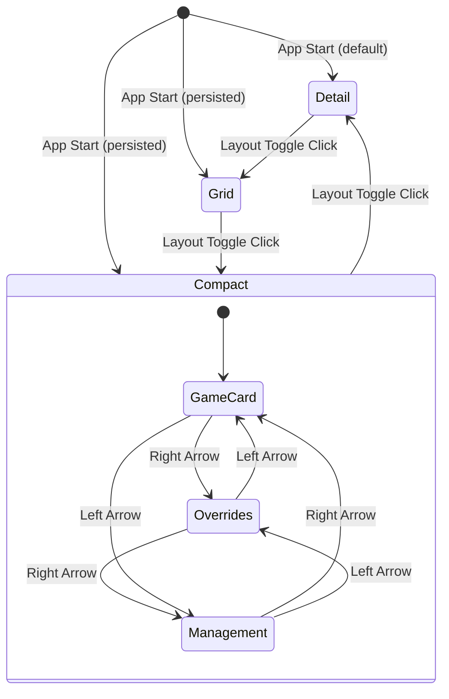

# Design Document: Compact View Mode

## Overview

This design adds a third view mode ("Compact") to the RHI WinUI 3 application. Currently the app toggles between Detail and Grid views using a boolean `IsGridLayout` property. The Compact view introduces a sidebar + paged content area layout where users navigate between Game Card, Overrides, and Management pages using left/right arrow buttons. The window is locked to a fixed size while in Compact mode.

The core changes are:
1. Replace the `IsGridLayout` boolean with a `ViewLayout` enum (Detail, Grid, Compact)
2. Add a new `CompactViewBuilder` class that constructs compact page content by reusing existing builder logic
3. Extend `WindowStateManager` with size-locking capabilities for Compact mode
4. Add XAML elements for the compact view container with navigation arrows
5. Update settings persistence to store the enum value

### Design Rationale

The existing codebase follows a pattern of extracting UI construction into builder classes (`CardBuilder`, `DetailPanelBuilder`, `OverridesFlyoutBuilder`). The Compact view follows this same pattern with a new `CompactViewBuilder` class. Rather than duplicating the overrides and management panel logic, the compact builder delegates to the existing `DetailPanelBuilder` methods where possible and builds lightweight versions of the same UI for the constrained compact layout.

## Architecture



### View Mode Transition Flow



### Key Design Decisions

1. **Enum over boolean**: A `ViewLayout` enum is cleaner than adding a second boolean and prevents invalid states. The enum is stored as an integer string in the settings file for forward compatibility.

2. **Separate CompactViewBuilder**: Rather than adding compact logic to `DetailPanelBuilder`, a new `CompactViewBuilder` keeps responsibilities clear. It calls into `DetailPanelBuilder` methods for content that is identical (game card info, overrides fields, management buttons).

3. **Page index on ViewModel**: The current compact page index (`CompactPageIndex`) lives on `MainViewModel` so it survives game selection changes (Requirement 10.4) and can be data-bound.

4. **Window size locking via WndProc**: The existing `WindowStateManager` already subclasses WndProc for minimum size enforcement. Adding max-size enforcement in Compact mode reuses the same mechanism — when Compact is active, `WM_GETMINMAXINFO` sets both min and max track size to the fixed compact dimensions, effectively locking the window.

5. **Reuse of sidebar**: The sidebar (Column 0 in `GameViewPanel`) is shared across all three view modes. Only the content area (Column 1) changes between Detail, Grid, and Compact containers.

## Components and Interfaces

### 1. ViewLayout Enum

**File**: `RenoDXCommander/Models/ViewLayout.cs` (new)

```csharp
namespace RenoDXCommander.Models;

public enum ViewLayout
{
    Detail = 0,
    Grid = 1,
    Compact = 2,
}
```

### 2. MainViewModel Changes

**File**: `RenoDXCommander/ViewModels/MainViewModel.cs`

Replace `IsGridLayout` boolean with `ViewLayout` enum property:

```csharp
[ObservableProperty] private ViewLayout _currentViewLayout = ViewLayout.Detail;
[ObservableProperty] private int _compactPageIndex = 0; // 0=GameCard, 1=Overrides, 2=Management

public Visibility DetailPanelVisibility =>
    CurrentViewLayout == ViewLayout.Detail ? Visibility.Visible : Visibility.Collapsed;

public Visibility CardGridVisibility =>
    CurrentViewLayout == ViewLayout.Grid ? Visibility.Visible : Visibility.Collapsed;

public Visibility CompactViewVisibility =>
    CurrentViewLayout == ViewLayout.Compact ? Visibility.Visible : Visibility.Collapsed;

public string LayoutToggleLabel => CurrentViewLayout switch
{
    ViewLayout.Detail => "Grid View",
    ViewLayout.Grid => "Compact View",
    ViewLayout.Compact => "Detail View",
    _ => "Grid View",
};

// Backward-compatible property for code that still checks grid mode
public bool IsGridLayout => CurrentViewLayout == ViewLayout.Grid;

partial void OnCurrentViewLayoutChanged(ViewLayout value)
{
    OnPropertyChanged(nameof(DetailPanelVisibility));
    OnPropertyChanged(nameof(CardGridVisibility));
    OnPropertyChanged(nameof(CompactViewVisibility));
    OnPropertyChanged(nameof(LayoutToggleLabel));
    OnPropertyChanged(nameof(IsGridLayout));
}

public ViewLayout NextViewLayout() => CurrentViewLayout switch
{
    ViewLayout.Detail => ViewLayout.Grid,
    ViewLayout.Grid => ViewLayout.Compact,
    ViewLayout.Compact => ViewLayout.Detail,
    _ => ViewLayout.Detail,
};

public void NavigateCompactPage(int delta)
{
    CompactPageIndex = ((CompactPageIndex + delta) % 3 + 3) % 3;
}
```

### 3. CompactViewBuilder

**File**: `RenoDXCommander/CompactViewBuilder.cs` (new)

Responsible for building the content of each compact page into a target `StackPanel`. Reuses existing builder logic where possible.

```csharp
public class CompactViewBuilder
{
    private readonly MainWindow _window;
    private readonly DispatcherQueue _dispatcherQueue;
    private GameCardViewModel? _currentCard;

    public CompactViewBuilder(MainWindow window) { ... }

    /// Builds the Game Card page content into the target panel.
    /// Reuses DetailPanelBuilder.PopulateDetailPanel logic but renders
    /// into the compact container instead of the detail panel XAML elements.
    public void BuildGameCardPage(StackPanel target, GameCardViewModel card) { ... }

    /// Builds the Overrides page content into the target panel.
    /// Delegates to DetailPanelBuilder.BuildOverridesPanel-style logic
    /// but renders into the compact container.
    public void BuildOverridesPage(StackPanel target, GameCardViewModel card) { ... }

    /// Builds the Management page content into the target panel.
    /// Creates the same four management buttons as DetailPanelBuilder.
    public void BuildManagementPage(StackPanel target, GameCardViewModel card) { ... }

    /// Rebuilds the currently active page for the given card.
    public void RebuildCurrentPage(StackPanel target, GameCardViewModel card, int pageIndex)
    {
        target.Children.Clear();
        switch (pageIndex)
        {
            case 0: BuildGameCardPage(target, card); break;
            case 1: BuildOverridesPage(target, card); break;
            case 2: BuildManagementPage(target, card); break;
        }
    }
}
```

### 4. MainWindow XAML Changes

**File**: `RenoDXCommander/MainWindow.xaml`

Add a new compact view container in Column 1 of `GameViewPanel`, alongside the existing `DetailScrollViewer` and `CardGridScrollViewer`:

```xml
<!-- Compact View Container — visible only in Compact mode -->
<Grid x:Name="CompactViewContainer"
      Visibility="{x:Bind ViewModel.CompactViewVisibility, Mode=OneWay}">
    <Grid.ColumnDefinitions>
        <ColumnDefinition Width="Auto"/>   <!-- Left arrow -->
        <ColumnDefinition Width="*"/>      <!-- Page content -->
        <ColumnDefinition Width="Auto"/>   <!-- Right arrow -->
    </Grid.ColumnDefinitions>

    <!-- Left navigation arrow -->
    <Button x:Name="CompactNavLeft" Grid.Column="0"
            Content="◀" Click="CompactNavLeft_Click"
            VerticalAlignment="Center"
            Background="{StaticResource SurfaceOverlayBrush}"
            Foreground="{StaticResource AccentTealBrush}"
            BorderThickness="0" FontSize="18"
            Padding="8,16" Margin="4,0"/>

    <!-- Scrollable page content area -->
    <ScrollViewer Grid.Column="1"
                  VerticalScrollBarVisibility="Auto"
                  HorizontalScrollBarVisibility="Disabled">
        <StackPanel x:Name="CompactPagePanel" x:FieldModifier="internal"
                    Spacing="12" Padding="16,12"/>
    </ScrollViewer>

    <!-- Right navigation arrow -->
    <Button x:Name="CompactNavRight" Grid.Column="2"
            Content="▶" Click="CompactNavRight_Click"
            VerticalAlignment="Center"
            Background="{StaticResource SurfaceOverlayBrush}"
            Foreground="{StaticResource AccentTealBrush}"
            BorderThickness="0" FontSize="18"
            Padding="8,16" Margin="0,0,4,0"/>
</Grid>
```

### 5. MainWindow Event Handlers

**File**: `RenoDXCommander/MainWindow.Events.cs`

Update `LayoutToggle_Click` to cycle through three modes:

```csharp
private void LayoutToggle_Click(object sender, RoutedEventArgs e)
{
    var previousLayout = ViewModel.CurrentViewLayout;
    ViewModel.CurrentViewLayout = ViewModel.NextViewLayout();
    ViewModel.SaveSettingsPublic();

    // Handle window size locking transitions
    if (ViewModel.CurrentViewLayout == ViewLayout.Compact)
    {
        _windowStateManager.CaptureCurrentBounds();
        _windowStateManager.ApplyCompactSize();
        _windowStateManager.SetSizeLocked(true);
    }
    else if (previousLayout == ViewLayout.Compact)
    {
        _windowStateManager.SetSizeLocked(false);
        _windowStateManager.RestoreWindowBounds();
    }

    // Rebuild content for the new layout
    switch (ViewModel.CurrentViewLayout)
    {
        case ViewLayout.Grid:
            RebuildCardGrid();
            break;
        case ViewLayout.Detail:
            if (ViewModel.SelectedGame is { } card)
            {
                PopulateDetailPanel(card);
                DetailPanel.Visibility = Visibility.Visible;
                BuildOverridesPanel(card);
                OverridesContainer.Visibility = Visibility.Visible;
                ManagementContainer.Visibility = Visibility.Visible;
            }
            break;
        case ViewLayout.Compact:
            if (ViewModel.SelectedGame is { } compactCard)
                _compactViewBuilder.RebuildCurrentPage(
                    CompactPagePanel, compactCard, ViewModel.CompactPageIndex);
            break;
    }
}

private void CompactNavLeft_Click(object sender, RoutedEventArgs e)
{
    ViewModel.NavigateCompactPage(-1);
    if (ViewModel.SelectedGame is { } card)
        _compactViewBuilder.RebuildCurrentPage(
            CompactPagePanel, card, ViewModel.CompactPageIndex);
}

private void CompactNavRight_Click(object sender, RoutedEventArgs e)
{
    ViewModel.NavigateCompactPage(1);
    if (ViewModel.SelectedGame is { } card)
        _compactViewBuilder.RebuildCurrentPage(
            CompactPagePanel, card, ViewModel.CompactPageIndex);
}
```

### 6. WindowStateManager Changes

**File**: `RenoDXCommander/WindowStateManager.cs`

Add size-locking support:

```csharp
private bool _sizeLocked;
private (int W, int H) _compactSize = (800, 700); // Fixed compact dimensions

public void SetSizeLocked(bool locked) => _sizeLocked = locked;

public void ApplyCompactSize()
{
    var dpi = NativeInterop.GetDpiForWindow(_hwnd);
    var scale = dpi / 96.0;
    var w = (int)(_compactSize.W * scale);
    var h = (int)(_compactSize.H * scale);

    // Get current position to preserve it
    NativeInterop.GetWindowRect(_hwnd, out var rect);
    NativeInterop.SetWindowPos(_hwnd, IntPtr.Zero,
        rect.Left, rect.Top, w, h, 0x0040 /* SWP_NOZORDER */);
}

// Updated WndProc — lock size when in Compact mode
internal IntPtr WndProc(IntPtr hWnd, uint msg, IntPtr wParam, IntPtr lParam)
{
    if (msg == NativeInterop.WM_GETMINMAXINFO)
    {
        var dpi = NativeInterop.GetDpiForWindow(hWnd);
        var scale = dpi / 96.0;
        var mmi = Marshal.PtrToStructure<NativeInterop.MINMAXINFO>(lParam);

        if (_sizeLocked)
        {
            // Lock both min and max to the compact size
            var w = (int)(_compactSize.W * scale);
            var h = (int)(_compactSize.H * scale);
            mmi.ptMinTrackSize = new System.Drawing.Point(w, h);
            mmi.ptMaxTrackSize = new System.Drawing.Point(w, h);
        }
        else
        {
            mmi.ptMinTrackSize = new System.Drawing.Point(
                (int)(NativeInterop.MinWindowWidth * scale),
                (int)(NativeInterop.MinWindowHeight * scale));
        }

        Marshal.StructureToPtr(mmi, lParam, false);
        return IntPtr.Zero;
    }
    // ... rest unchanged
}
```

### 7. GameList_SelectionChanged Update

**File**: `RenoDXCommander/MainWindow.xaml.cs`

Update the selection handler to support Compact mode:

```csharp
private void GameList_SelectionChanged(object sender, SelectionChangedEventArgs e)
{
    if (GameList.SelectedItem is GameCardViewModel card)
    {
        ViewModel.SelectedGame = card;

        switch (ViewModel.CurrentViewLayout)
        {
            case ViewLayout.Grid:
                ScrollToCard(card);
                break;
            case ViewLayout.Detail:
                PopulateDetailPanel(card);
                DetailPanel.Visibility = Visibility.Visible;
                BuildOverridesPanel(card);
                OverridesContainer.Visibility = Visibility.Visible;
                ManagementContainer.Visibility = Visibility.Visible;
                break;
            case ViewLayout.Compact:
                // Rebuild current page for new game, retain page index
                _compactViewBuilder.RebuildCurrentPage(
                    CompactPagePanel, card, ViewModel.CompactPageIndex);
                break;
        }
    }
    else
    {
        ViewModel.SelectedGame = null;
        // ... clear UI for each mode
    }
}
```

### 8. Settings Persistence Changes

**File**: `RenoDXCommander/Services/GameNameService.cs`

Replace `GridLayout` key with `ViewLayout`:

```csharp
// In LoadNameMappings:
if (s.TryGetValue("ViewLayout", out var vlVal) && int.TryParse(vlVal, out var vlInt))
    setViewLayout((ViewLayout)vlInt);
else if (s.TryGetValue("GridLayout", out var glVal))  // backward compat
    setViewLayout(glVal == "1" ? ViewLayout.Grid : ViewLayout.Detail);

// In SaveNameMappings:
s["ViewLayout"] = ((int)currentViewLayout).ToString();
```

## Data Models

### ViewLayout Enum

| Value | Int | Description |
|-------|-----|-------------|
| Detail | 0 | Full detail panel with sidebar |
| Grid | 1 | Card grid with sidebar |
| Compact | 2 | Sidebar + paged content area |

### CompactPageIndex

| Value | Page | Content |
|-------|------|---------|
| 0 | Game Card | Game name, path, action buttons, badges, component rows |
| 1 | Overrides | Game name, wiki name, DLL overrides, bitness, API, shaders, addons |
| 2 | Management | Change folder, Reset/Remove, Reset Overrides, Copy Report |

### Settings File Changes

The `settings.json` file gains a new key:

| Key | Type | Values | Migration |
|-----|------|--------|-----------|
| `ViewLayout` | string (int) | "0", "1", "2" | Falls back to `GridLayout` key if `ViewLayout` absent |

### Window Bounds Persistence

No changes to `window_main.json` format. The `CaptureCurrentBounds()` / `RestoreWindowBounds()` methods already handle saving and restoring the pre-compact window position.


## Correctness Properties

*A property is a characteristic or behavior that should hold true across all valid executions of a system — essentially, a formal statement about what the system should do. Properties serve as the bridge between human-readable specifications and machine-verifiable correctness guarantees.*

### Property 1: View mode cycling is a 3-cycle

*For any* initial `ViewLayout` value, calling `NextViewLayout()` three times in succession SHALL return the original value. The cycle is Detail → Grid → Compact → Detail.

**Validates: Requirements 1.1, 1.2, 1.3**

### Property 2: Layout toggle label names the next mode

*For any* `ViewLayout` value, the `LayoutToggleLabel` property SHALL return a string containing the name of the view mode that `NextViewLayout()` would transition to (i.e., "Grid View" when in Detail, "Compact View" when in Grid, "Detail View" when in Compact).

**Validates: Requirements 1.4, 1.5, 1.6**

### Property 3: ViewLayout persistence round-trip

*For any* `ViewLayout` enum value, serializing it to its integer string representation (as stored in the settings file) and then parsing it back SHALL produce the original enum value.

**Validates: Requirements 1.7, 9.1, 9.3**

### Property 4: ViewLayout change raises all dependent property notifications

*For any* `ViewLayout` value, setting `CurrentViewLayout` on the `MainViewModel` SHALL raise `PropertyChanged` events for `DetailPanelVisibility`, `CardGridVisibility`, `CompactViewVisibility`, `LayoutToggleLabel`, and `IsGridLayout`.

**Validates: Requirements 2.2**

### Property 5: Exactly one view container is visible per layout

*For any* `ViewLayout` value, exactly one of `DetailPanelVisibility`, `CardGridVisibility`, and `CompactViewVisibility` SHALL be `Visible`, and the other two SHALL be `Collapsed`.

**Validates: Requirements 2.3, 2.4, 2.5**

### Property 6: Compact page navigation is modular arithmetic

*For any* starting `CompactPageIndex` in {0, 1, 2} and *for any* navigation delta of +1 or -1, calling `NavigateCompactPage(delta)` SHALL set `CompactPageIndex` to `((start + delta) % 3 + 3) % 3`, and the result SHALL always be in the range [0, 2].

**Validates: Requirements 4.3, 4.4, 4.5, 4.6, 4.7, 4.8**

### Property 7: Page index retained across game selection

*For any* `CompactPageIndex` value and *for any* change to `SelectedGame`, the `CompactPageIndex` SHALL remain unchanged after the selection change.

**Validates: Requirements 10.4**

## Error Handling

### View Mode Transitions

- **Invalid persisted ViewLayout value**: If the settings file contains an unrecognized `ViewLayout` integer (e.g., from a future version), fall back to `ViewLayout.Detail` (value 0). The `LoadNameMappings` code should use `Enum.IsDefined` before casting.
- **Missing ViewLayout key**: If neither `ViewLayout` nor the legacy `GridLayout` key exists in settings, default to `ViewLayout.Detail`.
- **Compact mode with no game selected**: When entering Compact mode with `SelectedGame == null`, the compact content area should remain empty (no crash). The `CompactViewBuilder.RebuildCurrentPage` should guard against null cards.

### Window Size Locking

- **Multi-monitor DPI changes**: If the user moves the window to a different-DPI monitor while in Compact mode, the `WM_GETMINMAXINFO` handler recalculates the locked size using the current DPI. The `GetDpiForWindow` call in `WndProc` already handles this.
- **Restore bounds validation**: When restoring pre-compact bounds, validate that the saved position is still on-screen (existing logic in `RestoreWindowBounds` already checks `w >= 400 && h >= 300`).

### Compact Page Building

- **Builder exceptions**: Wrap `CompactViewBuilder.RebuildCurrentPage` in a try-catch that logs to `CrashReporter` and shows an empty page rather than crashing. This matches the existing pattern in `RebuildCardGrid`.
- **PropertyChanged during page rebuild**: If a `PropertyChanged` event fires while the compact page is being rebuilt, queue the update via `DispatcherQueue.TryEnqueue` to avoid reentrancy issues.

### Settings Migration

- **Backward compatibility**: The `GridLayout` key is still read as a fallback when `ViewLayout` is absent, so older settings files work without migration. New saves always write `ViewLayout`.
- **Forward compatibility**: If a future version adds a fourth view mode (value 3), the current code will fall back to Detail via the `Enum.IsDefined` guard.

## Testing Strategy

### Property-Based Tests (FsCheck)

The project already uses FsCheck with xUnit for property-based testing (see `RenoDXCommander.Tests/LayoutTogglePropertyTests.cs`). Each correctness property above maps to one property-based test.

**Library**: FsCheck.Xunit (already in use)
**Minimum iterations**: 100 per property
**Tag format**: `Feature: compact-view-mode, Property {N}: {title}`

| Property | Test Class | What Varies |
|----------|-----------|-------------|
| 1: 3-cycle | `ViewLayoutCyclePropertyTests` | All ViewLayout enum values |
| 2: Label consistency | `ViewLayoutCyclePropertyTests` | All ViewLayout enum values |
| 3: Persistence round-trip | `ViewLayoutPersistencePropertyTests` | All ViewLayout enum values |
| 4: PropertyChanged | `ViewLayoutNotificationPropertyTests` | All ViewLayout enum values |
| 5: Exclusive visibility | `ViewLayoutVisibilityPropertyTests` | All ViewLayout enum values |
| 6: Page navigation | `CompactPageNavigationPropertyTests` | Page indices {0,1,2} × deltas {+1,-1} |
| 7: Page index retention | `CompactPageRetentionPropertyTests` | Page indices {0,1,2} × arbitrary game selections |

### Unit Tests (Example-Based)

- **Enum values**: Verify `ViewLayout` has exactly three values (Detail, Grid, Compact)
- **Backward compat**: Verify `GridLayout = "1"` maps to `ViewLayout.Grid` during load
- **Invalid settings**: Verify unrecognized integer falls back to `ViewLayout.Detail`
- **Compact content**: Verify `CompactViewBuilder` builds expected UI elements for each page type
- **Window size lock**: Verify `SetSizeLocked(true)` causes WndProc to set max == min track size

### Integration Tests

- **Layout toggle end-to-end**: Click layout toggle three times, verify UI containers toggle correctly
- **Game selection in Compact mode**: Select different games, verify compact page rebuilds
- **Override persistence from Compact**: Change an override on the Compact overrides page, verify it persists
- **Startup with Compact persisted**: Launch app with `ViewLayout = 2` in settings, verify Compact mode activates with size locking

### Manual Testing

- **Visual verification**: Sidebar layout, navigation arrow positioning, page content appearance
- **Multi-monitor**: Move window between monitors with different DPI while in Compact mode
- **Accessibility**: Verify navigation arrows are keyboard-accessible (Tab + Enter)
