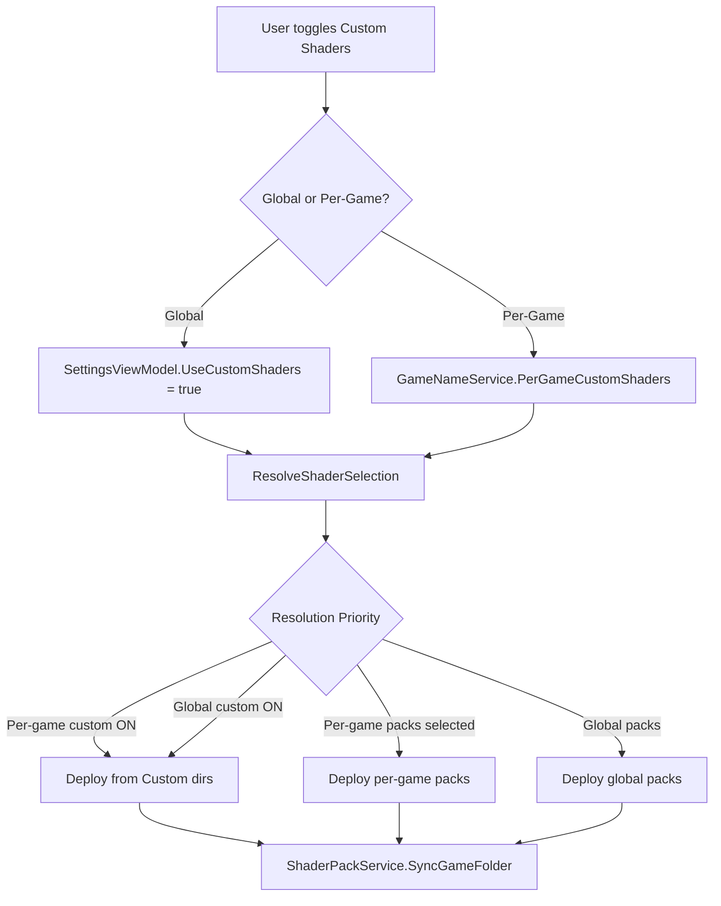

# Design Document: Custom Shaders

## Overview

This feature introduces a custom shader system to RHI that allows users to bypass the built-in shader pack pipeline and instead source shaders/textures from user-managed directories. It operates at two levels:

1. A **global toggle** in the Settings menu that switches all games to custom shader directories.
2. A **per-game toggle** in the overrides panel that allows individual games to opt in or out of custom shaders independently.

The shader deployment resolution follows a strict priority chain: per-game custom → per-game packs → global custom → global packs. This ensures users have fine-grained control while maintaining a sensible default cascade.

## Architecture

The feature integrates into the existing shader deployment pipeline by extending the `ResolveShaderSelection` method in `MainViewModel` and adding a new custom-shader-aware code path in `ShaderPackService`. No new services are introduced; instead, existing services are extended.



### Key Design Decisions

1. **No new service class**: The custom shader logic is a thin extension of the existing `ShaderPackService.SyncGameFolder` and `MainViewModel.ResolveShaderSelection`. Adding a separate service would fragment the shader deployment path unnecessarily.

2. **Directory auto-creation**: Custom shader directories are created on-demand when deployment is triggered, not when the toggle is enabled. This avoids creating empty directories that confuse users who haven't placed files yet.

3. **Sentinel return value for custom mode**: `ResolveShaderSelection` returns a special sentinel (e.g., a list containing a single `"__custom__"` marker) when custom shaders are active. `SyncGameFolder` detects this marker and switches to the custom directory source. This keeps the interface unchanged while adding the new behavior.

4. **Per-game custom state stored in `PerGameShaderMode`**: Rather than adding a new dictionary, the existing `PerGameShaderMode` dictionary is extended with a `"Custom"` value alongside the existing `"Global"` and `"Select"` values. This minimizes persistence changes.

## Components and Interfaces

### Modified Components

#### `SettingsViewModel`
- New property: `bool UseCustomShaders` (backed by `[ObservableProperty]`)
- Persisted as `"UseCustomShaders"` key in settings JSON (`"true"` / `"false"`)
- Loaded in `LoadSettingsFromDict`, saved in `SaveSettingsToDict`
- Defaults to `false` when key is absent

#### `MainViewModel`
- Extended `ResolveShaderSelection(string gameName, string? shaderModeOverride)` to check:
  1. Per-game `"Custom"` mode → return custom shader sentinel
  2. Per-game `"Select"` mode → return per-game pack selection
  3. Global `UseCustomShaders` enabled → return custom shader sentinel
  4. Fallback → return global pack selection
- New computed property `bool IsGlobalShaderButtonEnabled` → `!Settings.UseCustomShaders`
- Subscribes to `Settings.PropertyChanged` for `UseCustomShaders` to raise `OnPropertyChanged(nameof(IsGlobalShaderButtonEnabled))`

#### `ShaderPackService` / `IShaderPackService`
- `SyncGameFolder` extended to detect the custom shader sentinel in `selectedPackIds`
- When sentinel detected:
  - Ensures `%LOCALAPPDATA%\RHI\reshade\Custom\shaders` exists (creates if missing)
  - Ensures `%LOCALAPPDATA%\RHI\reshade\Custom\textures` exists (creates if missing)
  - Copies/syncs files from custom directories into the game's `reshade-shaders` folder
- New static constants for custom directory paths:
  ```csharp
  public static readonly string CustomShadersDir = Path.Combine(
      Environment.GetFolderPath(Environment.SpecialFolder.LocalApplicationData),
      "RHI", "reshade", "Custom", "shaders");
  public static readonly string CustomTexturesDir = Path.Combine(
      Environment.GetFolderPath(Environment.SpecialFolder.LocalApplicationData),
      "RHI", "reshade", "Custom", "textures");
  ```

#### `GameNameService` / `IGameNameService`
- `PerGameShaderMode` dictionary now accepts `"Custom"` as a valid value in addition to `"Global"` and `"Select"`
- No new dictionaries needed; the existing `PerGameShaderMode` key is reused

#### `SettingsHandler`
- Settings page UI construction extended to add the Custom Shaders toggle box between "Add Game" and "Full Refresh"
- Toggle wired to `ViewModel.Settings.UseCustomShaders` with auto-save via `ViewModel.SaveSettingsPublic()`

#### `DetailPanelBuilder.BuildOverridesPanel`
- Adds a "Use Custom Shaders" `ToggleSwitch` next to the existing "Global Shaders" toggle
- When toggled ON: sets `PerGameShaderMode[gameName] = "Custom"`, triggers `DeployShadersForCard`
- When toggled OFF: removes the custom override, falls back to global resolution

#### `OverridesFlyoutBuilder.OpenOverridesFlyout`
- Same "Use Custom Shaders" toggle added to the grid-view flyout, mirroring the detail panel

#### `MainWindow.xaml`
- `ChooseShadersBtn` (Global Shader Button) bound to `IsEnabled="{x:Bind ViewModel.IsGlobalShaderButtonEnabled, Mode=OneWay}"`
- Settings panel gets a new `ToggleSwitch` for custom shaders between the Add Game and Full Refresh boxes

### Interface Changes

No new interfaces are introduced. `IShaderPackService` is unchanged at the interface level — the custom shader sentinel is passed through the existing `selectedPackIds` parameter.

## Data Models

### Settings Persistence (settings.json)

New key added:
| Key | Type | Default | Description |
|-----|------|---------|-------------|
| `UseCustomShaders` | `string` | `"false"` | Global custom shaders enabled state |

### Per-Game Shader Mode (existing `PerGameShaderMode` dictionary)

Extended values:
| Value | Meaning |
|-------|---------|
| `"Global"` | Use global shader setting (existing) |
| `"Select"` | Use per-game pack selection (existing) |
| `"Custom"` | Use custom shader directories (new) |

### Custom Shader Sentinel

When `ResolveShaderSelection` determines custom shaders should be used, it returns:
```csharp
new[] { ShaderPackService.CustomShaderSentinel }
```
where `CustomShaderSentinel = "__custom__"`. This is detected by `SyncGameFolder` to switch source directories.

### File System Paths

| Path | Purpose |
|------|---------|
| `%LOCALAPPDATA%\RHI\reshade\Custom\shaders` | User-managed shader files |
| `%LOCALAPPDATA%\RHI\reshade\Custom\textures` | User-managed texture files |


## Correctness Properties

*A property is a characteristic or behavior that should hold true across all valid executions of a system — essentially, a formal statement about what the system should do. Properties serve as the bridge between human-readable specifications and machine-verifiable correctness guarantees.*

### Property 1: Settings round-trip preserves custom shader state

*For any* valid combination of `UseCustomShaders` (true/false) and any set of per-game shader mode overrides (including `"Custom"`, `"Select"`, `"Global"`), serializing the settings via `SaveSettingsToDict` and then deserializing via `LoadSettingsFromDict` shall produce an equivalent settings state — the global custom shaders flag and all per-game shader mode entries shall be identical before and after the round-trip.

**Validates: Requirements 1.3, 1.4, 1.5, 4.2, 4.3, 7.1, 7.3**

### Property 2: Global shader button enabled state is the inverse of custom shaders

*For any* value of `UseCustomShaders` (true or false), the computed property `IsGlobalShaderButtonEnabled` shall equal `!UseCustomShaders`. Changing `UseCustomShaders` shall immediately update `IsGlobalShaderButtonEnabled` without requiring any additional action.

**Validates: Requirements 3.1, 3.2, 3.3, 3.4, 3.5**

### Property 3: Shader resolution follows priority chain

*For any* game name, any global `UseCustomShaders` state (true/false), any per-game shader mode (`"Custom"`, `"Select"`, `"Global"`, or absent), and any per-game pack selection, the `ResolveShaderSelection` function shall return:
- The custom shader sentinel when per-game mode is `"Custom"` (regardless of global state)
- The per-game pack selection when per-game mode is `"Select"` (regardless of global state)
- The custom shader sentinel when per-game mode is `"Global"` or absent AND global `UseCustomShaders` is true
- The global pack selection when per-game mode is `"Global"` or absent AND global `UseCustomShaders` is false

**Validates: Requirements 2.1, 2.2, 4.4, 5.1, 5.2, 5.3, 6.1**

### Property 4: Toggle change triggers shader re-deployment

*For any* game with ReShade installed, when either the global `UseCustomShaders` toggle or the per-game custom shaders toggle is changed, `DeployShadersForCard` shall be invoked for that game, causing the shader deployment to reflect the new resolution result.

**Validates: Requirements 6.2**

## Error Handling

| Scenario | Behavior |
|----------|----------|
| Custom shader directories don't exist | Auto-created before deployment (Requirements 2.3, 2.4) |
| Custom shader directories are empty | Deployment proceeds with no shader files — game's `reshade-shaders` folder is synced to empty state (same as deploying an empty pack) |
| `UseCustomShaders` key missing from settings | Defaults to `false` (Requirement 7.2) |
| Per-game shader mode has unrecognized value | Falls through to global resolution (treated as `"Global"`) |
| File system errors during custom shader copy | Logged via `CrashReporter`, deployment continues for other games |
| Settings file corrupted or unreadable | Existing `LoadSettingsFile` error handling applies — returns empty dictionary, all settings default |

## Testing Strategy

### Unit Tests

Unit tests cover specific examples and edge cases:

- Settings toggle box exists in the correct position in the Settings panel (Requirement 1.1)
- Per-game custom toggle appears in both detail and grid overrides panels (Requirements 4.1, 4.5)
- Custom shader directories are created when they don't exist (Requirements 2.3, 2.4)
- `UseCustomShaders` defaults to `false` when settings key is absent (Requirement 7.2)
- Verbose logging includes effective shader source during deployment (Requirement 6.3)

### Property-Based Tests

Property-based tests use [FsCheck](https://fscheck.github.io/FsCheck/) (already used in the project's test suite) with a minimum of 100 iterations per property.

Each property test references its design document property:

1. **Feature: custom-shaders, Property 1: Settings round-trip preserves custom shader state**
   - Generate random `UseCustomShaders` bool and random `Dictionary<string, string>` of per-game shader modes (values from `{"Custom", "Select", "Global"}`)
   - Save via `SaveSettingsToDict`, load via `LoadSettingsFromDict`
   - Assert equivalence of `UseCustomShaders` and all per-game shader mode entries

2. **Feature: custom-shaders, Property 2: Global shader button enabled state is the inverse of custom shaders**
   - Generate random bool for `UseCustomShaders`
   - Set on `SettingsViewModel`, read `IsGlobalShaderButtonEnabled` from `MainViewModel`
   - Assert `IsGlobalShaderButtonEnabled == !UseCustomShaders`

3. **Feature: custom-shaders, Property 3: Shader resolution follows priority chain**
   - Generate random tuples of (globalCustomEnabled: bool, perGameMode: Option<"Custom"|"Select"|"Global">, perGamePacks: List<string>, globalPacks: List<string>)
   - Call `ResolveShaderSelection` with the generated configuration
   - Assert the result matches the expected priority chain output

4. **Feature: custom-shaders, Property 4: Toggle change triggers shader re-deployment**
   - Generate random game configurations with ReShade installed
   - Change the custom shaders toggle (global or per-game)
   - Assert `DeployShadersForCard` was invoked via a tracking stub

### Test Configuration

- Library: FsCheck.Xunit (existing project dependency)
- Minimum iterations: 100 per property (`[Property(MaxTest = 100)]`)
- Each property test tagged with a comment referencing the design property
- Each correctness property implemented by a single property-based test
