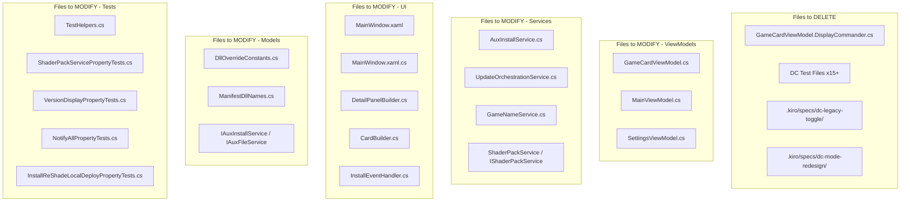

# Design Document: DC Removal

## Overview

This design covers the complete removal of all Display Commander (DC) functionality from the UPST codebase. DC was an optional addon that proxied ReShade loading alongside games. The feature is being retired — every DC code path, UI element, setting, service method, model field, test, and spec directory must be stripped.

The removal is a pure subtraction: no new features are introduced. The goal is a codebase that compiles, passes tests, and has zero awareness of Display Commander.

### Scope

- Delete entire files dedicated to DC (partial classes, test files, spec directories)
- Remove DC fields, properties, commands, and methods from shared files
- Remove DC UI elements from XAML and code-behind
- Remove DC persistence (settings load/save, migration logic)
- Simplify ReShade install path by removing DC-conditional branching
- Update tests: delete DC-only test classes, remove DC references from shared test helpers

### Out of Scope

- Refactoring non-DC code
- Adding new features
- Changing ReShade or RenoDX install behavior beyond removing DC conditionals

## Architecture

The removal touches every layer of the application:



### Removal Strategy

The removal proceeds bottom-up to minimize intermediate compile errors:

1. **Models & Constants** — Remove DC fields from data classes and constants
2. **Service Interfaces** — Remove DC method declarations from interfaces
3. **Services** — Remove DC methods, constants, and logic from service implementations
4. **ViewModels** — Remove DC state, commands, and computed properties
5. **UI** — Remove DC XAML elements, code-behind handlers, and builder logic
6. **Tests** — Delete DC test files, remove DC references from shared helpers
7. **Specs** — Delete obsolete DC spec directories

## Components and Interfaces

### Files to Delete Entirely

| File | Reason |
|------|--------|
| `RenoDXCommander/ViewModels/GameCardViewModel.DisplayCommander.cs` | Entire partial class is DC-only |
| `RenoDXCommander.Tests/DcCustomDllPersistencePropertyTests.cs` | DC-only test |
| `RenoDXCommander.Tests/DcFileRenameOnModeSwitchTests.cs` | DC-only test |
| `RenoDXCommander.Tests/DcLegacyTogglePropertyTests.cs` | DC-only test |
| `RenoDXCommander.Tests/DcModeCustomSelectorVisibilityPropertyTests.cs` | DC-only test |
| `RenoDXCommander.Tests/DcModeOverrideStaleLabelExplorationTests.cs` | DC-only test |
| `RenoDXCommander.Tests/DcModeOverrideStaleLabelPreservationTests.cs` | DC-only test |
| `RenoDXCommander.Tests/DcModeSwitchNoShaderTests.cs` | DC-only test |
| `RenoDXCommander.Tests/DcModeSwitchShaderPropertyTests.cs` | DC-only test |
| `RenoDXCommander.Tests/DcModeUiStatusPropertyTests.cs` | DC-only test |
| `RenoDXCommander.Tests/DcShaderDeployExplorationTests.cs` | DC-only test |
| `RenoDXCommander.Tests/DcShaderDeployPropertyTests.cs` | DC-only test |
| `RenoDXCommander.Tests/DcUninstallShaderPropertyTests.cs` | DC-only test |
| `RenoDXCommander.Tests/InstallDcShaderPreservationTests.cs` | DC-only test |
| `RenoDXCommander.Tests/SyncAllLocationsDcNeverCalledPropertyTests.cs` | DC-only test |
| `RenoDXCommander.Tests/MigrateLegacyDcShadersTests.cs` | DC-only test |
| `.kiro/specs/dc-legacy-toggle/` | Obsolete DC spec |
| `.kiro/specs/dc-mode-redesign/` | Obsolete DC spec |

### Key Modifications by Component

**GameCardViewModel.cs** — Remove fields: `_dcStatus`, `_dcIsInstalling`, `_dcProgress`, `_dcActionMessage`, `_dcInstalledFile`, `_dcInstalledVersion`, `_dcCustomDllFileName`, `DcRecord`, `PerGameDcMode`, `DcModeExcluded`, `ExcludeFromUpdateAllDc`, `DcLegacyMode`, `_rsBlockedByDcMode`. Remove all DC-related entries from `NotifyAll()`.

**MainViewModel.cs** — Remove properties: `DcModeEnabled`, `DcDllFileName`, `DcLegacyMode`, `DcLegacySettingsVisibility`, `DcLegacyHiddenVisibility`, `DcDllPickerVisibility`. Remove commands: `InstallDcCommand`, `UninstallDcCommand`. Remove methods: `InstallDcAsync`, `UninstallDc`, `ApplyDcModeSwitch`, `ResolveEffectiveDcMode`, `OnDcModeEnabledChanged`, `OnDcLegacyModeChanged`, `OnDcDllFileNameChanged`, `GetPerGameDcModeOverride`, `SetPerGameDcModeOverride`, `GetDcCustomDllFileName`, `SetDcCustomDllFileName`. Simplify `UpdateButtonTooltip` to not mention DC. Remove DC from `ApplyManifestDllRenames`.

**SettingsViewModel.cs** — Remove `_dcLegacyMode` field. Remove DcLegacyMode from `LoadSettingsFromDict` and `SaveSettingsToDict`.

**AuxInstallService.cs** — Remove DC constants (`DcUrl`, `DcUrl32`, `DcCacheFile*`, `DcNormalName*`, `DcDxgiName`, `DcWinmmName`, `DcReShadeFolderPath`, `DcIniPath`, `TypeDc`). Remove methods: `InstallDcAsync`, `CopyDcIni`, `SyncReShadeToDisplayCommander`, `IsDcFileStrict`. Remove `DisplayCommander` from `DxgiFileType` enum. Remove DC from `IdentifyDxgiFile`. Remove `WinmmFileType`/`IdentifyWinmmFile` if DC-only. Remove `RsDcModeName`/`RsDcModeName32` constants. Simplify `InstallReShadeAsync` to remove `dcMode`/`dcIsInstalled` parameters.

**UpdateOrchestrationService.cs** — Remove `UpdateAllDcAsync` method. Remove `dcModeEnabled` parameter from `UpdateAllReShadeAsync`. Remove `RsBlockedByDcMode` filter and `effectiveDcMode` computation. Pass `false` for dcMode and dcIsInstalled to `InstallReShadeAsync`.

**GameNameService.cs** — Remove fields: `_perGameDcModeOverride`, `_dcCustomDllFileNames`, `_updateAllExcludedDc`. Remove DC from `LoadNameMappings` (remove `setDcModeEnabled`/`setDcDllFileName` callbacks, DcModeLevel migration, DcModeEnabled/DcDllFileName loading, PerGameDcModeOverride migration). Remove DC from `SaveNameMappings`. Remove DC from `RenameGame` migration.

**DllOverrideConstants.cs** — Remove `DcDllPickerNames` array.

**ManifestDllNames.cs** — Remove `Dc` property.

**UI files** — Remove all DC XAML elements, DC handlers, DC builder rows, DC status dots, DC overrides panel sections.

**InstallEventHandler.cs** — Remove `InstallDcButton_Click`, `UninstallDcButton_Click`, `DeployDcModeButton_Click`. Remove DC from `CombinedInstallButton_Click`.

## Data Models

### Fields Removed from GameCardViewModel

```csharp
// All of these are removed:
[ObservableProperty] private GameStatus _dcStatus;
[ObservableProperty] private bool _dcIsInstalling;
[ObservableProperty] private double _dcProgress;
[ObservableProperty] private string _dcActionMessage;
[ObservableProperty] private string? _dcInstalledFile;
[ObservableProperty] private string? _dcInstalledVersion;
[ObservableProperty] private string? _dcCustomDllFileName;
public AuxInstalledRecord? DcRecord { get; set; }
public string? PerGameDcMode { get; set; }
public bool DcModeExcluded { get; }
public bool ExcludeFromUpdateAllDc { get; set; }
public bool DcLegacyMode { get; set; }
[ObservableProperty] private bool _rsBlockedByDcMode;
```

### Fields Removed from MainViewModel

```csharp
[ObservableProperty] private bool _dcModeEnabled;
[ObservableProperty] private string _dcDllFileName;
// Plus DcLegacyMode forwarding property
```

### Fields Removed from SettingsViewModel

```csharp
[ObservableProperty] private bool _dcLegacyMode;
```

### Constants Removed from AuxInstallService

```csharp
DcUrl, DcUrl32, DcCacheFile, DcCacheFile32, DcNormalName, DcNormalName32,
DcDxgiName, DcWinmmName, DcReShadeFolderPath, DcIniPath, TypeDc,
RsDcModeName, RsDcModeName32
```

### Constants Removed from DllOverrideConstants

```csharp
DcDllPickerNames  // entire array
```

### Settings Keys No Longer Persisted

```
DcModeEnabled, DcDllFileName, DcModeLevel (legacy),
PerGameDcModeOverride, DcCustomDllFileNames, UpdateAllExcludedDc, DcLegacyMode
```


## Correctness Properties

*A property is a characteristic or behavior that should hold true across all valid executions of a system — essentially, a formal statement about what the system should do. Properties serve as the bridge between human-readable specifications and machine-verifiable correctness guarantees.*

### Property 1: GameCardViewModel has no DC members

*For any* member name associated with Display Commander (DcStatus, DcIsInstalling, DcProgress, DcActionMessage, DcInstalledFile, DcInstalledVersion, DcCustomDllFileName, DcRecord, PerGameDcMode, DcModeExcluded, ExcludeFromUpdateAllDc, DcLegacyMode, RsBlockedByDcMode, and all computed properties from the deleted DisplayCommander partial class), the GameCardViewModel type should not contain a property, field, or method with that name.

**Validates: Requirements 1.1, 1.3**

### Property 2: AuxInstallService has no DC members

*For any* DC-related member name (DcUrl, DcUrl32, DcCacheFile, DcCacheFile32, DcNormalName, DcNormalName32, DcDxgiName, DcWinmmName, DcReShadeFolderPath, DcIniPath, TypeDc, RsDcModeName, RsDcModeName32, InstallDcAsync, CopyDcIni, SyncReShadeToDisplayCommander, IsDcFileStrict), the AuxInstallService type should not contain a field, property, or method with that name.

**Validates: Requirements 2.2, 2.3, 2.4, 2.5, 9.3, 12.3**

### Property 3: MainViewModel has no DC members

*For any* DC-related member name (DcModeEnabled, DcDllFileName, DcLegacyMode, DcLegacySettingsVisibility, DcLegacyHiddenVisibility, DcDllPickerVisibility, InstallDcCommand, UninstallDcCommand, InstallDcAsync, UninstallDc, ApplyDcModeSwitch, ApplyDcModeSwitchForCard, ResolveEffectiveDcMode, UpdateAllDcAsync, OnDcModeEnabledChanged, OnDcLegacyModeChanged, OnDcDllFileNameChanged, GetPerGameDcModeOverride, SetPerGameDcModeOverride, GetDcCustomDllFileName, SetDcCustomDllFileName), the MainViewModel type should not contain a property, field, or method with that name.

**Validates: Requirements 6.1, 6.2, 6.3, 6.4**

### Property 4: GameNameService has no DC members

*For any* DC-related member name (_perGameDcModeOverride, _dcCustomDllFileNames, _updateAllExcludedDc, PerGameDcModeOverride, DcCustomDllFileNames, UpdateAllExcludedDc), the GameNameService type should not contain a field or property with that name.

**Validates: Requirements 4.1, 4.2**

### Property 5: Settings persistence excludes DC keys

*For any* settings key in the DC removal list (DcModeEnabled, DcDllFileName, PerGameDcModeOverride, DcCustomDllFileNames, UpdateAllExcludedDc, DcLegacyMode), when SaveNameMappings is called, the resulting settings dictionary should not contain that key.

**Validates: Requirements 4.5, 7.3**

### Property 6: UI handler classes have no DC methods

*For any* DC-related method name on InstallEventHandler (InstallDcButton_Click, UninstallDcButton_Click, DeployDcModeButton_Click) and MainWindow (SyncDcDllPickerText, DcDllPicker_SelectionChanged, DcDllPicker_TextSubmitted, UpdateAllDc_Click, DcIniButton_Click), the respective types should not contain a method with that name.

**Validates: Requirements 8.2, 8.3**

### Property 7: ReShade installs as standard filename

*For any* game configuration (32-bit or 64-bit, with or without DLL override), when InstallReShadeAsync is called, the resulting AuxInstalledRecord.InstalledAs should be the standard filename (dxgi.dll, or the DLL override filename) and never ReShade64.dll or ReShade32.dll.

**Validates: Requirements 12.2**

## Error Handling

Since this is a pure removal, error handling changes are minimal:

- **Compile errors**: The primary risk is missed references. The removal order (models → interfaces → services → viewmodels → UI → tests) minimizes cascading compile errors.
- **Settings migration**: Existing settings files may contain DC keys. The load path should silently ignore unknown keys (which is already the behavior of the JSON deserialization pattern used). No migration code is needed — DC keys simply become dead data that is never read and gets dropped on next save.
- **Null references**: Removing DC fields from GameCardViewModel means any code that accessed `card.DcRecord`, `card.DcStatus`, etc. will fail to compile rather than produce null reference exceptions at runtime. This is the desired behavior.
- **Test failures**: DC test files are deleted entirely. Shared test helpers that referenced DC interfaces will fail to compile until the interface methods are also removed, which is handled in the same pass.

## Testing Strategy

### Dual Testing Approach

- **Unit tests**: Verify specific examples — file deletions, specific field removals, enum member removals
- **Property tests**: Verify universal properties — no DC members exist on key types, settings never persist DC keys, ReShade always installs with standard filenames

### Property-Based Testing Configuration

- Library: **FsCheck** (already used in the test project via `FsCheck.Xunit`)
- Minimum 100 iterations per property test
- Each property test must reference its design document property
- Tag format: **Feature: dc-removal, Property {number}: {property_text}**

### Test Plan

**Property tests** (new, validating correctness properties):
1. Reflection-based test: GameCardViewModel has no DC members (Property 1)
2. Reflection-based test: AuxInstallService has no DC members (Property 2)
3. Reflection-based test: MainViewModel has no DC members (Property 3)
4. Reflection-based test: GameNameService has no DC members (Property 4)
5. Settings round-trip test: saved settings exclude DC keys (Property 5)
6. Reflection-based test: UI handler classes have no DC methods (Property 6)
7. Behavioral test: ReShade install produces standard filename (Property 7)

**Unit tests** (specific examples and edge cases):
- DxgiFileType enum does not contain DisplayCommander member
- DllOverrideConstants does not contain DcDllPickerNames
- ManifestDllNames does not contain Dc property
- UpdateOrchestrationService does not contain UpdateAllDcAsync method
- SettingsViewModel does not contain DcLegacyMode property
- InstallReShadeAsync does not accept dcMode or dcIsInstalled parameters

**Deleted test files** (15+ DC-only test classes):
- All files prefixed with `Dc` in the test project
- `InstallDcShaderPreservationTests.cs`
- `SyncAllLocationsDcNeverCalledPropertyTests.cs`
- `MigrateLegacyDcShadersTests.cs`

**Modified test files** (DC references removed):
- `TestHelpers.cs` — remove DC stubs from interface implementations
- `ShaderPackServicePropertyTests.cs` — remove DC folder references
- `VersionDisplayPropertyTests.cs` — remove DC property references
- `NotifyAllPropertyTests.cs` — remove DC property references
- `InstallReShadeLocalDeployPropertyTests.cs` — remove DC parameters

Each correctness property MUST be implemented by a SINGLE property-based test. Property-based tests should use FsCheck with minimum 100 iterations. For reflection-based properties, the "for all" quantification is over the list of DC member names that must be absent.
