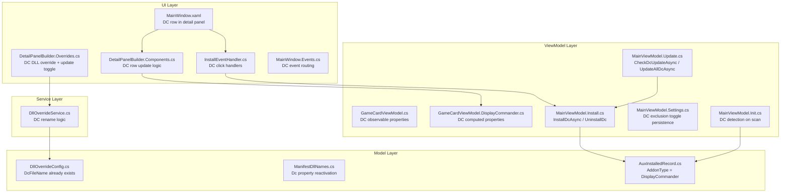

# Design Document: Display Commander Reintegration

## Overview

This design reintegrates Display Commander (DC) as a frame rate limiter addon in RHI, sitting alongside ReLimiter. DC follows the same architectural patterns already established for ReLimiter: GitHub-based download/caching, per-game install tracking, observable ViewModel properties, detail panel component rows, DLL naming overrides, update detection, and Update All integration.

DC and ReLimiter are mutually exclusive per game. The UI enforces this by disabling the opposing limiter's install button when one is already installed. DC uses the LITE variant (`zzz_display_commander_lite.addon64` / `.addon32`) downloaded from `https://github.com/pmnoxx/display-commander/releases/tag/latest_build`.

The manifest already contains a `"dc"` field in `dllNameOverrides` entries. The `ManifestDllNames` model already has a `DcFileName` property — this design reactivates it for DC install operations.

## Architecture

DC integration touches the same layers as ReLimiter, following the established partial-class decomposition:



### Design Decisions

1. **Follow ReLimiter pattern exactly**: DC uses the same GitHub releases API → cache → deploy flow as ReLimiter. No new service classes needed — all logic lives in `MainViewModel.Install.cs` and `MainViewModel.Update.cs` as partial methods, mirroring `InstallUlAsync`/`UninstallUl`/`CheckUlUpdateAsync`.

2. **AuxInstalledRecord for tracking**: DC uses `AuxInstalledRecord` with `AddonType = "DisplayCommander"` (matching the existing string in the model's XML doc comment), not `InstalledModRecord`. This is consistent with how ReShade is tracked and distinct from RenoDX addon records.

3. **Mutual exclusion at ViewModel level**: The `GameCardViewModel` exposes `DcInstallEnabled` and modifies `UlInstallEnabled` based on the opposing limiter's install state. The UI binds to these — no service-layer enforcement needed beyond the ViewModel guard in `InstallDcAsync`/`InstallUlAsync`.

4. **DC row in XAML between ReLimiter and RenoDX**: A new `DetailDcRow` Grid is added to `MainWindow.xaml` immediately after `DetailUlRow` and before `DetailRdxRow`. Both limiter rows are wrapped in a `Border` with a subtle border to visually group them.

5. **Manifest `dc` field already exists**: `DllOverrideConfig.DcFileName` is already defined. `ManifestDllNames` needs only a `Dc` property with `[JsonPropertyName("dc")]` added. The manifest JSON already has `"dc": ""` entries.

## Components and Interfaces

### New Files

| File | Purpose |
|------|---------|
| `GameCardViewModel.DisplayCommander.cs` | DC computed properties (status text, colors, action labels, visibility) — mirrors `GameCardViewModel.UltraLimiter.cs` |

### Modified Files

| File | Changes |
|------|---------|
| `GameCardViewModel.cs` | Add DC observable properties: `_dcStatus`, `_dcIsInstalling`, `_dcProgress`, `_dcActionMessage`, `_dcInstalledFile`, `_dcInstalledVersion`. Add `ExcludeFromUpdateAllDc`. Add DC entries to `NotifyAll()`. |
| `ManifestDllNames.cs` | Add `[JsonPropertyName("dc")] public string? Dc { get; set; }` |
| `MainViewModel.Install.cs` | Add `InstallDcAsync()`, `UninstallDc()`, DC constants (`DcFileName64`, `DcFileName32`, `DcReleasesApiUrl`), `GetDcFileName()`, `GetDcCachePath()`, `EnsureDcCachedAsync()`, `FetchLatestDcReleaseInfoAsync()`. Add mutual exclusion guards to both `InstallDcAsync` and `InstallUlAsync`. |
| `MainViewModel.Update.cs` | Add `CheckDcUpdateAsync()`, `UpdateAllDcAsync()`, `ReadDcInstalledVersion()`, `SaveDcMeta()`, DC meta path, pre-cache methods. Extend `CheckForUpdatesAsync()` to include DC. Extend `AnyUpdateAvailable` to include DC. |
| `MainViewModel.Init.cs` | Add DC file detection in game scan loop (check for `zzz_display_commander_lite.addon64/32` and AuxInstalledRecord with type "DisplayCommander"). |
| `MainViewModel.Settings.cs` | Add `IsUpdateAllExcludedDc()`, `ToggleUpdateAllExclusionDc()`. Extend `AnyUpdateAvailable` to include `DcStatus`. |
| `MainWindow.xaml` | Add `DetailDcRow` Grid with same 5-column layout as `DetailUlRow`. Wrap `DetailUlRow` + `DetailDcRow` in a grouping `Border`. Add DC progress bar and message TextBlock. |
| `MainWindow.Events.cs` | Add `InstallDcButton_Click`, `UninstallDcButton_Click`, `DetailDcStatus_PointerPressed` event handlers. |
| `InstallEventHandler.cs` | Add `InstallDcButton_Click`, `UninstallDcButton_Click` delegation methods. |
| `DetailPanelBuilder.Components.cs` | Add DC row update logic in `UpdateDetailComponentRows()`. Extend `GetMessageColor()` (already handles ✅/✖). |
| `DetailPanelBuilder.Overrides.cs` | Add DC DLL naming override toggle + dropdown in the DLL naming section. Add DC toggle in Global update inclusion section. |
| `DllOverrideService.cs` | Extend `EnableDllOverride()`, `UpdateDllOverrideNames()`, `DisableDllOverride()` to handle DC file renames alongside ReShade. |
| `GameCardViewModel.UI.cs` | Extend `UpdateBadgeVisibility` to include `DcStatus`. Extend `CanCardInstall` to include `DcIsInstalling`. Extend `IsManaged` to include DC. |
| `GameCardViewModel.UltraLimiter.cs` | Modify `UlActionLabel` / install button enabled state to respect DC mutual exclusion. |
| `GameNameService.cs` | Add `UpdateAllExcludedDc` HashSet, include in save/load/rename migration. |

### Interfaces

No new interfaces are needed. DC uses the existing `IAuxInstallService` for record persistence and `IDllOverrideService` for DLL override operations.

## Data Models

### DC Observable Properties on GameCardViewModel

```csharp
// In GameCardViewModel.cs
[ObservableProperty] private GameStatus _dcStatus  = GameStatus.NotInstalled;
[ObservableProperty] private bool       _dcIsInstalling;
[ObservableProperty] private double     _dcProgress;
[ObservableProperty] private string     _dcActionMessage = "";
[ObservableProperty] private string?    _dcInstalledFile;
[ObservableProperty] private string?    _dcInstalledVersion;
public bool ExcludeFromUpdateAllDc { get; set; }
```

### DC Computed Properties (GameCardViewModel.DisplayCommander.cs)

Mirrors `GameCardViewModel.UltraLimiter.cs` exactly:

```csharp
public string DcStatusDot => DcStatus == GameStatus.UpdateAvailable ? "🟢"
    : DcStatus == GameStatus.Installed ? "🟢" : "⚪";

public string DcActionLabel => DcIsInstalling ? "Installing..."
    : DcStatus == GameStatus.UpdateAvailable ? "⬆  Update DC"
    : DcStatus == GameStatus.Installed ? "↺  Reinstall DC"
    : "⬇  Install DC";

public string DcBtnBackground  => DcStatus == GameStatus.UpdateAvailable ? "#201838" : "#182840";
public string DcBtnForeground  => DcStatus == GameStatus.UpdateAvailable ? "#B898E8" : "#7AACDD";
public string DcBtnBorderBrush => DcStatus == GameStatus.UpdateAvailable ? "#3A2860" : "#2A4468";

public Visibility DcProgressVisibility => DcIsInstalling ? Visibility.Visible : Visibility.Collapsed;
public Visibility DcMessageVisibility  => string.IsNullOrEmpty(DcActionMessage) ? Visibility.Collapsed : Visibility.Visible;
public Visibility DcDeleteVisibility   => DcStatus == GameStatus.Installed || DcStatus == GameStatus.UpdateAvailable
    ? Visibility.Visible : Visibility.Collapsed;

public string DcStatusText => DcIsInstalling ? "Installing…"
    : DcStatus == GameStatus.UpdateAvailable ? "Update"
    : DcStatus == GameStatus.Installed ? (DcInstalledVersion ?? "Installed")
    : "Ready";
public string DcStatusColor => DcIsInstalling ? "#D4A856"
    : DcStatus == GameStatus.UpdateAvailable ? "#B898E8"
    : DcStatus == GameStatus.Installed ? "#5ECB7D"
    : "#A0AABB";

public bool IsDcNotInstalling => !DcIsInstalling;
public bool IsDcInstalled => DcStatus == GameStatus.Installed || DcStatus == GameStatus.UpdateAvailable;

/// DC row hidden in Luma mode (same as RenoDX row behavior).
public Visibility DcRowVisibility => EffectiveLumaMode ? Visibility.Collapsed : Visibility.Visible;
```

### Mutual Exclusion Properties

```csharp
// In GameCardViewModel.DisplayCommander.cs or UltraLimiter.cs
/// DC install button disabled when ReLimiter is installed
public bool DcInstallEnabled => !DcIsInstalling && !IsUlInstalled;

/// ReLimiter install button disabled when DC is installed (extends existing)
/// Modify UlActionLabel / IsUlNotInstalling to also check !IsDcInstalled
```

### ManifestDllNames Extension

```csharp
// In ManifestDllNames.cs — add alongside existing ReShade property
[JsonPropertyName("dc")]
public string? Dc { get; set; }
```

### DC Constants (in MainViewModel.Install.cs)

```csharp
private const string DcFileName64 = "zzz_display_commander_lite.addon64";
private const string DcFileName32 = "zzz_display_commander_lite.addon32";
private const string DcReleasesUrl =
    "https://github.com/pmnoxx/display-commander/releases/tag/latest_build";
private const string DcReleasesApiUrl =
    "https://api.github.com/repos/pmnoxx/display-commander/releases/tags/latest_build";

internal static string GetDcFileName(bool is32Bit) =>
    is32Bit ? DcFileName32 : DcFileName64;

internal static string GetDcCachePath(bool is32Bit) =>
    Path.Combine(ModInstallService.DownloadCacheDir, GetDcFileName(is32Bit));

private static readonly string DcMetaPath = Path.Combine(
    Environment.GetFolderPath(Environment.SpecialFolder.LocalApplicationData),
    "RHI", "dc_meta.json");
```

### DC DLL Override Dropdown Options

```csharp
// Used in DetailPanelBuilder.Overrides.cs for the DC DLL naming dropdown
private static readonly string[] DcDllOverrideNames = new[]
{
    "dxgi.dll", "d3d9.dll", "d3d11.dll", "d3d12.dll", "ddraw.dll",
    "hid.dll", "version.dll", "opengl32.dll", "dbghelp.dll",
    "vulkan-1.dll", "winmm.dll"
};
```

### XAML Detail Panel Row (DC)

The DC row follows the exact same 5-column Grid layout as the ReLimiter row:

```xml
<!-- Display Commander row -->
<Grid x:Name="DetailDcRow" x:FieldModifier="internal" ColumnSpacing="8" Visibility="Collapsed">
    <Grid.ColumnDefinitions>
        <ColumnDefinition Width="120"/>
        <ColumnDefinition Width="80"/>
        <ColumnDefinition Width="*"/>
        <ColumnDefinition Width="36"/>
        <ColumnDefinition Width="36"/>
    </Grid.ColumnDefinitions>
    <TextBlock Grid.Column="0" Text="Display Commander" FontSize="12"
               Foreground="{StaticResource TextSecondaryBrush}" VerticalAlignment="Center"/>
    <TextBlock x:Name="DetailDcStatus" x:FieldModifier="internal" Grid.Column="1" FontSize="12"
               VerticalAlignment="Center" HorizontalTextAlignment="Center"
               PointerPressed="DetailDcStatus_PointerPressed"/>
    <Button x:Name="DetailDcInstallBtn" x:FieldModifier="internal" Grid.Column="2"
            Click="InstallDcButton_Click"
            HorizontalAlignment="Stretch" VerticalAlignment="Stretch"
            CornerRadius="8" FontSize="12" Height="32"/>
    <Border Grid.Column="3"/>  <!-- No INI button for DC -->
    <Button x:Name="DetailDcDeleteBtn" x:FieldModifier="internal" Grid.Column="4"
            Click="UninstallDcButton_Click"
            Background="{StaticResource AccentRedBgBrush}" Foreground="{StaticResource AccentRedBrush}"
            BorderBrush="{StaticResource AccentPurpleBorderBrush}" BorderThickness="1"
            CornerRadius="8" Width="36" Height="32" Padding="0"
            ToolTipService.ToolTip="Remove Display Commander" Opacity="0" IsHitTestVisible="False">
        <TextBlock Text="✕" FontSize="12" HorizontalAlignment="Center"/>
    </Button>
</Grid>
```

### Limiter Grouping Border

Both limiter rows are wrapped in a `Border` to visually group them:

```xml
<!-- Limiter group -->
<Border BorderBrush="{StaticResource BorderSubtleBrush}" BorderThickness="1"
        CornerRadius="8" Padding="8,4">
    <StackPanel Spacing="8">
        <!-- ReLimiter row (existing DetailUlRow) -->
        ...
        <!-- Display Commander row (new DetailDcRow) -->
        ...
    </StackPanel>
</Border>
```


## Correctness Properties

*A property is a characteristic or behavior that should hold true across all valid executions of a system — essentially, a formal statement about what the system should do. Properties serve as the bridge between human-readable specifications and machine-verifiable correctness guarantees.*

### Property 1: Bitness selects correct DC filename

*For any* boolean `is32Bit` value, `GetDcFileName(is32Bit)` shall return `"zzz_display_commander_lite.addon32"` when true and `"zzz_display_commander_lite.addon64"` when false. Similarly, `GetDcCachePath` shall return distinct paths for each bitness.

**Validates: Requirements 1.2, 1.3**

### Property 2: Mutual exclusion of DC and ReLimiter

*For any* `GameCardViewModel` state, when `IsUlInstalled` is true then `DcInstallEnabled` shall be false, and when `IsDcInstalled` is true then the ReLimiter install button enabled state shall be false. Conversely, when neither limiter is installed, both install buttons shall be enabled (assuming no installing-in-progress state). This invariant holds regardless of how the state was reached (fresh launch, install, or removal).

**Validates: Requirements 2.1, 2.2, 2.3, 2.4, 2.5, 2.6, 2.7, 2.8**

### Property 3: DC status display consistency

*For any* combination of `DcStatus` (NotInstalled, Installed, UpdateAvailable), `DcIsInstalling` flag, and `DcInstalledVersion` string, the computed properties `DcStatusText`, `DcStatusColor`, `DcStatusDot`, `DcActionLabel`, `DcBtnBackground`, `DcBtnForeground`, `DcBtnBorderBrush`, `DcDeleteVisibility`, and `DcRowVisibility` shall return values consistent with the status mapping rules:
- NotInstalled + not installing → "Ready" / "#A0AABB" / "⚪"
- Installed + not installing → version or "Installed" / "#5ECB7D" / "🟢"
- UpdateAvailable + not installing → "Update" / "#B898E8" / "🟢"
- Any status + installing → "Installing…" / "#D4A856"
- Luma mode → DcRowVisibility is Collapsed regardless of status

**Validates: Requirements 3.3, 5.1, 5.2, 5.3, 5.4, 5.5, 5.6, 8.4**

### Property 4: DllOverrideConfig and ManifestDllNames round-trip

*For any* valid `DllOverrideConfig` with arbitrary `ReShadeFileName` and `DcFileName` strings, serializing to JSON and deserializing back shall produce an equivalent object. Similarly, *for any* `ManifestDllNames` with arbitrary `ReShade` and `Dc` strings, JSON round-trip shall preserve both fields.

**Validates: Requirements 6.5, 9.1**

### Property 5: DC DLL override resolution priority

*For any* game with a combination of user DLL override (`DllOverrideConfig.DcFileName`), manifest override (`ManifestDllNames.Dc`), and default filename (`GetDcFileName(is32Bit)`), the effective DC filename shall follow the priority: user override > manifest override > default. Specifically:
- If user override is non-empty → use user override
- Else if manifest override is non-empty → use manifest override
- Else → use default LITE variant filename

**Validates: Requirements 6.3, 6.4, 9.2, 9.3, 9.4**

### Property 6: DC update exclusion from badge and Update All

*For any* `GameCardViewModel` where `ExcludeFromUpdateAllDc` is true and `DcStatus` is `UpdateAvailable`, the `UpdateBadgeVisibility` shall not be `Visible` solely due to DC (other components may still trigger it), and the card shall not be included in the `UpdateAllDcAsync` eligible set.

**Validates: Requirements 7.2, 7.3, 8.2**

### Property 7: DC state change notifications

*For any* `GameCardViewModel`, when `DcStatus` changes value, `PropertyChanged` shall fire for all DC-dependent computed property names (DcStatusDot, DcActionLabel, DcBtnBackground, DcBtnForeground, DcBtnBorderBrush, DcDeleteVisibility, DcStatusText, DcStatusColor, IsDcInstalled, UpdateBadgeVisibility). When `DcIsInstalling` changes, `PropertyChanged` shall fire for DcProgressVisibility, IsDcNotInstalling, DcStatusText, DcStatusColor, DcActionLabel.

**Validates: Requirements 10.3, 10.4**

## Error Handling

### Network Failures

- **DC download failure**: `InstallDcAsync` catches all exceptions in the download/deploy flow. On failure, `DcActionMessage` is set to `"❌ Install failed: {message}"`, `DcIsInstalling` is reset to false, and the crash reporter logs the error. The game folder is left unchanged because the download goes to a temp file first, and the copy to the game folder only happens after successful download.

- **Update check failure**: `CheckDcUpdateAsync` catches exceptions from the GitHub API call. On failure, it logs and returns `false` (no update). Existing installed versions are unaffected.

- **Cache fallback**: `EnsureDcCachedAsync` checks for a cached file before attempting download. If the cache exists, it skips the network call entirely. If the cache doesn't exist and the network fails, the exception propagates to `InstallDcAsync` which handles it.

### File System Errors

- **DLL rename failure**: `DllOverrideService.UpdateDllOverrideNames` wraps file rename operations in try/catch. On failure, the crash reporter logs the error and the override config is still updated (the rename will be retried on next install).

- **Uninstall failure**: `UninstallDc` wraps file deletion in try/catch. On failure, `DcActionMessage` shows the error and the crash reporter logs it.

- **Foreign DLL conflict**: When a DC DLL override name matches an existing non-DC file, a confirmation dialog is shown before proceeding. If the user cancels, the dropdown reverts and no file operations occur.

### Mutual Exclusion Violations

- **Race condition guard**: `InstallDcAsync` checks `IsUlInstalled` at the start and returns early if true. Similarly, `InstallUlAsync` checks `IsDcInstalled`. Since both run on the UI thread via `DispatcherQueue`, there is no race condition between the check and the install.

## Testing Strategy

### Property-Based Testing

Use **FsCheck** (already in use in the test project based on existing `[Property]` attributes) with minimum 10 iterations per property test.

Each property test must reference its design document property with a comment tag:
```
// Feature: display-commander-reintegration, Property {N}: {title}
```

Property tests to implement:

1. **GetDcFileName bitness resolution** — Generate random booleans, verify filename mapping. (Property 1)
2. **Mutual exclusion invariant** — Generate random `(GameStatus dcStatus, GameStatus ulStatus, bool dcInstalling, bool ulInstalling)` tuples, verify install-enabled states are mutually exclusive. (Property 2)
3. **DC status display consistency** — Generate random `(GameStatus, bool isInstalling, string? version, bool isLumaMode)` tuples, verify all computed properties match the status mapping rules. (Property 3)
4. **DllOverrideConfig round-trip** — Generate random `(string rsName, string dcName)` pairs, serialize/deserialize, verify equality. (Property 4)
5. **ManifestDllNames round-trip** — Generate random `(string? reshade, string? dc)` pairs, serialize/deserialize, verify equality. (Property 4)
6. **DC DLL override resolution** — Generate random `(string? userOverride, string? manifestOverride, bool is32Bit)` tuples, verify priority chain. (Property 5)
7. **DC update exclusion** — Generate random `(bool excludeDc, GameStatus dcStatus, GameStatus ulStatus, GameStatus rdxStatus, GameStatus rsStatus)` tuples, verify badge visibility and Update All eligibility. (Property 6)
8. **DC state change notifications** — Change DcStatus on a GameCardViewModel, capture PropertyChanged events, verify all expected property names are fired. (Property 7)

### Unit Tests

Unit tests cover specific examples, edge cases, and integration points:

- DC install with mocked HTTP returns correct AuxInstalledRecord with AddonType "DisplayCommander"
- DC uninstall removes file and clears card state
- DC detection on scan finds `zzz_display_commander_lite.addon64` in game folder
- DC detection with custom DLL override name uses AuxInstalledRecord
- FadeMessage on DC install message (✅) clears after delay
- FadeMessage on DC removal message (✖) clears after delay
- Error messages (❌) do NOT use FadeMessage
- Manifest `dllNameOverrides` with `"dc": "winmm.dll"` deserializes correctly
- DC DLL override dropdown contains all 11 specified options
- Reset Overrides clears DC exclusion toggle
- NotifyAll includes all DC property names
- UpdateAllDcAsync skips hidden and excluded games
