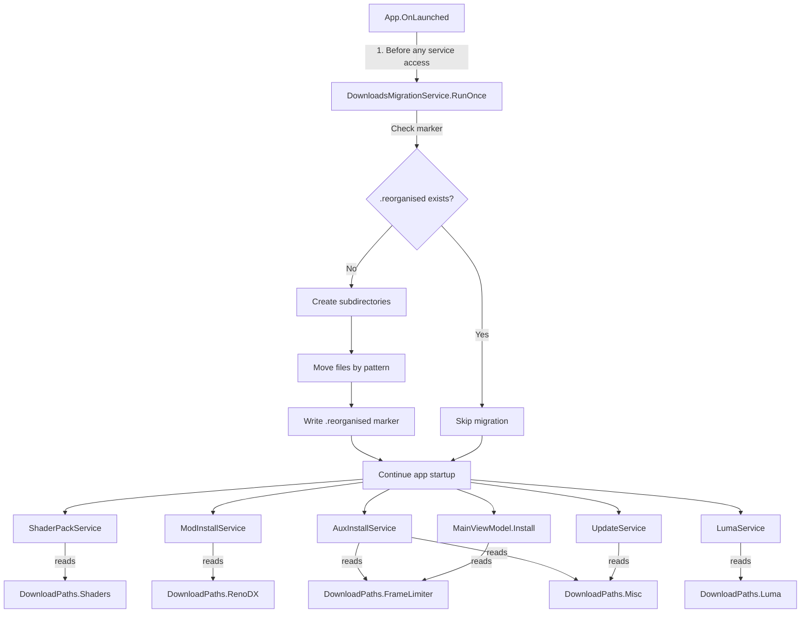

# Design Document: Downloads Folder Reorganisation

## Overview

This feature reorganises the flat `%LOCALAPPDATA%\RHI\downloads\` directory into categorised subdirectories (`shaders/`, `renodx/`, `framelimiter/`, `misc/`, `luma/`) and provides a one-time migration for existing users. The design introduces a centralised `DownloadPaths` static class that all services reference, a `DownloadsMigrationService` that runs at startup before any service accesses the downloads folder, and targeted path constant updates across `ShaderPackService`, `ModInstallService`, `AuxInstallService`, `LumaService`, `UpdateService`, and `MainViewModel.Install`.

The REFramework service already uses its own `downloads/reframework/` subdirectory and is unaffected.

## Architecture

The change is primarily a path-constant refactor plus a new migration service. No new DI registrations are needed — the migration runs as a static method called from `App.OnLaunched` (similar to the existing `MigrateLegacyAppData`).



## Components and Interfaces

### 1. `DownloadPaths` (new static class)

Location: `RenoDXCommander/Services/DownloadPaths.cs`

Single source of truth for all download subdirectory paths. Replaces the scattered `DownloadCacheDir` references.

```csharp
public static class DownloadPaths
{
    public static readonly string Root = Path.Combine(
        Environment.GetFolderPath(Environment.SpecialFolder.LocalApplicationData),
        "RHI", "downloads");

    public static readonly string Shaders      = Path.Combine(Root, "shaders");
    public static readonly string RenoDX       = Path.Combine(Root, "renodx");
    public static readonly string FrameLimiter = Path.Combine(Root, "framelimiter");
    public static readonly string Misc         = Path.Combine(Root, "misc");
    public static readonly string Luma         = Path.Combine(Root, "luma");

    /// <summary>All category subdirectories, used by migration and directory creation.</summary>
    public static readonly string[] AllSubdirectories = [Shaders, RenoDX, FrameLimiter, Misc, Luma];
}
```

### 2. `DownloadsMigrationService` (new static class)

Location: `RenoDXCommander/Services/DownloadsMigrationService.cs`

Runs once at startup. Moves files from the flat `downloads/` root into the correct subdirectories based on filename patterns.

```csharp
public static class DownloadsMigrationService
{
    private static readonly string MarkerPath = Path.Combine(DownloadPaths.Root, ".reorganised");

    public static void RunOnce();
    internal static string ClassifyFile(string fileName); // returns target subdirectory path
}
```

Classification rules (in priority order):
1. `renodx-*.addon64` or `renodx-*.addon32` → `DownloadPaths.RenoDX`
2. `relimiter.*` or `dc_lite.*` or `ul_meta.json` or `dc_meta.json` → `DownloadPaths.FrameLimiter`
3. `luma_*` → `DownloadPaths.Luma`
4. `*.7z` or `*.zip` → `DownloadPaths.Shaders`
5. Everything else → `DownloadPaths.Misc`

### 3. Service Path Updates

Each service replaces its local `DownloadCacheDir` reference:

| Service | Current Path | New Path |
|---|---|---|
| `ShaderPackService.Download` | `AuxInstallService.DownloadCacheDir` | `DownloadPaths.Shaders` |
| `ModInstallService` | `ModInstallService.DownloadCacheDir` (self) | `DownloadPaths.RenoDX` |
| `AuxInstallService` | `ModInstallService.DownloadCacheDir` (alias) | `DownloadPaths.FrameLimiter` / `DownloadPaths.Misc` |
| `LumaService` | local `DownloadCacheDir` field | `DownloadPaths.Luma` |
| `UpdateService` | `Path.GetTempPath()` | `DownloadPaths.Misc` (if changed per requirements) |
| `MainViewModel.Install` | `ModInstallService.DownloadCacheDir` | `DownloadPaths.FrameLimiter` |
| `LiliumShaderService` | `AuxInstallService.DownloadCacheDir` | `DownloadPaths.Shaders` |
| `SettingsHandler` | `ModInstallService.DownloadCacheDir` | `DownloadPaths.Root` |

Note: `UpdateService.DownloadInstallerAsync` currently writes to `Path.GetTempPath()`, not the downloads folder. Per Requirement 6, it should write to `DownloadPaths.Misc` instead.

### 4. `App.OnLaunched` Integration

The migration call is inserted after `MigrateLegacyAppData()` and before any service resolution:

```csharp
protected override void OnLaunched(LaunchActivatedEventArgs args)
{
    MigrateLegacyAppData();
    DownloadsMigrationService.RunOnce();  // <-- new
    // ... rest of startup
}
```

## Data Models

### File Classification Rules

The migration service classifies files using filename pattern matching. The `ClassifyFile` method is a pure function that takes a filename and returns the target subdirectory path.

```csharp
internal static string ClassifyFile(string fileName)
{
    // Priority-ordered pattern matching
    if (fileName.StartsWith("renodx-", StringComparison.OrdinalIgnoreCase) &&
        (fileName.EndsWith(".addon64", StringComparison.OrdinalIgnoreCase) ||
         fileName.EndsWith(".addon32", StringComparison.OrdinalIgnoreCase)))
        return DownloadPaths.RenoDX;

    if (fileName.StartsWith("relimiter.", StringComparison.OrdinalIgnoreCase) ||
        fileName.StartsWith("dc_lite.", StringComparison.OrdinalIgnoreCase) ||
        fileName.Equals("ul_meta.json", StringComparison.OrdinalIgnoreCase) ||
        fileName.Equals("dc_meta.json", StringComparison.OrdinalIgnoreCase))
        return DownloadPaths.FrameLimiter;

    if (fileName.StartsWith("luma_", StringComparison.OrdinalIgnoreCase))
        return DownloadPaths.Luma;

    var ext = Path.GetExtension(fileName);
    if (ext.Equals(".7z", StringComparison.OrdinalIgnoreCase) ||
        ext.Equals(".zip", StringComparison.OrdinalIgnoreCase))
        return DownloadPaths.Shaders;

    return DownloadPaths.Misc;
}
```

### Migration Marker

The marker file `.reorganised` is a zero-byte file at `DownloadPaths.Root`. Its existence signals that migration has already run. The marker is written even if some individual file moves fail, to prevent repeated migration attempts on every startup.

### UlMetaPath / DcMetaPath Relocation

The `ul_meta.json` and `dc_meta.json` files are currently stored at `%LOCALAPPDATA%\RHI\` (the RHI root, not the downloads folder). The requirements specify they should be resolved against `Downloads_Root\framelimiter\`. The migration service will move copies found in the downloads root. The `MainViewModel.Install` paths (`UlMetaPath`, `DcMetaPath`) should be updated to point to `DownloadPaths.FrameLimiter`.


## Correctness Properties

*A property is a characteristic or behavior that should hold true across all valid executions of a system — essentially, a formal statement about what the system should do. Properties serve as the bridge between human-readable specifications and machine-verifiable correctness guarantees.*

### Property 1: File classification correctness

*For any* filename string, `ClassifyFile` shall return exactly one of the five category paths, and the returned path shall match the highest-priority rule that applies:
- filenames starting with `renodx-` and ending with `.addon64` or `.addon32` → `DownloadPaths.RenoDX`
- filenames starting with `relimiter.` or `dc_lite.`, or equal to `ul_meta.json` or `dc_meta.json` → `DownloadPaths.FrameLimiter`
- filenames starting with `luma_` → `DownloadPaths.Luma`
- filenames ending with `.7z` or `.zip` → `DownloadPaths.Shaders`
- all other filenames → `DownloadPaths.Misc`

**Validates: Requirements 8.5, 8.6, 8.7, 8.8, 8.9**

### Property 2: Download path constants resolve under Root

*For any* path in `DownloadPaths.AllSubdirectories`, that path shall start with `DownloadPaths.Root` as a prefix and shall end with the expected subdirectory name.

**Validates: Requirements 7.3**

### Property 3: Migration idempotence — existing destination files are skipped

*For any* set of files in the downloads root where some files already exist at their classified destination, running the migration shall not overwrite existing destination files and shall not throw errors.

**Validates: Requirements 10.1**

## Error Handling

### Migration Errors

The migration service wraps each file move in a try/catch. Individual failures are logged via `CrashReporter.Log` and do not halt the migration. The marker file is written even if some moves fail, preventing repeated migration attempts.

Error scenarios:
- **File locked by another process**: Log and skip. The file stays in the root; the service will still find it there (or re-download).
- **Subdirectory creation fails** (permissions): Log and skip all files destined for that subdirectory.
- **Marker file write fails**: Log and continue. Next startup will re-attempt migration, which is safe due to idempotence (existing files are skipped).
- **Destination file already exists**: Skip silently (no error, no overwrite).

### Service Path Errors

Each service already calls `Directory.CreateDirectory` before writing files. This pattern is preserved — the only change is the path constant. If a subdirectory cannot be created at download time, the existing service-level error handling applies.

## Testing Strategy

### Property-Based Tests (FsCheck.Xunit)

The project already uses `FsCheck.Xunit` (v2.16.6) with xUnit. Each correctness property maps to a single property-based test class.

**Property 1 — File classification correctness**:
- Generator: random filenames covering all five categories plus edge cases (empty extensions, mixed case, filenames that partially match patterns)
- Test: call `ClassifyFile(fileName)` and assert the result matches the expected category based on the priority rules
- Minimum 100 iterations
- Tag: `Feature: downloads-folder-reorganisation, Property 1: File classification correctness`

**Property 2 — Download path constants resolve under Root**:
- Generator: iterate over `DownloadPaths.AllSubdirectories`
- Test: assert each path starts with `DownloadPaths.Root` and ends with the expected folder name
- Tag: `Feature: downloads-folder-reorganisation, Property 2: Download path constants resolve under Root`

**Property 3 — Migration idempotence**:
- Generator: random sets of filenames, with some pre-placed at their destination
- Test: run migration, assert no destination files were overwritten (compare file contents/timestamps)
- Minimum 100 iterations
- Tag: `Feature: downloads-folder-reorganisation, Property 3: Migration idempotence`

### Unit Tests (xUnit)

Unit tests cover specific examples and edge cases:

- Migration runs when marker absent, skips when marker present (Req 8.1, 8.2)
- Migration writes marker after completion, even with partial failures (Req 8.10, 9.3)
- Migration continues after individual file move failure (Req 9.1)
- Migration handles subdirectory creation failure gracefully (Req 9.2)
- Migration handles marker write failure gracefully (Req 9.4)
- `DownloadPaths` defines all five expected subdirectories (Req 1.1)
- Path constants are referenced by services (structural test, Req 7.1)

### Test Configuration

- Property tests: minimum 100 iterations (`[Property(MaxTest = 100)]`)
- Each property test references its design document property in a comment tag
- Tests use temporary directories to avoid polluting the real filesystem
