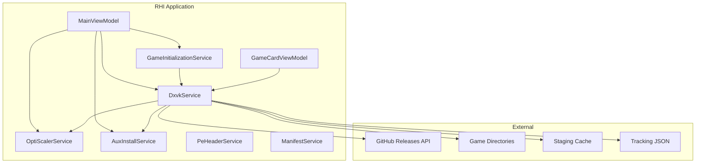
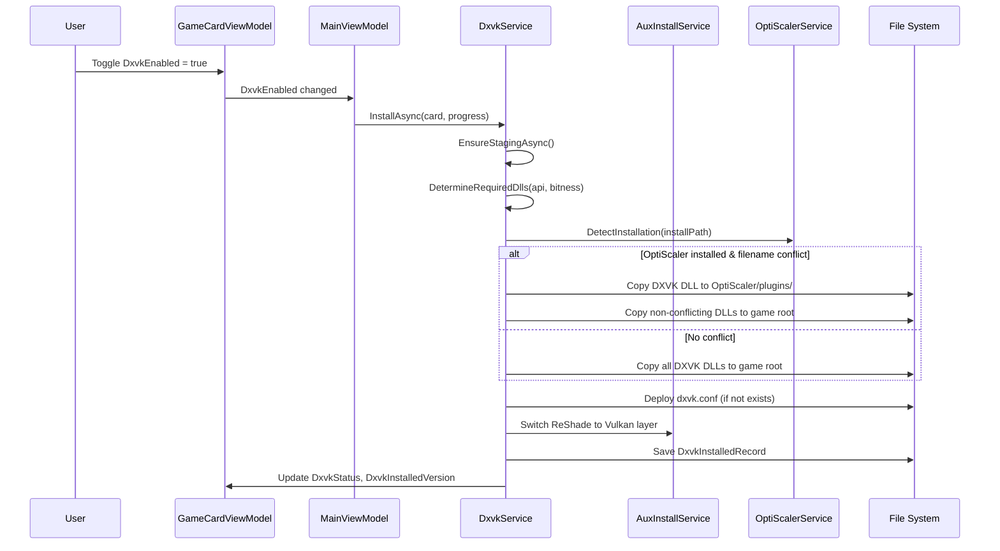

# Design Document: DXVK Integration for RHI

## Overview

This design adds DXVK as a managed per-game component in RHI, following the same lifecycle pattern established by OptiScaler, ReShade, ReLimiter, and Display Commander. DXVK translates DirectX 8/9/10/11 API calls into Vulkan, enabling ReShade compute shaders on older games, improving performance, reducing shader stutter, and enabling HDR output.

The integration introduces:
- A new `DxvkService` (implementing `IDxvkService`) registered in the DI container
- A `DxvkInstalledRecord` data model for per-game install tracking
- Observable DXVK state properties on `GameCardViewModel` following the existing component pattern
- A DXVK component row in the detail panel (hidden until the user enables the DXVK override toggle)
- OptiScaler coexistence via the plugins folder mechanism (filename-conflict-based across all DX versions)
- ReShade mode switching coordination (DX proxy ↔ Vulkan layer)
- Binary signature detection for foreign DLL protection
- Manifest schema additions for blacklisting, game notes, and API overrides
- Update All integration
- A Settings page variant selector (Standard DXVK vs gplasync)

### Key Design Decisions

1. **Hidden until enabled**: The DXVK component row is invisible until the user enables the `DxvkEnabled` toggle in the Overrides panel. This avoids cluttering the UI for the majority of users who don't need DXVK.
2. **Two variants only**: Standard DXVK (doitsujin/dxvk) and gplasync. No dxvk-hdr — standard DXVK already supports HDR via `dxgi.enableHDR = True`.
3. **Filename-conflict-based coexistence**: OptiScaler coexistence works across ALL DX versions. The conflict check is based on whether any DXVK DLL filename matches OptiScaler's installed filename, not on the DX version.
4. **Component row placement**: Below OptiScaler, under the "── Optional ──" separator.
5. **Follow OptiScalerService pattern**: Same staging/install/uninstall/update lifecycle, same DI dependencies, same progress reporting pattern.

## Architecture

### System Context



### Service Layer Integration

`DxvkService` sits alongside `OptiScalerService` and `AuxInstallService` in the service layer. It follows the same patterns:

| Aspect | OptiScalerService | DxvkService |
|--------|-------------------|-------------|
| Interface | `IOptiScalerService` | `IDxvkService` |
| DI Dependencies | `HttpClient`, `IAuxInstallService`, `IDllOverrideService`, `GitHubETagCache` | `HttpClient`, `IAuxInstallService`, `IOptiScalerService`, `GitHubETagCache` |
| Staging Dir | `%LocalAppData%\RHI\optiscaler\` | `%LocalAppData%\RHI\dxvk\` |
| Version File | `version.txt` in staging dir | `version.txt` in staging dir |
| Tracking File | Uses `aux_installed.json` via `IAuxInstallService` | `%LocalAppData%\RHI\dxvk_installed.json` (own file) |
| GitHub API | `repos/optiscaler/OptiScaler/releases/latest` | `repos/doitsujin/dxvk/releases/latest` (or gplasync variant) |
| Archive Format | `.zip` | `.tar.gz` (7-Zip handles both) |
| Progress Reporting | `IProgress<(string message, double percent)>` | `IProgress<(string message, double percent)>` |

**Why `IOptiScalerService` as a dependency?** DxvkService needs to query OptiScaler's installed state to determine filename conflicts and route DLLs to the plugins folder. It also needs to coordinate when OptiScaler is installed/uninstalled after DXVK.

### Lifecycle Flow



## Components and Interfaces

### IDxvkService Interface

```csharp
public interface IDxvkService
{
    // ── Staging properties ─────────────────────────────────────────────
    bool IsStagingReady { get; }
    bool HasUpdate { get; }
    string? StagedVersion { get; }
    bool FirstTimeWarningAcknowledged { get; set; }

    // ── Staging and update ─────────────────────────────────────────────
    Task EnsureStagingAsync(IProgress<(string message, double percent)>? progress = null);
    Task CheckForUpdateAsync();
    void ClearStaging();

    // ── Install / Uninstall / Update ───────────────────────────────────
    Task InstallAsync(
        GameCardViewModel card,
        IProgress<(string message, double percent)>? progress = null);

    void Uninstall(GameCardViewModel card);

    Task UpdateAsync(
        GameCardViewModel card,
        IProgress<(string message, double percent)>? progress = null);

    // ── Configuration ──────────────────────────────────────────────────
    void CopyConfToGame(GameCardViewModel card);

    // ── Detection ──────────────────────────────────────────────────────
    bool IsDxvkFile(string filePath);
    string? DetectInstallation(string installPath, GraphicsApiType api);

    // ── Tracking records ───────────────────────────────────────────────
    List<DxvkInstalledRecord> LoadAllRecords();
    DxvkInstalledRecord? FindRecord(string gameName, string installPath);

    // ── Variant ────────────────────────────────────────────────────────
    DxvkVariant SelectedVariant { get; set; }
}
```

### DxvkService Implementation

```csharp
public partial class DxvkService : IDxvkService
{
    // ── Constants ──────────────────────────────────────────────────────
    private static readonly string StagingDir = Path.Combine(
        Environment.GetFolderPath(Environment.SpecialFolder.LocalApplicationData),
        "RHI", "dxvk");
    private static readonly string VersionFilePath = 
        Path.Combine(StagingDir, "version.txt");
    private static readonly string DbPath = Path.Combine(
        Environment.GetFolderPath(Environment.SpecialFolder.LocalApplicationData),
        "RHI", "dxvk_installed.json");
    private static readonly string ConfTemplatePath = Path.Combine(
        AuxInstallService.InisDir, "dxvk.conf");

    private static readonly string StandardGitHubApi =
        "https://api.github.com/repos/doitsujin/dxvk/releases/latest";
    private static readonly string GplasyncGitHubApi =
        "https://api.github.com/repos/Digger1955/dxvk-gplasync-lowlatency/releases/latest";

    // ── Binary signature markers ──────────────────────────────────────
    private static readonly byte[][] DxvkSignatures =
    [
        Encoding.ASCII.GetBytes("dxvk"),
        Encoding.ASCII.GetBytes("DXVK_"),
    ];

    // ── DI Dependencies ───────────────────────────────────────────────
    private readonly HttpClient _http;
    private readonly IAuxInstallService _auxInstaller;
    private readonly IOptiScalerService _optiScalerService;
    private readonly GitHubETagCache _etagCache;

    public DxvkService(
        HttpClient http,
        IAuxInstallService auxInstaller,
        IOptiScalerService optiScalerService,
        GitHubETagCache etagCache)
    {
        _http = http;
        _auxInstaller = auxInstaller;
        _optiScalerService = optiScalerService;
        _etagCache = etagCache;
    }
}
```

### DLL Selection Logic

The core DLL selection is driven by the game's `GraphicsApiType` and bitness:

```csharp
public static (string archFolder, List<string> dllNames) DetermineRequiredDlls(
    GraphicsApiType api, bool is32Bit)
{
    var arch = is32Bit ? "x32" : "x64";
    var dlls = api switch
    {
        GraphicsApiType.DirectX8  => new List<string> { "d3d8.dll" },
        GraphicsApiType.DirectX9  => new List<string> { "d3d9.dll" },
        GraphicsApiType.DirectX10 => new List<string> { "d3d10core.dll", "dxgi.dll" },
        GraphicsApiType.DirectX11 => new List<string> { "d3d11.dll", "dxgi.dll" },
        _ => throw new InvalidOperationException(
            $"DXVK does not support {api}. Only DX8/9/10/11 are supported.")
    };
    return (arch, dlls);
}
```

### OptiScaler Coexistence Logic

The coexistence check is filename-based, not DX-version-based. This handles all scenarios including edge cases where OptiScaler is installed as a non-default DLL name:

```csharp
private (List<string> rootDlls, List<string> pluginDlls) ResolveDeploymentPaths(
    List<string> requiredDlls, string installPath)
{
    var rootDlls = new List<string>();
    var pluginDlls = new List<string>();

    // Check if OptiScaler is installed and get its filename
    var osInstalledFile = _optiScalerService.DetectInstallation(installPath);

    foreach (var dll in requiredDlls)
    {
        if (osInstalledFile != null &&
            string.Equals(dll, osInstalledFile, StringComparison.OrdinalIgnoreCase))
        {
            // Filename conflict — route to OptiScaler plugins folder
            pluginDlls.Add(dll);
        }
        else
        {
            rootDlls.Add(dll);
        }
    }

    return (rootDlls, pluginDlls);
}
```

### ReShade Mode Switching

When DXVK is enabled, the game presents as Vulkan to the system. ReShade must switch from DX proxy to Vulkan layer:

```csharp
private async Task SwitchReShadeForDxvk(
    GameCardViewModel card, bool dxvkEnabled)
{
    // Skip if game is already Vulkan or dual-API on Vulkan path
    if (card.IsVulkanOnly || card.RequiresVulkanInstall)
        return;

    // Skip if ReShade is not installed
    if (card.RsStatus == GameStatus.NotInstalled)
        return;

    if (dxvkEnabled)
    {
        // Uninstall DX proxy ReShade, reinstall as Vulkan layer
        _auxInstaller.UninstallReShade(card);
        await _auxInstaller.InstallReShadeAsync(
            card, vulkanMode: true);
    }
    else
    {
        // Remove Vulkan layer, reinstall as DX proxy
        _auxInstaller.UninstallReShade(card);
        await _auxInstaller.InstallReShadeAsync(
            card, vulkanMode: false);
    }
}
```

### Variant Selection

```csharp
public enum DxvkVariant
{
    Standard,   // doitsujin/dxvk — default, recommended
    Gplasync    // dxvk-gplasync-lowlatency fork
}
```

The variant determines which GitHub API endpoint is used for staging downloads. Changing the variant clears the staging cache and re-downloads.

## Data Models

### DxvkInstalledRecord

```csharp
public class DxvkInstalledRecord
{
    /// <summary>Game name as detected by RHI.</summary>
    public string GameName { get; set; } = "";

    /// <summary>Resolved install path for the game.</summary>
    public string InstallPath { get; set; } = "";

    /// <summary>DXVK version tag (e.g. "v2.7.1").</summary>
    public string DxvkVersion { get; set; } = "";

    /// <summary>DXVK DLLs deployed to the Game_Directory root.</summary>
    public List<string> InstalledDlls { get; set; } = new();

    /// <summary>DXVK DLLs deployed to OptiScaler/plugins/ folder.</summary>
    public List<string> PluginFolderDlls { get; set; } = new();

    /// <summary>Original files backed up with .original extension.</summary>
    public List<string> BackedUpFiles { get; set; } = new();

    /// <summary>Whether RHI deployed dxvk.conf to the game directory.</summary>
    public bool DeployedConf { get; set; }

    /// <summary>Whether any DXVK DLL is in the OptiScaler plugins folder.</summary>
    public bool InOptiScalerPlugins { get; set; }

    /// <summary>Timestamp of installation.</summary>
    public DateTime InstalledAt { get; set; }
}
```

The `InstalledDlls` and `PluginFolderDlls` separation is critical for correct uninstall — DLLs in the game root are deleted directly, while DLLs in the plugins folder are deleted from `<InstallPath>\OptiScaler\plugins\`.

### DxvkVariant Enum

```csharp
public enum DxvkVariant
{
    Standard,   // doitsujin/dxvk
    Gplasync    // dxvk-gplasync-lowlatency
}
```

### GameCardViewModel DXVK Properties

Following the established component pattern (matching OptiScaler, ReLimiter, Display Commander):

```csharp
// In GameCardViewModel.Dxvk.cs (new partial class file)
public partial class GameCardViewModel
{
    // ── DXVK observable properties ────────────────────────────────────
    [ObservableProperty] private GameStatus _dxvkStatus = GameStatus.NotInstalled;
    [ObservableProperty] private bool       _dxvkIsInstalling;
    [ObservableProperty] private double     _dxvkProgress;
    [ObservableProperty] private string     _dxvkActionMessage = "";
    [ObservableProperty] private string?    _dxvkInstalledVersion;

    // ── Per-game overrides ────────────────────────────────────────────
    [ObservableProperty] private bool _dxvkEnabled;
    public bool ExcludeFromUpdateAllDxvk { get; set; }

    // ── Tracking record ───────────────────────────────────────────────
    public DxvkInstalledRecord? DxvkRecord { get; set; }

    // ── Computed properties (same pattern as OptiScaler) ──────────────
    public string DxvkStatusDot => DxvkStatus == GameStatus.UpdateAvailable ? "🟢"
        : DxvkStatus == GameStatus.Installed ? "🟢" : "⚪";

    public string DxvkActionLabel => DxvkIsInstalling ? "Installing..."
        : DxvkStatus == GameStatus.UpdateAvailable ? "⬆  Update DXVK"
        : DxvkStatus == GameStatus.Installed ? "↺  Reinstall DXVK"
        : "⬇  Install DXVK";

    public bool IsDxvkInstalled => DxvkStatus == GameStatus.Installed
        || DxvkStatus == GameStatus.UpdateAvailable;

    public bool DxvkInstallEnabled => !DxvkIsInstalling;

    public Visibility DxvkRowVisibility => DxvkEnabled
        ? Visibility.Visible : Visibility.Collapsed;

    public Visibility DxvkProgressVisibility => DxvkIsInstalling
        ? Visibility.Visible : Visibility.Collapsed;

    public Visibility DxvkDeleteVisibility => IsDxvkInstalled
        ? Visibility.Visible : Visibility.Collapsed;

    // ... additional computed properties following OptiScaler pattern
}
```

### Manifest Schema Additions

Three new fields on `RemoteManifest`:

```csharp
/// <summary>
/// Games where the DXVK toggle is blocked (anti-cheat, known incompatible).
/// </summary>
[JsonPropertyName("dxvkBlacklist")]
public List<string>? DxvkBlacklist { get; set; }

/// <summary>
/// Per-game DXVK notes displayed in the DXVK Info dialog.
/// </summary>
[JsonPropertyName("dxvkGameNotes")]
public Dictionary<string, GameNoteEntry>? DxvkGameNotes { get; set; }

/// <summary>
/// Per-game DirectX API overrides for DXVK DLL selection.
/// Overrides auto-detected API when DXVK needs a different DX version.
/// Key = game name, Value = "DX8", "DX9", "DX10", or "DX11".
/// </summary>
[JsonPropertyName("dxvkApiOverrides")]
public Dictionary<string, string>? DxvkApiOverrides { get; set; }
```

Corresponding `manifest.json` additions:

```json
{
  "dxvkBlacklist": [
    "Fortnite",
    "Apex Legends",
    "Dead by Daylight",
    "PUBG: BATTLEGROUNDS",
    "Rainbow Six Siege",
    "Escape from Tarkov",
    "Genshin Impact",
    "Valorant"
  ],
  "dxvkGameNotes": {
    "FINAL FANTASY XIV Online": {
      "notes": "ℹ️ DXVK provides significant CPU-bound performance improvements for FFXIV.",
      "notesUrl": null,
      "notesUrlLabel": null
    }
  },
  "dxvkApiOverrides": {
    "Some Game": "DX9"
  }
}
```

### SavedGame DXVK Fields

Added to `SavedGame` (or equivalent saved game entry):

```csharp
public bool DxvkEnabled { get; set; }
public string? DxvkInstalledVersion { get; set; }
public bool ExcludeFromUpdateAllDxvk { get; set; }
```

### Staging Cache Structure

```
%LocalAppData%\RHI\dxvk\
├── version.txt          (e.g. "v2.7.1")
├── x64/
│   ├── d3d8.dll
│   ├── d3d9.dll
│   ├── d3d10core.dll
│   ├── d3d11.dll
│   └── dxgi.dll
└── x32/
    ├── d3d8.dll
    ├── d3d9.dll
    ├── d3d10core.dll
    ├── d3d11.dll
    └── dxgi.dll
```


## Correctness Properties

*A property is a characteristic or behavior that should hold true across all valid executions of a system — essentially, a formal statement about what the system should do. Properties serve as the bridge between human-readable specifications and machine-verifiable correctness guarantees.*

### Property 1: DxvkInstalledRecord serialization round-trip

*For any* valid `DxvkInstalledRecord` with arbitrary field values (non-null strings, lists of DLL names, boolean flags, DateTime), serializing to JSON then deserializing SHALL produce an equivalent record with all fields matching the original.

**Validates: Requirements 18.4**

### Property 2: DLL selection mapping

*For any* valid `(GraphicsApiType, bool is32Bit)` pair where the API is one of DirectX8, DirectX9, DirectX10, or DirectX11, `DetermineRequiredDlls` SHALL return the correct architecture folder (`"x32"` for 32-bit, `"x64"` for 64-bit) and the correct set of DLL names: `["d3d8.dll"]` for DX8, `["d3d9.dll"]` for DX9, `["d3d10core.dll", "dxgi.dll"]` for DX10, `["d3d11.dll", "dxgi.dll"]` for DX11.

**Validates: Requirements 3.1, 3.2, 3.3, 3.4, 3.5**

### Property 3: Architecture validation rejects mismatches

*For any* `(GraphicsApiType, bool is32Bit, bool dllIs32Bit)` triple where `is32Bit != dllIs32Bit`, the DXVK deployment SHALL be refused with a descriptive error. Deployment SHALL succeed only when the DLL architecture matches the game's bitness.

**Validates: Requirements 3.11**

### Property 4: OptiScaler coexistence routing

*For any* combination of required DXVK DLL names and an OptiScaler installed filename (or null if OptiScaler is not installed), `ResolveDeploymentPaths` SHALL route each DLL such that: DLLs whose filename matches OptiScaler's installed filename go to `PluginFolderDlls`, and all other DLLs go to `InstalledDlls` (game root). When OptiScaler is not installed, all DLLs go to game root.

**Validates: Requirements 6.1, 6.5, 6.6, 6.7**

### Property 5: DXVK toggle eligibility

*For any* game with a `GraphicsApiType` and a set of blacklist entries, the DXVK toggle SHALL be enabled if and only if: the game's primary API is one of DirectX8, DirectX9, DirectX10, or DirectX11, AND the game is not in the DXVK blacklist, AND the game's API is not Unknown (unless an API override exists in the manifest).

**Validates: Requirements 9.1, 9.2, 9.7, 10.5, 17.4**

### Property 6: Path safety validation

*For any* file path string, the deployment path validator SHALL reject paths that are under `%SystemRoot%`, `%SystemRoot%\System32`, `%SystemRoot%\SysWOW64`, or `%ProgramFiles%\WindowsApps`. It SHALL accept paths that are valid game directories outside these protected locations.

**Validates: Requirements 9.5, 9.6, 21.2**

### Property 7: Update All exclusion filtering

*For any* set of game cards with varying `DxvkStatus` and `ExcludeFromUpdateAllDxvk` values, the Update All filter SHALL select only cards where `DxvkStatus == UpdateAvailable` AND `ExcludeFromUpdateAllDxvk == false` AND `IsHidden == false`. Cards with the exclusion flag set, or without an available update, or that are hidden, SHALL never be selected.

**Validates: Requirements 2.5, 16.2**

### Property 8: Binary signature detection

*For any* byte array representing a DLL file's first 2 MB, `IsDxvkFile` SHALL return true if and only if the byte array contains the ASCII string `"dxvk"` or `"DXVK_"`. Files without these signatures SHALL return false.

**Validates: Requirements 8.1, 8.2**

### Property 9: Uninstall restores original state

*For any* valid `DxvkInstalledRecord` describing an installed DXVK configuration, after uninstall: all DLLs in `InstalledDlls` SHALL be removed from the game directory root, all DLLs in `PluginFolderDlls` SHALL be removed from the OptiScaler plugins folder, and all files in `BackedUpFiles` SHALL be restored from their `.original` backups (renamed back to original names).

**Validates: Requirements 4.1, 4.2, 4.3**

### Property 10: IsStagingReady correctness

*For any* combination of (staging directory exists, version.txt exists, d3d9.dll exists in x64/), `IsStagingReady` SHALL return true if and only if all three conditions are true simultaneously.

**Validates: Requirements 1.4**

### Property 11: Update detection

*For any* pair of version strings (cached, remote), `HasUpdate` SHALL be true if and only if the remote version differs from the cached version.

**Validates: Requirements 2.1, 2.2**

### Property 12: Backup skip for managed DLLs

*For any* DLL file in a game directory, the backup logic SHALL create a `.original` backup only if the file is NOT identified as an RHI-managed DLL (not ReShade, not OptiScaler, not a previous DXVK install). RHI-managed DLLs SHALL be overwritten without backup.

**Validates: Requirements 3.7**

### Property 13: API override precedence

*For any* game with both an auto-detected `GraphicsApiType` and a `dxvkApiOverrides` entry in the manifest, the DXVK DLL selection SHALL use the overridden API version, not the auto-detected value.

**Validates: Requirements 17.5**

### Property 14: MergeCards DXVK field copy

*For any* pair of (existing card, fresh card) with arbitrary DXVK field values, after MergeCards processes the fresh card, the existing card's `DxvkStatus`, `DxvkInstalledVersion`, `DxvkRecord`, `DxvkEnabled`, and `ExcludeFromUpdateAllDxvk` SHALL all equal the fresh card's corresponding values.

**Validates: Requirements 14.1**

## Error Handling

### Error Categories and Responses

| Error Scenario | Response | Recovery |
|---|---|---|
| GitHub API failure (network, rate limit) | Log via `CrashReporter`, set staging as unavailable | Retry on next startup or manual retry; don't block other components |
| `.tar.gz` extraction failure | Log error, clean up partial extraction | Allow user to retry; clear staging cache |
| DLL file copy fails (file locked by running game) | Display error message: "File is in use — close the game and retry" | User closes game, retries toggle |
| DLL file copy fails (permission denied) | Display error message with path | User runs as admin or checks permissions |
| `.original` backup missing during uninstall | Log warning, skip restore for that file, continue | Uninstall completes with warning; user may need to verify game integrity |
| DLL deletion fails during uninstall | Log error, mark record as partially uninstalled | User can retry uninstall or manually delete |
| Staging download interrupted | Clean up partial download files | User retries; `IsStagingReady` returns false |
| Game directory does not exist | Report error, refuse deployment | User verifies game installation |
| System path detected as target | Refuse deployment with descriptive error | Never deploy to system directories |
| Architecture mismatch (32-bit DLL for 64-bit game) | Refuse deployment with descriptive error | User checks game bitness settings |
| Tracking file corrupted/unreadable | Log error, start with empty record set | Records are rebuilt as users interact with DXVK |
| OptiScaler plugins folder doesn't exist | Create the folder before placing DLLs | Auto-recovery |

### Error Logging Convention

All errors follow the existing `CrashReporter` pattern:

```csharp
CrashReporter.Log($"[DxvkService.{methodName}] {description} — {ex.Message}");
```

For unhandled exceptions during install/uninstall/update:

```csharp
CrashReporter.WriteCrashReport(ex, $"DXVK {operation} for {card.GameName}");
```

### Partial Failure Handling

During Update All, if DXVK re-deployment fails for one game:
1. Log the error with game name
2. Report the failure in the Update All summary
3. Continue processing remaining games
4. The failed game's `DxvkInstalledVersion` remains at the old version

During uninstall, if one DLL cannot be deleted:
1. Log the error
2. Continue removing other DLLs and restoring backups
3. Mark the record as partially uninstalled (don't delete the record)
4. User can retry uninstall later

## Testing Strategy

### Dual Testing Approach

This feature uses both unit tests and property-based tests for comprehensive coverage:

- **Property-based tests** verify universal properties across many generated inputs (DLL selection, coexistence routing, path validation, serialization round-trip, toggle eligibility, etc.)
- **Unit tests** verify specific examples, edge cases, integration points, and error conditions

### Property-Based Testing

**Library**: [FsCheck](https://fscheck.github.io/FsCheck/) with xUnit integration (`FsCheck.Xunit`)

**Configuration**: Minimum 100 iterations per property test.

**Tag format**: `Feature: dxvk-integration, Property {number}: {property_text}`

Each correctness property from the design document maps to a single property-based test:

| Property | Test Focus | Generator Strategy |
|----------|-----------|-------------------|
| 1: Serialization round-trip | `DxvkInstalledRecord` JSON round-trip | Generate random records with arbitrary strings, lists, booleans, DateTimes |
| 2: DLL selection mapping | `DetermineRequiredDlls` pure function | Generate random `(GraphicsApiType ∈ {DX8,DX9,DX10,DX11}, bool)` pairs |
| 3: Architecture validation | Deployment refusal on mismatch | Generate random `(API, gameBitness, dllBitness)` triples |
| 4: OptiScaler coexistence routing | `ResolveDeploymentPaths` pure function | Generate random DLL name lists + optional OptiScaler filename |
| 5: Toggle eligibility | `IsDxvkToggleEligible` logic | Generate random `(GraphicsApiType, blacklist set, hasOverride)` |
| 6: Path safety validation | `IsValidDeploymentPath` | Generate random path strings including system paths |
| 7: Update All exclusion | Filter logic | Generate random card sets with varying status/exclusion flags |
| 8: Binary signature detection | `IsDxvkFile` | Generate random byte arrays with/without DXVK signatures |
| 9: Uninstall restores state | Uninstall cleanup logic | Generate random `DxvkInstalledRecord` with various DLL placements |
| 10: IsStagingReady | Boolean property correctness | Generate random `(dirExists, versionExists, dllExists)` triples |
| 11: Update detection | `HasUpdate` logic | Generate random version string pairs |
| 12: Backup skip for managed DLLs | Backup decision logic | Generate random DLL files with/without RHI signatures |
| 13: API override precedence | Override resolution | Generate random `(autoApi, overrideApi)` pairs |
| 14: MergeCards field copy | Field propagation | Generate random card pairs with arbitrary DXVK fields |

### Unit Tests (Example-Based)

| Test Area | Examples |
|-----------|----------|
| Staging | Valid cache skips download; empty cache triggers download; version.txt written after extraction |
| Install flow | DX9 game gets d3d9.dll; DX11 game gets d3d11.dll + dxgi.dll; backup created for existing files |
| Uninstall flow | DLLs removed; backups restored; dxvk.conf deleted when DeployedConf=true; record removed |
| dxvk.conf | Default deployed when none exists; existing conf preserved; template copy works |
| ReShade switching | DX proxy → Vulkan layer on enable; Vulkan layer → DX proxy on disable; skip for Vulkan games |
| OptiScaler ordering | OptiScaler installed after DXVK moves DLL to plugins; OptiScaler uninstall moves DLL back |
| Detection | Unmanaged DXVK detected shows "Detected (unmanaged)"; adopt flow creates record |
| Safety | First-time warning shown; warning suppressed after acknowledgment; blacklisted game blocked |
| Update All | DXVK included in batch; excluded games skipped; failure doesn't stop other games |
| Settings | Variant change clears cache; variant persisted across sessions |

### Edge Case Tests

| Edge Case | Expected Behavior |
|-----------|-------------------|
| Missing `.original` backup during uninstall | Log warning, continue |
| File locked by running game during install | Error message suggesting game closure |
| Staging download interrupted | Partial files cleaned up |
| Game directory doesn't exist | Error reported, no deployment |
| Tracking file corrupted | Start with empty records |
| OptiScaler plugins folder doesn't exist | Create folder automatically |
| DLL deletion fails during uninstall | Mark as partially uninstalled |

### Integration Tests

| Integration Point | Test Strategy |
|-------------------|---------------|
| GitHub API staging | Mock HTTP responses, verify extraction and version tracking |
| ReShade mode switching | Mock `IAuxInstallService`, verify correct mode transitions |
| OptiScaler coexistence (install order) | Mock `IOptiScalerService`, verify DLL routing for both install orders |
| Cache phase loading | Verify DXVK state populated from saved records on startup |
| MergeCards | Verify DXVK fields survive background scan refresh |
| Update All | Verify DXVK included in batch update with correct filtering |
