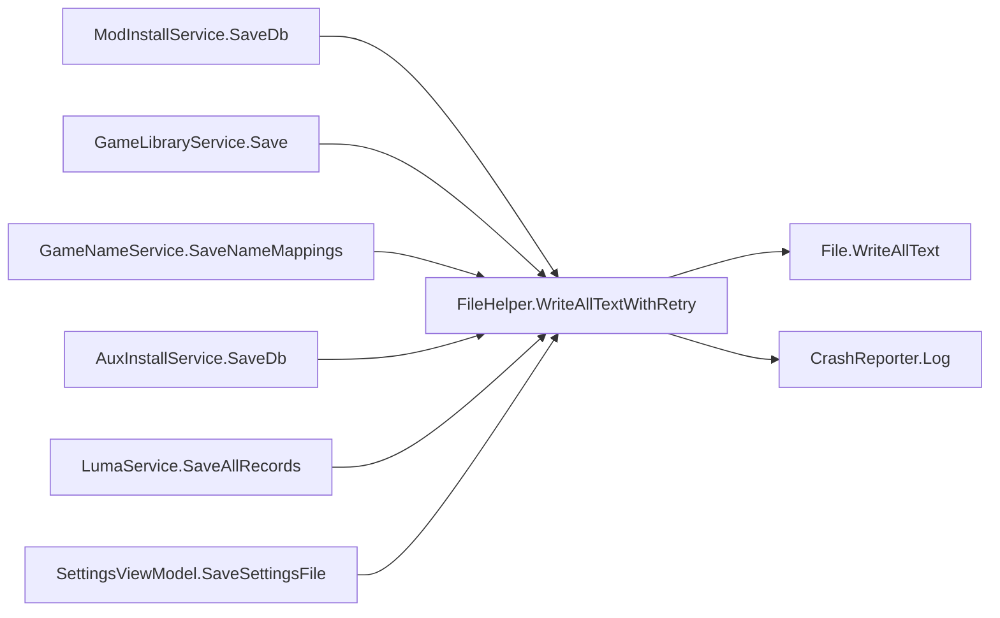

# Design Document: File Write Retry Helper

## Overview

This design extracts the duplicated file-write-with-retry pattern found in 6+ locations across the RenoDXCommander codebase into a single static `FileHelper` utility class. The pattern retries `File.WriteAllText` up to 3 times with progressive backoff on transient `IOException`, and optionally logs non-recoverable failures via `CrashReporter`.

After analyzing all 6 call sites, two behavioral variants exist:

| Variant | Sites | `catch (Exception)` on any attempt? |
|---------|-------|-------------------------------------|
| **Silent** — retries IOExceptions, silently gives up after 3 failures | ModInstallService.SaveDb, GameLibraryService.Save, AuxInstallService.SaveDb | No |
| **Logging** — retries IOExceptions, logs non-IOException via CrashReporter | SettingsViewModel.SaveSettingsFile, LumaService.SaveAllRecords (outer catch), GameNameService.SaveNameMappings (outer catch) | Yes |

The unified `WriteAllTextWithRetry` method covers both variants by accepting a caller-context tag. When a tag is provided, non-IOException failures are logged; the method never throws.

## Architecture



The helper is a pure static utility with no state, no dependencies beyond `System.IO` and `CrashReporter`, and no impact on the existing DI container or service interfaces.

## Components and Interfaces

### FileHelper (new)

```csharp
namespace RenoDXCommander.Services;

/// <summary>
/// Shared file-write utilities with built-in retry logic for transient IO failures.
/// </summary>
public static class FileHelper
{
    /// <summary>
    /// Writes <paramref name="content"/> to <paramref name="path"/> with up to 3 attempts.
    /// On transient <see cref="IOException"/>, waits 50ms × (attempt + 1) before retrying.
    /// On non-IOException or final failure, logs via <see cref="CrashReporter"/> using
    /// <paramref name="callerTag"/> and returns without throwing.
    /// </summary>
    /// <param name="path">Destination file path.</param>
    /// <param name="content">Text content to write.</param>
    /// <param name="callerTag">
    /// Context string for log messages, e.g. "ModInstallService.SaveDb".
    /// </param>
    public static void WriteAllTextWithRetry(string path, string content, string callerTag);
}
```

**Design decisions:**

- **Static class, static method** — matches the project convention (e.g. `CrashReporter` is static). No instance state needed.
- **`callerTag` parameter** — every existing call site already formats a unique `[ClassName.MethodName]` prefix for CrashReporter. Passing this as a parameter preserves the existing log format without coupling FileHelper to caller internals.
- **Never throws** — all 6 existing call sites swallow exceptions (either silently or after logging). The helper preserves this behavior. Callers that need to know about failure can check the file themselves, but none currently do.
- **`Directory.CreateDirectory` stays at call sites** — 5 of 6 call sites call `Directory.CreateDirectory` before the retry loop, but they create different directories (the parent of the target file). This is a one-liner that belongs to the caller's setup logic, not to the write-retry concern.

### Call Site Changes

Each call site replaces its inline retry loop with a single call:

```csharp
FileHelper.WriteAllTextWithRetry(DbPath, json, "ModInstallService.SaveDb");
```

**GameNameService.SaveNameMappings** is the most complex call site — it wraps the entire load-serialize-save sequence in its own retry loop. The inner `SettingsViewModel.SaveSettingsFile` call already has the retry pattern. After refactoring, the outer retry loop in `SaveNameMappings` remains (it retries the full read-modify-write cycle on IOException), but the inner write uses `FileHelper`.

## Data Models

No new data models are introduced. The helper operates on primitive `string` parameters (file path, content, caller tag) and interacts only with `System.IO.File` and `CrashReporter`.

### Constants (internal to FileHelper)

| Constant | Value | Source |
|----------|-------|--------|
| Max attempts | 3 | All 6 existing call sites |
| Base delay | 50 ms | All 6 existing call sites |
| Delay formula | `50 * (attempt + 1)` | Produces 50ms, 100ms, 150ms |


## Correctness Properties

*A property is a characteristic or behavior that should hold true across all valid executions of a system — essentially, a formal statement about what the system should do. Properties serve as the bridge between human-readable specifications and machine-verifiable correctness guarantees.*

### Property 1: Write round trip

*For any* valid file path (in a writable temp directory) and *for any* non-null string content, calling `WriteAllTextWithRetry` and then reading the file back with `File.ReadAllText` should return content identical to what was written.

**Validates: Requirements 1.2**

### Property 2: IOException retry with bounded attempts

*For any* number of transient `IOException` failures `n` (where `0 ≤ n ≤ 3`), if the first `n` write attempts throw `IOException` and attempt `n+1` succeeds (or `n = 3` and all fail), then:
- The method should attempt exactly `min(n + 1, 3)` writes.
- The method should never throw an unhandled exception.
- If `n < 3`, the file should contain the expected content after the successful attempt.

**Validates: Requirements 1.3, 1.4, 1.6, 3.1, 3.2, 3.3**

### Property 3: Non-IOException halts and logs

*For any* attempt number (0, 1, or 2) and *for any* non-IOException exception type (e.g. `UnauthorizedAccessException`, `ArgumentException`), if that exception is thrown on that attempt, the method should:
- Stop retrying immediately (no further write attempts).
- Log a message via `CrashReporter.Log` containing both the caller-context tag and the exception message.
- Not throw an unhandled exception.

**Validates: Requirements 1.5, 3.4**

## Error Handling

| Scenario | Behavior |
|----------|----------|
| Transient `IOException` (file locked by antivirus, concurrent flush) | Retry up to 3 times with 50/100/150 ms delays |
| All 3 attempts throw `IOException` | Give up silently — no throw, no log (matches existing silent sites) |
| Non-`IOException` on any attempt (e.g. `UnauthorizedAccessException`, `SecurityException`) | Log via `CrashReporter.Log` with caller tag, stop immediately, no throw |
| `null` path or content | Let `File.WriteAllText` throw `ArgumentNullException`, caught by the general `Exception` handler, logged and returned |
| Directory does not exist | Callers are responsible for `Directory.CreateDirectory` before calling the helper (preserves existing behavior) |

The helper never throws. This matches the existing behavior at all 6 call sites where exceptions are swallowed.

## Testing Strategy

### Property-Based Tests

Use **FsCheck** (the standard .NET property-based testing library) with **xUnit** as the test runner.

Each property test runs a minimum of 100 iterations with randomly generated inputs.

**Test structure:**
- Generate random file content strings (including empty, whitespace, unicode, large strings).
- Use a temporary directory per test run to avoid filesystem conflicts.
- For retry tests, use a wrapper/delegate that simulates IOException on configurable attempts.

**Tag format for each test:**

```
// Feature: file-write-retry-helper, Property 1: Write round trip
// Feature: file-write-retry-helper, Property 2: IOException retry with bounded attempts
// Feature: file-write-retry-helper, Property 3: Non-IOException halts and logs
```

### Unit Tests

Unit tests complement property tests for specific examples and edge cases:

- Verify the method signature exists with the expected parameters (Requirement 1.1).
- Verify that `Directory.CreateDirectory` is still called at each refactored call site before `WriteAllTextWithRetry` (Requirement 3.5) — a code review checklist item, optionally backed by a grep-based test.
- Verify the log message format includes the caller tag and exception message.
- Verify behavior with an empty string content and an empty string caller tag.

### Test Configuration

- **Library:** FsCheck.Xunit (NuGet package)
- **Runner:** xUnit
- **Iterations:** 100 minimum per property
- **Each property test references its design document property number**
- **Each correctness property is implemented by a single property-based test**
