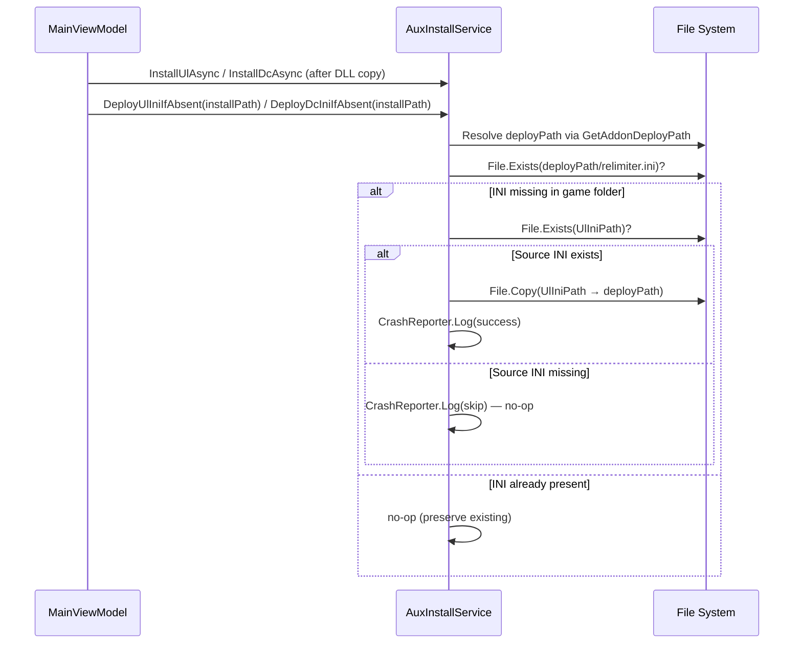

# Design Document: INI First-Install Deploy

## Overview

This feature adds automatic deployment of `relimiter.ini` and `DisplayCommander.ini` from the AppData INI folder (`%LocalAppData%\RHI\inis\`) to a game's addon deploy path during the first install of ReLimiter or Display Commander. The copy is conditional: it only occurs when the INI file does not already exist in the game directory. Failures are logged but never block the addon installation.

Currently, `CopyUlIni` and `CopyDcIni` in `AuxInstallService.Ini.cs` perform unconditional overwrites and throw on missing source files. The new feature introduces a safe, non-throwing variant that is called automatically from the install flows in `MainViewModel.Install.cs`.

## Architecture

The change is localised to two layers:

1. **Service layer** (`AuxInstallService.Ini.cs`) — Two new static methods `DeployUlIniIfAbsent` and `DeployDcIniIfAbsent` that encapsulate the "copy-if-missing" logic with full error handling.
2. **ViewModel layer** (`MainViewModel.Install.cs`) — `InstallUlAsync` and `InstallDcAsync` each call the corresponding deploy method after the addon DLL has been copied to the game folder.

### Design Decisions

- **New methods instead of modifying existing ones**: `CopyUlIni` / `CopyDcIni` are used by the manual "Copy INI" button and intentionally overwrite. The new `DeployUlIniIfAbsent` / `DeployDcIniIfAbsent` methods have different semantics (skip-if-exists, never throw) so they are separate methods.
- **Static methods**: Consistent with the existing `CopyUlIni` / `CopyDcIni` pattern in `AuxInstallService`.
- **No interface changes**: The deploy methods are called directly from the ViewModel install flows. They don't need to be on `IAuxFileService` or `IAuxInstallService` since they are static helpers invoked at a specific point in the install sequence.

## Components and Interfaces

### New Methods

#### `AuxInstallService.DeployUlIniIfAbsent(string gameInstallPath)`
- Static, void, never throws.
- Resolves `deployPath` via `ModInstallService.GetAddonDeployPath(gameInstallPath)`.
- If `relimiter.ini` already exists at `deployPath` → returns (no-op).
- If `UlIniPath` does not exist → logs and returns.
- Otherwise copies `UlIniPath` → `deployPath/relimiter.ini` inside a try/catch. Logs success or failure.

#### `AuxInstallService.DeployDcIniIfAbsent(string gameInstallPath)`
- Same contract as above, for `DisplayCommander.ini` / `DcIniPath`.

### Modified Methods

#### `MainViewModel.InstallUlAsync`
- After the addon DLL `File.Copy` succeeds and before the UI success dispatch, call `AuxInstallService.DeployUlIniIfAbsent(card.InstallPath)`.

#### `MainViewModel.InstallDcAsync`
- After the addon DLL `File.Copy` succeeds and before the `AuxInstalledRecord` is saved, call `AuxInstallService.DeployDcIniIfAbsent(card.InstallPath)`.

## Data Models

No new data models are required. The feature uses existing paths (`UlIniPath`, `DcIniPath`) and the existing `ModInstallService.GetAddonDeployPath` resolution.

## Correctness Properties

*A property is a characteristic or behavior that should hold true across all valid executions of a system — essentially, a formal statement about what the system should do. Properties serve as the bridge between human-readable specifications and machine-verifiable correctness guarantees.*

### Property 1: Deploy copies INI when destination is absent

*For any* addon type (ReLimiter or Display Commander), *for any* valid INI file content in the AppData source folder, and *for any* game deploy path where the corresponding INI does not yet exist, calling the deploy method SHALL result in the INI file appearing at the deploy path with content identical to the source.

**Validates: Requirements 1.1, 2.1**

### Property 2: Deploy preserves existing INI

*For any* addon type (ReLimiter or Display Commander), *for any* existing INI content already present at the game deploy path, and *for any* source INI content in the AppData folder, calling the deploy method SHALL leave the existing file byte-for-byte unchanged.

**Validates: Requirements 1.2, 2.2, 3.1, 3.2**

### Property 3: Deploy is a no-op when source INI is missing

*For any* addon type (ReLimiter or Display Commander), *for any* game deploy path where the INI does not exist, if the source INI file is absent from the AppData folder, calling the deploy method SHALL not create any file at the deploy path and SHALL not throw an exception.

**Validates: Requirements 1.3, 2.3**

## Error Handling

| Scenario | Behaviour |
|---|---|
| Source INI missing from AppData `inis` folder | Log via `CrashReporter.Log`, return silently. No file created. |
| Destination INI already exists | No-op. Existing file untouched. |
| I/O error during `File.Copy` (permissions, disk full, etc.) | Catch `Exception`, log via `CrashReporter.Log`, return silently. Install continues. |
| `GetAddonDeployPath` throws | Caught by the outer try/catch in the deploy method. Logged and swallowed. |

The deploy methods are designed to never throw. The calling install methods (`InstallUlAsync`, `InstallDcAsync`) already have their own top-level try/catch for the overall install flow, but the INI deploy step must not contribute to install failure under any circumstances.

## Testing Strategy

### Property-Based Tests (FsCheck.Xunit)

The project uses FsCheck.Xunit for property-based testing. Each property test will:
- Run a minimum of 100 iterations (`MaxTest = 100`)
- Use temp directories to isolate file system state
- Parameterise over addon type (UL / DC) where applicable
- Tag with the design property reference

| Property | Test Class | What It Generates |
|---|---|---|
| Property 1: Copy when absent | `IniFirstInstallDeployCopyPropertyTests` | Random INI content (byte arrays), random deploy paths (temp dirs). Verifies file appears with matching content. |
| Property 2: Preserve existing | `IniFirstInstallDeployPreservePropertyTests` | Random existing INI content + random source INI content. Verifies existing file is byte-for-byte unchanged after deploy. |
| Property 3: No-op when source missing | `IniFirstInstallDeployNoSourcePropertyTests` | Random deploy paths with no source INI. Verifies no file created and no exception. |

### Unit Tests (Example-Based)

- **I/O error handling (Req 4.1)**: Create a read-only destination, call deploy, verify no exception.
- **Install flow integration (Req 4.2)**: Verify that `InstallUlAsync` / `InstallDcAsync` still succeed when the INI deploy encounters an error (mock or temp-dir based).

### Test Configuration

- Framework: xUnit + FsCheck.Xunit (already in project)
- Tag format: `Feature: ini-first-install-deploy, Property {N}: {title}`
- Each property test runs 100+ iterations
