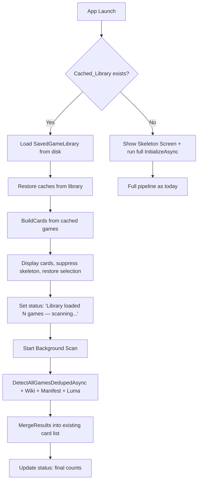
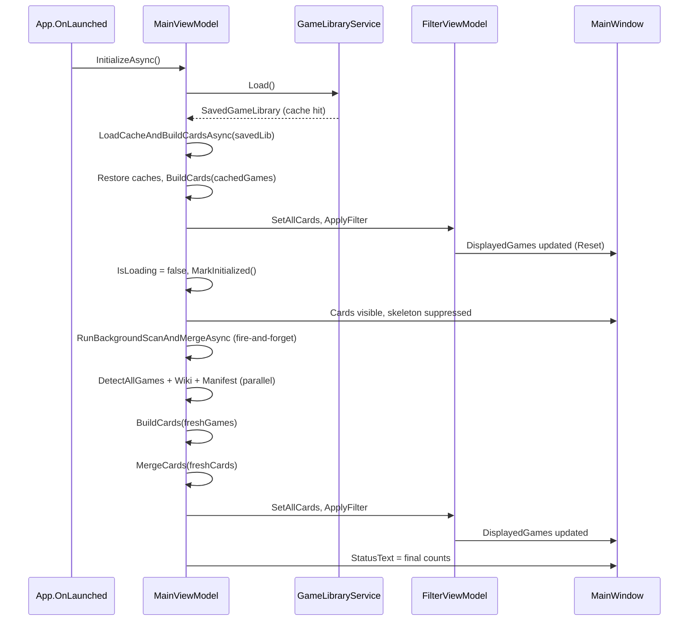

# Design Document: Instant Cache UI

## Overview

This feature splits the monolithic `InitializeAsync` method into two phases:

1. **Cache Phase** (fast, synchronous-feeling): Load the `SavedGameLibrary` from disk, build cards from it, and display them immediately. This suppresses the skeleton screen and gives the user an instant UI.
2. **Scan Phase** (background): Run the full detection pipeline (platform scans, wiki fetch, manifest fetch, shader pack checks) concurrently. When complete, merge fresh results into the already-visible card list without a full rebuild.

The existing `FullRefreshAsync` path is unchanged — it clears all caches and runs the current blocking pipeline with the skeleton screen.

### Design Rationale

The current `InitializeAsync` already loads the cached library and restores caches from it, but it still blocks the UI until detection, wiki fetch, and manifest fetch all complete before calling `BuildCards`. The key insight is that `BuildCards` can run with cached data alone — engine caches, resolved path caches, addon file caches, and bitness caches are all persisted in `SavedGameLibrary`. The only thing the background scan adds is: (a) newly installed/uninstalled games, (b) fresh wiki/manifest data, and (c) updated addon states.

## Architecture



### Two-Phase Split in InitializeAsync

The current `InitializeAsync` method will be refactored into two internal phases:

**Phase 1 — `LoadCacheAndBuildCardsAsync`** (called when `savedLib != null && !forceRescan`):
- Restores all caches from `SavedGameLibrary` (engine, resolved path, addon file, bitness).
- Converts cached `SavedGame` entries to `DetectedGame` list via `ToDetectedGames`.
- Calls `BuildCards` with cached games and cached addon data.
- Sets `_allCards`, pushes to `FilterViewModel`, applies filter.
- Sets `IsLoading = false` and calls `MarkInitialized()`.
- Sets `StatusText` to show cached game count and scan age.
- Returns immediately — UI is now interactive.

**Phase 2 — `RunBackgroundScanAndMergeAsync`** (fire-and-forget after Phase 1):
- Launches all background tasks in parallel (detection, wiki, manifest, luma, etc.) — same as today.
- Awaits all results.
- Calls `MergeResults` to reconcile fresh data with the displayed card list.
- Updates `StatusText` with final counts.

When no cache exists or `forceRescan` is true, the method falls back to the current single-phase behavior.

## Components and Interfaces

### Modified Components

#### `MainViewModel.Init.cs` — `InitializeAsync`

The method gains a branch at the top:

```
if (savedLib != null && !forceRescan)
{
    // Phase 1: build cards from cache, display immediately
    await LoadCacheAndBuildCardsAsync(savedLib);
    // Phase 2: background scan + merge
    _ = RunBackgroundScanAndMergeAsync(savedLib);
    return;
}
// else: existing full-init path unchanged
```

#### New private method: `LoadCacheAndBuildCardsAsync(SavedGameLibrary savedLib)`

Responsibilities:
- Restore hidden/favourite sets, manual games, all caches from `savedLib`.
- Convert cached games to `DetectedGame` list.
- Apply game renames, folder overrides, manifest (from cache — no network).
- Call `BuildCards` with cached data.
- Apply card overrides, manifest card overrides.
- Push to `FilterViewModel`, apply filter.
- Set `IsLoading = false`, call `MarkInitialized()`.
- Restore selection from `LastSelectedGameName`.

This method reuses the existing `BuildCards` method unchanged. The caches (engine type, resolved path, addon file, bitness) are already restored from the library, so `BuildCards` will hit cache for every game and skip filesystem traversal.

#### New private method: `RunBackgroundScanAndMergeAsync(SavedGameLibrary savedLib)`

Responsibilities:
- Launch all background tasks (detection, wiki, manifest, luma, Nexus, PCGW, Lyall, OptiScaler, HDR DB, ReShade staging).
- Await detection + network tasks.
- Rebuild cards from fresh data using `BuildCards`.
- Call `MergeCards` to reconcile fresh cards with displayed cards.
- Save updated library.
- Update status text.
- Launch deferred work (shader sync, addon deploy) — same as today.

#### New private method: `MergeCards(List<GameCardViewModel> freshCards)`

This is the core merge logic. It reconciles `freshCards` with the current `_allCards`:

```
Algorithm:
1. Build a lookup of existing cards by GameName (case-insensitive).
2. For each fresh card:
   a. If a matching existing card exists → update its mutable properties in-place.
   b. If no match → add to _allCards (new game detected).
3. For each existing card not in fresh set → remove from _allCards (stale game).
4. Preserve SelectedGame:
   a. If SelectedGame still exists in _allCards → keep it.
   b. If SelectedGame was removed → select first card.
5. Re-sort _allCards.
6. Push to FilterViewModel, apply filter.
```

Property updates on existing cards use the card's existing setter methods so WinUI bindings fire automatically. The `DisplayedGames` collection is updated via `FilterViewModel.ApplyFilter()` which calls `ReplaceAll` — this is the existing pattern and fires a single Reset notification.

#### `GameLibraryService` — No changes needed

The `SavedGameLibrary` model already persists all the data needed for cache-based card building: games, addon scan cache, hidden/favourite sets, manual games, engine type cache, resolved path cache, addon file cache, bitness cache, and last selected game.

#### `GameInitializationService` — No changes needed

`DetectAllGamesDedupedAsync`, `ApplyManifest`, `ApplyManifestStatusOverrides`, `ApplyCardOverrides`, and `ApplyManifestCardOverrides` are all called the same way in both phases.

### New/Modified Properties on MainViewModel

| Property | Type | Purpose |
|---|---|---|
| `IsBackgroundScanning` | `bool` (observable) | True while Phase 2 is running. Drives status bar messaging. |
| `BackgroundScanStatusText` | `string` (observable) | Sub-status text during background scan (e.g., "Scanning for changes..."). |

### Sequence Diagram — Cache Hit Path



## Data Models

### Existing Models (unchanged)

**`SavedGameLibrary`** — Already contains all fields needed:
- `LastScanned: DateTime`
- `Games: List<SavedGame>` — game name, install path, source
- `AddonScanCache: Dictionary<string, bool>`
- `HiddenGames: HashSet<string>`
- `FavouriteGames: HashSet<string>`
- `ManualGames: List<SavedGame>`
- `EngineTypeCache: Dictionary<string, string>` — rootPath → engine type name
- `ResolvedPathCache: Dictionary<string, string>` — rootPath → resolved install path
- `AddonFileCache: Dictionary<string, string>` — resolvedPath → addon filename
- `BitnessCache: Dictionary<string, MachineType>` — resolvedPath → PE machine type
- `LastSelectedGame: string?`

**`SavedGame`** — Name, InstallPath, Source, IsManuallyAdded.

**`GameCardViewModel`** — The card displayed in the UI. Has observable properties for all display state.

### No new models required

The existing `SavedGameLibrary` already persists everything needed for cache-based card building. The merge logic operates on `GameCardViewModel` instances directly.

## Correctness Properties

*A property is a characteristic or behavior that should hold true across all valid executions of a system — essentially, a formal statement about what the system should do. Properties serve as the bridge between human-readable specifications and machine-verifiable correctness guarantees.*

### Property 1: SavedGameLibrary serialization round-trip

*For any* valid `SavedGameLibrary` instance with arbitrary games, cache dictionaries (engine type, resolved path, addon file, bitness), hidden/favourite sets, manual games, and a last-selected game name, serializing to JSON and deserializing back SHALL produce an equivalent object with all fields preserved.

**Validates: Requirements 2.1, 2.2**

### Property 2: Merge correctness — fresh results reconciled with cached cards

*For any* cached card list and fresh card list (both derived from valid `DetectedGame` lists), after merging: (a) every game in the fresh list SHALL appear in the merged result, (b) every game in the merged result that is not a manual game SHALL appear in the fresh list, and (c) the merged result SHALL be sorted by game name.

**Validates: Requirements 3.2, 3.3**

### Property 3: Selection preservation during merge

*For any* cached card list, fresh card list, and a selected game that exists in both lists, after merging the selected game SHALL remain the selected game. If the selected game exists only in the cached list (removed during merge), the selected game SHALL be the first game in the merged result.

**Validates: Requirements 3.4, 3.5**

## Error Handling

| Scenario | Handling |
|---|---|
| **Cache file corrupt / deserialization fails** | `GameLibraryService.Load()` already returns `null` on any exception. The app falls back to the no-cache path (skeleton screen + full init). No change needed. |
| **Cache file missing** | Same as above — `Load()` returns `null`, fallback to full init. |
| **Background scan fails (detection throws)** | Each platform scan is already wrapped in `SafeScan` with per-platform try/catch. A total failure means `freshGames` is empty. The merge will remove all cached cards (no fresh games detected). To mitigate: if detection returns 0 games and cache had >0, log a warning and skip the merge to preserve the cached state. |
| **Network tasks fail (wiki, manifest, luma)** | Already handled with individual try/catch per task. Cards built from cache will lack fresh wiki/manifest data but remain functional. The merge will update cards when network succeeds on next launch. |
| **Merge fails (unexpected exception)** | Wrap `MergeCards` in try/catch. On failure, log the error and leave the cached cards in place. The user sees stale data but the app remains functional. |
| **Background scan completes after user navigates away** | The merge dispatches UI updates via `DispatcherQueue.TryEnqueue`. If the dispatcher is gone (app closing), `TryEnqueue` returns false silently. No crash risk. |

### Defensive Merge: Zero-Detection Guard

If the background scan detects 0 games but the cache had games, this likely indicates a transient failure (e.g., Steam not running, registry inaccessible). The merge should skip removal in this case:

```
if (freshCards.Count == 0 && _allCards.Count > 0)
{
    _crashReporter.Log("[MergeCards] Background scan returned 0 games — skipping merge to preserve cached state.");
    return;
}
```

## Testing Strategy

### Property-Based Tests (fast-check or equivalent)

Property-based testing is appropriate for this feature because the core logic involves data transformations (serialization round-trips, list merging) with clear input/output behavior and large input spaces.

**Library**: Use a C# PBT library such as **FsCheck** (mature, works with xUnit/NUnit) or **CsCheck** for property-based tests.

**Configuration**: Minimum 100 iterations per property test.

**Tag format**: `Feature: instant-cache-ui, Property {number}: {property_text}`

| Property | What to generate | What to verify |
|---|---|---|
| 1: Serialization round-trip | Random `SavedGameLibrary` with varied games, caches, sets | `Serialize → Deserialize` produces equivalent object |
| 2: Merge correctness | Random cached game list + random fresh game list | Post-merge list contains exactly fresh games + manual games, sorted |
| 3: Selection preservation | Random lists + selected game in both/only-cached | Selected game preserved or falls back to first |

### Unit Tests (example-based)

| Test | Scenario |
|---|---|
| Cache hit → cards displayed, skeleton suppressed | Provide a `SavedGameLibrary`, verify `IsLoading=false` and `HasInitialized=true` after cache phase |
| Cache miss → full init with skeleton | Provide `null` library, verify skeleton screen shown |
| Last selected game restored | Cache with `LastSelectedGame` set, verify selection after cache phase |
| Full refresh clears caches | Call `FullRefreshAsync`, verify engine/path/addon/bitness caches are cleared |
| Status text during background scan | Verify `StatusText` contains game count and scanning indicator |
| Status text after scan completes | Verify `StatusText` contains final game count and mod count |
| Zero-detection guard | Background scan returns 0 games, cache had 10 → merge skipped |

### Integration Tests

| Test | Scenario |
|---|---|
| End-to-end cache → scan → merge | Full flow with mocked services: cache loads, cards display, scan completes, merge updates cards |
| Full refresh bypasses cache | Trigger `FullRefreshAsync`, verify cache is ignored and full pipeline runs |
