# Design Document: MainWindow Breakup

## Overview

This design describes the extraction of ~2200 lines from `MainWindow.xaml.cs` (~3400 lines) into five focused helper classes, plus the removal of duplicate drag-drop code already present in `DragDropHandler.cs`. The refactoring is purely structural — no user-visible behaviour changes.

The extraction follows the established pattern set by `CardBuilder` and `DetailPanelBuilder`: each new class receives `MainWindow` (or its required dependencies) via constructor injection, lives in the `RenoDXCommander` namespace at the project root, and exposes `internal`/`public` methods that MainWindow delegates to from one-line event handler stubs.

After extraction, MainWindow.xaml.cs should be under 1200 lines, containing only:
- Constructor and lifecycle hooks
- One-line delegation stubs for event handlers
- `OnViewModelChanged` UI sync
- Navigation, search, selection, and scroll helpers
- `PickFolderAsync` (tied to window handle)

## Architecture

```mermaid
graph TD
    MW[MainWindow.xaml.cs<br/>~1100 lines] -->|delegates to| CB[CardBuilder]
    MW -->|delegates to| DPB[DetailPanelBuilder]
    MW -->|delegates to| OFB[OverridesFlyoutBuilder]
    MW -->|delegates to| DS[DialogService]
    MW -->|delegates to| SH[SettingsHandler]
    MW -->|delegates to| IEH[InstallEventHandler]
    MW -->|delegates to| WSM[WindowStateManager]
    MW -->|delegates to| DDH[DragDropHandler]

    style OFB fill:#2a4468,stroke:#7aacdd
    style DS fill:#2a4468,stroke:#7aacdd
    style SH fill:#2a4468,stroke:#7aacdd
    style IEH fill:#2a4468,stroke:#7aacdd
    style WSM fill:#2a4468,stroke:#7aacdd
    style CB fill:#1e242c,stroke:#6b7a8e
    style DPB fill:#1e242c,stroke:#6b7a8e
    style DDH fill:#1e242c,stroke:#6b7a8e
```



All new classes (blue) follow the same pattern as existing extractions (grey). `DragDropHandler` already exists — the duplicate code in MainWindow is simply deleted.

### Dependency Flow

Each extracted class depends on a subset of MainWindow's surface:

| Class | Receives | Accesses |
|---|---|---|
| OverridesFlyoutBuilder | `MainWindow` | `ViewModel`, `DispatcherQueue`, `Content.XamlRoot`, XAML elements for reselect |
| DialogService | `XamlRoot`, `DispatcherQueue`, `MainViewModel`, close callback | Dialog display, update service |
| SettingsHandler | `MainWindow` | `ViewModel`, page visibility, XAML toggle elements |
| InstallEventHandler | `MainWindow` | `ViewModel`, `PickFolderAsync` delegate, XAML detail elements |
| WindowStateManager | `Window`, `IntPtr hwnd` | `AppWindow`, `NativeInterop`, `DragDropHandler` |

## Components and Interfaces

### OverridesFlyoutBuilder

**File:** `RenoDXCommander/OverridesFlyoutBuilder.cs`

Encapsulates the ~700-line `OpenOverridesFlyout` method and its helper state. Constructs the per-game overrides flyout panel (game name editing, wiki name mapping, DC mode, shader mode, DLL naming override, update inclusion toggles, wiki exclusion).

```csharp
public class OverridesFlyoutBuilder
{
    private readonly MainWindow _window;
    private readonly DispatcherQueue _dispatcherQueue;

    public OverridesFlyoutBuilder(MainWindow window) { ... }

    /// <summary>
    /// Builds and shows the overrides flyout anchored to the given element.
    /// </summary>
    public void OpenOverridesFlyout(GameCardViewModel card, FrameworkElement anchor) { ... }
}
```

MainWindow retains a one-line stub:
```csharp
private void OpenOverridesFlyout(GameCardViewModel card, FrameworkElement anchor)
    => _overridesFlyoutBuilder.OpenOverridesFlyout(card, anchor);
```

### DialogService

**File:** `RenoDXCommander/DialogService.cs`

Encapsulates all dialog construction and async update/patch-notes workflows (~400 lines). Receives `XamlRoot` and `DispatcherQueue` so dialogs display on the UI thread.

```csharp
public class DialogService
{
    private readonly MainWindow _window;

    public DialogService(MainWindow window) { ... }

    public async Task CheckForAppUpdateAsync() { ... }
    public async Task ShowUpdateDialogAsync(UpdateInfo updateInfo) { ... }
    public async Task DownloadAndInstallUpdateAsync(UpdateInfo updateInfo) { ... }
    public async Task ShowPatchNotesIfNewVersionAsync() { ... }
    public async Task ShowPatchNotesDialogAsync() { ... }
    public async Task<bool> ShowForeignDxgiConfirmDialogAsync(GameCardViewModel card, string path) { ... }
    public async Task<bool> ShowForeignWinmmConfirmDialogAsync(GameCardViewModel card, string path) { ... }
    public async void NotesButton_Click(object sender, RoutedEventArgs e) { ... }
    public async Task ShowUeExtendedWarningAsync(GameCardViewModel card) { ... }
}
```

### SettingsHandler

**File:** `RenoDXCommander/SettingsHandler.cs`

Encapsulates settings-page event handlers (~100 lines). Each method is a thin handler that interacts with `MainViewModel`.

```csharp
public class SettingsHandler
{
    private readonly MainWindow _window;

    public SettingsHandler(MainWindow window) { ... }

    public void SettingsButton_Click(object sender, RoutedEventArgs e) { ... }
    public void SettingsBack_Click(object sender, RoutedEventArgs e) { ... }
    public void SkipUpdateToggle_Toggled(object sender, RoutedEventArgs e) { ... }
    public void BetaOptInToggle_Toggled(object sender, RoutedEventArgs e) { ... }
    public void VerboseLoggingToggle_Toggled(object sender, RoutedEventArgs e) { ... }
    public void OpenLogsFolder_Click(object sender, RoutedEventArgs e) { ... }
    public void OpenDownloadsFolder_Click(object sender, RoutedEventArgs e) { ... }
}
```

### InstallEventHandler

**File:** `RenoDXCommander/InstallEventHandler.cs`

Encapsulates detail-panel install/uninstall button click handlers (~250 lines). Accepts a folder-picker delegate so path selection remains tied to the window handle.

```csharp
public class InstallEventHandler
{
    private readonly MainWindow _window;
    private readonly Func<string?, Task<string?>> _pickFolderAsync;

    public InstallEventHandler(MainWindow window, Func<string?, Task<string?>> pickFolderAsync) { ... }

    public async void CombinedInstallButton_Click(object sender, RoutedEventArgs e) { ... }
    public async void InstallButton_Click(object sender, RoutedEventArgs e) { ... }
    public async void Install64Button_Click(object sender, RoutedEventArgs e) { ... }
    public async void Install32Button_Click(object sender, RoutedEventArgs e) { ... }
    public async Task EnsurePathAndInstall(GameCardViewModel card, ...) { ... }
    public void UninstallButton_Click(object sender, RoutedEventArgs e) { ... }
    public async void InstallRsButton_Click(object sender, RoutedEventArgs e) { ... }
    public void UninstallRsButton_Click(object sender, RoutedEventArgs e) { ... }
    public async void InstallDcButton_Click(object sender, RoutedEventArgs e) { ... }
    public void UninstallDcButton_Click(object sender, RoutedEventArgs e) { ... }
    public async void InstallLumaButton_Click(object sender, RoutedEventArgs e) { ... }
    public void UninstallLumaButton_Click(object sender, RoutedEventArgs e) { ... }
    public void DeployDcModeButton_Click(object sender, RoutedEventArgs e) { ... }
    public async void ChooseShadersButton_Click(object sender, RoutedEventArgs e) { ... }
    public void LumaToggle_Click(object sender, RoutedEventArgs e) { ... }
    public void SwitchToLumaButton_Click(object sender, RoutedEventArgs e) { ... }
    public void UeExtendedFlyoutItem_Click(object sender, RoutedEventArgs e) { ... }
}
```

### WindowStateManager

**File:** `RenoDXCommander/WindowStateManager.cs`

Encapsulates Win32 interop for window bounds persistence, WndProc subclassing (minimum size enforcement), and WM_DROPFILES routing (~200 lines).

```csharp
public class WindowStateManager
{
    private readonly Window _window;
    private readonly DragDropHandler _dragDropHandler;
    private IntPtr _hwnd;
    private IntPtr _origWndProc;
    private NativeInterop.WndProcDelegate? _wndProcDelegate;
    private (int X, int Y, int W, int H)? _windowBounds;

    public WindowStateManager(Window window, IntPtr hwnd, DragDropHandler dragDropHandler) { ... }

    public void InstallWndProcSubclass() { ... }
    public void EnableDragAccept() { ... }
    public void TryRestoreWindowBounds() { ... }
    public void CaptureCurrentBounds() { ... }
    public void RestoreWindowBounds() { ... }
    public void SaveWindowBounds() { ... }
    internal IntPtr WndProc(IntPtr hWnd, uint msg, IntPtr wParam, IntPtr lParam) { ... }
    internal void HandleWin32Drop(IntPtr hDrop) { ... }
}
```

## Data Models

No new data models are introduced. All existing models (`GameCardViewModel`, `MainViewModel`, `DetectedGame`, `DllOverrideConfig`, `UpdateInfo`, etc.) remain unchanged.

The extracted classes interact with the same ViewModel layer and model types. The only new "data" is the constructor parameter patterns:

- `MainWindow` reference (same as `CardBuilder`/`DetailPanelBuilder`)
- `Func<string?, Task<string?>>` delegate for folder picking (InstallEventHandler)
- `IntPtr hwnd` + `DragDropHandler` reference (WindowStateManager)


## Correctness Properties

*A property is a characteristic or behavior that should hold true across all valid executions of a system — essentially, a formal statement about what the system should do. Properties serve as the bridge between human-readable specifications and machine-verifiable correctness guarantees.*

This refactoring is purely structural (code reorganization with no behaviour changes), so most requirements are architectural constraints rather than runtime properties. The testable properties focus on verifying the extraction was performed correctly.

### Property 1: Extracted classes contain all required methods

*For any* extracted class (OverridesFlyoutBuilder, DialogService, SettingsHandler, InstallEventHandler, WindowStateManager), the class SHALL exist in the `RenoDXCommander` namespace and SHALL contain all public/internal methods specified in its requirement's acceptance criteria, accessible via reflection.

**Validates: Requirements 2.1, 3.1, 4.1, 5.1, 8.1, 8.2**

### Property 2: Duplicate drag-drop methods removed from MainWindow

*For any* method name in the set {`Grid_DragOver`, `Grid_Drop`, `ProcessDroppedExe`, `ProcessDroppedArchive`, `ProcessDroppedAddon`, `InferGameRoot`, `LooksLikeGameRoot`, `InferGameName`, `CleanUnrealExeName`, `CleanFolderName`}, MainWindow SHALL NOT declare that method (verified via reflection).

**Validates: Requirements 6.1**

### Property 3: Project compiles without errors

*For any* build configuration (Debug x64), the solution SHALL compile without errors after all extractions are complete.

**Validates: Requirements 7.2**

### Property 4: MainWindow line count reduced

*For any* completed extraction, the MainWindow.xaml.cs file SHALL contain fewer than 1200 lines of code.

**Validates: Requirements 8.4**

## Error Handling

Since this is a structural refactoring with no new features, error handling remains unchanged:

- All existing `try/catch` blocks in extracted methods are moved as-is to the new classes.
- `CrashReporter.Log` calls retain their original log prefixes (updated to reflect the new class name, e.g. `[DialogService.CheckForAppUpdateAsync]`).
- Dialog display errors (e.g. `XamlRoot` not yet available) continue to use the existing `while (Content.XamlRoot == null) await Task.Delay(...)` pattern.
- Win32 interop errors in `WindowStateManager` continue to be silently caught (same as current `MainWindow` behaviour).

No new error paths are introduced.

## Testing Strategy

### Build Verification

The primary correctness check is that the project compiles and runs identically after extraction. All builds must use `-p:Platform=x64`.

```bash
dotnet build -p:Platform=x64
```

### Unit Tests (Reflection-Based)

Unit tests verify the structural correctness of the extraction using reflection:

1. Each extracted class exists in the `RenoDXCommander` namespace
2. Each extracted class has the required methods (by name)
3. Each extracted class has a constructor accepting the expected dependencies
4. MainWindow no longer contains the removed duplicate methods
5. MainWindow.xaml.cs is under 1200 lines

These are example-based tests since they check specific known method names against specific known classes.

### Property-Based Tests

Property-based testing has limited applicability for a pure structural refactoring. The existing `DragDropHandler` tests (which already cover `IsAllowedExtension`, `InferGameRoot`, `LooksLikeGameRoot`, `InferGameName`, `CleanUnrealExeName`, `CleanFolderName`) remain the primary property-based test suite and must continue to pass after the duplicate code is removed from MainWindow.

**PBT Library:** [FsCheck](https://github.com/fscheck/FsCheck) (C# / .NET)
**Minimum iterations:** 100 per property test

Each property test must be tagged with a comment referencing the design property:
```csharp
// Feature: mainwindow-breakup, Property 1: Extracted classes contain all required methods
// Feature: mainwindow-breakup, Property 2: Duplicate drag-drop methods removed from MainWindow
```

### Manual Verification

Since this is a UI-heavy refactoring, manual smoke testing is essential:

1. Launch the app, verify game list loads
2. Click a game card, verify detail panel populates
3. Open overrides flyout, verify all controls work (rename, DC mode, DLL override, toggles)
4. Trigger install/uninstall flows
5. Open settings, toggle options, navigate back
6. Drag-drop an .exe, .addon64, and .zip file
7. Resize and close the window, reopen to verify bounds persistence
8. Trigger update check (if update available)
