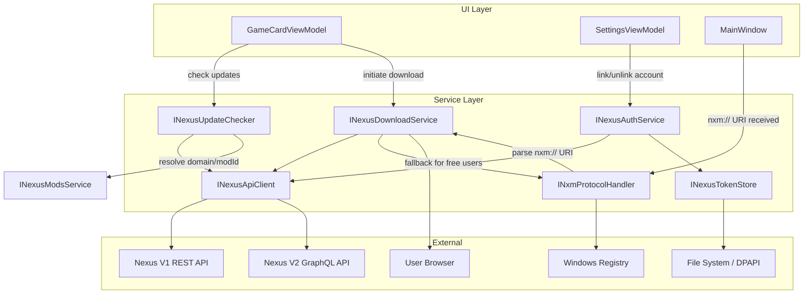
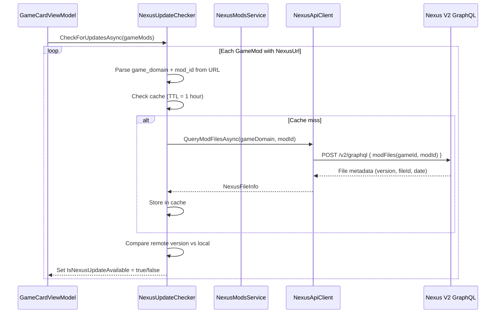
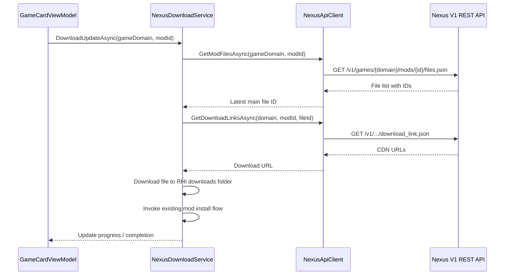

# Design Document: Nexus API Integration

## Overview

This design adds Nexus Mods API integration to RHI, enabling automatic mod update detection and download capabilities. The integration spans four concerns:

1. **Authentication** — API key validation (Phase 1) and OAuth 2.0 + PKCE (Phase 2), with DPAPI-encrypted token storage
2. **Update detection** — Resolving game domains/mod IDs from existing `GameMod.NexusUrl` and manifest overrides, then querying the V2 GraphQL API for latest file metadata
3. **Downloads** — Premium users get direct CDN downloads via V1 REST API; free users are guided through the `nxm://` protocol handler flow
4. **UI** — Update badges on game cards, download progress, and Settings panel for account linking

The system uses the V2 GraphQL API (`https://api.nexusmods.com/v2/graphql`) for metadata queries and the V1 REST API (`https://api.nexusmods.com/v1/`) for download link generation and user validation. Authentication tokens are stored encrypted in `%LocalAppData%\RHI\nexus_tokens.dat` using Windows DPAPI.

## Architecture

The integration follows the existing interface + implementation + DI pattern used throughout RHI. New services are registered as singletons in `App.xaml.cs` and injected where needed.



### Data Flow: Update Check



### Data Flow: Download (Premium)



## Components and Interfaces

### INexusTokenStore

Handles encrypted persistence of API keys and OAuth tokens using DPAPI.

```csharp
public interface INexusTokenStore
{
    /// <summary>Saves an API key or access token, encrypted with DPAPI.</summary>
    void SaveApiKey(string apiKey);

    /// <summary>Reads and decrypts the stored API key. Returns null if absent or corrupted.</summary>
    string? LoadApiKey();

    /// <summary>Saves OAuth tokens (access, refresh, expiry).</summary>
    void SaveOAuthTokens(string accessToken, string refreshToken, DateTimeOffset expiry);

    /// <summary>Loads OAuth tokens. Returns null if absent or corrupted.</summary>
    OAuthTokenData? LoadOAuthTokens();

    /// <summary>Deletes all stored tokens from disk.</summary>
    void ClearAll();

    /// <summary>Returns true if any valid token exists on disk.</summary>
    bool HasStoredToken();
}
```

### INexusAuthService

Manages authentication state, key validation, and (Phase 2) OAuth flow.

```csharp
public interface INexusAuthService
{
    /// <summary>Current user profile (null if not authenticated).</summary>
    NexusUserProfile? CurrentUser { get; }

    /// <summary>Whether the current user has premium status.</summary>
    bool IsPremium { get; }

    /// <summary>Whether any valid authentication exists.</summary>
    bool IsAuthenticated { get; }

    /// <summary>Validates a personal API key and stores it if valid.</summary>
    Task<bool> ValidateAndStoreApiKeyAsync(string apiKey);

    /// <summary>Re-validates the stored key at startup.</summary>
    Task<bool> RevalidateStoredKeyAsync();

    /// <summary>Clears all tokens and cached profile.</summary>
    void UnlinkAccount();

    /// <summary>Returns the current Bearer token for API calls.</summary>
    string? GetBearerToken();

    // Phase 2: OAuth
    /// <summary>Initiates OAuth 2.0 + PKCE flow.</summary>
    Task<bool> StartOAuthFlowAsync();

    /// <summary>Refreshes the access token if near expiry.</summary>
    Task<bool> RefreshTokenIfNeededAsync();
}
```

### INexusApiClient

Low-level HTTP client for Nexus Mods V1 REST and V2 GraphQL APIs. Handles auth headers, rate limit tracking, and error mapping.

```csharp
public interface INexusApiClient
{
    /// <summary>Validates an API key via GET /v1/users/validate.json.</summary>
    Task<NexusValidationResponse?> ValidateKeyAsync(string apiKey);

    /// <summary>Queries mod files via V2 GraphQL.</summary>
    Task<List<NexusFileInfo>> GetModFilesGraphQLAsync(string gameDomain, int modId);

    /// <summary>Gets file list via V1 REST (for identifying latest main file).</summary>
    Task<List<NexusFileInfo>> GetModFilesV1Async(string gameDomain, int modId);

    /// <summary>Gets CDN download links for a specific file (premium or nxm key+expires).</summary>
    Task<List<NexusDownloadLink>> GetDownloadLinksAsync(
        string gameDomain, int modId, int fileId,
        string? nxmKey = null, long? expires = null);

    /// <summary>Current daily API requests remaining.</summary>
    int DailyRequestsRemaining { get; }

    /// <summary>Whether the rate limit has been hit.</summary>
    bool IsRateLimited { get; }
}
```

### INexusUpdateChecker

Orchestrates update detection across all resolvable mods.

```csharp
public interface INexusUpdateChecker
{
    /// <summary>Checks all resolvable mods for updates. Updates GameCardViewModel properties.</summary>
    Task CheckAllAsync(IEnumerable<GameCardViewModel> cards, bool bypassCache = false);

    /// <summary>Checks a single mod for updates.</summary>
    Task<NexusUpdateResult?> CheckSingleAsync(string gameDomain, int modId);

    /// <summary>Clears the update cache.</summary>
    void ClearCache();
}
```

### INexusDownloadService

Handles downloading mod files for both premium and free users.

```csharp
public interface INexusDownloadService
{
    /// <summary>Downloads and installs a mod update. Chooses premium or free flow automatically.</summary>
    Task DownloadAndInstallAsync(
        GameCardViewModel card, string gameDomain, int modId,
        IProgress<double>? progress = null, CancellationToken ct = default);

    /// <summary>Processes an nxm:// URI received from the protocol handler.</summary>
    Task ProcessNxmUriAsync(NxmUri uri);
}
```

### INxmProtocolHandler

Manages nxm:// protocol registration and URI parsing.

```csharp
public interface INxmProtocolHandler
{
    /// <summary>Registers RHI as the nxm:// protocol handler in the Windows registry.</summary>
    bool Register();

    /// <summary>Removes the nxm:// protocol handler registration.</summary>
    bool Unregister();

    /// <summary>Returns true if RHI is currently registered as the nxm:// handler.</summary>
    bool IsRegistered();

    /// <summary>Parses an nxm:// URI string into a structured NxmUri object.</summary>
    NxmUri? Parse(string uri);

    /// <summary>Formats an NxmUri back into a URI string.</summary>
    string Format(NxmUri nxmUri);
}
```

### URL Parsing Utility

A static helper for extracting game domain and mod ID from Nexus URLs. Used by `INexusUpdateChecker` and the existing `INexusModsService`.

```csharp
public static class NexusUrlParser
{
    /// <summary>
    /// Parses a Nexus Mods URL into game domain and mod ID.
    /// Supports both formats:
    ///   https://www.nexusmods.com/{game_domain}/mods/{mod_id}
    ///   https://www.nexusmods.com/games/{game_domain}
    /// Returns null if the URL doesn't match either pattern.
    /// </summary>
    public static NexusModReference? Parse(string url);

    /// <summary>
    /// Formats a NexusModReference back into a canonical URL string.
    /// </summary>
    public static string Format(NexusModReference reference);
}
```

## Data Models

### NexusUserProfile

```csharp
public record NexusUserProfile(
    string Name,
    string Email,
    string ProfileUrl,
    bool IsPremium,
    bool IsSupporter
);
```

### NexusValidationResponse

Maps the JSON response from `GET /v1/users/validate.json`.

```csharp
public record NexusValidationResponse(
    string Name,
    string Email,
    string ProfileUrl,
    bool IsPremium,
    bool IsSupporter,
    string Key
);
```

### NexusFileInfo

Represents a file entry from the Nexus API (V1 or V2).

```csharp
public record NexusFileInfo(
    int FileId,
    string FileName,
    string Version,
    long SizeKb,
    string Category,       // "MAIN", "UPDATE", "OPTIONAL", etc.
    DateTimeOffset UploadedAt
);
```

### NexusDownloadLink

A CDN download URL returned by the V1 download link endpoint.

```csharp
public record NexusDownloadLink(
    string Name,           // CDN name (e.g., "Nexus CDN")
    string ShortName,      // e.g., "Nexus"
    string Uri             // The actual download URL
);
```

### NexusModReference

Parsed result from a Nexus Mods URL.

```csharp
public record NexusModReference(
    string GameDomain,
    int? ModId              // null for catalogue-only URLs (/games/{domain})
);
```

### NxmUri

Parsed result from an `nxm://` protocol URI.

```csharp
public record NxmUri(
    string GameDomain,
    int ModId,
    int FileId,
    string Key,
    long Expires
);
```

### OAuthTokenData

Stored OAuth token bundle.

```csharp
public record OAuthTokenData(
    string AccessToken,
    string RefreshToken,
    DateTimeOffset Expiry
);
```

### NexusUpdateResult

Result of an update check for a single mod.

```csharp
public record NexusUpdateResult(
    string GameDomain,
    int ModId,
    NexusFileInfo LatestFile,
    bool UpdateAvailable,
    DateTimeOffset CheckedAt
);
```

### GameCardViewModel Extensions

New observable properties added to `GameCardViewModel`:

```csharp
// In GameCardViewModel (new partial file: GameCardViewModel.Nexus.cs)
[ObservableProperty] private bool _isNexusUpdateAvailable;
[ObservableProperty] private bool _isNexusDownloading;
[ObservableProperty] private double _nexusDownloadProgress;
[ObservableProperty] private string _nexusActionMessage = "";
```


## Correctness Properties

*A property is a characteristic or behavior that should hold true across all valid executions of a system — essentially, a formal statement about what the system should do. Properties serve as the bridge between human-readable specifications and machine-verifiable correctness guarantees.*

### Property 1: Nexus URL parse round-trip

*For any* valid `NexusModReference` (a non-empty game domain string containing only lowercase alphanumeric characters, and an optional positive mod ID), formatting it into a URL string with `NexusUrlParser.Format` and then parsing it back with `NexusUrlParser.Parse` SHALL produce an equivalent `NexusModReference`.

**Validates: Requirements 2.1, 2.2, 2.4**

### Property 2: NXM URI parse round-trip

*For any* valid `NxmUri` (non-empty alphanumeric game domain, positive mod ID, positive file ID, non-empty alphanumeric key, positive expires timestamp), formatting it with `INxmProtocolHandler.Format` and then parsing it back with `INxmProtocolHandler.Parse` SHALL produce an equivalent `NxmUri` with all fields matching.

**Validates: Requirements 8.1, 8.2, 8.4, 6.3**

### Property 3: NXM URI parsing robustness

*For any* arbitrary string input, calling `INxmProtocolHandler.Parse` SHALL never throw an exception. It SHALL return a valid `NxmUri` for well-formed input or `null` for malformed input.

**Validates: Requirements 8.3**

### Property 4: NXM link expiry detection

*For any* pair of `DateTimeOffset` values (currentTime, expiresTime), the expiry check SHALL return expired=true if and only if `currentTime` is past the `expires` Unix timestamp. Equivalently: `isExpired == (currentTime.ToUnixTimeSeconds() >= expires)`.

**Validates: Requirements 6.6**

### Property 5: Token store encryption round-trip

*For any* non-empty string token, storing it via `INexusTokenStore.SaveApiKey` and then loading it via `INexusTokenStore.LoadApiKey` SHALL return the original token string unchanged.

**Validates: Requirements 9.1, 9.3**

### Property 6: PKCE code challenge correctness

*For any* code verifier string of length ≥ 43 composed of unreserved characters (A-Z, a-z, 0-9, `-._~`), the computed code challenge SHALL equal `Base64Url(SHA256(verifier))` with no padding.

**Validates: Requirements 11.1**

### Property 7: Token refresh threshold decision

*For any* pair of `DateTimeOffset` values (currentTime, tokenExpiry), the refresh decision SHALL return needsRefresh=true if and only if `tokenExpiry - currentTime <= TimeSpan.FromMinutes(5)`.

**Validates: Requirements 11.6**

### Property 8: Version comparison determines update availability

*For any* two non-empty version strings (localVersion, remoteVersion), the update checker SHALL report `updateAvailable = true` if and only if `localVersion != remoteVersion` (string inequality, since Nexus mod versions are free-form strings without guaranteed semver structure).

**Validates: Requirements 3.2**

### Property 9: Cache TTL decision

*For any* pair of `DateTime` values (lastCheckUtc, currentUtc) and a positive `TimeSpan` TTL, the cache SHALL report a hit if and only if `(currentUtc - lastCheckUtc) < TTL`.

**Validates: Requirements 3.4**

### Property 10: Rate limit header tracking

*For any* non-negative integer value received in the `X-RL-Daily-Remaining` response header, the `INexusApiClient.DailyRequestsRemaining` property SHALL equal that value, AND `IsRateLimited` SHALL be false when the value is > 0 after a successful response.

**Validates: Requirements 10.1, 10.2**

## Error Handling

### Authentication Errors

| Error | Handling |
|-------|----------|
| API key validation returns 401 | Display "Invalid API key" error in Settings. Do not store the key. |
| API key validation network failure | Display "Could not reach Nexus Mods" error. Retry on next app launch. |
| OAuth callback timeout (no code received within 2 minutes) | Cancel the listener, display "Authentication timed out" message. |
| OAuth token exchange failure | Display error, clear partial state, prompt user to retry. |
| Refresh token exchange failure (11.7) | Clear all stored tokens, set `IsAuthenticated = false`, prompt re-authentication. |
| DPAPI decryption failure (wrong user account, corrupted file) | Delete the token file, return null, prompt re-authentication. |

### API Errors

| Error | Handling |
|-------|----------|
| HTTP 429 (rate limited) | Set `IsRateLimited = true`, stop all non-essential API calls, notify user via Settings UI. |
| HTTP 403 on download link (non-premium) | Fall back to free-user nxm:// flow for that download. |
| HTTP 5xx (server error) | Log the error, skip the affected mod, continue with remaining mods. |
| Network timeout | Log warning, skip affected mod. Do not retry immediately — next scheduled check will retry. |
| GraphQL error response | Log the error details, skip the affected mod. |
| Malformed API response (JSON parse failure) | Log warning with response snippet, skip affected mod. |

### Protocol Handler Errors

| Error | Handling |
|-------|----------|
| Registry write fails (insufficient permissions) | Display message suggesting the user run as administrator. |
| Malformed nxm:// URI | Log the raw URI, discard silently (no crash). |
| Expired nxm:// key | Notify user the link has expired, prompt them to re-click on the Nexus website. |
| nxm:// URI for unknown game domain | Log warning, attempt download anyway (the API will return an error if invalid). |

### Download Errors

| Error | Handling |
|-------|----------|
| CDN download fails mid-transfer | Delete partial file, display error on game card, allow retry. |
| Disk full | Catch IOException, display "Insufficient disk space" message. |
| Install flow failure after download | Display error on game card. Downloaded file is retained for manual retry. |

## Testing Strategy

### Unit Tests (xUnit)

Unit tests cover specific examples, edge cases, and integration points:

- **NexusUrlParser**: Concrete URL examples for both formats, edge cases (trailing slashes, query strings, fragments, empty strings, null)
- **NxmProtocolHandler.Parse**: Concrete nxm:// URI examples, malformed URIs (missing segments, non-numeric IDs, missing query params)
- **NexusAuthService**: Mock HTTP client for validate/unlink flows, 401 handling, startup re-validation
- **NexusUpdateChecker**: Mock API client for update detection, cache bypass, rate limit handling
- **NexusDownloadService**: Mock API client for premium flow, 403 fallback to free flow, progress reporting
- **NexusTokenStore**: DPAPI round-trip with real encryption (Windows-only), corrupted file handling
- **GameCardViewModel.Nexus**: Badge visibility based on IsNexusUpdateAvailable and IsAuthenticated states

### Property-Based Tests (FsCheck.Xunit)

The project already uses FsCheck.Xunit. Each property test runs a minimum of 100 iterations and references its design document property.

| Property | Test Description | Tag |
|----------|-----------------|-----|
| Property 1 | Generate random NexusModReference, verify Format→Parse round-trip | `Feature: nexus-api-integration, Property 1: Nexus URL parse round-trip` |
| Property 2 | Generate random NxmUri, verify Format→Parse round-trip | `Feature: nexus-api-integration, Property 2: NXM URI parse round-trip` |
| Property 3 | Generate arbitrary strings, verify Parse never throws | `Feature: nexus-api-integration, Property 3: NXM URI parsing robustness` |
| Property 4 | Generate random (currentTime, expires) pairs, verify expiry logic | `Feature: nexus-api-integration, Property 4: NXM link expiry detection` |
| Property 5 | Generate random token strings, verify SaveApiKey→LoadApiKey round-trip | `Feature: nexus-api-integration, Property 5: Token store encryption round-trip` |
| Property 6 | Generate random PKCE verifiers, verify challenge == Base64Url(SHA256(verifier)) | `Feature: nexus-api-integration, Property 6: PKCE code challenge correctness` |
| Property 7 | Generate random (currentTime, tokenExpiry) pairs, verify refresh threshold | `Feature: nexus-api-integration, Property 7: Token refresh threshold decision` |
| Property 8 | Generate random version string pairs, verify update-available logic | `Feature: nexus-api-integration, Property 8: Version comparison determines update availability` |
| Property 9 | Generate random (lastCheck, current, TTL) triples, verify cache hit/miss | `Feature: nexus-api-integration, Property 9: Cache TTL decision` |
| Property 10 | Generate random non-negative integers, verify rate limit tracking | `Feature: nexus-api-integration, Property 10: Rate limit header tracking` |

### Integration Tests

Integration tests verify the wiring between components with mocked external dependencies:

- **Full update check flow**: Mock API client → NexusUpdateChecker → GameCardViewModel property updates
- **Full premium download flow**: Mock API client → NexusDownloadService → file download → install trigger
- **Full free-user flow**: Mock browser launch → nxm:// URI received → download → install
- **OAuth flow**: Mock browser + token endpoint → token storage → authenticated state

### Test Configuration

- Property tests: minimum 100 iterations per property (FsCheck default is 100, which meets this requirement)
- All tests run via `dotnet test` on the existing `RenoDXCommander.Tests` project
- Property tests use FsCheck.Xunit `[Property]` attribute
- Each property test includes a trait/comment referencing the design property number
