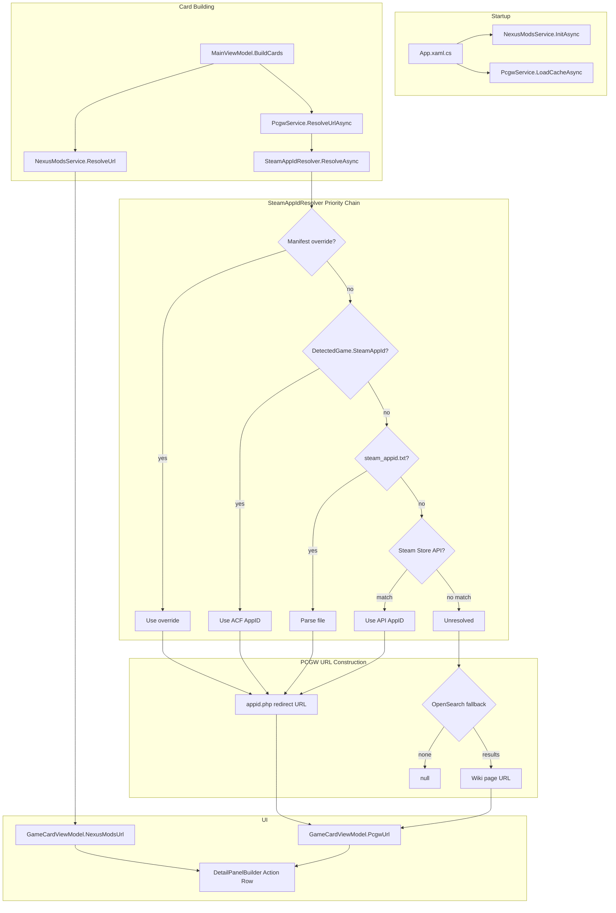
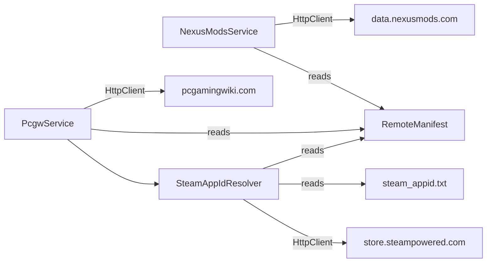

# Design Document: Nexus Mods & PCGamingWiki Integration

## Overview

This feature adds two external link integrations to RHI: Nexus Mods (mod browsing) and PCGamingWiki (game compatibility wiki). Both URLs are resolved automatically per detected game and displayed as clickable icons in a new action row on the detail panel.

The Nexus Mods integration fetches the public `games.json` catalogue, builds a normalized-name lookup dictionary, and matches detected games. The PCGW integration resolves Steam AppIDs through a multi-step priority chain, constructs redirect URLs, and falls back to OpenSearch for non-Steam games. Both services support manifest overrides for games where automatic resolution fails.

## Architecture



### Service Dependency Graph



## Components and Interfaces

### 1. NexusModsService

Responsible for fetching, caching, and querying the Nexus Mods game catalogue.

```csharp
public interface INexusModsService
{
    /// <summary>
    /// Fetches games.json (or loads from cache), builds the lookup dictionary.
    /// Called once at startup.
    /// </summary>
    Task InitAsync();

    /// <summary>
    /// Returns the Nexus Mods URL for a game, checking:
    /// 1. Manifest nexusUrlOverrides (highest priority)
    /// 2. Normalized-name dictionary lookup
    /// Returns null if no match.
    /// </summary>
    string? ResolveUrl(string gameName, RemoteManifest? manifest);
}
```


Implementation details:
- Constructor takes `HttpClient` (injected, same pattern as `ManifestService`)
- Cache file: `%LocalAppData%/RHI/nexus_games.json`
- Cache TTL: 24 hours (skip fetch if file is fresh)
- Dictionary key: `NormalizeName(entry.name)` → `entry.nexusmods_url`
- Uses the existing `GameDetectionService.NormalizeName` (extracted to a shared static helper or called via the service)

### 2. PcgwService

Responsible for resolving PCGW URLs via Steam AppID or OpenSearch fallback.

```csharp
public interface IPcgwService
{
    /// <summary>
    /// Loads the AppID cache from disk. Called once at startup.
    /// </summary>
    Task LoadCacheAsync();

    /// <summary>
    /// Resolves the PCGW URL for a game, checking:
    /// 1. Manifest pcgwUrlOverrides (highest priority)
    /// 2. Steam AppID → appid.php redirect URL
    /// 3. OpenSearch fallback (for games with no AppID)
    /// Returns null if unresolvable.
    /// </summary>
    Task<string?> ResolveUrlAsync(string gameName, int? steamAppId, string installPath, RemoteManifest? manifest);
}
```

Implementation details:
- Constructor takes `HttpClient`, `SteamAppIdResolver`
- AppID cache file: `%LocalAppData%/RHI/steam_appid_cache.json` (JSON dict: normalized name → int)
- PCGW URL from AppID: `https://www.pcgamingwiki.com/api/appid.php?appid={appId}`
- OpenSearch URL: `https://www.pcgamingwiki.com/w/api.php?action=opensearch&search={name}&limit=5&format=json`
- OpenSearch result URL: `https://www.pcgamingwiki.com/wiki/{pageTitle}` (spaces → underscores)

### 3. SteamAppIdResolver

Encapsulates the 5-step Steam AppID resolution priority chain.

```csharp
public interface ISteamAppIdResolver
{
    /// <summary>
    /// Resolves a Steam AppID for a game through the priority chain:
    /// 1. Manifest steamAppIdOverrides
    /// 2. DetectedGame.SteamAppId (from ACF parsing)
    /// 3. steam_appid.txt in install directory
    /// 4. Steam Store search API (rate-limited to 1 req/sec)
    /// 5. Unresolved (returns null)
    /// </summary>
    Task<int?> ResolveAsync(string gameName, int? detectedAppId, string installPath, RemoteManifest? manifest);
}
```

Implementation details:
- Constructor takes `HttpClient`
- `steam_appid.txt` parsing: read first line, `int.TryParse`
- Steam Store search: `https://store.steampowered.com/api/storesearch/?term={name}&l=english&cc=US`
- Rate limiting: `SemaphoreSlim` + `Task.Delay(1000)` between requests
- Normalize-compare search results against game name using `NormalizeName`

### 4. Model Changes

#### DetectedGame — new field

```csharp
public class DetectedGame
{
    // ... existing fields ...
    public int? SteamAppId { get; set; }
}
```

#### RemoteManifest — new fields

```csharp
// Add to RemoteManifest.cs:
[JsonPropertyName("nexusUrlOverrides")]
public Dictionary<string, string>? NexusUrlOverrides { get; set; }

[JsonPropertyName("steamAppIdOverrides")]
public Dictionary<string, int>? SteamAppIdOverrides { get; set; }

[JsonPropertyName("pcgwUrlOverrides")]
public Dictionary<string, string>? PcgwUrlOverrides { get; set; }
```

#### GameCardViewModel — new properties

```csharp
// Observable properties (set during card building)
[ObservableProperty] private string? _nexusModsUrl;
[ObservableProperty] private string? _pcgwUrl;

// Computed properties
public bool HasNexusModsUrl => !string.IsNullOrEmpty(NexusModsUrl);
public bool HasPcgwUrl      => !string.IsNullOrEmpty(PcgwUrl);
```

Note: The existing `NexusUrl` property on `GameCardViewModel` is used for per-mod Nexus links (set from wiki data). The new `NexusModsUrl` is the game-level Nexus Mods page URL resolved from `games.json`. These are distinct — `NexusUrl` links to a specific mod page, `NexusModsUrl` links to the game's mod catalogue.

### 5. DetailPanelBuilder — Action Row

The current title row contains the game name plus action icons (favourite, browse, hide, info, discussion). This design relocates all action icons to a new dedicated row below the badges row, and adds PCGW and Nexus Mods icons.

Action row icon order (left to right):
1. ⭐ Favourite star
2. 📁 Browse folder
3. 🚫 Hide
4. 🔗 PCGW link (conditional: `HasPcgwUrl`)
5. 🔗 Nexus Mods link (conditional: `HasNexusModsUrl`)
6. ℹ️ Info/notes (conditional: `HasNotes`)
7. 💬 Discussion link (conditional: `HasNameUrl`)

The action row is built programmatically in `DetailPanelBuilder.PopulateDetailPanel()` as a `StackPanel` with `Orientation.Horizontal`, inserted after the badges row.

### 6. Integration Flow

During `MainViewModel.BuildCards()`:

```
1. NexusModsService.InitAsync() — called once at startup (before BuildCards)
2. PcgwService.LoadCacheAsync() — called once at startup (before BuildCards)
3. For each detected game:
   a. card.NexusModsUrl = nexusModsService.ResolveUrl(game.Name, manifest)
   b. card.PcgwUrl = await pcgwService.ResolveUrlAsync(
        game.Name, game.SteamAppId, game.InstallPath, manifest)
4. DetailPanelBuilder renders action row with conditional icon visibility
```

### 7. ACF AppID Extraction

In `GameDetectionService.FindSteamGames()`, extract the AppID from the ACF filename:

```csharp
// Current: parses name and installdir from ACF content
// New: also extract AppID from filename pattern appmanifest_<APPID>.acf
var fileName = Path.GetFileNameWithoutExtension(acf); // "appmanifest_601150"
if (fileName.StartsWith("appmanifest_") 
    && int.TryParse(fileName["appmanifest_".Length..], out var appId))
{
    game.SteamAppId = appId;
}
```

## Data Models

### NexusModsGame (deserialization model)

```csharp
public class NexusModsGame
{
    [JsonPropertyName("name")]
    public string Name { get; set; } = "";

    [JsonPropertyName("nexusmods_url")]
    public string NexusmodsUrl { get; set; } = "";
}
```

### Steam Store Search Response (deserialization model)

```csharp
public class SteamStoreSearchResponse
{
    [JsonPropertyName("total")]
    public int Total { get; set; }

    [JsonPropertyName("items")]
    public List<SteamStoreSearchItem> Items { get; set; } = new();
}

public class SteamStoreSearchItem
{
    [JsonPropertyName("id")]
    public int Id { get; set; }

    [JsonPropertyName("name")]
    public string Name { get; set; } = "";
}
```

### AppID Cache (JSON on disk)

```json
{
  "devilmaycry5": 601150,
  "eldenring": 1245620,
  "cyberpunk2077": 1091500
}
```

Keys are normalized game names. Values are integer Steam AppIDs.

### Manifest Override Examples

```json
{
  "nexusUrlOverrides": {
    "STAR WARS Jedi: Survivor": "https://www.nexusmods.com/starwarsjedisurvivortm"
  },
  "steamAppIdOverrides": {
    "Some Weird Game Title": 123456
  },
  "pcgwUrlOverrides": {
    "Game With Wrong Wiki Page": "https://www.pcgamingwiki.com/wiki/Correct_Page_Name"
  }
}
```


## Correctness Properties

*A property is a characteristic or behavior that should hold true across all valid executions of a system — essentially, a formal statement about what the system should do. Properties serve as the bridge between human-readable specifications and machine-verifiable correctness guarantees.*

### Property 1: Nexus dictionary round-trip

*For any* list of `NexusModsGame` entries with distinct normalized names, building the lookup dictionary and then querying it with `NormalizeName(entry.Name)` for each entry SHALL return the corresponding `nexusmods_url`.

**Validates: Requirements 1.6, 1.7, 2.1**

### Property 2: Nexus URL resolution priority

*For any* game name, manifest `nexusUrlOverrides` dictionary, and Nexus lookup dictionary:
- If the game name exists in `nexusUrlOverrides`, the override URL SHALL be returned regardless of dictionary contents.
- Else if `NormalizeName(gameName)` exists in the lookup dictionary, the dictionary URL SHALL be returned.
- Else null SHALL be returned.

**Validates: Requirements 2.3, 2.4, 2.5, 3.3**

### Property 3: ACF filename AppID extraction round-trip

*For any* positive integer `n`, constructing the filename `appmanifest_{n}.acf` and extracting the AppID SHALL yield `n`. *For any* string that does not match the pattern `appmanifest_<digits>.acf`, extraction SHALL yield null.

**Validates: Requirements 4.1, 4.2, 4.3**

### Property 4: Steam AppID resolution priority chain

*For any* game name, manifest `steamAppIdOverrides`, `DetectedGame.SteamAppId`, and AppID cache:
- If the game name exists in `steamAppIdOverrides`, the override AppID SHALL be returned.
- Else if the AppID cache contains the normalized game name, the cached AppID SHALL be returned.
- Else if `DetectedGame.SteamAppId` is non-null, that AppID SHALL be returned.
- Each step SHALL short-circuit (skip subsequent steps).

**Validates: Requirements 5.1, 5.2, 5a.3, 6.3**

### Property 5: Normalize-compare search result matching

*For any* game name and list of `SteamStoreSearchItem` results, the resolver SHALL return the `Id` of the first item whose `NormalizeName(item.Name)` equals `NormalizeName(gameName)`, or null if no item matches.

**Validates: Requirements 5.5, 5.6**

### Property 6: PCGW URL construction

*For any* positive integer AppID, the constructed URL SHALL equal `https://www.pcgamingwiki.com/api/appid.php?appid={appId}`. *For any* non-empty page title string, the constructed URL SHALL equal `https://www.pcgamingwiki.com/wiki/{title}` where spaces in the title are replaced by underscores.

**Validates: Requirements 7.2, 7.4**

### Property 7: PCGW URL resolution priority

*For any* game name, manifest `pcgwUrlOverrides` dictionary, and resolved Steam AppID:
- If the game name exists in `pcgwUrlOverrides`, the override URL SHALL be returned regardless of AppID availability.
- Else if a Steam AppID is available, the `appid.php` URL SHALL be returned.
- Else the OpenSearch fallback SHALL be attempted.

**Validates: Requirements 7.1, 7a.3**

### Property 8: HasNexusModsUrl and HasPcgwUrl computed properties

*For any* `GameCardViewModel` instance and any nullable string value assigned to `NexusModsUrl` (or `PcgwUrl`), `HasNexusModsUrl` (or `HasPcgwUrl`) SHALL equal `!string.IsNullOrEmpty(value)`.

**Validates: Requirements 8.3, 8.4**

### Property 9: Manifest new fields serialization round-trip

*For any* `RemoteManifest` with arbitrary `nexusUrlOverrides` (Dictionary<string,string>), `steamAppIdOverrides` (Dictionary<string,int>), and `pcgwUrlOverrides` (Dictionary<string,string>), serializing to JSON and deserializing SHALL produce an equivalent manifest with identical override dictionaries.

**Validates: Requirements 3.1, 5a.1, 7a.1**

### Property 10: Cache TTL decision

*For any* `DateTime` representing the cache file's last-write time and a current `DateTime`, the service SHALL skip the network fetch if and only if `(current - lastWrite) < TimeSpan.FromHours(24)`.

**Validates: Requirements 1.5**

## Error Handling

| Scenario | Behaviour |
|---|---|
| `games.json` fetch fails, cache exists | Load from cache, log warning |
| `games.json` fetch fails, no cache | Log error, all Nexus lookups return null |
| `games.json` contains malformed JSON | Log error, treat as fetch failure |
| Steam Store API returns non-200 | Log warning, skip to unresolved |
| Steam Store API returns malformed JSON | Log warning, skip to unresolved |
| Steam Store API rate limit exceeded | `SemaphoreSlim` ensures max 1 req/sec; if 429 received, log and skip |
| PCGW OpenSearch returns non-200 | Log warning, PCGW URL remains null |
| PCGW OpenSearch returns malformed JSON | Log warning, PCGW URL remains null |
| `steam_appid.txt` contains non-integer | Log warning, skip to next resolution step |
| `steam_appid.txt` is empty | Treated as unparseable, skip to next step |
| AppID cache file is corrupt | Log warning, start with empty cache |
| Manifest override fields are null | Treated as empty dictionaries (null-coalescing) |
| `NormalizeName` returns empty string | Skip lookup (no match possible) |
| Network timeout on any HTTP request | `HttpClient` timeout (default 30s), caught and logged |

All errors are non-fatal — the app continues without the affected link. Errors are logged via the existing `CrashReporter.Log()` pattern.

## Testing Strategy

### Property-Based Tests (FsCheck.Xunit)

Each correctness property maps to one property-based test class. Minimum 100 iterations per test.

| Test Class | Property | Tag |
|---|---|---|
| `NexusDictionaryRoundTripPropertyTests` | P1 | Feature: nexus-pcgw-integration, Property 1: Nexus dictionary round-trip |
| `NexusUrlResolutionPriorityPropertyTests` | P2 | Feature: nexus-pcgw-integration, Property 2: Nexus URL resolution priority |
| `AcfAppIdExtractionPropertyTests` | P3 | Feature: nexus-pcgw-integration, Property 3: ACF filename AppID extraction round-trip |
| `SteamAppIdPriorityPropertyTests` | P4 | Feature: nexus-pcgw-integration, Property 4: Steam AppID resolution priority chain |
| `NormalizeCompareSearchPropertyTests` | P5 | Feature: nexus-pcgw-integration, Property 5: Normalize-compare search result matching |
| `PcgwUrlConstructionPropertyTests` | P6 | Feature: nexus-pcgw-integration, Property 6: PCGW URL construction |
| `PcgwUrlResolutionPriorityPropertyTests` | P7 | Feature: nexus-pcgw-integration, Property 7: PCGW URL resolution priority |
| `LinkVisibilityPropertyTests` | P8 | Feature: nexus-pcgw-integration, Property 8: HasNexusModsUrl and HasPcgwUrl computed properties |
| `ManifestOverrideRoundTripPropertyTests` | P9 | Feature: nexus-pcgw-integration, Property 9: Manifest new fields serialization round-trip |
| `CacheTtlDecisionPropertyTests` | P10 | Feature: nexus-pcgw-integration, Property 10: Cache TTL decision |

### Unit Tests (Example-Based)

- `NexusModsService` fallback to cache on fetch failure (Req 1.3)
- `NexusModsService` graceful degradation with no cache (Req 1.4)
- `NexusModsService` null override field treated as empty (Req 3.2)
- `SteamAppIdResolver` null override field treated as empty (Req 5a.2)
- `PcgwService` null override field treated as empty (Req 7a.2)
- `PcgwService` OpenSearch empty results returns null (Req 7.5)

### Integration Tests

- End-to-end: `NexusModsService.InitAsync()` with real HTTP (optional, CI-gated)
- `SteamAppIdResolver` rate limiting verification
- AppID cache persistence round-trip (write then read from disk)

### Manual / Visual Tests

- Action row layout and icon ordering (Req 9.1–9.3)
- PCGW and Nexus icons open correct URLs in browser (Req 9.6, 9.7)
- Relocated icons preserve existing behaviour (Req 9.8)
