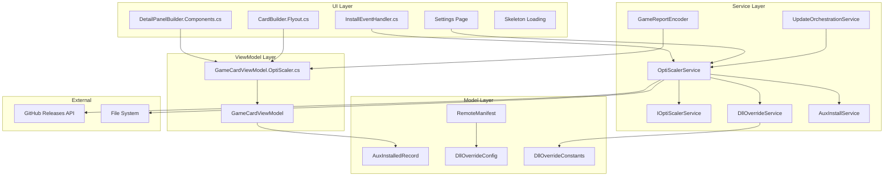
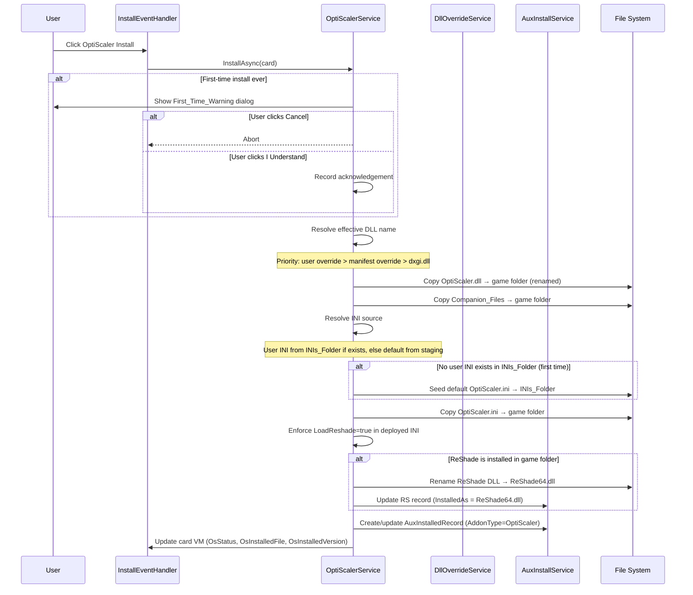
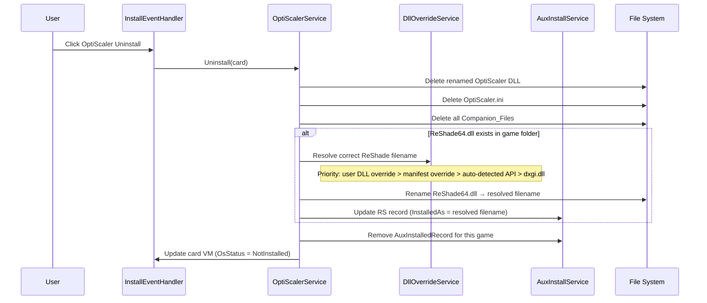
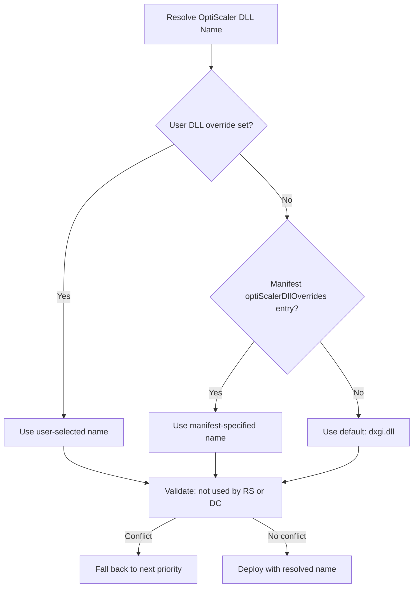
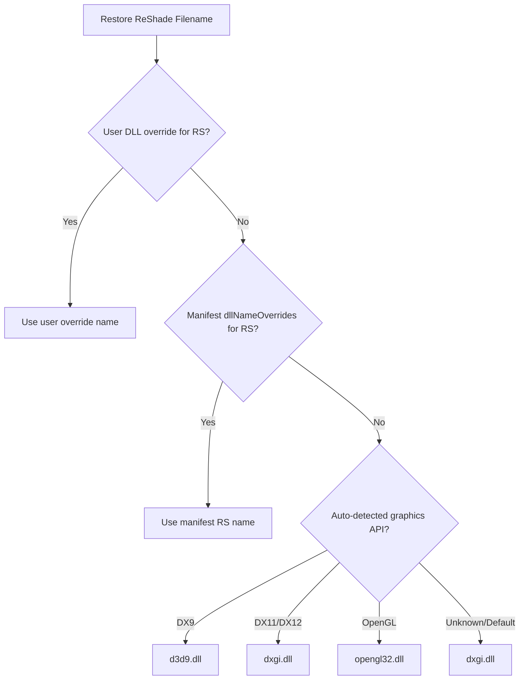
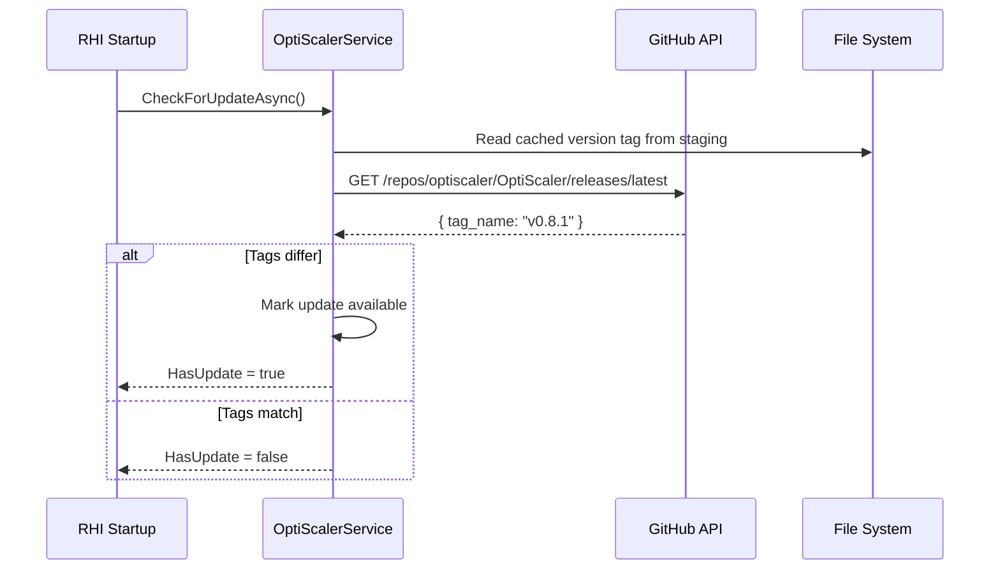
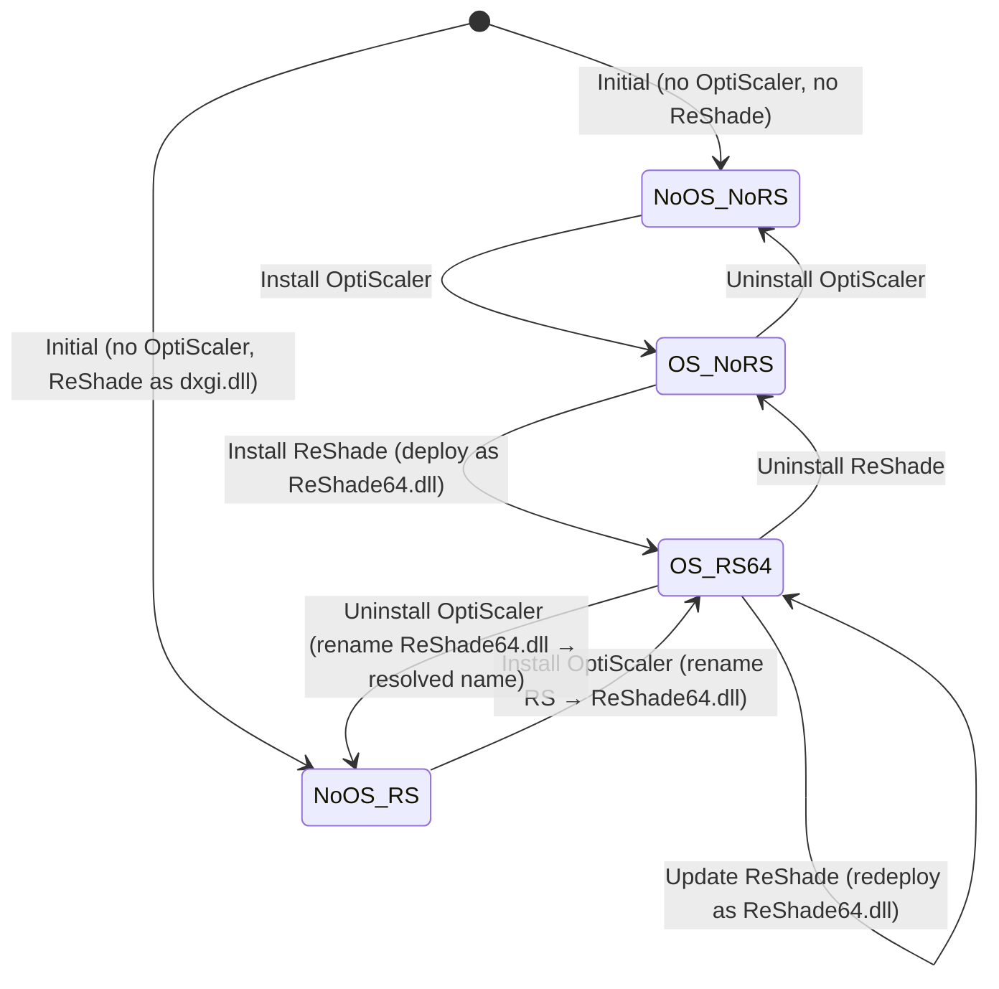

# Design Document: OptiScaler Integration

## Overview

This design describes the integration of OptiScaler as a fully managed component in RHI (RenoDX HDR Installer / RenoDXCommander). OptiScaler is a 64-bit middleware DLL that intercepts upscaler calls (DLSS, FSR, XeSS) and redirects them to alternative backends. RHI will manage the complete lifecycle: download, staging, install, uninstall, update detection, INI configuration, ReShade coexistence, DLL naming overrides, hotkey configuration, and per-game tracking.

The integration follows the established patterns used by ReLimiter (UL) and Display Commander (DC): an `IOptiScalerService` interface with an `OptiScalerService` implementation, DI registration, `CrashReporter.Log()` for diagnostics, `AuxInstalledRecord` for per-game tracking, and a partial `GameCardViewModel` file for computed properties.

### Key Design Decisions

| Decision | Choice | Rationale |
|---|---|---|
| Architecture only | 64-bit | OptiScaler has no 32-bit build; 32-bit games get a greyed-out row |
| Default DLL name | `dxgi.dll` | Most common proxy DLL for DirectX games |
| INI filename | `OptiScaler.ini` (exact) | OptiScaler hardcodes this name |
| LoadReshade setting | Always `true` | Ensures ReShade is loaded via OptiScaler regardless of install order |
| ReShade coexistence | Rename to `ReShade64.dll` | OptiScaler loads ReShade by this exact filename |
| Staging folder | `%LOCALAPPDATA%\RHI\optiscaler\` | Consistent with existing RHI staging pattern |
| INI template | `%LOCALAPPDATA%\RHI\inis\OptiScaler.ini` | Consistent with existing INI template pattern |
| Hotkey INI key | `ShortcutKey=` | OptiScaler's overlay toggle key |
| Default hotkey | `Insert` | OptiScaler's built-in default |
| Release source | GitHub releases API | `https://github.com/optiscaler/OptiScaler/releases` |
| Archive format | 7z (~53 MB) | Existing 7z extraction infrastructure in RHI |
| Companion files | `fakenvapi.dll`, `dlssg_to_fsr3.dll`, FFX SDK DLLs | Required for full OptiScaler functionality |

## Architecture

### High-Level Component Diagram



### Install Flow



### Uninstall Flow



### DLL Naming Resolution Priority Chain



### ReShade Filename Restoration Priority (on OptiScaler Uninstall)



### Update Detection Flow



### ReShade Coexistence State Machine



## Components and Interfaces

### IOptiScalerService Interface

```csharp
namespace RenoDXCommander.Services;

/// <summary>
/// Manages OptiScaler lifecycle: download, staging, install, uninstall,
/// update detection, INI management, and ReShade coexistence.
/// </summary>
public interface IOptiScalerService
{
    /// <summary>Whether the staging folder contains a valid OptiScaler release.</summary>
    bool IsStagingReady { get; }

    /// <summary>Whether a newer OptiScaler release is available on GitHub.</summary>
    bool HasUpdate { get; }

    /// <summary>The currently staged version tag (e.g. "v0.8.1"), or null.</summary>
    string? StagedVersion { get; }

    /// <summary>
    /// Downloads and extracts the latest OptiScaler release to the staging folder.
    /// No-op if staging is already valid and up to date.
    /// </summary>
    Task EnsureStagingAsync(IProgress<(string message, double percent)>? progress = null);

    /// <summary>
    /// Checks the GitHub releases API for a newer version than the staged one.
    /// Sets HasUpdate accordingly.
    /// </summary>
    Task CheckForUpdateAsync();

    /// <summary>
    /// Installs OptiScaler to the specified game folder.
    /// Handles first-time warning, DLL naming, INI seeding, LoadReshade enforcement,
    /// companion file deployment, and ReShade coexistence.
    /// </summary>
    Task<AuxInstalledRecord?> InstallAsync(
        GameCardViewModel card,
        IProgress<(string message, double percent)>? progress = null);

    /// <summary>
    /// Uninstalls OptiScaler from the specified game folder.
    /// Removes DLL, INI, companion files, restores ReShade filename, removes tracking record.
    /// </summary>
    void Uninstall(GameCardViewModel card);

    /// <summary>
    /// Updates OptiScaler in a game folder: replaces DLL and companions, preserves INI.
    /// </summary>
    Task UpdateAsync(
        GameCardViewModel card,
        IProgress<(string message, double percent)>? progress = null);

    /// <summary>
    /// Copies OptiScaler.ini from the INIs_Folder to the game folder,
    /// enforcing LoadReshade=true.
    /// </summary>
    void CopyIniToGame(GameCardViewModel card);

    /// <summary>
    /// Detects whether OptiScaler is installed in a game folder by checking
    /// binary signatures and OptiScaler.ini presence.
    /// Returns the detected DLL filename, or null if not found.
    /// </summary>
    string? DetectInstallation(string installPath);

    /// <summary>
    /// Returns true if the given DLL file contains OptiScaler binary signatures.
    /// Used by both detection and foreign DLL protection.
    /// </summary>
    bool IsOptiScalerFile(string filePath);

    /// <summary>
    /// Loads all persisted OptiScaler AuxInstalledRecords from disk.
    /// </summary>
    List<AuxInstalledRecord> LoadAllRecords();

    /// <summary>
    /// Finds the OptiScaler tracking record for a specific game.
    /// </summary>
    AuxInstalledRecord? FindRecord(string gameName, string installPath);

    /// <summary>
    /// Removes the staging folder contents (called from Settings cache clear).
    /// </summary>
    void ClearStaging();

    /// <summary>
    /// Resolves the effective OptiScaler DLL filename for a game,
    /// following the priority chain: user override > manifest override > dxgi.dll.
    /// </summary>
    string GetEffectiveOsDllName(string gameName);

    /// <summary>
    /// Writes the ShortcutKey= value to the OptiScaler.ini in the INIs_Folder.
    /// </summary>
    void SetHotkey(string hotkeyValue);

    /// <summary>
    /// Updates ShortcutKey= in all game folders where OptiScaler is installed.
    /// </summary>
    void ApplyHotkeyToAllGames(string hotkeyValue);

    /// <summary>
    /// Whether the first-time warning has been acknowledged.
    /// </summary>
    bool FirstTimeWarningAcknowledged { get; set; }
}
```

### OptiScalerService Implementation (Key Members)

```csharp
namespace RenoDXCommander.Services;

public class OptiScalerService : IOptiScalerService
{
    // ── Constants ─────────────────────────────────────────────────────────────
    public const string DefaultDllName = "dxgi.dll";
    public const string IniFileName = "OptiScaler.ini";
    public const string ReShadeCoexistName = "ReShade64.dll";
    public const string AddonType = "OptiScaler";

    public static readonly string[] SupportedDllNames =
    [
        "dxgi.dll", "winmm.dll", "d3d12.dll", "dbghelp.dll",
        "version.dll", "wininet.dll", "winhttp.dll"
    ];

    public static readonly string[] CompanionFiles =
    [
        "fakenvapi.dll",
        "dlssg_to_fsr3.dll",
        // FFX SDK DLLs (exact names resolved from staging folder at runtime)
    ];

    private static readonly string StagingDir = Path.Combine(
        Environment.GetFolderPath(Environment.SpecialFolder.LocalApplicationData),
        "RHI", "optiscaler");

    private static readonly string VersionFilePath = Path.Combine(StagingDir, "version.txt");

    public static readonly string OsIniPath = Path.Combine(
        AuxInstallService.InisDir, IniFileName);

    private static readonly string GitHubReleasesApi =
        "https://api.github.com/repos/optiscaler/OptiScaler/releases/latest";

    // ── Binary signature markers ──────────────────────────────────────────────
    // Unique strings embedded in OptiScaler.dll that distinguish it from ReShade
    // and other proxy DLLs. Checked via binary scan of the first ~2 MB.
    private static readonly byte[][] OptiScalerSignatures =
    [
        System.Text.Encoding.ASCII.GetBytes("OptiScaler"),
        // Additional unique markers TBD from actual binary analysis
    ];

    // ── Dependencies (injected via DI) ────────────────────────────────────────
    private readonly HttpClient _http;
    private readonly IAuxInstallService _auxInstaller;
    private readonly IDllOverrideService _dllOverrideService;

    public OptiScalerService(
        HttpClient http,
        IAuxInstallService auxInstaller,
        IDllOverrideService dllOverrideService)
    {
        _http = http;
        _auxInstaller = auxInstaller;
        _dllOverrideService = dllOverrideService;
    }

    // Implementation follows the same patterns as AuxInstallService:
    // - CrashReporter.Log() for all error paths
    // - AuxInstalledRecord for per-game tracking (AddonType = "OptiScaler")
    // - JSON persistence via the existing aux_installed.json database
    // - 7z extraction using the bundled 7z.exe
}
```

### DllOverrideConfig Extension

The existing `DllOverrideConfig` model gains an OptiScaler field:

```csharp
namespace RenoDXCommander.Models;

public class DllOverrideConfig
{
    public string ReShadeFileName { get; set; } = "";
    public string DcFileName { get; set; } = "";
    public string OsFileName { get; set; } = "";  // NEW: OptiScaler DLL name override
}
```

### DllOverrideService Extensions

New methods added to `IDllOverrideService` and `DllOverrideService`:

```csharp
// New methods on IDllOverrideService / DllOverrideService:

/// <summary>
/// Returns the effective OptiScaler DLL filename for a game.
/// Priority: user override > manifest override > default (dxgi.dll).
/// </summary>
public string GetEffectiveOsName(string gameName)
{
    var cfg = GetDllOverride(gameName);
    if (cfg != null && !string.IsNullOrWhiteSpace(cfg.OsFileName))
        return cfg.OsFileName;

    // Check manifest override
    if (_manifestOsDllOverrides.TryGetValue(gameName, out var manifestName)
        && !string.IsNullOrWhiteSpace(manifestName))
        return manifestName;

    return OptiScalerService.DefaultDllName;
}

/// <summary>
/// Returns the supported OptiScaler DLL names filtered to exclude
/// names currently used by ReShade or Display Commander for the same game.
/// </summary>
public string[] GetAvailableOsDllNames(string gameName, bool is32Bit)
{
    var rsName = GetEffectiveRsName(gameName);
    var dcName = GetEffectiveDcName(gameName, is32Bit);
    return OptiScalerService.SupportedDllNames
        .Where(n => !n.Equals(rsName, StringComparison.OrdinalIgnoreCase)
                  && !n.Equals(dcName, StringComparison.OrdinalIgnoreCase))
        .ToArray();
}
```

### RemoteManifest Extension

```csharp
// New field on RemoteManifest:

/// <summary>
/// Per-game OptiScaler DLL filename overrides. When a game requires a specific
/// proxy DLL name for OptiScaler (e.g. games where dxgi.dll conflicts with
/// another tool), this provides a direct mapping.
/// Key = game name, Value = DLL filename string (e.g. "winmm.dll").
/// </summary>
[JsonPropertyName("optiScalerDllOverrides")]
public Dictionary<string, string>? OptiScalerDllOverrides { get; set; }
```

### ManifestDllNames Extension

```csharp
// Extended ManifestDllNames (optional — if per-game overrides are bundled
// into the existing dllNameOverrides structure instead of a separate field):

public class ManifestDllNames
{
    [JsonPropertyName("reshade")]
    public string? ReShade { get; set; }

    [JsonPropertyName("dc")]
    public string? Dc { get; set; }

    [JsonPropertyName("optiscaler")]
    public string? OptiScaler { get; set; }  // NEW
}
```

**Design decision:** A separate `optiScalerDllOverrides` top-level field on `RemoteManifest` is preferred over extending `ManifestDllNames`, because OptiScaler overrides are independent of the RS/DC override system and may be managed by different maintainers. Both approaches are shown; the implementation should use the top-level field.


## Data Models

### AuxInstalledRecord Usage for OptiScaler

OptiScaler reuses the existing `AuxInstalledRecord` model with `AddonType = "OptiScaler"`:

```csharp
// Example record for an OptiScaler installation:
new AuxInstalledRecord
{
    GameName    = "Cyberpunk 2077",
    InstallPath = @"C:\Games\Cyberpunk 2077\bin\x64",
    AddonType   = "OptiScaler",           // Distinguishes from "ReShade", "DisplayCommander"
    InstalledAs = "dxgi.dll",             // The DLL filename used on disk
    SourceUrl   = "https://github.com/optiscaler/OptiScaler/releases/...",
    RemoteFileSize = 55_000_000,          // For update detection
    InstalledAt = DateTime.UtcNow
}
```

Records are persisted in the existing `%LOCALAPPDATA%\RHI\aux_installed.json` database alongside ReShade and Display Commander records. The `AddonType` field discriminates between component types.

### OptiScaler Staging Layout

```
%LOCALAPPDATA%\RHI\optiscaler\
├── version.txt                    # Contains the release tag (e.g. "v0.8.1")
├── OptiScaler.dll                 # Main DLL (renamed during install)
├── OptiScaler.ini                 # Default INI template
├── fakenvapi.dll                  # Companion: fake NVIDIA API
├── dlssg_to_fsr3.dll              # Companion: DLSS-G to FSR3 bridge
└── ffx_*.dll                      # Companion: FFX SDK runtime DLLs
```

### INI Template Layout

```
%LOCALAPPDATA%\RHI\inis\
├── reshade.ini                    # Existing: ReShade INI template
├── reshade.vulkan.ini             # Existing: ReShade Vulkan INI template
├── ReShadePreset.ini              # Existing: ReShade preset template
├── relimiter.ini                  # Existing: ReLimiter INI template
├── DisplayCommander.ini           # Existing: Display Commander INI template
└── OptiScaler.ini                 # NEW: OptiScaler INI template
```

### Game Folder Layout (After OptiScaler Install)

```
<game_folder>/
├── dxgi.dll                       # OptiScaler.dll renamed (or other supported name)
├── OptiScaler.ini                 # OptiScaler configuration (LoadReshade=true)
├── ReShade64.dll                  # ReShade (renamed from original DLL name)
├── reshade.ini                    # ReShade configuration (unchanged)
├── fakenvapi.dll                  # Companion file
├── dlssg_to_fsr3.dll              # Companion file
├── ffx_*.dll                      # FFX SDK companion files
└── <other game files>
```

### GameCardViewModel OptiScaler State

New observable and computed properties added via `GameCardViewModel.OptiScaler.cs`:

```csharp
namespace RenoDXCommander.ViewModels;

// OptiScaler status, install state, and computed properties
public partial class GameCardViewModel
{
    // ── Observable properties ──────────────────────────────────────────────────
    [ObservableProperty] private GameStatus _osStatus = GameStatus.NotInstalled;
    [ObservableProperty] private bool       _osIsInstalling;
    [ObservableProperty] private double     _osProgress;
    [ObservableProperty] private string     _osActionMessage = "";
    [ObservableProperty] private string?    _osInstalledFile;
    [ObservableProperty] private string?    _osInstalledVersion;

    // Per-game update exclusion
    public bool ExcludeFromUpdateAllOs { get; set; }

    // ── Computed properties ───────────────────────────────────────────────────

    /// <summary>Per-component status dot for OptiScaler.</summary>
    public string OsStatusDot => OsStatus == GameStatus.UpdateAvailable ? "🟢"
        : OsStatus == GameStatus.Installed ? "🟢" : "⚪";

    public string OsActionLabel => OsIsInstalling ? "Installing..."
        : OsStatus == GameStatus.UpdateAvailable ? "⬆  Update OptiScaler"
        : OsStatus == GameStatus.Installed ? "↺  Reinstall OptiScaler"
        : "⬇  Install OptiScaler";

    public string OsBtnBackground  => OsStatus == GameStatus.UpdateAvailable ? "#201838" : "#182840";
    public string OsBtnForeground  => OsStatus == GameStatus.UpdateAvailable ? "#B898E8" : "#7AACDD";
    public string OsBtnBorderBrush => OsStatus == GameStatus.UpdateAvailable ? "#3A2860" : "#2A4468";

    public Visibility OsProgressVisibility => OsIsInstalling ? Visibility.Visible : Visibility.Collapsed;
    public Visibility OsMessageVisibility  => string.IsNullOrEmpty(OsActionMessage)
        ? Visibility.Collapsed : Visibility.Visible;
    public Visibility OsDeleteVisibility   => OsStatus == GameStatus.Installed
        || OsStatus == GameStatus.UpdateAvailable ? Visibility.Visible : Visibility.Collapsed;

    public string OsStatusText => OsIsInstalling ? "Installing…"
        : OsStatus == GameStatus.UpdateAvailable ? "Update"
        : OsStatus == GameStatus.Installed ? (OsInstalledVersion ?? "Installed")
        : "Ready";
    public string OsStatusColor => OsIsInstalling ? "#D4A856"
        : OsStatus == GameStatus.UpdateAvailable ? "#B898E8"
        : OsStatus == GameStatus.Installed ? "#5ECB7D"
        : "#A0AABB";
    public string OsShortAction => OsIsInstalling ? "…"
        : OsStatus == GameStatus.UpdateAvailable ? "⬆ Update"
        : OsStatus == GameStatus.Installed ? "↺ Reinstall"
        : "⬇ Install";

    public bool IsOsNotInstalling => !OsIsInstalling;
    public bool IsOsInstalled => OsStatus == GameStatus.Installed
        || OsStatus == GameStatus.UpdateAvailable;

    /// <summary>
    /// OptiScaler install enabled when: not installing, not 32-bit.
    /// No mutual exclusion with other components (unlike UL/DC).
    /// </summary>
    public bool OsInstallEnabled => !OsIsInstalling && !Is32Bit;

    /// <summary>True when OptiScaler.ini exists in the inis folder.</summary>
    public bool OsIniExists => File.Exists(OptiScalerService.OsIniPath);

    /// <summary>OptiScaler row is always visible for all games.</summary>
    public Visibility OsRowVisibility => Visibility.Visible;

    // ── Card grid properties ──────────────────────────────────────────────────
    public string CardOsStatusDot => OsIsInstalling ? "#2196F3"
        : OsStatus == GameStatus.UpdateAvailable ? "#4CAF50"
        : OsStatus == GameStatus.Installed ? "#4CAF50" : "#5A6880";
    public bool CardOsInstallEnabled => !OsIsInstalling && !Is32Bit;

    // ── Targeted notifications ────────────────────────────────────────────────
    private void NotifyOsStatusDependents()
    {
        OnPropertyChanged(nameof(OsStatusDot));
        OnPropertyChanged(nameof(OsActionLabel));
        OnPropertyChanged(nameof(OsBtnBackground));
        OnPropertyChanged(nameof(OsBtnForeground));
        OnPropertyChanged(nameof(OsBtnBorderBrush));
        OnPropertyChanged(nameof(OsDeleteVisibility));
        OnPropertyChanged(nameof(OsStatusText));
        OnPropertyChanged(nameof(OsStatusColor));
        OnPropertyChanged(nameof(OsShortAction));
        OnPropertyChanged(nameof(IsOsInstalled));
        OnPropertyChanged(nameof(OsInstallEnabled));
        OnPropertyChanged(nameof(CardOsStatusDot));
        OnPropertyChanged(nameof(CardOsInstallEnabled));
        OnPropertyChanged(nameof(UpdateBadgeVisibility));
    }

    private void NotifyOsIsInstallingDependents()
    {
        OnPropertyChanged(nameof(OsActionLabel));
        OnPropertyChanged(nameof(OsProgressVisibility));
        OnPropertyChanged(nameof(IsOsNotInstalling));
        OnPropertyChanged(nameof(OsInstallEnabled));
        OnPropertyChanged(nameof(OsStatusText));
        OnPropertyChanged(nameof(OsStatusColor));
        OnPropertyChanged(nameof(OsShortAction));
        OnPropertyChanged(nameof(CardOsStatusDot));
        OnPropertyChanged(nameof(CardOsInstallEnabled));
    }

    partial void OnOsStatusChanged(GameStatus value) => NotifyOsStatusDependents();
    partial void OnOsIsInstallingChanged(bool value) => NotifyOsIsInstallingDependents();
    partial void OnOsInstalledVersionChanged(string? value) => OnPropertyChanged(nameof(OsStatusText));
    partial void OnOsActionMessageChanged(string value) => OnPropertyChanged(nameof(OsMessageVisibility));
}
```

### INI Management

OptiScaler.ini is a standard Windows INI file. Key operations:

1. **LoadReshade enforcement**: After copying the INI to a game folder, the service reads the file, finds or creates the `LoadReshade` key under the `[OptiScaler]` section (or root if no section), and sets it to `true`. This is done via simple string manipulation (find line starting with `LoadReshade=` and replace, or append if missing).

2. **Hotkey writing**: The `ShortcutKey=` key is written to the `[Hotkey]` section (or equivalent). The default value is `Insert`.

3. **Template seeding**: On first install, if no `OptiScaler.ini` exists in the INIs_Folder, the default INI from the staging folder is copied there. This template is never overwritten if the user has modified it.

```csharp
// INI enforcement pseudocode:
public static void EnforceLoadReshade(string iniPath)
{
    var lines = File.ReadAllLines(iniPath).ToList();
    bool found = false;
    for (int i = 0; i < lines.Count; i++)
    {
        if (lines[i].TrimStart().StartsWith("LoadReshade=", StringComparison.OrdinalIgnoreCase))
        {
            lines[i] = "LoadReshade=true";
            found = true;
            break;
        }
    }
    if (!found)
        lines.Add("LoadReshade=true");
    File.WriteAllLines(iniPath, lines);
}
```

### Binary Signature Detection

OptiScaler DLLs are distinguished from ReShade and other proxy DLLs by scanning for unique string markers in the binary. The detection reads the first ~2 MB of a DLL file and searches for byte patterns:

```csharp
public bool IsOptiScalerFile(string filePath)
{
    try
    {
        using var stream = File.OpenRead(filePath);
        var buffer = new byte[Math.Min(stream.Length, 2 * 1024 * 1024)];
        stream.Read(buffer, 0, buffer.Length);

        foreach (var signature in OptiScalerSignatures)
        {
            if (ContainsSequence(buffer, signature))
                return true;
        }
    }
    catch (Exception ex)
    {
        CrashReporter.Log($"[OptiScalerService.IsOptiScalerFile] Error scanning '{filePath}' — {ex.Message}");
    }
    return false;
}
```

This approach is consistent with how `AuxInstallService.IsReShadeFile()` identifies ReShade DLLs. The foreign DLL protection system will call `IsOptiScalerFile()` to whitelist OptiScaler DLLs.

### Detail Panel Layout

The OptiScaler row is positioned between the RenoDX row and the "Choose one from below" separator, with an "── Optional ──" separator above it:

```
┌─────────────────────────────────────────────────┐
│ ReShade          Ready    [⬇ Install] [📋] [🗑] │
│ ReLimiter        Ready    [⬇ Install] [📋] [🗑] │
│ Display Commander Ready   [⬇ Install] [📋] [🗑] │
│ ── Optional ──                                   │
│ OptiScaler       Ready    [⬇ Install] [📋] [🗑] │
│ ─── Choose one from below ───                    │
│ RenoDX           Ready    [⬇ Install]      [🗑] │
│ Luma             Ready    [⬇ Install]      [🗑] │
└─────────────────────────────────────────────────┘
```

When the game is 32-bit, the OptiScaler row renders with:
- `Opacity = 0.35`
- `IsHitTestVisible = false`
- Label and status text with `TextDecorations.Strikethrough`

### Settings Page Hotkey Section

The OptiScaler hotkey section mirrors the existing ReShade and ReLimiter hotkey sections:

```
┌─────────────────────────────────────────────────┐
│ ReShade overlay toggle key:     [Home     ▼]    │
│ ReLimiter overlay toggle key:   [End      ▼]    │
│ OptiScaler overlay toggle key:  [Insert   ▼]    │  ← NEW
│                        [Apply to All Games]      │
└─────────────────────────────────────────────────┘
```

### Overrides Panel Extension

The per-game overrides panel gains an OptiScaler update exclusion toggle and a DLL name dropdown:

```
┌─────────────────────────────────────────────────┐
│ DLL Naming Overrides                             │
│ Select ReShade DLL name:    [dxgi.dll      ▼]   │
│ Select DC DLL name:         [addon64       ▼]   │
│ Select OptiScaler DLL name: [dxgi.dll      ▼]   │  ← NEW
│                                                   │
│ Update Exclusions                                 │
│ ☐ RS  ☐ RDX  ☐ UL  ☐ DC  ☐ OS                  │  ← OS toggle NEW
└─────────────────────────────────────────────────┘
```


## Correctness Properties

*A property is a characteristic or behavior that should hold true across all valid executions of a system — essentially, a formal statement about what the system should do. Properties serve as the bridge between human-readable specifications and machine-verifiable correctness guarantees.*

### Property 1: Version Tag Round-Trip

*For any* valid version tag string (non-empty, no path-separator characters), writing the tag to the staging folder's `version.txt` and reading it back should produce the exact same string.

**Validates: Requirements 1.3, 6.5**

### Property 2: Update Detection by Tag Comparison

*For any* two version tag strings `cached` and `remote`, the update detection function should return `true` if and only if `cached` differs from `remote` (case-sensitive string comparison).

**Validates: Requirements 2.2**

### Property 3: INI Preservation During Update

*For any* OptiScaler.ini file content in a game folder, after an OptiScaler update operation, the OptiScaler.ini content in the game folder should be byte-identical to the pre-update content.

**Validates: Requirements 2.5**

### Property 4: Update Exclusion Filtering

*For any* set of games with random `ExcludeFromUpdateAllOs` boolean flags, the Update All operation should update exactly the games where `ExcludeFromUpdateAllOs` is `false` and OptiScaler is installed.

**Validates: Requirements 2.6**

### Property 5: DLL Naming Resolution Priority Chain

*For any* game name, given a user DLL override (string or null), a manifest `optiScalerDllOverrides` entry (string or null), and the default `dxgi.dll`, the resolved effective DLL name should be: the user override if non-empty, else the manifest override if non-empty, else `dxgi.dll`.

**Validates: Requirements 3.4, 9.6, 19.3**

### Property 6: LoadReshade=true Enforcement

*For any* OptiScaler.ini content (with or without an existing `LoadReshade` line, with any value for `LoadReshade`), after the `EnforceLoadReshade` function is applied, the resulting INI content should contain exactly one line matching `LoadReshade=true` (case-insensitive key match).

**Validates: Requirements 3.7, 3.10, 18.2**

### Property 7: ReShade Rename on OptiScaler Install

*For any* ReShade DLL filename from the set of supported DLL names, when OptiScaler is installed in a game folder containing that ReShade DLL, the ReShade file should be renamed to `ReShade64.dll`.

**Validates: Requirements 4.1**

### Property 8: ReShade Deploys as ReShade64.dll When OptiScaler Present

*For any* game with OptiScaler installed (IsOsInstalled = true), a ReShade install or update operation should deploy the ReShade DLL as `ReShade64.dll` regardless of user DLL overrides or manifest overrides.

**Validates: Requirements 4.5, 4.6, 4.7**

### Property 9: ReShade Filename Restoration Priority on Uninstall

*For any* combination of user DLL override for ReShade (string or null), manifest `dllNameOverrides` ReShade entry (string or null), and detected graphics API, when OptiScaler is uninstalled and `ReShade64.dll` exists, the restored ReShade filename should follow the priority: user override if non-empty, else manifest override if non-empty, else API-based default, else `dxgi.dll`.

**Validates: Requirements 5.4**

### Property 10: Tracking Record Serialization Round-Trip

*For any* valid `AuxInstalledRecord` with `AddonType = "OptiScaler"`, arbitrary `GameName`, `InstallPath`, `InstalledAs` from the supported DLL names, and a valid `InstalledAt` timestamp, serializing the record to JSON and deserializing it back should produce an equivalent record.

**Validates: Requirements 6.1, 6.5**

### Property 11: OsInstallEnabled Boolean Logic

*For any* combination of `Is32Bit` (bool) and `OsIsInstalling` (bool), the `OsInstallEnabled` computed property should equal `!Is32Bit && !OsIsInstalling`.

**Validates: Requirements 7.6, 8.3, 21.2, 21.3**

### Property 12: OptiScaler DLL Dropdown Conflict Filtering

*For any* pair of ReShade effective filename and Display Commander effective filename drawn from the supported DLL names, the `GetAvailableOsDllNames` function should return a list that excludes both the RS and DC filenames, and includes all other supported OptiScaler DLL names.

**Validates: Requirements 9.3**

### Property 13: Hotkey INI Round-Trip

*For any* valid hotkey string (non-empty, printable ASCII), writing `ShortcutKey=<value>` to the OptiScaler.ini and reading it back should produce the same hotkey value.

**Validates: Requirements 11.3**

## Error Handling

### Network Failures

- **GitHub API unreachable**: `CheckForUpdateAsync` logs via `CrashReporter.Log()` and sets `HasUpdate = false`. OptiScaler remains available if staging exists.
- **Download failure**: `EnsureStagingAsync` logs the failure and returns without staging. The OptiScaler row shows "Ready" but install attempts will fail gracefully with a user-visible message.
- **Partial download / corrupt archive**: The 7z extraction will fail; the service deletes the partial staging folder and logs the error.

### File System Failures

- **Permission denied on game folder**: Install/uninstall operations catch `UnauthorizedAccessException`, log via `CrashReporter.Log()`, and surface a user-visible error message on the card's `OsActionMessage`.
- **File in use**: If a DLL cannot be renamed or deleted (e.g., game is running), the operation logs the error and shows "File in use — close the game and retry."
- **Missing staging folder**: If staging is missing when install is attempted, the service attempts to re-download. If that fails, the install is aborted with a message.

### ReShade Coexistence Edge Cases

- **ReShade not found during OptiScaler install**: No rename needed; `LoadReshade=true` is still set in the INI so OptiScaler will load ReShade if it appears later.
- **ReShade64.dll already exists during OptiScaler install**: This indicates a previous incomplete operation. The service overwrites it with the current ReShade DLL.
- **ReShade64.dll missing during OptiScaler uninstall**: No rename needed; the uninstall proceeds normally.
- **Target ReShade filename occupied during restore**: Falls back to `ReShade64.dll` (keeps current name) and logs a warning.

### Detection Edge Cases

- **Multiple DLLs match OptiScaler signature**: Use the first match and log a warning.
- **OptiScaler.ini present but no matching DLL**: Treat as a partial/broken install; create a tracking record with status but flag for user attention.
- **DLL matches both OptiScaler and ReShade signatures**: OptiScaler signature check takes priority (checked first).

## Testing Strategy

### Property-Based Tests (FsCheck / C#)

The project uses **FsCheck** with **xUnit** for property-based testing, consistent with the existing test suite in `RenoDXCommander.Tests/`. Each property test runs a minimum of 100 iterations.

| Property | Test File | What Varies |
|---|---|---|
| P1: Version tag round-trip | `OptiScalerVersionTagRoundTripPropertyTests.cs` | Random version tag strings |
| P2: Update detection | `OptiScalerUpdateDetectionPropertyTests.cs` | Random pairs of version strings |
| P3: INI preservation | `OptiScalerIniPreservationPropertyTests.cs` | Random INI file content |
| P4: Update exclusion | `OptiScalerUpdateExclusionPropertyTests.cs` | Random sets of games with random exclusion flags |
| P5: DLL naming priority | `OptiScalerDllNamingPriorityPropertyTests.cs` | Random combinations of user/manifest/default overrides |
| P6: LoadReshade enforcement | `OptiScalerLoadReshadeEnforcementPropertyTests.cs` | Random INI content with/without LoadReshade lines |
| P7: ReShade rename on install | `OptiScalerReShadeRenamePropertyTests.cs` | Random ReShade DLL filenames |
| P8: ReShade deploys as ReShade64 | `OptiScalerReShadeCoexistPropertyTests.cs` | Random game states with OptiScaler installed |
| P9: ReShade restore priority | `OptiScalerReShadeRestorePriorityPropertyTests.cs` | Random combinations of override/manifest/API |
| P10: Record round-trip | `OptiScalerRecordRoundTripPropertyTests.cs` | Random AuxInstalledRecord fields |
| P11: OsInstallEnabled logic | `OptiScalerInstallEnabledPropertyTests.cs` | Random bool combinations |
| P12: DLL dropdown filtering | `OptiScalerDllDropdownFilterPropertyTests.cs` | Random RS/DC filename pairs |
| P13: Hotkey round-trip | `OptiScalerHotkeyRoundTripPropertyTests.cs` | Random hotkey strings |

### Example-Based Unit Tests

| Scenario | What's Verified |
|---|---|
| First-time warning shown on first install | Dialog displayed, flag not set |
| First-time warning not shown after acknowledgement | Flag persisted, dialog skipped |
| Cancel on first-time warning aborts install | No files copied, no record created |
| Companion files deployed on install | All expected files present in game folder |
| Companion files removed on uninstall | All companion files deleted |
| OptiScaler.ini seeded to INIs_Folder on first install | Default INI created if missing |
| 32-bit game row greyed out | Opacity 0.35, strikethrough, disabled |
| Detection finds existing OptiScaler | Record created, status set |
| Foreign DLL protection whitelists OptiScaler | No false positive flags |
| Game report includes OptiScaler status | Report contains OS info |
| Skeleton has OptiScaler placeholder | Placeholder row present |
| Card flyout has OptiScaler row | Row present with correct actions |
| Download failure logs and continues | CrashReporter called, no crash |
| ReShade DLL override dropdown disabled when OS installed | Dropdown disabled, tooltip shown |

### Integration Tests

| Scenario | What's Verified |
|---|---|
| Full install → uninstall cycle | Files deployed and cleaned up correctly |
| Install with ReShade present | ReShade renamed, LoadReshade=true set |
| Update All includes OptiScaler | All non-excluded games updated |
| Refresh detects manual deletion | Record removed, ReShade64.dll restored |
| Apply hotkey to all games | All game INIs updated |

### Test Configuration

```xml
<!-- In RenoDXCommander.Tests.csproj -->
<PackageReference Include="FsCheck" Version="2.*" />
<PackageReference Include="FsCheck.Xunit" Version="2.*" />
```

Each property test is tagged with:
```csharp
// Feature: optiscaler-integration, Property {N}: {property_text}
```
