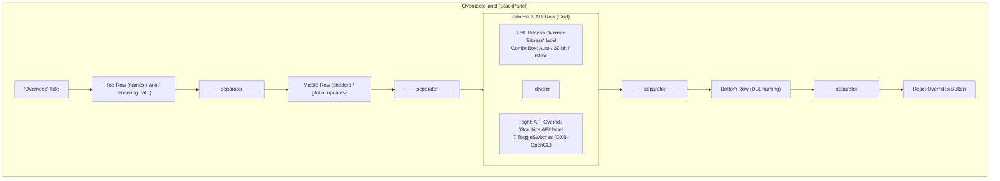

# Design Document: Bitness & API Override

## Overview

This feature adds a new "Bitness & API Override" section to the per-game overrides panel, allowing users to manually override the auto-detected bitness (32-bit / 64-bit) and the detected graphics APIs for a game. The section is inserted between the existing Middle Row (shaders / global update toggles) and the Bottom Row (DLL naming override) in `DetailPanelBuilder.BuildOverridesPanel`.

The bitness override addresses PE header misidentification. The API override addresses import-table scanning inaccuracies — particularly useful for dual-API games where the user wants to suppress one API so only the relevant mod options appear.

Auto-detection (`PeHeaderService`, `GraphicsApiDetector`) continues to run on every app load. When a user override exists, it takes priority over the detected value. When no override exists (or after reset), the app falls back to auto-detection.

## Architecture

The change touches three layers:

1. **UI Layer** — `DetailPanelBuilder.BuildOverridesPanel` gains a new row (Bitness & API section) inserted between the Middle Row separator and the Bottom Row.
2. **Persistence Layer** — `IGameNameService` / `GameNameService` gains two new per-game dictionaries, serialized to the settings JSON alongside existing dictionaries like `VulkanRenderingPaths` and `PerGameShaderMode`.
3. **ViewModel Layer** — `MainViewModel` gains accessor/mutator methods for the new dictionaries and applies overrides during card creation (where `ResolveIs32Bit` and `_DetectAllApisForCard` are called).



### Key Design Decisions

1. **ComboBox for bitness**: Three options — "Auto", "32-bit", "64-bit". "Auto" means no override (fall back to `PeHeaderService` detection). This matches the existing ComboBox pattern used for Rendering Path.

2. **Individual ToggleSwitches for APIs**: One toggle per non-Unknown `GraphicsApiType` value (7 toggles). When no override exists, toggles reflect the auto-detected `DetectedApis`. Once the user flips any toggle, the entire API set becomes user-controlled for that game. This avoids partial-override ambiguity.

3. **Persistence follows existing pattern**: New dictionaries `BitnessOverrides` (`Dictionary<string, string>`) and `ApiOverrides` (`Dictionary<string, List<string>>`) are added to `GameNameService`, serialized/deserialized in `SaveNameMappings`/`LoadNameMappings` alongside `VulkanRenderingPaths`, `PerGameShaderMode`, etc.

4. **Override applied at card creation time**: `MainViewModel` applies bitness overrides in `ResolveIs32Bit` and API overrides in `_DetectAllApisForCard` / `DetectGraphicsApi`, so the rest of the app sees the effective values transparently.

5. **Reset clears overrides**: The existing Reset Overrides button handler is extended to remove entries from both new dictionaries and revert the UI controls.

## Components and Interfaces

### Modified Components

#### `IGameNameService` / `GameNameService`

New properties added to the interface and implementation:

```csharp
/// <summary>Per-game bitness overrides. Key = game name, Value = "32" or "64". Absent = auto-detect.</summary>
Dictionary<string, string> BitnessOverrides { get; }

/// <summary>Per-game API overrides. Key = game name, Value = list of GraphicsApiType names that are ON. Absent = auto-detect.</summary>
Dictionary<string, List<string>> ApiOverrides { get; }
```

- `LoadNameMappings`: Deserializes `"BitnessOverrides"` and `"ApiOverrides"` from the settings JSON.
- `SaveNameMappings`: Serializes both dictionaries to the settings JSON.
- `RenameGame`: Calls `MigrateDict` for both new dictionaries.

#### `MainViewModel`

New accessor/mutator methods:

```csharp
// Bitness override
public string? GetBitnessOverride(string gameName);
public void SetBitnessOverride(string gameName, string? value); // null or "Auto" removes override

// API override
public List<string>? GetApiOverride(string gameName);
public void SetApiOverride(string gameName, List<string>? apis); // null removes override
```

Modified methods:
- `ResolveIs32Bit`: Checks `BitnessOverrides` before manifest overrides. If "32" → return true; if "64" → return false; otherwise fall through to existing logic.
- `_DetectAllApisForCard`: If `ApiOverrides` contains the game, returns the override set instead of scanning.
- `DetectGraphicsApi`: If `ApiOverrides` contains the game, derives the primary API from the override set.
- Card creation (two sites): No change needed — they already call `ResolveIs32Bit` and `_DetectAllApisForCard`.

#### `DetailPanelBuilder.BuildOverridesPanel`

New section inserted between `middleRowGrid` + separator and `dllSection`:

1. **Bitness ComboBox** (left column): Items = `["Auto", "32-bit", "64-bit"]`. Selection change handler calls `SetBitnessOverride`, updates `card.Is32Bit`, and updates the DLL naming section's `PlaceholderText`.
2. **API ToggleSwitches** (right column): One per non-Unknown `GraphicsApiType`. Initial state from `GetApiOverride` or `DetectedApis`. Toggled handler calls `SetApiOverride` with the full current toggle state, then updates `card.DetectedApis`, `card.IsDualApiGame`, `card.GraphicsApi`, and triggers `card.NotifyAll()`.
3. **Reset handler**: Extended to reset the ComboBox to "Auto", reset all API toggles to auto-detected state, and call `SetBitnessOverride(null)` / `SetApiOverride(null)`.

#### `GameCardViewModel`

No new properties. Existing properties `Is32Bit`, `DetectedApis`, `IsDualApiGame`, `GraphicsApi` are updated by the override logic. `DetectedApis` and `IsDualApiGame` are plain (non-observable) properties, so `NotifyAll()` is called after mutation to refresh dependent UI.

### Grid Structure

**Bitness & API Row Grid (3 columns):**
- Column 0 (Star): StackPanel — "Bitness" label, ComboBox with Auto/32-bit/64-bit
- Column 1 (Auto): Vertical divider (1px Border, `BorderDefaultBrush`, 12px horizontal margin)
- Column 2 (Star): StackPanel — "Graphics API" label, WrapPanel or horizontal StackPanel with 7 ToggleSwitches

## Data Models

### New Persistence Dictionaries

| Dictionary | Key | Value | Settings JSON Key |
|---|---|---|---|
| `BitnessOverrides` | Game name (string) | `"32"` or `"64"` | `"BitnessOverrides"` |
| `ApiOverrides` | Game name (string) | `List<string>` of enabled API names (e.g. `["DirectX11", "Vulkan"]`) | `"ApiOverrides"` |

Both follow the same `Dictionary<string, T>` pattern as `VulkanRenderingPaths` and `PerGameShaderMode`. Case-insensitive string comparer (`StringComparer.OrdinalIgnoreCase`).

### Bitness Override Values

| ComboBox Selection | Dictionary Value | Effective Behavior |
|---|---|---|
| "Auto" | Entry removed | Use `PeHeaderService` + manifest logic |
| "32-bit" | `"32"` | `Is32Bit = true` |
| "64-bit" | `"64"` | `Is32Bit = false` |

### API Override Values

When no override exists for a game, the dictionary has no entry and auto-detection is used. When the user modifies any toggle, the full set of enabled API names is stored. For example, if the user enables DX11 and Vulkan: `["DirectX11", "Vulkan"]`.

The stored strings match `GraphicsApiType` enum names, parsed via `Enum.TryParse<GraphicsApiType>`.


## Correctness Properties

*A property is a characteristic or behavior that should hold true across all valid executions of a system — essentially, a formal statement about what the system should do. Properties serve as the bridge between human-readable specifications and machine-verifiable correctness guarantees.*

### Property 1: Bitness resolution respects override priority

*For any* game name, any detected machine type (I386 or AMD64), and any bitness override value ("Auto", "32", or "64"), the resolved `Is32Bit` value should be: `true` when the override is "32", `false` when the override is "64", and equal to the auto-detected value (based on PE header / manifest logic) when the override is "Auto" or absent.

**Validates: Requirements 2.3, 2.4, 2.5, 2.6, 4.3**

### Property 2: DLL placeholder text matches effective bitness

*For any* boolean `Is32Bit` value, the DLL naming section's ReShade filename placeholder text should be `"ReShade32.dll"` when `Is32Bit` is true, and `"ReShade64.dll"` when `Is32Bit` is false.

**Validates: Requirements 2.7**

### Property 3: API resolution respects override priority

*For any* game name, any auto-detected API set, and any API override set (or absence thereof), the effective `DetectedApis` should exactly equal the override set when an override entry exists for the game, or the auto-detected set when no override entry exists.

**Validates: Requirements 3.3, 3.4, 3.5, 3.6, 4.4**

### Property 4: IsDualApiGame is correctly derived from effective APIs

*For any* set of `GraphicsApiType` values representing a game's effective APIs, `IsDualApiGame` should be `true` if and only if the set contains at least one DirectX API (DX8–DX12) and also contains Vulkan.

**Validates: Requirements 3.7**

### Property 5: Primary GraphicsApi is deterministically derived from effective APIs

*For any* non-empty set of `GraphicsApiType` values representing a game's effective APIs, the primary `GraphicsApi` value should be deterministically selected (preferring the highest DirectX version when both DX and Vulkan are present, or the single API when only one exists, or `Unknown` when the set is empty).

**Validates: Requirements 3.8**

### Property 6: Override persistence round-trip

*For any* game name and any valid bitness override value, setting the bitness override and then getting it should return the same value. *For any* game name and any valid list of API names, setting the API override and then getting it should return an equivalent list.

**Validates: Requirements 4.1, 4.2**

### Property 7: Reset removes all overrides and restores auto-detected values

*For any* game name with any combination of bitness and API overrides set, after performing a reset, the `BitnessOverrides` dictionary should not contain an entry for that game, the `ApiOverrides` dictionary should not contain an entry for that game, and the resolved `Is32Bit` and `DetectedApis` should equal their auto-detected values.

**Validates: Requirements 5.1, 5.2, 5.3, 5.4**

## Error Handling

This feature does not introduce fundamentally new error conditions. Error handling follows existing patterns:

- **Invalid enum parse**: When loading `ApiOverrides` from JSON, `Enum.TryParse<GraphicsApiType>` is used for each stored string. Unrecognized values are silently skipped, resulting in a smaller effective set. This is safe — the user can re-toggle to correct.
- **Missing settings key on load**: The existing `Load<T>(key, fallback)` pattern in `GameNameService.LoadNameMappings` handles missing or corrupt JSON keys gracefully by returning the fallback (empty dictionary). No change needed.
- **Concurrent save contention**: The existing retry loop in `SaveNameMappings` (3 attempts with backoff) handles file contention. The new dictionaries are serialized within the same save call, so they benefit from the same protection.
- **Empty API override set**: If the user turns off all API toggles, the override stores an empty list. The resolution logic treats an empty effective API set as `GraphicsApiType.Unknown` for the primary badge and `IsDualApiGame = false`. This is a valid (if unusual) state.
- **Game rename migration**: Both new dictionaries are migrated via `MigrateDict` in `RenameGame`, following the same pattern as `_perGameShaderMode` and `_vulkanRenderingPaths`.

## Testing Strategy

### Property-Based Tests

Property-based tests use **FsCheck 2.16.6** with **xUnit**, matching the existing test infrastructure. Each test runs a minimum of 10 iterations and is tagged with a comment referencing the design property.

Tag format: `Feature: override-bitness-api, Property {number}: {property_text}`

Since the override resolution logic lives in `MainViewModel` methods (`ResolveIs32Bit`, `_DetectAllApisForCard`, `DetectGraphicsApi`) and the persistence logic lives in `GameNameService`, the property tests should exercise these methods directly rather than instantiating WinUI controls.

**Property tests to implement:**

- **Property 1** (Bitness resolution): Generate random game names, random `MachineType` values, and random override values ("Auto"/"32"/"64"). Call the resolution logic and verify the result matches the expected value.
- **Property 2** (DLL placeholder): Generate random booleans for `Is32Bit`. Verify the placeholder string is correct. (Simple enough to be a parameterized test, but included for completeness.)
- **Property 3** (API resolution): Generate random game names, random auto-detected API sets (subsets of non-Unknown `GraphicsApiType`), and random override sets (or null for no override). Call the resolution logic and verify the result.
- **Property 4** (IsDualApiGame): Generate random subsets of `GraphicsApiType`. Compute `IsDualApiGame` and verify it equals `(set contains any DX API) && (set contains Vulkan)`.
- **Property 5** (Primary GraphicsApi): Generate random non-empty subsets of `GraphicsApiType`. Compute the primary API and verify it follows the deterministic selection rule.
- **Property 6** (Persistence round-trip): Generate random game names and override values. Set via the mutator, get via the accessor, verify equality.
- **Property 7** (Reset): Generate random game names with random overrides. Perform reset. Verify dictionaries no longer contain entries for the game.

### Unit Tests (Example-Based)

Unit tests complement property tests for specific structural and edge-case checks:

- Verify the "Bitness" section label text is exactly "Bitness" (Req 2.1)
- Verify the "Graphics API" section label text is exactly "Graphics API" (Req 3.1)
- Verify the ComboBox contains exactly three items: "Auto", "32-bit", "64-bit" (Req 2.2)
- Verify there are exactly 7 API toggles, one per non-Unknown `GraphicsApiType` (Req 3.2)
- Verify the Bitness & API section appears between Middle Row separator and DLL section in the panel children order (Req 1.1, 1.2)
- Verify that when no override exists, the ComboBox defaults to "Auto" (Req 2.8)
- Verify that an empty API override set results in `GraphicsApi = Unknown` and `IsDualApiGame = false` (edge case)
- Verify that `Enum.TryParse` gracefully handles an unrecognized API string in persisted data (edge case)
