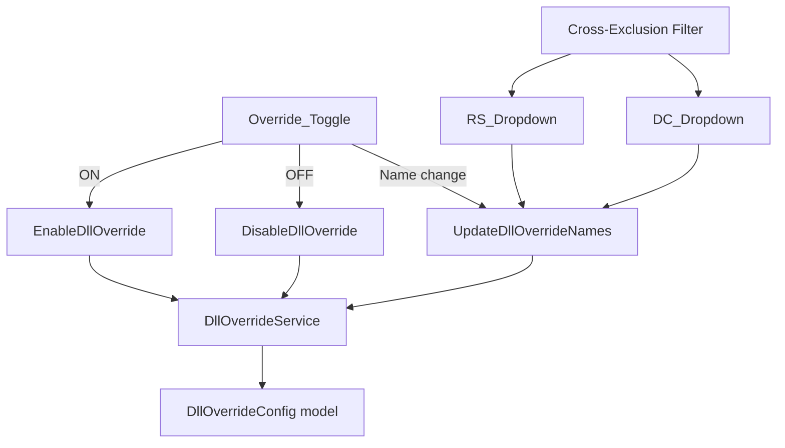

# Design Document: Override Menu Redesign

## Overview

This feature replaces the current two-toggle DLL naming override system (separate RS toggle + DC toggle) with a single unified toggle that controls both RS and DC overrides together. The change is purely in the UI layer — `DetailPanelBuilder.Overrides.cs` and `OverridesFlyoutBuilder.cs` — while the underlying `DllOverrideConfig` model and `DllOverrideService` remain unchanged.

The current system requires users to manage two independent toggles with confusing cross-toggle interactions and partial-on states (RS on / DC off, RS off / DC on, both on, both off). The redesign collapses this into a single toggle that enables/disables both components atomically, reducing cognitive load and eliminating partial-on edge cases.

## Architecture

The architecture remains unchanged at the service and model layers. Only the UI builders are modified:



The key architectural change is removing the `dcDllToggle` ToggleSwitch and its `Toggled` handler from both `DetailPanelBuilder.Overrides.cs` and `OverridesFlyoutBuilder.cs`. The existing `dllOverrideToggle` becomes the single unified toggle that controls both RS and DC dropdowns.

### What Changes

| Component | Change |
|---|---|
| `DetailPanelBuilder.Overrides.cs` | Remove `dcDllToggle`, update `dllOverrideToggle.Toggled` handler to manage both dropdowns, update cross-exclusion filter to reference toggle state instead of `dcDllToggle.IsOn`, update reset handler |
| `OverridesFlyoutBuilder.cs` | Same changes as above for the flyout variant |
| `DllOverrideConfig` | No change |
| `DllOverrideService` | No change |
| `IDllOverrideService` | No change |

### What Does NOT Change

- `DllOverrideConfig` model — already stores both `ReShadeFileName` and `DcFileName`
- `DllOverrideService.EnableDllOverride` — already handles both RS and DC renames
- `DllOverrideService.DisableDllOverride` — already reverts both RS and DC, returns `DllDisableResult`
- `DllOverrideService.UpdateDllOverrideNames` — already updates both components
- Cross-exclusion filtering logic (the algorithm stays the same, only the toggle reference changes)
- Foreign DLL conflict dialog for DC
- Manifest-driven override injection and opt-out
- Luma mode interaction

## Components and Interfaces

### Modified: `DetailPanelBuilder.BuildOverridesPanel`

The `dllOverrideToggle` becomes the single unified toggle. Its `Toggled` handler changes:

**Toggle ON (no prior config):**
1. Enable both `rsNameBox` and `dcNameBox`
2. Auto-select `Safe_RS_Name` (`ReShade64.dll` or `ReShade32.dll` based on bitness) in `rsNameBox`
3. Keep `dcNameBox` at `Default_DC_Name` (the default addon filename)
4. Call `DllOverrideService.EnableDllOverride(card, rsName, dcName)`

**Toggle ON (prior config exists):**
1. Enable both `rsNameBox` and `dcNameBox`
2. Restore previously saved RS and DC filenames into the dropdowns
3. Call `DllOverrideService.EnableDllOverride(card, rsName, dcName)`

**Toggle OFF:**
1. Call `DllOverrideService.DisableDllOverride(card)` — this reverts both RS and DC
2. Disable both `rsNameBox` and `dcNameBox`
3. Clear both dropdowns (SelectedIndex = -1, Text = "")
4. If `DllDisableResult.RsReverted == false`, set tooltip explaining RS fallback
5. If `DllDisableResult.DcReverted == false`, set tooltip explaining DC kept under current name

**Removed:** The `dcDllToggle` ToggleSwitch, its `Toggled` handler, and all references to `dcDllToggle.IsOn` in cross-exclusion filters and dropdown handlers.

### Modified: `OverridesFlyoutBuilder.OpenOverridesFlyout`

Identical changes to `DetailPanelBuilder` but applied to the flyout variant. The flyout's DLL override section changes from:
- `dllOverrideToggle` + `rsNameBox` + `dcDllToggle` + `dcNameBox`

To:
- `dllOverrideToggle` + `rsNameBox` + `dcNameBox`

### Modified: Cross-Exclusion Filter

The `UpdateDcDropdownItems()` and `UpdateRsDropdownItems()` local functions currently reference `dcDllToggle.IsOn` to determine whether to filter. After the redesign, both functions reference `dllOverrideToggle.IsOn` since the single toggle controls both components.

**`UpdateDcDropdownItems()`:** Filters `DcDllOverrideNames` to exclude the current RS selection when the override toggle is ON.

**`UpdateRsDropdownItems()`:** Filters `DllOverrideConstants.CommonDllNames` to exclude the current DC selection when the override toggle is ON.

### Modified: Reset Overrides Handler

Both `DetailPanelBuilder` and `OverridesFlyoutBuilder` reset handlers currently set both `dllOverrideToggle.IsOn = false` and `dcDllToggle.IsOn = false`. After the redesign, they only set `dllOverrideToggle.IsOn = false` (which triggers the unified toggle-OFF handler that calls `DisableDllOverride`).

### Modified: Dropdown Auto-Save Handlers

The RS and DC dropdown `SelectionChanged` and `KeyDown` handlers currently check `dcDllToggle.IsOn` to determine the DC name to pass to `UpdateDllOverrideNames`. After the redesign, they always read the DC name from `dcNameBox` when `dllOverrideToggle.IsOn` is true, since both dropdowns are always enabled/disabled together.

## Data Models

No changes to data models. The existing models are sufficient:

### `DllOverrideConfig` (unchanged)
```csharp
public class DllOverrideConfig
{
    public string ReShadeFileName { get; set; } = "";
    public string DcFileName { get; set; } = "";
}
```

### `DllDisableResult` (unchanged)
```csharp
public record DllDisableResult(bool RsReverted, bool DcReverted);
```

### `DllOverrideConstants.CommonDllNames` (unchanged)
RS dropdown items: `dxgi.dll`, `d3d9.dll`, `d3d10.dll`, `d3d11.dll`, `d3d12.dll`, `opengl32.dll`, `dinput8.dll`, `version.dll`, `winmm.dll`, `ddraw.dll`, `xinput1_3.dll`, `msvcp140.dll`, `bink2w64.dll`

### `DetailPanelBuilder.DcDllOverrideNames` (unchanged)
DC dropdown items: `dxgi.dll`, `d3d9.dll`, `d3d11.dll`, `d3d12.dll`, `ddraw.dll`, `hid.dll`, `version.dll`, `opengl32.dll`, `dbghelp.dll`, `vulkan-1.dll`, `winmm.dll`


## Correctness Properties

*A property is a characteristic or behavior that should hold true across all valid executions of a system — essentially, a formal statement about what the system should do. Properties serve as the bridge between human-readable specifications and machine-verifiable correctness guarantees.*

Most acceptance criteria for this feature are UI-specific example tests (toggle state transitions, specific service calls, specific UI rendering). However, the cross-exclusion filtering logic is a universal property that holds across all valid DLL name selections and is suitable for property-based testing.

### Property 1: Cross-exclusion dropdown filtering

*For any* RS name selected from `DllOverrideConstants.CommonDllNames` and any DC name selected from `DetailPanelBuilder.DcDllOverrideNames`, when the override toggle is ON, the DC dropdown's filtered item list SHALL NOT contain the current RS selection, and the RS dropdown's filtered item list SHALL NOT contain the current DC selection (case-insensitive comparison).

**Validates: Requirements 4.1, 4.2**

### Property 2: Typed name collision rejection

*For any* string typed into the RS dropdown that is a case-insensitive match of the current DC dropdown selection, the RS handler SHALL reject the input and revert. Symmetrically, *for any* string typed into the DC dropdown that is a case-insensitive match of the current RS dropdown selection, the DC handler SHALL reject the input and revert.

**Validates: Requirements 4.3, 4.4**

## Error Handling

### Toggle OFF — Revert Failures

When `DisableDllOverride` is called and returns `DllDisableResult`:

- **RS revert failed** (`RsReverted == false`): The default RS filename (`dxgi.dll`) is occupied by another file. RS was renamed to a fallback (`ReShade64.dll` or `ReShade32.dll`). The toggle displays a tooltip explaining this.
- **DC revert failed** (`DcReverted == false`): The default DC filename is occupied. DC was kept under its current custom name. The toggle displays a tooltip explaining this.

Both failure cases are non-blocking — the toggle still moves to OFF and both dropdowns are disabled/cleared. The tooltip provides user feedback about the partial revert.

### Foreign DLL Conflict (DC)

When the user selects a new DC filename, `CheckDcForeignDllConflictAsync` checks if the target filename already exists as a non-DC file in the game folder. If a conflict is detected:
- A confirmation dialog is shown to the user
- If the user cancels, the DC dropdown reverts to its previous selection
- If the user confirms, the override proceeds (existing file is overwritten)

This behavior is preserved unchanged from the current implementation.

### Cross-Exclusion Collision

If a user types a name that matches the other component's current selection (case-insensitive), the handler rejects the input and reverts the dropdown to its previous valid value. No error dialog is shown — the rejection is silent.

## Testing Strategy

### Unit Tests (Example-Based)

The majority of acceptance criteria are UI state transitions and service call verifications best covered by example-based unit tests:

- **Toggle ON/OFF state transitions**: Verify dropdowns enable/disable, values clear, correct service methods are called (Requirements 1.1–1.4, 2.1–2.6, 3.1–3.5)
- **Auto-selection on first enable**: Verify `Safe_RS_Name` is auto-selected, DC stays at default (Requirements 2.3, 2.4)
- **Config restoration**: Verify previously saved filenames are restored on re-enable (Requirement 2.6)
- **Dropdown auto-save**: Verify `UpdateDllOverrideNames` is called with correct args on selection change and Enter key (Requirements 5.1–5.4)
- **Foreign DLL conflict**: Verify `CheckDcForeignDllConflictAsync` is called, dropdown reverts on cancel (Requirements 5.5, 5.6)
- **Reset Overrides**: Verify toggle is set to OFF and `DisableDllOverride` is called (Requirements 6.1, 6.2)
- **Manifest compatibility**: Verify toggle reflects manifest state, opt-out is recorded (Requirements 7.1–7.3)
- **Luma mode**: Verify toggle and dropdowns are disabled (Requirements 8.1, 8.2)

### Property-Based Tests

Property-based tests using FsCheck (already used in the project's test suite) with minimum 100 iterations:

- **Feature: override-menu-redesign, Property 1: Cross-exclusion dropdown filtering** — Generate random RS/DC name pairs from the known lists, apply the filter functions, assert mutual exclusion holds.
- **Feature: override-menu-redesign, Property 2: Typed name collision rejection** — Generate random strings (including case variations of known DLL names), simulate typed input, assert collision is rejected and previous value is restored.

### Edge Case Tests

- RS revert failure tooltip (Requirement 3.4)
- DC revert failure tooltip (Requirement 3.5)
- Foreign DLL conflict cancellation revert (Requirement 5.6)
