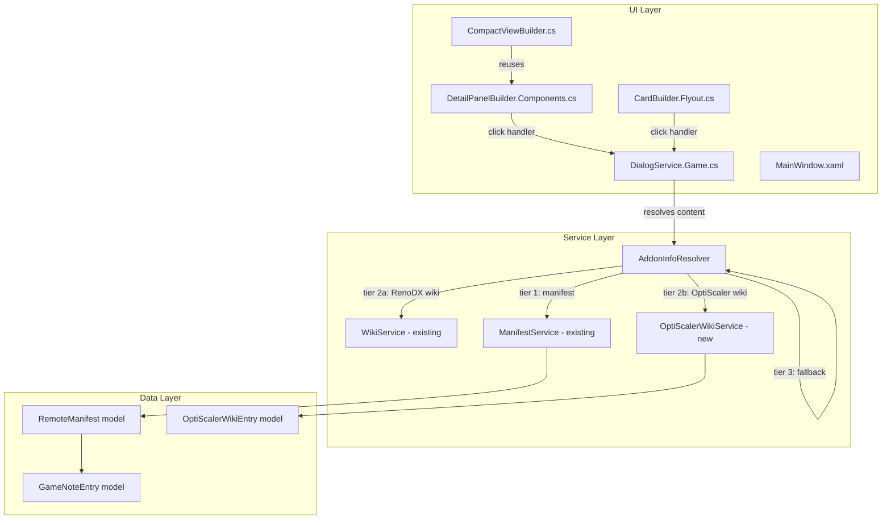

# Design Document: Per-Addon Info Buttons

## Overview

This feature adds a per-addon "Info" button to every component row across all three view modes (Detail, Card flyout, Compact). Each button opens a ContentDialog showing contextual information resolved through a three-tier priority system: per-game manifest entries → wiki-scraped content (RenoDX/OptiScaler only) → generic fallback text. The existing header-level "ℹ" (DetailNotesBtn) and "💬" (DetailDiscussionBtn) buttons are removed, with their functionality migrated into the per-addon RenoDX Info button.

### Key Design Decisions

1. **Info button placement**: A new column is inserted between the status text column (col 1) and the install button column (col 2) in each component row Grid. This keeps the button close to the addon name while not disrupting the install/uninstall flow on the right side.

2. **Content resolution as a service**: A new `AddonInfoResolver` class centralizes the three-tier lookup logic. This avoids duplicating resolution logic across Detail, Card, and Compact views.

3. **OptiScaler wiki scraping at startup**: OptiScaler wiki data is fetched in parallel with the existing RenoDX wiki fetch during app initialization. This ensures Info button styling (highlighted vs muted) is correct from the first render.

4. **Reuse of existing dialog patterns**: The Info dialog follows the same ContentDialog pattern used by `NotesButton_Click` in `DialogService.Game.cs`, ensuring visual consistency.

## Architecture



### Data Flow

1. User clicks an Info button on a component row.
2. The click handler in `DialogService.Game.cs` calls `AddonInfoResolver.ResolveAsync(gameName, addonType)`.
3. `AddonInfoResolver` checks tiers in order:
   - **Tier 1**: Per-addon manifest dictionary (e.g., `reshadeGameInfo["Cyberpunk 2077"]`)
   - **Tier 2**: Wiki-scraped content (RenoDX wiki for RenoDX addon, OptiScaler wiki for OptiScaler addon, Luma wiki/manifest notes for Luma addon)
   - **Tier 3**: Static generic fallback text
4. The resolver returns an `AddonInfoResult` containing the content, source type (manifest/wiki/fallback), and optional URL.
5. `DialogService` renders the result in a styled ContentDialog.

## Components and Interfaces

### 1. AddonInfoResolver (New Service)

**File**: `RenoDXCommander/Services/AddonInfoResolver.cs`

Centralizes the three-tier content resolution logic. Stateless — receives dependencies via constructor injection.

```csharp
public enum AddonType { REFramework, ReShade, RenoDX, ReLimiter, DisplayCommander, OptiScaler, Luma }
public enum InfoSourceType { Manifest, Wiki, Fallback, None }

public class AddonInfoResult
{
    public string Content { get; init; } = "";
    public string? Url { get; init; }
    public string? UrlLabel { get; init; }
    public InfoSourceType Source { get; init; }
    // For RenoDX: wiki status badge data
    public string? WikiStatusLabel { get; init; }
    public string? WikiStatusBadgeBg { get; init; }
    public string? WikiStatusBadgeFg { get; init; }
    public string? WikiStatusBadgeBorder { get; init; }
    // For OptiScaler: structured compatibility data
    public OptiScalerCompatEntry? OptiScalerCompat { get; init; }
    public OptiScalerCompatEntry? OptiScalerFsr4Compat { get; init; }
}

public class AddonInfoResolver
{
    public AddonInfoResult Resolve(
        GameCardViewModel card,
        AddonType addon,
        RemoteManifest? manifest,
        OptiScalerWikiData? osWikiData);
    
    public string GetTooltip(GameCardViewModel card, AddonType addon,
        RemoteManifest? manifest, OptiScalerWikiData? osWikiData);
    
    public InfoSourceType GetSourceType(GameCardViewModel card, AddonType addon,
        RemoteManifest? manifest, OptiScalerWikiData? osWikiData);
}
```

### 2. OptiScalerWikiService (New Service)

**File**: `RenoDXCommander/Services/OptiScalerWikiService.cs`

Fetches and parses the OptiScaler wiki Compatibility List and FSR4 Compatibility List pages. Caches results for the session.

```csharp
public class OptiScalerCompatEntry
{
    public string GameName { get; init; } = "";
    public string Status { get; init; } = "";        // "Working", "Not Working", "Partial"
    public List<string> Upscalers { get; init; } = []; // "DLSS", "FSR", "XeSS"
    public string? Notes { get; init; }
    public string? DetailPageUrl { get; init; }
}

public class OptiScalerWikiData
{
    public Dictionary<string, OptiScalerCompatEntry> StandardCompat { get; init; } = new();
    public Dictionary<string, OptiScalerCompatEntry> Fsr4Compat { get; init; } = new();
}

public interface IOptiScalerWikiService
{
    Task<OptiScalerWikiData> FetchAsync(IProgress<string>? progress = null);
    OptiScalerWikiData? CachedData { get; }
}
```

### 3. Modified DetailPanelBuilder.Components.cs

Each XAML component row Grid gains a new column (inserted at position 2, shifting install button to col 3, and subsequent columns right by 1). The new column hosts the Info button:

**Current column layout** (5 columns):
| Col 0 (120) | Col 1 (80) | Col 2 (*) | Col 3 (36) | Col 4 (36) |
|---|---|---|---|---|
| Label | Status | Install btn | Copy/UE | Delete |

**New column layout** (6 columns):
| Col 0 (120) | Col 1 (80) | Col 2 (36) | Col 3 (*) | Col 4 (36) | Col 5 (36) |
|---|---|---|---|---|---|
| Label | Status | **Info btn** | Install btn | Copy/UE | Delete |

New XAML elements per row: `DetailRefInfoBtn`, `DetailRsInfoBtn`, `DetailRdxInfoBtn`, `DetailLumaInfoBtn`, `DetailUlInfoBtn`, `DetailDcInfoBtn`, `DetailOsInfoBtn`.

### 4. Modified CardBuilder.Flyout.cs — BuildComponentRow

The `BuildComponentRow` method gains a new `addonType` parameter and inserts an Info button column between status text and install button. The button uses the same `AddonInfoResolver` to determine styling and tooltip.

### 5. Modified DialogService.Game.cs

New method `ShowAddonInfoDialogAsync(GameCardViewModel card, AddonType addon)` replaces the old `NotesButton_Click` for RenoDX-specific content and handles all addon types. The existing `NotesButton_Click` is removed.

### 6. Modified MainWindow.xaml

- Remove `DetailNotesBtn` and `DetailDiscussionBtn` from the header action buttons area.
- Add Info button elements to each component row Grid.
- Update column definitions from 5 to 6 columns per row.

### 7. Modified RemoteManifest Model

New nullable dictionary properties for per-addon info entries and OptiScaler wiki name mappings.

## Data Models

### AddonInfoResult

```csharp
public class AddonInfoResult
{
    public string Content { get; init; } = "";
    public string? Url { get; init; }
    public string? UrlLabel { get; init; }
    public InfoSourceType Source { get; init; } = InfoSourceType.None;
    public string? WikiStatusLabel { get; init; }
    public string? WikiStatusBadgeBg { get; init; }
    public string? WikiStatusBadgeFg { get; init; }
    public string? WikiStatusBadgeBorder { get; init; }
    public OptiScalerCompatEntry? OptiScalerCompat { get; init; }
    public OptiScalerCompatEntry? OptiScalerFsr4Compat { get; init; }
}
```

### OptiScalerCompatEntry

```csharp
public class OptiScalerCompatEntry
{
    public string GameName { get; init; } = "";
    public string Status { get; init; } = "";
    public List<string> Upscalers { get; init; } = [];
    public string? Notes { get; init; }
    public string? DetailPageUrl { get; init; }
}
```

### OptiScalerWikiData

```csharp
public class OptiScalerWikiData
{
    public Dictionary<string, OptiScalerCompatEntry> StandardCompat { get; init; } = new(StringComparer.OrdinalIgnoreCase);
    public Dictionary<string, OptiScalerCompatEntry> Fsr4Compat { get; init; } = new(StringComparer.OrdinalIgnoreCase);
}
```

### RemoteManifest Extensions

```csharp
// New properties added to RemoteManifest.cs
[JsonPropertyName("reshadeGameInfo")]
public Dictionary<string, GameNoteEntry>? ReshadeGameInfo { get; set; }

[JsonPropertyName("relimiterGameInfo")]
public Dictionary<string, GameNoteEntry>? RelimiterGameInfo { get; set; }

[JsonPropertyName("displayCommanderGameInfo")]
public Dictionary<string, GameNoteEntry>? DisplayCommanderGameInfo { get; set; }

[JsonPropertyName("reframeworkGameInfo")]
public Dictionary<string, GameNoteEntry>? ReframeworkGameInfo { get; set; }

[JsonPropertyName("optiScalerGameInfo")]
public Dictionary<string, GameNoteEntry>? OptiScalerGameInfo { get; set; }

[JsonPropertyName("lumaGameInfo")]
public Dictionary<string, GameNoteEntry>? LumaGameInfo { get; set; }

[JsonPropertyName("optiScalerWikiNames")]
public Dictionary<string, string>? OptiScalerWikiNames { get; set; }
```

### AddonType Enum

```csharp
public enum AddonType
{
    REFramework,
    ReShade,
    RenoDX,
    ReLimiter,
    DisplayCommander,
    OptiScaler,
    Luma
}
```

### InfoSourceType Enum

```csharp
public enum InfoSourceType
{
    None,
    Manifest,
    Wiki,
    Fallback
}
```

### Generic Fallback Text Constants

Defined as static strings in `AddonInfoResolver`:

| Addon | Fallback Text |
|---|---|
| RE Framework | "RE Framework is a modding framework for RE Engine games. It enables ReShade injection and other mods by hooking into the game's rendering pipeline." |
| ReShade | "ReShade is a post-processing injector that adds visual effects to games. It is required by RenoDX to apply HDR tone mapping and color grading." |
| RenoDX | "RenoDX is an HDR mod framework that upgrades SDR games to HDR using ReShade. It provides per-game tone mapping and color space conversion." |
| ReLimiter | "ReLimiter is a frame limiter that works alongside ReShade to reduce input lag and improve frame pacing in games." |
| Display Commander | "Display Commander is a display management tool that works alongside ReShade to control HDR output settings and display configuration." |
| OptiScaler | "OptiScaler is an upscaling compatibility layer that enables FSR, XeSS, or DLSS across different GPU vendors, allowing you to use any upscaler regardless of your hardware." |
| Luma | "Luma is an alternative HDR mod framework that provides native HDR output for supported games, bypassing the need for ReShade-based injection." |


## Correctness Properties

*A property is a characteristic or behavior that should hold true across all valid executions of a system — essentially, a formal statement about what the system should do. Properties serve as the bridge between human-readable specifications and machine-verifiable correctness guarantees.*

### Property 1: Manifest entry is highest priority

*For any* game name, addon type, manifest with a matching per-addon entry, and any wiki data (present or absent), the `AddonInfoResolver.Resolve()` SHALL return the manifest entry content with `InfoSourceType.Manifest`, regardless of whether wiki data also exists for that game+addon.

**Validates: Requirements 4.1, 4.2**

### Property 2: Wiki content is tier 2 for eligible addons

*For any* game name where no per-addon manifest entry exists, and the addon is one of {RenoDX, OptiScaler, Luma}, and wiki data exists for that game, the `AddonInfoResolver.Resolve()` SHALL return the wiki content with `InfoSourceType.Wiki`.

**Validates: Requirements 4.3, 4.4, 4.7**

### Property 3: Generic fallback is tier 3

*For any* game name and addon type where no per-addon manifest entry exists and no wiki content is available, the `AddonInfoResolver.Resolve()` SHALL return a non-empty generic fallback string with `InfoSourceType.Fallback`.

**Validates: Requirements 4.5, 9.1–9.8**

### Property 4: Resolution is independent per addon

*For any* game name and two distinct addon types A and B, setting a manifest entry for addon A SHALL NOT change the resolution result for addon B. Each addon's resolution depends only on its own manifest entry, its own wiki eligibility, and its own fallback text.

**Validates: Requirements 4.6**

### Property 5: Manifest round-trip preserves addon info entries

*For any* `RemoteManifest` object with arbitrary per-addon info dictionaries (`reshadeGameInfo`, `relimiterGameInfo`, `displayCommanderGameInfo`, `reframeworkGameInfo`, `optiScalerGameInfo`, `lumaGameInfo`, `optiScalerWikiNames`), serializing to JSON and deserializing back SHALL produce an equivalent manifest with identical addon info dictionaries.

**Validates: Requirements 6.1, 6.2, 6.4**

### Property 6: OptiScaler game name matching with overrides

*For any* game name and OptiScaler wiki dataset, when an `optiScalerWikiNames` override maps the game name to a wiki name, the matcher SHALL use the override name for lookup. When no override exists, the matcher SHALL use the original game name. In both cases, a matching entry SHALL be returned if one exists in the wiki data.

**Validates: Requirements 7.2**

### Property 7: Info result includes all available fields

*For any* `AddonInfoResult` where the source is Wiki or Manifest, if the source data contains a URL, the result's `Url` field SHALL be non-null. If the source data contains notes text, the result's `Content` field SHALL contain that text. For OptiScaler wiki results, if the entry has a status and upscaler list, those SHALL appear in the formatted content.

**Validates: Requirements 7.3, 7.4, 8.5**

### Property 8: Tooltip and visual style are determined by source type

*For any* game name and addon type, the tooltip returned by `GetTooltip()` SHALL be "Per-game notes available" when source is Manifest, "Wiki info available" when source is Wiki, and "General addon info" when source is Fallback. The source type returned by `GetSourceType()` SHALL match the source type of the full `Resolve()` result.

**Validates: Requirements 11.1, 11.2, 12.1, 12.2, 12.3, 12.4**

### Property 9: Dual-list OptiScaler merge and display

*For any* game name appearing in both the standard OptiScaler Compatibility List and the FSR4 Compatibility List, the merged `OptiScalerWikiData` SHALL contain entries in both `StandardCompat` and `Fsr4Compat` dictionaries. For a game appearing only in the FSR4 list, `StandardCompat` SHALL not contain an entry for that game while `Fsr4Compat` SHALL.

**Validates: Requirements 13.3, 15.2, 15.3**

## Error Handling

### Network Failures

- **OptiScaler wiki fetch failure**: If the HTTP request to the OptiScaler wiki fails (timeout, 404, parse error), `OptiScalerWikiService.FetchAsync()` catches the exception, logs it via `CrashReporter.Log()`, and returns an empty `OptiScalerWikiData`. All OptiScaler Info buttons fall back to generic text with muted styling.
- **RenoDX wiki fetch failure**: Already handled by the existing `WikiService`. If wiki data is unavailable, the RenoDX Info button falls back to manifest `gameNotes` (if present) or generic text.

### Missing Manifest Data

- All new manifest dictionary properties are nullable. `AddonInfoResolver` checks for null dictionaries and null entries before accessing content. Missing manifest data simply means tier 1 is skipped.

### Dialog Display Errors

- The `ShowAddonInfoDialogAsync` method wraps the `ContentDialog.ShowAsync()` call in a try-catch, logging any `COMException` or other WinUI dialog errors (e.g., if another dialog is already open). This follows the existing pattern in `DialogService.Game.cs`.

### Malformed Wiki HTML

- `OptiScalerWikiService` uses defensive HTML parsing with null checks on every `SelectSingleNode`/`SelectNodes` call. If the wiki page structure changes, parsing returns empty results rather than throwing. A diagnostic log entry is written for debugging.

## Testing Strategy

### Property-Based Tests (fast-check or FsCheck)

The project uses C# with xUnit. Property-based tests will use **FsCheck.Xunit** (already available in the test project based on existing property test files).

Each correctness property maps to a single property-based test with minimum 100 iterations:

| Property | Test Description | Generator Strategy |
|---|---|---|
| Property 1 | Manifest priority | Random game names × addon types × manifest entries × optional wiki data |
| Property 2 | Wiki tier 2 | Random game names × wiki-eligible addons × wiki entries (no manifest) |
| Property 3 | Generic fallback | Random game names × all addon types (no manifest, no wiki) |
| Property 4 | Independent resolution | Random game names × pairs of addon types × selective manifest entries |
| Property 5 | Manifest round-trip | Random RemoteManifest with addon info dictionaries |
| Property 6 | OptiScaler name matching | Random game names × wiki datasets × optional name overrides |
| Property 7 | Result field completeness | Random source data with URLs, notes, status fields |
| Property 8 | Tooltip/style from source | Random game names × addon types × mixed content availability |
| Property 9 | Dual-list merge | Random standard + FSR4 compatibility entries with overlapping game names |

### Unit Tests (Example-Based)

- Verify Info button XAML placement and styling in detail view (Requirements 1.1–1.4)
- Verify Info button in card flyout BuildComponentRow output (Requirements 2.1–2.3)
- Verify dialog title format, styling, ScrollViewer MaxHeight (Requirements 5.1–5.5)
- Verify DetailNotesBtn and DetailDiscussionBtn are removed from XAML (Requirements 8.1–8.2)
- Verify each addon type has a non-empty fallback string (Requirements 9.1–9.7)
- Verify Info button remains clickable when row is greyed out (Requirement 10.1)
- Verify OptiScaler wiki caching behavior (Requirement 7.6)

### Integration Tests

- OptiScaler wiki HTML parsing with mock HTTP responses (Requirements 7.1, 15.1)
- Startup fetch of OptiScaler wiki data in parallel with RenoDX wiki (Requirements 13.1–13.2)
- End-to-end Info button click → dialog display with real manifest data

### Edge Case Tests

- OptiScaler wiki fetch failure → graceful fallback (Requirement 7.5)
- Startup wiki fetch failure → app continues without wiki data (Requirement 13.4)
- Info button with no content at all → greyed out state (Requirement 14.1)
