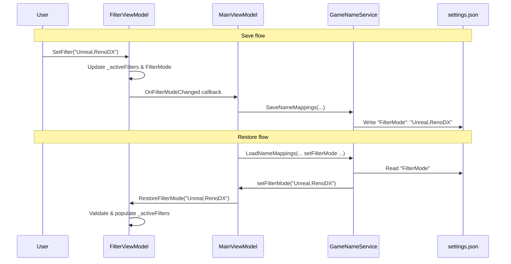

# Design Document: Persist Filter Mode

## Overview

This feature adds persistence for the user's selected filter mode in RDXC so it survives application restarts. The current `FilterViewModel` always initialises `FilterMode` to `"Detected"`. We will save the filter mode string to the existing `settings.json` file under a `"FilterMode"` key whenever it changes, and restore it during startup. Invalid or corrupt values fall back to `"Detected"`.

The change is minimal: a small addition to `FilterViewModel` (save callback + restore method), a two-line addition to `GameNameService` (read/write the key), and wiring in `MainViewModel`.

## Architecture

The persistence follows the exact same pattern already used for `GridLayout`, `DcModeEnabled`, and other scalar settings:

1. `GameNameService.SaveNameMappings` writes `s["FilterMode"] = value` alongside all other settings.
2. `GameNameService.LoadNameMappings` reads the key and passes it to a callback (`Action<string>`).
3. `MainViewModel` provides the callback that calls `FilterViewModel.RestoreFilterMode(value)`.
4. `FilterViewModel.SetFilter` already updates `FilterMode`; after the update we invoke a save callback.

## Components and Interfaces

### FilterViewModel (modified)

New members:

- `Action? FilterModeChanged` — callback property invoked after `FilterMode` is updated in `SetFilter`. `MainViewModel` sets this to trigger `SaveNameMappings`.
- `void RestoreFilterMode(string persisted)` — parses and validates the persisted string, populates `_activeFilters`, sets `FilterMode`, and calls `ApplyFilter()`. Falls back to `"Detected"` on any validation failure.

The existing `SetFilter` method gains a single line: `FilterModeChanged?.Invoke()` at the end, after `ApplyFilter()`.

### GameNameService (modified)

- `LoadNameMappings` gains a new `Action<string> setFilterMode` parameter. After loading the settings dictionary, it reads `s["FilterMode"]` and invokes the callback.
- `SaveNameMappings` gains a new `string filterMode` parameter. It writes `s["FilterMode"] = filterMode`.

### IGameNameService (modified)

Both `LoadNameMappings` and `SaveNameMappings` signatures gain the new parameters to match `GameNameService`.

### MainViewModel (modified)

- Constructor: sets `_filterViewModel.FilterModeChanged = () => SaveNameMappings()`.
- `LoadNameMappings` call: passes `val => _filterViewModel.RestoreFilterMode(val)` as the new callback.
- `SaveNameMappings` call: passes `_filterViewModel.FilterMode` as the new parameter.

## Data Models

### Settings File Schema (addition)

The `settings.json` file at `%LocalAppData%/RenoDXCommander/settings.json` is a flat `Dictionary<string, string>`. A new key is added:

| Key | Type | Example Values | Default |
|-----|------|---------------|---------|
| `"FilterMode"` | `string` | `"Detected"`, `"Favourites"`, `"Unreal,RenoDX"` | `"Detected"` |

For exclusive filters, the value is a single token (e.g. `"Installed"`).
For combinable filters, the value is a comma-separated string with no spaces (e.g. `"Unreal,Luma"`).

### Validation Rules (in RestoreFilterMode)

1. If the value is null, empty, or whitespace → `"Detected"`.
2. Split by comma. Each token must be in `ExclusiveFilters` or `CombinableFilters`.
3. If any token is unrecognised → `"Detected"`.
4. If tokens contain a mix of exclusive and combinable → `"Detected"`.
5. If tokens contain more than one exclusive filter → `"Detected"`.
6. Otherwise, populate `_activeFilters` with the tokens and set `FilterMode`.

## Correctness Properties

*A property is a characteristic or behavior that should hold true across all valid executions of a system — essentially, a formal statement about what the system should do. Properties serve as the bridge between human-readable specifications and machine-verifiable correctness guarantees.*

### Property 1: SetFilter produces correct FilterMode string

*For any* valid filter name (exclusive or combinable), calling `SetFilter` should update `FilterMode` to a string that exactly represents the current `ActiveFilters` set, and should invoke the `FilterModeChanged` callback. For exclusive filters, `FilterMode` should equal the filter name. For combinable filters, `FilterMode` should be a comma-separated string of all active combinable filters.

**Validates: Requirements 1.1, 1.2**

### Property 2: RestoreFilterMode correctly restores valid state

*For any* valid filter mode string (a single exclusive filter name, or a comma-separated list of combinable filter names), calling `RestoreFilterMode` should set `FilterMode` to that string and populate `ActiveFilters` to contain exactly the filters represented by that string.

**Validates: Requirements 2.1, 2.2**

### Property 3: Invalid input falls back to Detected

*For any* string that contains at least one unrecognised filter token, or mixes exclusive and combinable filter tokens, or is null/empty/whitespace, calling `RestoreFilterMode` should set `FilterMode` to `"Detected"` and `ActiveFilters` to `{"Detected"}`.

**Validates: Requirements 2.3, 2.4, 3.1, 3.2**

### Property 4: Round-trip persistence preserves filter set

*For any* valid filter mode value, calling `SetFilter` to establish the mode, reading the resulting `FilterMode` string, then calling `RestoreFilterMode` with that string, should produce an `ActiveFilters` set identical to the one after `SetFilter`. This holds regardless of the order in which combinable filters were originally selected.

**Validates: Requirements 4.1, 4.2**

## Error Handling

| Scenario | Behaviour |
|----------|-----------|
| `settings.json` missing or unreadable | `LoadSettingsFile` returns empty dict → no `"FilterMode"` key → default to `"Detected"` |
| `"FilterMode"` key absent | `RestoreFilterMode` receives null/empty → default to `"Detected"` |
| `"FilterMode"` value is whitespace | `RestoreFilterMode` trims and detects empty → default to `"Detected"` |
| `"FilterMode"` contains unknown token | Validation rejects → default to `"Detected"` |
| `"FilterMode"` mixes exclusive + combinable | Validation rejects → default to `"Detected"` |
| File write fails (IOException) | `SaveNameMappings` already retries up to 3 times with backoff; logs on final failure. No change needed. |

No new exception types are introduced. All error paths converge on the safe default of `"Detected"`.

## Testing Strategy

### Property-Based Tests

Use [FsCheck](https://fscheck.github.io/FsCheck/) (the standard .NET property-based testing library) with xUnit. Each property test runs a minimum of 100 iterations.

Custom generators needed:
- `ValidExclusiveFilter` — picks from `{"Detected", "Favourites", "Hidden", "Installed"}`
- `ValidCombinableFilterSet` — generates a non-empty subset of `{"Unreal", "Unity", "Other", "RenoDX", "Luma"}`
- `ValidFilterMode` — either a single exclusive filter or a combinable set joined by commas
- `InvalidFilterMode` — strings with at least one unrecognised token, or mixed exclusive+combinable, or whitespace-only

Each property test must be tagged with a comment referencing the design property:
- `// Feature: persist-filter-mode, Property 1: SetFilter produces correct FilterMode string`
- `// Feature: persist-filter-mode, Property 2: RestoreFilterMode correctly restores valid state`
- `// Feature: persist-filter-mode, Property 3: Invalid input falls back to Detected`
- `// Feature: persist-filter-mode, Property 4: Round-trip persistence preserves filter set`

### Unit Tests

Unit tests complement property tests for specific examples and edge cases:
- Verify the settings key is literally `"FilterMode"` (Requirement 1.3)
- Verify `RestoreFilterMode(null)` → `"Detected"` (Requirement 2.3)
- Verify `RestoreFilterMode("")` → `"Detected"` (Requirement 2.4)
- Verify `RestoreFilterMode("   ")` → `"Detected"` (Requirement 2.4)
- Verify `RestoreFilterMode("Detected,Unreal")` → `"Detected"` (Requirement 3.2)
- Verify first launch with no settings file defaults to `"Detected"`

### Test Scope

Property tests target `FilterViewModel` in isolation (no file I/O). The `FilterModeChanged` callback is replaced with a test spy. This keeps tests fast and deterministic. Integration with `GameNameService` file I/O is covered by the existing settings persistence infrastructure and a small number of integration-level unit tests.
