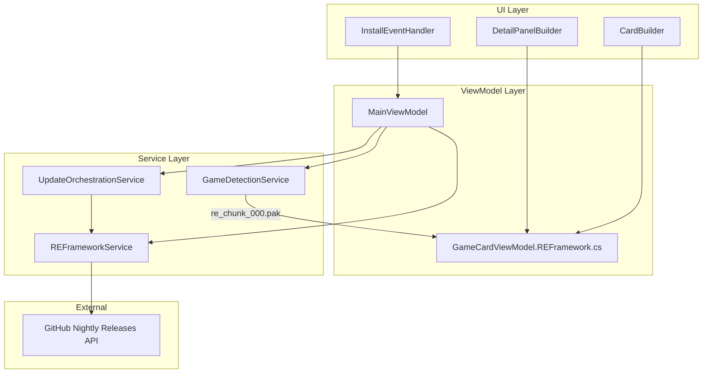

# Design Document: RE Framework Support

## Overview

This feature adds first-class RE Framework support to RenoDX Commander (RHI), enabling automatic detection of RE Engine games, one-click installation of RE Framework from GitHub nightly releases, version tracking, always-on auto-updating, and uninstallation. The implementation follows the established patterns used by the existing ReShade and ReLimiter auxiliary tool integrations.

RE Framework (by praydog) injects via `dinput8.dll` and is required for ReShade/RenoDX to function in Capcom RE Engine games (Monster Hunter Wilds, Resident Evil series, Devil May Cry 5, Street Fighter 6, Dragon's Dogma 2, etc.). Currently, users must manually download and place this DLL — this feature automates the entire lifecycle.

## Architecture

The feature integrates into the existing layered architecture:



Key design decisions:
- **New `REFrameworkService`** follows the same pattern as `AuxInstallService` (ReShade) and the ReLimiter install logic in `MainViewModel`. It owns download, extraction, install, uninstall, version tracking, and update checking.
- **New `GameCardViewModel.REFramework.cs`** partial class follows the pattern of `GameCardViewModel.UltraLimiter.cs` — contains all RE Framework observable properties, computed properties, and targeted notification methods.
- **`EngineType.REEngine`** added to the existing enum, with detection logic in `GameDetectionService.DetectEngineAndPathCore` checking for `re_chunk_000.pak`.
- **No user toggle for auto-update** — RE Framework updates are always checked and included in "Update All".

## Components and Interfaces

### 1. `IREFrameworkService` / `REFrameworkService`

New service responsible for the RE Framework lifecycle. Registered as a singleton in DI.

```csharp
public interface IREFrameworkService
{
    /// <summary>
    /// Downloads MHWILDS.zip from the latest nightly release, extracts dinput8.dll,
    /// caches it, and copies it to the game's install path.
    /// </summary>
    Task<REFrameworkInstalledRecord> InstallAsync(
        string gameName, string installPath,
        IProgress<(string message, double percent)>? progress = null);

    /// <summary>Deletes dinput8.dll from the game directory and removes the install record.</summary>
    void Uninstall(string gameName, string installPath);

    /// <summary>Checks GitHub nightly releases for a newer version than the installed one.</summary>
    Task<bool> CheckForUpdateAsync(string installedVersion);

    /// <summary>Returns the latest release tag from the nightly API (cached per session).</summary>
    Task<string?> GetLatestVersionAsync();
}
```

Internal implementation details:
- Uses the shared `HttpClient` singleton (already configured with `User-Agent: RHI/2.0`).
- Downloads `MHWILDS.zip` from `https://github.com/praydog/REFramework-nightly/releases/latest/download/MHWILDS.zip`.
- Extracts `dinput8.dll` using `System.IO.Compression.ZipFile` (standard ZIP, no 7-Zip needed).
- Caches extracted `dinput8.dll` in `%LocalAppData%\RHI\downloads\reframework\dinput8.dll`.
- Deletes the downloaded ZIP after extraction, retaining only the DLL.
- Version is obtained from the GitHub release tag via the releases API.
- Persists install records to `%LocalAppData%\RHI\reframework_installed.json`.

### 2. `REFrameworkInstalledRecord` (Model)

```csharp
public class REFrameworkInstalledRecord
{
    public string GameName { get; set; } = "";
    public string InstallPath { get; set; } = "";
    public string InstalledVersion { get; set; } = "";
    public DateTime InstalledAt { get; set; }
}
```

Follows the pattern of `AuxInstalledRecord` and `LumaInstalledRecord`.

### 3. `EngineType` Enum Extension

```csharp
public enum EngineType { Unknown, Unreal, UnrealLegacy, Unity, REEngine }
```

### 4. `GameDetectionService` Changes

In `DetectEngineAndPathCore`, add RE Engine detection before the generic fallback:

```csharp
// --- RE Engine ---
// re_chunk_000.pak is the signature file for all RE Engine games
var reChunk = FindFileShallow(rootPath, "re_chunk_000.pak", maxDepth: MaxScanDepth / 2);
if (reChunk != null)
{
    var reExeFolder = FindShallowExeFolder(rootPath);
    return (reExeFolder ?? rootPath, EngineType.REEngine);
}
```

This is placed after Unity detection and before the generic fallback, since RE Engine games have a distinctive marker file.

### 5. `GameCardViewModel.REFramework.cs` (Partial Class)

New partial class following the `GameCardViewModel.UltraLimiter.cs` pattern:

Observable properties:
- `RefStatus` (GameStatus) — NotInstalled, Installed, UpdateAvailable
- `RefIsInstalling` (bool)
- `RefProgress` (double)
- `RefActionMessage` (string)
- `RefInstalledVersion` (string?)

Plain properties:
- `RefRecord` (REFrameworkInstalledRecord?)
- `IsREEngineGame` (bool) — set during card initialization
- `ExcludeFromUpdateAllRef` (bool)

Computed properties (same pattern as UltraLimiter):
- `RefStatusText`, `RefStatusColor`, `RefShortAction`
- `RefActionLabel`, `RefBtnBackground/Foreground/BorderBrush`
- `RefDeleteVisibility`, `RefProgressVisibility`, `RefMessageVisibility`
- `RefRowVisibility` — Visible only when `IsREEngineGame && !EffectiveLumaMode`
- `IsRefInstalled`, `IsRefNotInstalling`
- `CardRefStatusDot`, `CardRefInstallEnabled`

### 6. UI Changes

**DetailPanelBuilder**: Add RE Framework row in `UpdateDetailComponentRows()` above the ReShade row. The row follows the same Grid layout as RS/UL/RDX rows (name, status, install button, delete button).

**CardBuilder**: Add RE Framework component row in `BuildInstallFlyoutContent()` above the ReShade row. Add RE Framework status dot in the card grid status row.

**InstallEventHandler**: Add `InstallRefButton_Click` and `UninstallRefButton_Click` handlers following the same pattern as `InstallUlButton_Click`/`UninstallUlButton_Click`.

**MainWindow.xaml**: Add `DetailRefRow` Grid with the same column structure as `DetailRsRow`, `DetailUlRow`, etc.

### 7. UpdateOrchestrationService Changes

- Add `UpdateAllREFrameworkAsync()` method following the pattern of `UpdateAllReShadeAsync()`.
- Add RE Framework update checking in `CheckForUpdatesAsync()` alongside existing RS checks.
- Include RE Framework in the "Update All" batch operation.

### 8. MainViewModel Changes

- Register `IREFrameworkService` in card initialization.
- Set `IsREEngineGame = true` when `engine == EngineType.REEngine`.
- Add `InstallREFrameworkCommand` and `UninstallREFrameworkCommand` relay commands.
- Wire RE Framework status into `NotifyAll()`.
- Add RE Framework to the `EngineHint` mapping: `EngineType.REEngine => "RE Engine"`.
- Add RE Framework to the graphics API fallback: RE Engine games typically use DirectX 11/12.

## Data Models

### REFrameworkInstalledRecord

| Field | Type | Description |
|-------|------|-------------|
| GameName | string | Name of the game |
| InstallPath | string | Path where dinput8.dll was installed |
| InstalledVersion | string | Release tag from GitHub (e.g. "01302") |
| InstalledAt | DateTime | UTC timestamp of installation |

### Persistence

- File: `%LocalAppData%\RHI\reframework_installed.json`
- Format: JSON array of `REFrameworkInstalledRecord`
- Read on startup, written after each install/uninstall operation
- Follows the same pattern as `aux_installed.json`

### GitHub API Response (Nightly Releases)

The service queries `https://api.github.com/repos/praydog/REFramework-nightly/releases` and uses:
- `tag_name` — version identifier (e.g. "01302")
- `assets[].name` — to find "MHWILDS.zip"
- `assets[].browser_download_url` — direct download URL


## Correctness Properties

*A property is a characteristic or behavior that should hold true across all valid executions of a system — essentially, a formal statement about what the system should do. Properties serve as the bridge between human-readable specifications and machine-verifiable correctness guarantees.*

### Property 1: RE Engine detection via re_chunk_000.pak

*For any* game install directory, the engine detection function SHALL return `EngineType.REEngine` if and only if `re_chunk_000.pak` exists in the directory (or adjacent to the game executable). Directories without this file SHALL NOT be classified as REEngine.

**Validates: Requirements 1.1, 1.2**

### Property 2: Engine hint mapping for RE Engine

*For any* game card where the detected engine type is `EngineType.REEngine`, the `EngineHint` property SHALL be set to `"RE Engine"`.

**Validates: Requirements 1.3**

### Property 3: Manifest engine override takes precedence

*For any* game that is auto-detected as RE Engine but has a manifest engine override set, the displayed engine label SHALL match the manifest override value, not `"RE Engine"`.

**Validates: Requirements 1.5**

### Property 4: RE Framework row visibility

*For any* game card, the RE Framework row visibility SHALL be `Visible` if and only if `IsREEngineGame` is true and the card is not in Luma mode. When either condition is false, the row SHALL be `Collapsed`.

**Validates: Requirements 2.1, 2.4, 2.5**

### Property 5: RE Framework status text mapping

*For any* game card with `IsREEngineGame == true`, the `RefStatusText` SHALL be:
- `"Installing…"` when `RefIsInstalling` is true
- `"Update"` when `RefStatus` is `UpdateAvailable`
- The installed version string when `RefStatus` is `Installed` and a version is known
- `"Installed"` when `RefStatus` is `Installed` and no version is known
- `"Ready"` when `RefStatus` is `NotInstalled`

**Validates: Requirements 4.1, 4.3, 5.3**

### Property 6: RE Framework action label mapping

*For any* game card with `IsREEngineGame == true`, the `RefActionLabel` SHALL be:
- `"Installing..."` when `RefIsInstalling` is true
- `"⬆  Update RE Framework"` when `RefStatus` is `UpdateAvailable`
- `"↺  Reinstall RE Framework"` when `RefStatus` is `Installed`
- `"⬇  Install RE Framework"` when `RefStatus` is `NotInstalled` or `Available`

**Validates: Requirements 6.1, 6.2, 6.3, 6.4**

### Property 7: RE Framework status dot and UI state mapping

*For any* game card with `IsREEngineGame == true`:
- The status dot color SHALL be green (`#4CAF50`) when installed, amber/green when update available, blue (`#2196F3`) when installing, and grey (`#5A6880`) when not installed.
- The delete button SHALL be visible only when `RefStatus` is `Installed` or `UpdateAvailable`.
- The progress indicator SHALL be visible only when `RefIsInstalling` is true.

**Validates: Requirements 6.5, 7.4, 3.6**

### Property 8: Install record serialization round-trip

*For any* valid `REFrameworkInstalledRecord`, serializing to JSON and then deserializing SHALL produce an equivalent record with the same `GameName`, `InstallPath`, `InstalledVersion`, and `InstalledAt` values.

**Validates: Requirements 4.4**

### Property 9: Update propagation across all installed cards

*For any* set of game cards where RE Framework is installed, when a newer version is detected, ALL such cards SHALL have their `RefStatus` set to `UpdateAvailable`.

**Validates: Requirements 5.2, 5.5**

## Error Handling

| Scenario | Handling |
|----------|----------|
| GitHub API unreachable | Log warning, skip update check, retain current install state. No user-facing error unless install was explicitly requested. |
| MHWILDS.zip download fails | Set `RefActionMessage` to error text, revert `RefIsInstalling` to false, keep `RefStatus` unchanged. |
| ZIP extraction fails (corrupt archive) | Same as download failure. Delete partial ZIP from cache. |
| dinput8.dll copy fails (file locked) | Set `RefActionMessage` to error text explaining the file may be in use. Suggest closing the game. |
| Uninstall fails (file locked) | Set `RefActionMessage` to error text. Status remains Installed. |
| JSON persistence fails | Log error via `CrashReporter`. Non-fatal — app continues but version info may be lost on restart. |
| Rate limiting on GitHub API | Use conditional requests (If-None-Match/ETag). Cache the latest version per session to avoid repeated calls. |

All error paths follow the existing pattern: catch exceptions, log via `CrashReporter`, set the card's action message to a user-friendly error string prefixed with `❌`, and ensure `IsInstalling` is reset to false.

## Testing Strategy

### Property-Based Testing

Library: **FsCheck** (already used in the project's test suite based on existing test files like `DragDropPropertyTests.cs`).

Each correctness property above maps to a single property-based test with a minimum of 100 iterations. Tests are tagged with the format:

```
Feature: re-framework-support, Property {N}: {title}
```

Property tests focus on:
- Engine detection logic (Property 1) — generate random directory structures with/without `re_chunk_000.pak`
- ViewModel computed property mappings (Properties 2, 4, 5, 6, 7) — generate random `(GameStatus, bool, string?)` tuples and verify computed outputs
- Serialization round-trip (Property 8) — generate random `REFrameworkInstalledRecord` instances
- Update propagation (Property 9) — generate random sets of cards with various install states

### Unit Testing

Unit tests complement property tests for specific examples and edge cases:
- Manifest override precedence with specific game names
- Install flow with mocked HTTP responses (specific ZIP content)
- Uninstall when file is locked (IOException handling)
- ZIP cleanup after successful extraction
- Error message formatting for specific failure modes
- UI row ordering verification (RE Framework above ReShade)

### Integration Points

- `GameDetectionService.DetectEngineAndPathCore` — verify RE Engine detection integrates correctly with existing Unreal/Unity detection (RE Engine check must not false-positive on Unreal games)
- `UpdateOrchestrationService` — verify RE Framework is included in batch update flow
- `MainViewModel` card initialization — verify `IsREEngineGame` flag is set correctly from engine detection results
