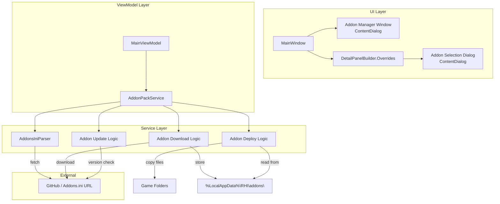

# Design Document: ReShade Addons

## Overview

This feature adds curated ReShade addon management to RHI, mirroring the existing Global Shaders pattern. It introduces:

1. An **Addons.ini parser** that fetches and parses the official ReShade addon list, filtering out excluded/commented sections.
2. A **Global Addon Manager Window** (ContentDialog) accessible from the main UI header, allowing users to browse and download addons.
3. An **Addon Download & Storage Service** that downloads addon files (direct `.addon32`/`.addon64` or `.zip` archives) to `%LocalAppData%\RHI\addons\`.
4. An **Addon Auto-Update Service** using the same GitHub release checking mechanism as ShaderPackService.
5. **Override Panel layout changes** — swapping Shaders to the bottom row and Bitness/API to the middle row, with a new Addons section on the bottom-right.
6. **Per-game addon control** via a Global toggle (on = global set, off = per-game selection) in the override panel.
7. **Addon deployment** to game folders alongside ReShade, selecting the correct bitness variant.
8. An **Addon Selection Dialog** (ContentDialog) for per-game addon picking, mirroring ShaderPopupHelper.

### Key Design Decisions

- **Mirror the Shaders pattern**: The addon manager, per-game toggle, and selection dialog follow the same UX and code patterns as ShaderPackService / ShaderPopupHelper to maintain consistency.
- **INI parser as a pure service**: `AddonsIniParser` is a stateless utility with `Parse` and `PrettyPrint` methods, making it independently testable with round-trip properties.
- **Staging area model**: Addons are downloaded once to a central staging directory, then deployed (copied) per-game. This avoids redundant downloads and simplifies updates.
- **Exclusion list is hardcoded**: Sections 00, 21, 26 and commented-out sections are filtered at parse time. This is a simple constant array, not user-configurable.
- **RenoDX DevKit as a supplementary addon**: The RenoDX DevKit addon is injected into the available packs list alongside the Addons.ini entries, with its own static download URLs from the `snapshot` release tag. This keeps it decoupled from the INI parser.
- **First-time warning gate**: A persistent boolean flag (`AddonWarningDismissed`) gates the first open of the Addon Manager Window. The flag is stored in the app's settings JSON. This ensures advanced users acknowledge the nature of addons before proceeding.

## Architecture



### Data Flow

1. On startup (or refresh), `AddonPackService.EnsureLatestAsync()` fetches Addons.ini, parses it via `AddonsIniParser`, appends the RenoDX DevKit addon entry, and caches the result.
2. The Addon Manager Window reads from `AddonPackService.AvailablePacks` and shows download status from the staging directory. On first open, a warning dialog is shown.
3. Downloads go through `AddonPackService` which handles direct files and zip extraction, storing results in `%LocalAppData%\RHI\addons\`.
4. Auto-update checks each downloaded addon's GitHub release tag against the stored version.
5. Deployment reads the game's addon selection (global or per-game) and copies the correct bitness variant to the game's addon deploy path.

## Components and Interfaces

### AddonsIniParser (Static Utility)

```csharp
namespace RenoDXCommander.Services;

public static class AddonsIniParser
{
    // Section IDs to exclude (managed by RHI or N/A)
    public static readonly HashSet<string> ExcludedSections = new() { "00", "21", "26" };

    /// <summary>
    /// Parses Addons.ini content into a list of AddonEntry objects.
    /// Skips excluded sections and commented-out sections.
    /// Skips entries with malformed/missing required fields (logs warning).
    /// </summary>
    public static List<AddonEntry> Parse(string iniContent, Action<string>? logWarning = null);

    /// <summary>
    /// Formats a list of AddonEntry objects back into valid Addons.ini format.
    /// </summary>
    public static string PrettyPrint(List<AddonEntry> entries);
}
```

### AddonEntry (Model)

```csharp
namespace RenoDXCommander.Models;

public record AddonEntry(
    string SectionId,
    string PackageName,
    string? PackageDescription,
    string? DownloadUrl,
    string? DownloadUrl32,
    string? DownloadUrl64,
    string? RepositoryUrl,
    string? EffectInstallPath);
```

### IAddonPackService (Interface)

```csharp
namespace RenoDXCommander.Services;

public interface IAddonPackService
{
    /// <summary>Available addon entries parsed from Addons.ini.</summary>
    IReadOnlyList<AddonEntry> AvailablePacks { get; }

    /// <summary>Fetches Addons.ini, parses, and caches. Called on startup.</summary>
    Task EnsureLatestAsync();

    /// <summary>Downloads an addon to the staging area. Handles .addon/.zip formats.</summary>
    Task DownloadAddonAsync(AddonEntry entry, IProgress<(string msg, double pct)>? progress = null);

    /// <summary>Checks if an addon is already downloaded in the staging area.</summary>
    bool IsDownloaded(string packageName);

    /// <summary>Returns the list of addon package names currently in the staging area.</summary>
    IReadOnlyList<string> DownloadedAddonNames { get; }

    /// <summary>Checks all downloaded addons for updates and downloads newer versions.</summary>
    Task CheckAndUpdateAllAsync();

    /// <summary>
    /// Deploys addons for a specific game based on its selection (global or per-game).
    /// Copies correct bitness variant. Removes stale addon files.
    /// </summary>
    void DeployAddonsForGame(string gameName, string installPath, bool is32Bit,
        bool useGlobalSet, List<string>? perGameSelection);
}
```

### AddonPackService (Implementation)

```csharp
namespace RenoDXCommander.Services;

/// <summary>
/// Manages addon lifecycle: fetch, parse, download, update, deploy.
/// Mirrors ShaderPackService pattern.
/// </summary>
public class AddonPackService : IAddonPackService
{
    private static readonly string AddonsIniUrl =
        "https://raw.githubusercontent.com/crosire/reshade-shaders/list/Addons.ini";
    private static readonly string StagingDir =
        Path.Combine(Environment.GetFolderPath(Environment.SpecialFolder.LocalApplicationData),
            "RHI", "addons");
    private static readonly string CachePath =
        Path.Combine(Environment.GetFolderPath(Environment.SpecialFolder.LocalApplicationData),
            "RHI", "addons_cache.ini");

    private readonly HttpClient _http;
    private List<AddonEntry> _packs = new();

    // RenoDX DevKit addon — injected alongside Addons.ini entries
    private static readonly AddonEntry RenoDxDevKitEntry = new(
        SectionId: "renodx-devkit",
        PackageName: "RenoDX DevKit",
        PackageDescription: "RenoDX development tools addon for ReShade",
        DownloadUrl: null,
        DownloadUrl32: "https://github.com/clshortfuse/renodx/releases/download/snapshot/renodx-devkit.addon32",
        DownloadUrl64: "https://github.com/clshortfuse/renodx/releases/download/snapshot/renodx-devkit.addon64",
        RepositoryUrl: "https://github.com/clshortfuse/renodx",
        EffectInstallPath: null);

    // ... implementation follows ShaderPackService patterns
    // EnsureLatestAsync appends RenoDxDevKitEntry to the parsed Addons.ini list
}
```

### AddonPopupHelper (Static UI Helper)

Mirrors `ShaderPopupHelper` for addon selection:

```csharp
namespace RenoDXCommander;

public static class AddonPopupHelper
{
    public enum PopupContext { Global, PerGame }

    /// <summary>
    /// Shows the addon selection popup. Returns selected addon package names, or null if cancelled.
    /// </summary>
    public static async Task<List<string>?> ShowAsync(
        XamlRoot xamlRoot,
        IAddonPackService addonPackService,
        List<string>? currentSelection,
        PopupContext context);

    /// <summary>
    /// Pure logic: computes the checkbox model for the popup.
    /// </summary>
    internal static List<(string PackageName, bool IsChecked)> ComputeCheckboxModel(
        IReadOnlyList<AddonEntry> availableAddons,
        List<string>? currentSelection);
}
```

### UI Integration Points

- **MainWindow header**: A "ReShade Addons" button added to the right of "Global Shaders" in `MainWindow.Skeleton.cs` / `MainWindow.xaml`. First click shows a warning dialog; subsequent clicks go straight to the manager.
- **First-time warning dialog**: A ContentDialog with warning text explaining addons are advanced features. "Continue" persists `AddonWarningDismissed = true` in settings and opens the manager. "Cancel" closes without persisting.
- **DetailPanelBuilder.Overrides.cs**: Override panel restructured:
  - Middle row: Bitness/API (left) | Global update inclusion (right) — moved from bottom
  - Bottom row: Shaders (left) | Addons (right) — Shaders moved from middle, Addons new
- **Addons override section**: Global toggle + "Select Addons" button, same pattern as Shaders toggle + "Select Shaders" button.
- **MainViewModel**: New properties/methods for addon state, per-game addon selection persistence, and deployment orchestration.
- **SettingsViewModel**: New `PerGameAddonSelection` dictionary, `SelectedGlobalAddons` list, and `AddonWarningDismissed` boolean persisted to settings JSON.

## Data Models

### AddonEntry

| Field | Type | Required | Description |
|-------|------|----------|-------------|
| SectionId | string | Yes | INI section number (e.g. "01") |
| PackageName | string | Yes | Display name from INI |
| PackageDescription | string? | No | Description text |
| DownloadUrl | string? | No | Single download URL |
| DownloadUrl32 | string? | No | 32-bit specific download URL |
| DownloadUrl64 | string? | No | 64-bit specific download URL |
| RepositoryUrl | string? | No | GitHub/source repository URL |
| EffectInstallPath | string? | No | Custom install path for effects |

At least one of `DownloadUrl`, `DownloadUrl32`/`DownloadUrl64`, or `RepositoryUrl` must be present for a valid entry.

### Addon Storage Layout

```
%LocalAppData%\RHI\
├── addons\
│   ├── AddonName.addon64
│   ├── AddonName.addon32
│   ├── AnotherAddon.addon64
│   ├── renodx-devkit.addon64  # RenoDX DevKit addon
│   ├── renodx-devkit.addon32  # RenoDX DevKit addon (32-bit)
│   └── versions.json          # Tracks installed versions per addon
├── addons_cache.ini           # Cached Addons.ini for offline fallback
```

### Per-Game Addon Selection (Persisted in GameNameService)

```csharp
// In GameNameService, mirroring PerGameShaderSelection
public Dictionary<string, List<string>> PerGameAddonSelection { get; set; } = new();
// Key: game name, Value: list of addon PackageNames

// In GameNameService, mirroring PerGameShaderMode
public Dictionary<string, string> PerGameAddonMode { get; set; } = new();
// Key: game name, Value: "Global" or "Select"
```

### Addon Version Tracking (versions.json)

```json
{
  "AddonName": {
    "version": "1.2.3",
    "lastChecked": "2024-01-15T10:30:00Z",
    "fileName32": "AddonName.addon32",
    "fileName64": "AddonName.addon64"
  }
}
```


## Correctness Properties

*A property is a characteristic or behavior that should hold true across all valid executions of a system — essentially, a formal statement about what the system should do. Properties serve as the bridge between human-readable specifications and machine-verifiable correctness guarantees.*

### Property 1: Addons.ini parse/print round-trip

*For any* valid list of `AddonEntry` objects, pretty-printing them to INI format and then parsing the result back should produce an equivalent list of `AddonEntry` objects.

**Validates: Requirements 1.2, 1.6, 1.7**

### Property 2: Parse filtering excludes invalid and excluded entries

*For any* Addons.ini content containing a mix of valid sections, excluded section IDs (00, 21, 26), commented-out sections, and malformed sections, the parser output should contain only entries with valid required fields whose section IDs are not in the exclusion list and are not commented out.

**Validates: Requirements 1.3, 1.5**

### Property 3: Addon action type determined by URL availability

*For any* `AddonEntry`, if it has at least one download URL (`DownloadUrl`, `DownloadUrl32`, or `DownloadUrl64`), the manager window should show a download button; if it has only a `RepositoryUrl` and no download URLs, it should show a repository link.

**Validates: Requirements 2.5, 2.6**

### Property 4: Download status reflects storage state

*For any* `AddonEntry` and any state of the addon staging directory, `IsDownloaded(packageName)` should return true if and only if the corresponding addon file(s) exist in the staging directory.

**Validates: Requirements 2.7**

### Property 5: URL classification — direct save vs zip extract

*For any* download URL string, if the URL ends with `.addon32` or `.addon64` the download service should save the file directly; if it ends with `.zip` the service should extract addon files from the archive.

**Validates: Requirements 3.2, 3.3**

### Property 6: Download file count matches provided URLs

*For any* `AddonEntry`, if both `DownloadUrl32` and `DownloadUrl64` are provided, two files should be stored in the staging area; if only a single `DownloadUrl` is provided, one file should be stored.

**Validates: Requirements 3.4, 3.5**

### Property 7: Addon version tracking round-trip

*For any* addon package name and version string, writing the version to `versions.json` and then reading it back should produce the same version string.

**Validates: Requirements 3.7**

### Property 8: Per-game addon selection persistence round-trip

*For any* game name and list of addon package names, persisting the per-game addon selection and then loading it should produce an equivalent list.

**Validates: Requirements 6.5**

### Property 9: Global toggle ON clears per-game selection

*For any* game that has a per-game addon selection, switching the Global toggle from OFF to ON should result in the per-game selection being cleared (empty or removed).

**Validates: Requirements 6.6**

### Property 10: Deployment matches active selection with correct bitness

*For any* game with ReShade installed, the set of addon files in the deploy path after deployment should exactly match the active selection (global set if Global toggle is ON, per-game selection if OFF), filtered to only include addons that have the matching bitness variant available, and each deployed file should have the correct bitness extension (`.addon32` for 32-bit games, `.addon64` for 64-bit games). Addons without the required bitness variant should not be deployed.

**Validates: Requirements 6.2, 7.1, 7.2, 7.3, 7.4**

### Property 11: Deployment removes stale addon files

*For any* game's addon deploy path, after a deployment operation, the only addon files present should be those in the current active selection. Any previously deployed addon files not in the new selection should be removed.

**Validates: Requirements 7.6**

### Property 12: Addon selection checkbox model

*For any* set of available addons (global addon set) and any current per-game selection, the computed checkbox model should contain one entry per available addon, and each entry's `IsChecked` state should be `true` if and only if the addon's package name is in the current selection.

**Validates: Requirements 8.1, 8.2, 8.3, 8.4**

### Property 13: Cancel preserves existing selection

*For any* existing per-game addon selection, if the user cancels the addon selection dialog, the per-game selection should remain unchanged.

**Validates: Requirements 8.5**

### Property 14: RenoDX DevKit addon always present in available packs

*For any* result of `EnsureLatestAsync`, the `AvailablePacks` list should always contain an entry with PackageName "RenoDX DevKit" and the correct download URLs for both 32-bit and 64-bit variants, regardless of the Addons.ini content.

**Validates: Requirements 9.1, 9.2**

### Property 15: First-time warning shown exactly once

*For any* sequence of Addon Manager Window open attempts, the warning dialog should be shown if and only if `AddonWarningDismissed` is false. After the user clicks "Continue", `AddonWarningDismissed` becomes true and the warning is never shown again. If the user clicks "Cancel", `AddonWarningDismissed` remains false.

**Validates: Requirements 10.1, 10.4, 10.5**

### Property 16: Missing bitness variant skips addon deployment

*For any* addon in the active selection and any game bitness, if the addon does not have the required bitness variant file (`.addon32` for 32-bit, `.addon64` for 64-bit) in the staging directory, that addon should not be deployed to the game's folder. No fallback variant should be used.

**Validates: Requirements 7.3, 7.4**

## Error Handling

| Scenario | Behavior |
|----------|----------|
| Addons.ini fetch fails (network error, HTTP error) | Log error via `ICrashReporter`, fall back to cached `addons_cache.ini` if available. If no cache, `AvailablePacks` remains empty. |
| Malformed INI section (missing PackageName) | Skip the entry, log a warning. Other valid entries are still returned. |
| Addon download fails (network error, disk full) | Display error message on the addon's row in the manager window, log via `ICrashReporter`. Existing files in staging are not affected. |
| Zip archive contains no addon files | Log warning, display "No addon files found in archive" message. |
| Addon update check fails | Retain existing addon version, log error. Do not remove or corrupt the existing file. |
| Deploy path creation fails (permissions) | Log error, skip deployment for that game. Display error in the UI status message. |
| Game folder doesn't exist during deployment | Skip deployment, log warning. |
| versions.json is corrupted | Log error, recreate the file from the files present in the staging directory. |

## Testing Strategy

### Unit Tests

Unit tests cover specific examples, edge cases, and integration points:

- **Parse empty INI content** → returns empty list
- **Parse INI with only excluded sections** → returns empty list
- **Parse INI with one valid section** → returns one `AddonEntry` with correct fields
- **Fetch failure with cached file** → returns cached entries
- **Fetch failure without cache** → returns empty list, logs error
- **Download failure** → error message displayed, staging unchanged
- **Update failure** → existing version retained
- **Empty global addon set** → selection dialog shows "no addons" message
- **Deploy to non-existent directory** → directory created, files deployed
- **EffectInstallPath handling** → addon placed in correct subdirectory

### Property-Based Tests

Property-based tests use **FsCheck** (the standard .NET PBT library, already available in the test project) with a minimum of 20 iterations per property.

Each property test references its design document property:

1. **Feature: reshade-addons, Property 1: Addons.ini parse/print round-trip** — Generate random lists of `AddonEntry`, pretty-print, parse, verify equivalence.
2. **Feature: reshade-addons, Property 2: Parse filtering excludes invalid and excluded entries** — Generate INI content with mixed valid/excluded/malformed sections, verify output contains only valid non-excluded entries.
3. **Feature: reshade-addons, Property 3: Addon action type determined by URL availability** — Generate random `AddonEntry` objects with varying URL fields, verify correct action type.
4. **Feature: reshade-addons, Property 4: Download status reflects storage state** — Generate random package names and staging directory states, verify `IsDownloaded` correctness.
5. **Feature: reshade-addons, Property 5: URL classification — direct save vs zip extract** — Generate random URLs with `.addon32`, `.addon64`, `.zip` extensions, verify classification.
6. **Feature: reshade-addons, Property 6: Download file count matches provided URLs** — Generate random `AddonEntry` objects with varying URL combinations, verify file count.
7. **Feature: reshade-addons, Property 7: Addon version tracking round-trip** — Generate random package names and version strings, write/read, verify equivalence.
8. **Feature: reshade-addons, Property 8: Per-game addon selection persistence round-trip** — Generate random game names and addon lists, persist/load, verify equivalence.
9. **Feature: reshade-addons, Property 9: Global toggle ON clears per-game selection** — Generate random per-game selections, toggle to Global, verify cleared.
10. **Feature: reshade-addons, Property 10: Deployment matches active selection with correct bitness** — Generate random addon sets, game bitness, and toggle states, verify deployed files match.
11. **Feature: reshade-addons, Property 11: Deployment removes stale addon files** — Generate random previous and new selections, verify stale files removed.
12. **Feature: reshade-addons, Property 12: Addon selection checkbox model** — Generate random available addons and current selections, verify checkbox model via `AddonPopupHelper.ComputeCheckboxModel`.
13. **Feature: reshade-addons, Property 13: Cancel preserves existing selection** — Generate random selections, simulate cancel, verify unchanged.
14. **Feature: reshade-addons, Property 14: RenoDX DevKit addon always present in available packs** — Generate random Addons.ini content (including empty), verify RenoDX DevKit entry is always in the result.
15. **Feature: reshade-addons, Property 15: First-time warning shown exactly once** — Generate random sequences of open attempts with Continue/Cancel choices, verify warning flag state transitions.
16. **Feature: reshade-addons, Property 16: Missing bitness variant skips addon deployment** — Generate random addons with missing 32/64 variants and random game bitness, verify skipped addons are not deployed.

### Test Configuration

- PBT library: **FsCheck** (with xUnit integration via `FsCheck.Xunit`)
- Minimum iterations: 20 per property
- Each test tagged with: `// Feature: reshade-addons, Property N: <title>`
- Test project: `RenoDXCommander.Tests`
