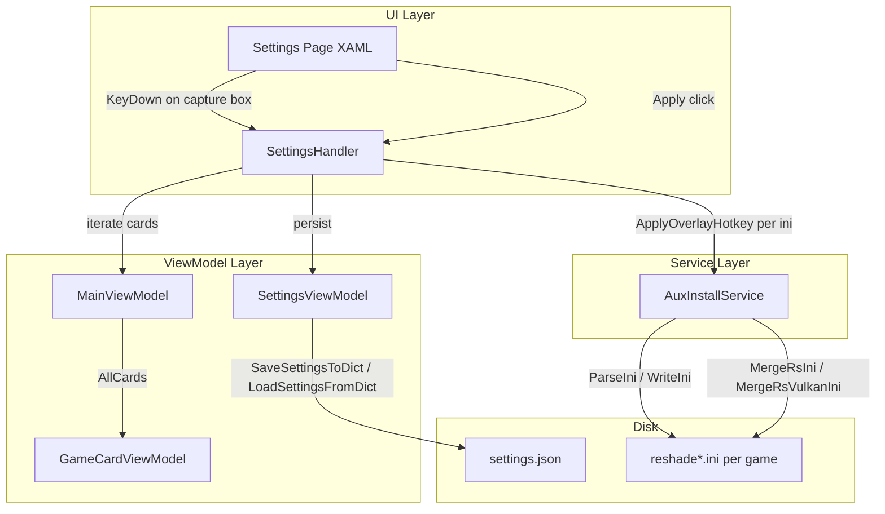

# Design Document: ReShade Hotkey Settings

## Overview

This feature adds a ReShade UI overlay hotkey configuration section to the RHI Settings page. The existing Screenshots container is restructured into a two-column layout: Screenshots on the left, ReShade UI Hotkey on the right. Users press a key combination in a capture box, persist it across restarts, and apply it to all managed reshade*.ini files. The hotkey is stored in ReShade's native `KeyOverlay=<vk_code>,<shift>,<ctrl>,<alt>` format under the `[INPUT]` section.

The implementation touches four layers:
1. **SettingsViewModel** — one new persisted property (`OverlayHotkey`, stored as `"vk,shift,ctrl,alt"` string)
2. **Settings page XAML** — restructure the Screenshots `<Border>` into a two-column `<Grid>` with the hotkey section on the right
3. **AuxInstallService** — a new static `ApplyOverlayHotkey` method plus integration into `MergeRsIni`/`MergeRsVulkanIni`
4. **SettingsHandler** — hotkey capture logic (KeyDown interception), Apply handler, and display formatting

## Architecture



Key design decisions:

- **Single string persistence** — The hotkey is stored as one `"vk,shift,ctrl,alt"` string (e.g. `"36,0,0,0"`) in both `settings.json` and the INI `KeyOverlay` value. This avoids four separate properties and matches ReShade's native format exactly.
- **Reuse `ParseIni`/`WriteIni`** — `ApplyOverlayHotkey` follows the identical pattern as `ApplyScreenshotPath`: parse → mutate `[INPUT]` section → write. No new INI infrastructure needed.
- **Static method on `AuxInstallService`** — Follows the `ApplyScreenshotPath` pattern. No new service class.
- **Default hotkey skip on deploy** — When the configured hotkey is the default Home key (`36,0,0,0`), `MergeRsIni`/`MergeRsVulkanIni` do NOT write `KeyOverlay`, preserving template-specific values (e.g. RDR2's END key). Only non-default hotkeys are written during deploy.
- **KeyDown interception on the capture box** — The `PreviewKeyDown` event on the `TextBox` intercepts the key press, extracts `VirtualKey` + modifier state from `KeyboardModifiers`, formats a human-readable label, and stores the raw values. The event is marked `Handled = true` to prevent the TextBox from receiving the character.
- **Pure helper functions** — `FormatHotkeyDisplay(int vk, bool shift, bool ctrl, bool alt)` and `ParseHotkeyString(string value)` are pure functions, easy to test with PBT.

## Components and Interfaces

### 1. `SettingsViewModel` — New Property

One new `[ObservableProperty]` field:

```csharp
[ObservableProperty] private string _overlayHotkey = "36,0,0,0";
```

`LoadSettingsFromDict` reads `"OverlayHotkey"` key, defaulting to `"36,0,0,0"` if absent. `SaveSettingsToDict` writes `s["OverlayHotkey"] = OverlayHotkey`. Follows the exact pattern of `ScreenshotPath`.

### 2. `AuxInstallService` — New Static Method

```csharp
/// <summary>
/// Writes or updates the [INPUT] section in the given reshade*.ini file,
/// setting KeyOverlay to the specified value. All other sections/keys are preserved.
/// </summary>
public static void ApplyOverlayHotkey(string iniFilePath, string keyOverlayValue)
```

Implementation: `ParseIni` → ensure `[INPUT]` section exists → set `KeyOverlay=<value>` → `WriteIni`. Identical structure to `ApplyScreenshotPath` but targeting `[INPUT]`/`KeyOverlay` instead of `[SCREENSHOT]`/`SavePath`.

### 3. `SettingsHandler` — New Methods

```csharp
/// <summary>
/// Parses a KeyOverlay format string "vk,shift,ctrl,alt" into its components.
/// Returns (vkCode, shift, ctrl, alt). Returns default (36,false,false,false) on invalid input.
/// </summary>
public static (int vk, bool shift, bool ctrl, bool alt) ParseHotkeyString(string value)

/// <summary>
/// Formats a hotkey into a human-readable display string.
/// Modifier order: Ctrl, Shift, Alt, then the main key name.
/// </summary>
public static string FormatHotkeyDisplay(int vk, bool shift, bool ctrl, bool alt)

/// <summary>
/// Formats a KeyOverlay string "vk,shift,ctrl,alt" into a human-readable display string.
/// </summary>
public static string FormatHotkeyDisplay(string keyOverlayValue)

/// <summary>
/// Builds a KeyOverlay format string from components.
/// </summary>
public static string BuildHotkeyString(int vk, bool shift, bool ctrl, bool alt)

/// <summary>
/// Returns true if the given KeyOverlay string represents the default Home key (36,0,0,0).
/// </summary>
public static bool IsDefaultHotkey(string keyOverlayValue)
```

**KeyDown handler** — attached to the `HotkeyBox` `PreviewKeyDown` event:
1. If the pressed key is a modifier-only key (Ctrl, Shift, Alt, or Windows), ignore it (Req 7.4).
2. Extract `VirtualKey` code from `e.Key`.
3. Read modifier state from the current keyboard state.
4. Build the `"vk,shift,ctrl,alt"` string and store it on a field.
5. Set `HotkeyBox.Text` to the formatted display string.
6. Mark `e.Handled = true`.

**Apply handler** — `ApplyOverlayHotkey_Click`:
1. Read the current hotkey string from the stored field.
2. Persist via `SettingsViewModel.OverlayHotkey` → `SaveSettingsPublic()`.
3. Iterate `ViewModel.AllCards`, enumerate `reshade*.ini` files per game (same pattern as `ApplyScreenshotPath_Click`).
4. Call `AuxInstallService.ApplyOverlayHotkey(iniFile, hotkeyValue)` for each.
5. Show confirmation dialog with count.

### 4. Settings Page XAML — Restructured Layout

The existing Screenshots `<Border>` is restructured into a two-column `<Grid>`:

```xml
<!-- ── Screenshots & Hotkey ────────────────────────────────── -->
<Border Background="{StaticResource SurfaceRaisedBrush}" CornerRadius="10" Padding="20,16"
        BorderBrush="{StaticResource BorderSubtleBrush}" BorderThickness="1">
    <Grid ColumnSpacing="24">
        <Grid.ColumnDefinitions>
            <ColumnDefinition Width="*"/>
            <ColumnDefinition Width="*"/>
        </Grid.ColumnDefinitions>

        <!-- Left: Screenshots (existing content, unchanged) -->
        <StackPanel Grid.Column="0" Spacing="8">
            <TextBlock Text="Screenshots" ... />
            <!-- existing screenshot controls -->
        </StackPanel>

        <!-- Right: ReShade UI Hotkey -->
        <StackPanel Grid.Column="1" Spacing="8">
            <TextBlock Text="ReShade UI Hotkey" FontSize="14" FontWeight="SemiBold"
                       Foreground="{StaticResource TextPrimaryBrush}"/>
            <TextBlock TextWrapping="Wrap" FontSize="11"
                       Foreground="{StaticResource InlineDescriptionBrush}" LineHeight="18"
                       Text="Set the key combination to toggle the ReShade overlay in-game."/>
            <TextBox x:Name="HotkeyBox" x:FieldModifier="internal"
                     PlaceholderText="Press a key..."
                     IsReadOnly="True"
                     FontSize="12"
                     Background="{StaticResource SurfaceInputBrush}"
                     Foreground="{StaticResource TextSecondaryBrush}"
                     BorderBrush="{StaticResource BorderSubtleBrush}"
                     PreviewKeyDown="HotkeyBox_PreviewKeyDown"/>
            <Button x:Name="ApplyHotkeyBtn"
                    Content="Apply to All Games"
                    Click="ApplyOverlayHotkey_Click"
                    Background="{StaticResource AccentBlueBgBrush}"
                    Foreground="{StaticResource AccentBlueBrush}"
                    BorderBrush="{StaticResource AccentBlueBorderBrush}" BorderThickness="1"
                    CornerRadius="8" Padding="12,7" FontSize="12"
                    HorizontalAlignment="Stretch"/>
        </StackPanel>
    </Grid>
</Border>
```

### 5. Integration with MergeRsIni / MergeRsVulkanIni

An optional `string? overlayHotkey = null` parameter is added to both methods. After the existing merge + screenshot path logic, if `overlayHotkey` is non-null and not the default `"36,0,0,0"`, `ApplyOverlayHotkey` is called:

```csharp
public static void MergeRsIni(string gameDir, string? screenshotSavePath = null, string? overlayHotkey = null)
public static void MergeRsVulkanIni(string gameDir, string? gameName = null, string? screenshotSavePath = null, string? overlayHotkey = null)
```

The default-hotkey skip ensures template-specific values (like RDR2's END key) are preserved when the user hasn't customized the hotkey.

## Data Models

### Settings Persistence (settings.json)

One new key added to the flat `Dictionary<string, string>`:

| Key | Type | Default | Description |
|-----|------|---------|-------------|
| `OverlayHotkey` | string | `"36,0,0,0"` | KeyOverlay format: `vk_code,shift,ctrl,alt` |

### INI Section Format

The `[INPUT]` section written to reshade*.ini:

```ini
[INPUT]
KeyOverlay=36,0,0,0
```

With modifiers (e.g. Ctrl+F2):

```ini
[INPUT]
KeyOverlay=113,0,1,0
```

Format: `<vk_code>,<shift 0|1>,<ctrl 0|1>,<alt 0|1>`.

### Hotkey String Parsing/Formatting

| Direction | Input | Output |
|-----------|-------|--------|
| Parse | `"113,0,1,0"` | `(vk=113, shift=false, ctrl=true, alt=false)` |
| Format display | `(vk=113, shift=false, ctrl=true, alt=false)` | `"Ctrl + F2"` |
| Build string | `(vk=36, shift=false, ctrl=false, alt=false)` | `"36,0,0,0"` |
| Format display | `(vk=36, shift=false, ctrl=false, alt=false)` | `"Home"` |


## Correctness Properties

*A property is a characteristic or behavior that should hold true across all valid executions of a system — essentially, a formal statement about what the system should do. Properties serve as the bridge between human-readable specifications and machine-verifiable correctness guarantees.*

### Property 1: Hotkey settings round-trip

*For any* valid KeyOverlay format string `s` (matching `"<int>,<0|1>,<0|1>,<0|1>"`), setting `OverlayHotkey = s` on a `SettingsViewModel`, calling `SaveSettingsToDict`, then calling `LoadSettingsFromDict` on a fresh `SettingsViewModel` should produce the same `OverlayHotkey` value.

**Validates: Requirements 3.1, 3.2, 3.4**

### Property 2: Hotkey string round-trip

*For any* valid virtual key code integer (1–254) and any combination of boolean modifier flags (shift, ctrl, alt), calling `BuildHotkeyString(vk, shift, ctrl, alt)` then `ParseHotkeyString` on the result should return the original `(vk, shift, ctrl, alt)` tuple.

**Validates: Requirements 2.2**

### Property 3: FormatHotkeyDisplay produces correct ordered format

*For any* valid virtual key code (1–254) and any combination of modifier flags, `FormatHotkeyDisplay(vk, shift, ctrl, alt)` should produce a non-empty string where: (a) if any modifiers are true, they appear before the main key name separated by " + ", (b) modifier names appear in the order Ctrl, Shift, Alt, and (c) the main key name is non-empty.

**Validates: Requirements 2.1, 7.1, 7.2, 7.3**

### Property 4: ApplyOverlayHotkey writes correct KeyOverlay

*For any* valid INI file content and any non-empty KeyOverlay format string, after calling `ApplyOverlayHotkey(iniFile, value)`, parsing the resulting INI should yield an `[INPUT]` section containing `KeyOverlay` equal to the provided value.

**Validates: Requirements 4.3, 6.1, 6.3**

### Property 5: ApplyOverlayHotkey preserves other sections and keys

*For any* valid INI file content with arbitrary sections and keys, after calling `ApplyOverlayHotkey`, all sections other than `[INPUT]` should have identical keys and values as before the call. Keys within `[INPUT]` other than `KeyOverlay` should also be preserved.

**Validates: Requirements 4.4, 6.4, 6.5**

### Property 6: ApplyOverlayHotkey idempotence

*For any* valid INI file content (with or without an existing `[INPUT]` section), after calling `ApplyOverlayHotkey`, the resulting INI should contain exactly one `[INPUT]` section. Calling `ApplyOverlayHotkey` a second time with a different value should still result in exactly one `[INPUT]` section with the new value.

**Validates: Requirements 6.2**

### Property 7: MergeRsIni writes non-default hotkey

*For any* valid INI template content, any valid game INI content, and any non-default KeyOverlay string (not `"36,0,0,0"`), after calling `MergeRsIni(gameDir, screenshotSavePath: null, overlayHotkey: value)`, the resulting reshade.ini should contain an `[INPUT]` section with `KeyOverlay` equal to the provided value.

**Validates: Requirements 5.1, 5.3**

### Property 8: MergeRsIni skips default hotkey

*For any* valid INI template content and any game INI content that already contains a `KeyOverlay` value in `[INPUT]`, after calling `MergeRsIni` with `overlayHotkey` set to the default `"36,0,0,0"` (or `null`), the resulting `KeyOverlay` value should be unchanged from the template-merged result — the default hotkey should not overwrite existing values.

**Validates: Requirements 5.2**

## Error Handling

| Scenario | Handling |
|----------|----------|
| `reshade*.ini` is locked by another process | `ApplyOverlayHotkey` will throw `IOException`. The Apply handler catches it, logs via `CrashReporter`, and reports the failure count to the user. |
| Game folder no longer exists | The Apply handler checks `Directory.Exists(card.InstallPath)` before attempting to read/write. Skipped silently. |
| `reshade*.ini` is malformed (no valid sections) | `ParseIni` returns an empty dictionary. `ApplyOverlayHotkey` adds the `[INPUT]` section to it. |
| Invalid KeyOverlay string in settings.json | `ParseHotkeyString` returns the default `(36, false, false, false)` on any parse failure. |
| User clears the hotkey capture box | Reverts to default `"36,0,0,0"`. The Apply handler still writes this value to INIs (explicit apply). |
| Settings file is corrupted or missing | `LoadSettingsFile` returns an empty dictionary. `OverlayHotkey` defaults to `"36,0,0,0"`. |
| VK code outside valid range | `FormatHotkeyDisplay` falls back to `"Key <code>"` for unrecognized VK codes. |

## Testing Strategy

### Property-Based Tests (FsCheck + xUnit)

Each correctness property is implemented as a single FsCheck property test with a minimum of 100 iterations. Tests use the existing `FsCheck.Xunit` (v2.16.6) infrastructure already in the project.

| Test Class | Property | Tag |
|------------|----------|-----|
| `HotkeySettingsRoundTripPropertyTests` | Property 1 | Feature: reshade-hotkey-settings, Property 1: Hotkey settings round-trip |
| `HotkeyStringRoundTripPropertyTests` | Property 2 | Feature: reshade-hotkey-settings, Property 2: Hotkey string round-trip |
| `HotkeyDisplayFormatPropertyTests` | Property 3 | Feature: reshade-hotkey-settings, Property 3: FormatHotkeyDisplay produces correct ordered format |
| `ApplyOverlayHotkeyPropertyTests` | Property 4 | Feature: reshade-hotkey-settings, Property 4: ApplyOverlayHotkey writes correct KeyOverlay |
| `HotkeyIniPreservationPropertyTests` | Property 5 | Feature: reshade-hotkey-settings, Property 5: ApplyOverlayHotkey preserves other sections and keys |
| `HotkeyIniIdempotencePropertyTests` | Property 6 | Feature: reshade-hotkey-settings, Property 6: ApplyOverlayHotkey idempotence |
| `MergeRsIniHotkeyPropertyTests` | Property 7 | Feature: reshade-hotkey-settings, Property 7: MergeRsIni writes non-default hotkey |
| `MergeRsIniDefaultHotkeySkipPropertyTests` | Property 8 | Feature: reshade-hotkey-settings, Property 8: MergeRsIni skips default hotkey |

Each property test must:
- Use `[Property(MaxTest = 100)]` attribute
- Include a comment referencing the design property number and text
- Use `Prop.ForAll` with appropriate `Arb` generators

### Unit Tests

Unit tests complement property tests for specific examples and edge cases:

- Fresh `SettingsViewModel` has `OverlayHotkey == "36,0,0,0"` (Req 3.3 default)
- `ParseHotkeyString` with invalid input returns default `(36, false, false, false)`
- `FormatHotkeyDisplay("36,0,0,0")` returns `"Home"`
- `FormatHotkeyDisplay("113,0,1,0")` returns `"Ctrl + F2"`
- `IsDefaultHotkey("36,0,0,0")` returns `true`; `IsDefaultHotkey("113,0,1,0")` returns `false`
- Clearing the capture box reverts to default hotkey string (Req 2.3)
