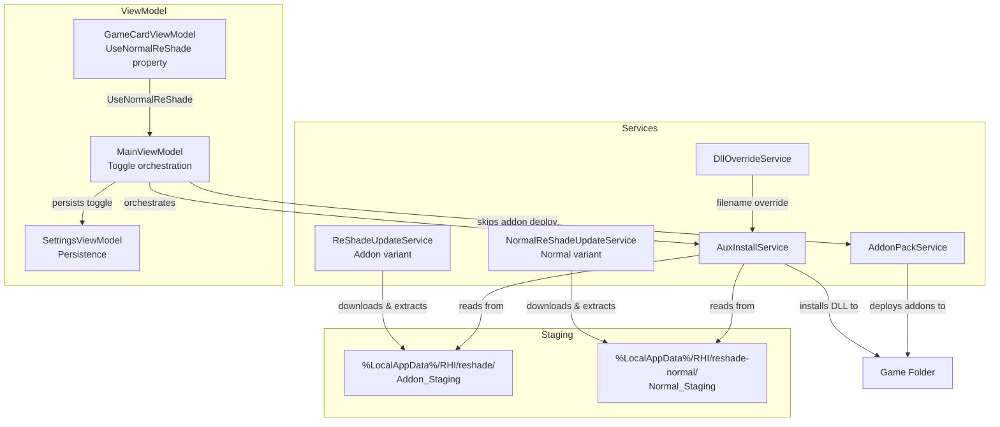

# Design Document: ReShade Without Addon Support

## Overview

This feature adds a per-game toggle (`UseNormalReShade`) that lets users switch individual games from the addon-enabled ReShade variant to the standard (non-addon) ReShade variant. When enabled, the toggle:

1. Downloads and stages the non-addon ReShade installer from `reshade.me` via a new `NormalReShadeUpdateService`
2. Removes all managed addon files from the game folder
3. Replaces the addon-enabled ReShade DLL with the normal variant
4. Disables addon-related UI elements for that game
5. Excludes the game from global addon deployment operations

The toggle is persisted per-game in `settings.json` and survives app restarts. Shader deployment is unaffected by the toggle.

## Architecture



The design follows existing patterns:
- `NormalReShadeUpdateService` mirrors `ReShadeUpdateService` with a different regex and staging directory
- Per-game toggle persistence uses the same `HashSet<string>` + `settings.json` pattern as `_updateAllExcludedReShade`
- Addon exclusion follows the same guard-check pattern used in `DeployAddonsForCard`
- Install state tracking uses `AuxInstalledRecord.AddonType` with a new `"ReShadeNormal"` value

## Components and Interfaces

### New: INormalReShadeUpdateService

A new interface mirroring `IReShadeUpdateService` for the non-addon variant:

```csharp
public interface INormalReShadeUpdateService
{
    Task<(string version, string url)?> CheckLatestVersionAsync();
    Task<bool> EnsureLatestAsync(IProgress<(string msg, double pct)>? progress = null);
    static string? GetStagedVersion(); // reads reshade_version.txt from Normal_Staging
}
```

**Rationale**: A separate interface (rather than reusing `IReShadeUpdateService`) avoids DI ambiguity and makes it explicit which variant is being resolved. The two services have different staging directories, regex patterns, and installer filenames.

### New: NormalReShadeUpdateService

Implements `INormalReShadeUpdateService`. Structurally identical to `ReShadeUpdateService` with these differences:

| Aspect | ReShadeUpdateService | NormalReShadeUpdateService |
|--------|---------------------|---------------------------|
| Regex | `/downloads/ReShade_Setup_([\d.]+)_Addon\.exe` | `/downloads/ReShade_Setup_([\d.]+)\.exe` |
| Staging dir | `%LocalAppData%\RHI\reshade\` | `%LocalAppData%\RHI\reshade-normal\` |
| Exe pattern | `ReShade_Setup_{ver}_Addon.exe` | `ReShade_Setup_{ver}.exe` |
| Cleanup glob | `ReShade_Setup_*_Addon.exe` | `ReShade_Setup_*.exe` (excluding `*_Addon.exe`) |

Constructor takes `HttpClient` and `ISevenZipExtractor` — same as the existing service.

### Modified: AuxInstallService

New constants and staging paths added to the partial class:

```csharp
public const string TypeReShadeNormal = "ReShadeNormal";

public static readonly string RsNormalStagingDir = Path.Combine(
    Environment.GetFolderPath(Environment.SpecialFolder.LocalApplicationData),
    "RHI", "reshade-normal");
public static string RsNormalStagedPath64 => Path.Combine(RsNormalStagingDir, RsStaged64);
public static string RsNormalStagedPath32 => Path.Combine(RsNormalStagingDir, RsStaged32);
```

`InstallReShadeAsync` gains a new optional parameter `bool useNormalReShade = false`. When true:
- Copies from `RsNormalStagedPath64/32` instead of `RsStagedPath64/32`
- Saves the record with `AddonType = TypeReShadeNormal` instead of `TypeReShade`
- All other logic (DC occupancy check, foreign DLL backup, INI merge, shader deploy) remains identical

`CheckReShadeUpdateLocal` is extended to handle `TypeReShadeNormal` records by comparing against the normal staging DLLs.

### Modified: IAuxInstallService

The interface method signature gains the new parameter:

```csharp
Task<AuxInstalledRecord> InstallReShadeAsync(
    string gameName, string installPath,
    string? shaderModeOverride = null, bool use32Bit = false,
    string? filenameOverride = null, IEnumerable<string>? selectedPackIds = null,
    IProgress<(string message, double percent)>? progress = null,
    string? screenshotSavePath = null,
    bool useNormalReShade = false);  // NEW
```

### Modified: GameCardViewModel

New observable property in the main partial class:

```csharp
[ObservableProperty] private bool _useNormalReShade;
```

New computed properties (in a new partial file `GameCardViewModel.NormalReShade.cs` or inline):

```csharp
/// <summary>True when addons should be disabled for this game (normal ReShade mode).</summary>
public bool AddonsDisabled => UseNormalReShade;

/// <summary>Addon rows should show strikethrough text when normal ReShade is active.</summary>
public bool AddonStrikethrough => UseNormalReShade;
```

Existing computed properties modified:
- `DcInstallEnabled` adds `&& !UseNormalReShade`
- `UlInstallEnabled` adds `&& !UseNormalReShade`
- Card-level addon install buttons check `!UseNormalReShade`

`OnUseNormalReShadeChanged` partial method triggers notification of all addon-related dependents.

### Modified: MainViewModel / Settings Persistence

Per-game toggle stored as `HashSet<string>` keyed by game name:

```csharp
private HashSet<string> _normalReShadeGames = new(StringComparer.OrdinalIgnoreCase);
```

Persisted in `settings.json` via `GameNameService.SaveNameMappings` / `LoadNameMappings` as a JSON array under key `"NormalReShadeGames"`.

Toggle orchestration method:

```csharp
public async Task SetUseNormalReShade(GameCardViewModel card, bool enable)
```

When `enable = true`:
1. Check normal staging DLLs exist; if not, show error
2. Uninstall existing addon ReShade (if installed)
3. Remove all managed addon files from game folder
4. Install normal ReShade via `InstallReShadeAsync(..., useNormalReShade: true)`
5. Add game to `_normalReShadeGames`, persist, update card

When `enable = false`:
1. Uninstall existing normal ReShade (if installed)
2. Install addon ReShade via `InstallReShadeAsync(..., useNormalReShade: false)`
3. Re-deploy addons per game's addon selection
4. Remove game from `_normalReShadeGames`, persist, update card

### Modified: AddonPackService / Deployment Exclusion

No changes to `AddonPackService` itself. The exclusion is handled at the call site in `MainViewModel.DeployAddonsForCard` and `DeployAllAddons`:

```csharp
// Skip addon deployment for normal ReShade games
if (card.UseNormalReShade)
{
    // Remove any existing managed addons
    _addonPackService.DeployAddonsForGame(gameName, card.InstallPath, is32Bit,
        useGlobalSet: true, perGameSelection: new List<string>()); // empty = remove all
    return;
}
```

This approach avoids modifying `AddonPackService`'s interface and keeps the exclusion logic co-located with the toggle orchestration.

## Data Models

### AuxInstalledRecord (extended)

No schema change. The `AddonType` field gains a new valid value:

| AddonType Value | Meaning |
|----------------|---------|
| `"ReShade"` | Addon-enabled ReShade (existing) |
| `"ReShadeNormal"` | Normal ReShade without addon support (new) |
| `"DisplayCommander"` | Display Commander (existing) |

### Settings Persistence (settings.json)

New key added to the settings dictionary:

```json
{
  "NormalReShadeGames": "[\"Game A\",\"Game B\"]"
}
```

Stored as a JSON-serialized `List<string>` (matching the `EnabledGlobalAddons` pattern). Loaded into `HashSet<string>` at startup.

### Normal Staging Directory Layout

```
%LocalAppData%\RHI\reshade-normal\
├── ReShade64.dll
├── ReShade32.dll
├── reshade_version.txt
└── ReShade_Setup_X.Y.Z.exe  (cached installer)
```

Mirrors the existing `reshade\` directory layout exactly.

## Correctness Properties

*A property is a characteristic or behavior that should hold true across all valid executions of a system — essentially, a formal statement about what the system should do. Properties serve as the bridge between human-readable specifications and machine-verifiable correctness guarantees.*

### Property 1: Toggle persistence round-trip

*For any* set of game names (including names with special characters, mixed case, and Unicode), serializing the `NormalReShadeGames` set to a settings dictionary and then deserializing it back should produce an equivalent set. Additionally, removing a game from the set, re-serializing, and deserializing should result in a set that does not contain the removed game.

**Validates: Requirements 1.2, 1.3, 1.4**

### Property 2: Addon deployment exclusion

*For any* game card with `UseNormalReShade` set to `true`, the addon deployment logic should deploy zero addons (empty selection list) regardless of the game's per-game or global addon selection. Conversely, for any game card with `UseNormalReShade` set to `false`, the addon deployment logic should use the game's actual addon selection.

**Validates: Requirements 3.1, 3.2**

### Property 3: Addon UI disabled when UseNormalReShade is active

*For any* `GameCardViewModel` state where `UseNormalReShade` is `true`, the computed properties `DcInstallEnabled`, `UlInstallEnabled`, and `AddonsDisabled` should all indicate that addon installation is disabled, regardless of other state (DcStatus, UlStatus, Is32Bit). When `UseNormalReShade` is `false`, these properties should follow existing mutual-exclusivity rules (DC blocks UL and vice versa).

**Validates: Requirements 4.1, 4.3**

### Property 4: Normal ReShade version regex extraction

*For any* valid version string (digits and dots, e.g. "6.7.3", "6.10.0"), when embedded in an HTML page as `/downloads/ReShade_Setup_{version}.exe`, the `NormalReShadeUpdateService` regex should extract the correct version string and construct the correct download URL. The regex must NOT match URLs containing `_Addon` in the filename.

**Validates: Requirements 5.1**

### Property 5: PE header and size validation

*For any* byte array of length ≥ 500,000 that starts with bytes `0x4D 0x5A` (MZ), the validation should pass. For any byte array that does not start with MZ, or any byte array shorter than 500,000 bytes, the validation should fail.

**Validates: Requirements 5.3, 5.4**

### Property 6: Version file round-trip

*For any* non-empty version string, writing it to `reshade_version.txt` in the Normal_Staging directory and then reading it back via `GetStagedVersion()` should produce the same trimmed string.

**Validates: Requirements 5.5**

### Property 7: Staging path and AddonType selection

*For any* combination of `useNormalReShade` (true/false) and `is32Bit` (true/false), the `InstallReShadeAsync` method should: (a) read the DLL from the correct staging directory (Normal_Staging when `useNormalReShade=true`, Addon_Staging when `false`), and (b) save the `AuxInstalledRecord` with `AddonType = "ReShadeNormal"` when `useNormalReShade=true` or `AddonType = "ReShade"` when `false`.

**Validates: Requirements 6.4, 6.5, 9.1**

### Property 8: Update check uses correct staging DLLs

*For any* `AuxInstalledRecord` with `AddonType = "ReShadeNormal"`, the update check should compare the installed file size against the Normal_Staging DLLs. For any record with `AddonType = "ReShade"`, the update check should compare against the Addon_Staging DLLs. The two staging directories are independent — a size match in one should not affect the result for the other.

**Validates: Requirements 9.2**

## Error Handling

| Scenario | Handling |
|----------|----------|
| Normal staging DLLs missing when toggle enabled | Display error message to user; do not modify game folder; toggle remains off |
| NormalReShadeUpdateService download fails | Log error; return false from `EnsureLatestAsync`; existing staged DLLs (if any) remain |
| Downloaded file fails PE validation (no MZ header) | Delete temp file; log warning; return false |
| Downloaded file too small (< 500KB) | Delete file; log warning; return false |
| 7-Zip extraction fails | Log error with archive entry listing; return false; no partial DLLs left in staging |
| reshade.me page doesn't contain normal ReShade link | Log HTML snippet for debugging; return null from `CheckLatestVersionAsync` |
| Toggle enable fails mid-operation (e.g. file locked) | Log error; attempt to restore previous state (re-install addon ReShade if it was removed); report failure to user |
| Settings deserialization fails for NormalReShadeGames | Log warning; default to empty set (no games use normal ReShade) |

All error handling follows existing patterns in `ReShadeUpdateService` and `AuxInstallService` — log via `CrashReporter.Log`, clean up temp files, and return failure indicators to callers.

## Testing Strategy

### Property-Based Tests (fast-check / FsCheck)

The project uses xUnit with FsCheck for property-based testing. Each property test runs a minimum of 100 iterations.

| Property | Test File | Tag |
|----------|-----------|-----|
| Property 1: Toggle persistence round-trip | `NormalReShadeTogglePersistenceRoundTripPropertyTests.cs` | Feature: reshade-no-addon-support, Property 1: Toggle persistence round-trip |
| Property 2: Addon deployment exclusion | `NormalReShadeAddonExclusionPropertyTests.cs` | Feature: reshade-no-addon-support, Property 2: Addon deployment exclusion |
| Property 3: Addon UI disabled | `NormalReShadeAddonUiDisabledPropertyTests.cs` | Feature: reshade-no-addon-support, Property 3: Addon UI disabled when UseNormalReShade |
| Property 4: Version regex extraction | `NormalReShadeVersionRegexPropertyTests.cs` | Feature: reshade-no-addon-support, Property 4: Normal ReShade version regex extraction |
| Property 5: PE header and size validation | `NormalReShadeValidationPropertyTests.cs` | Feature: reshade-no-addon-support, Property 5: PE header and size validation |
| Property 6: Version file round-trip | `NormalReShadeVersionFileRoundTripPropertyTests.cs` | Feature: reshade-no-addon-support, Property 6: Version file round-trip |
| Property 7: Staging path and AddonType selection | `NormalReShadeStagingPathPropertyTests.cs` | Feature: reshade-no-addon-support, Property 7: Staging path and AddonType selection |
| Property 8: Update check staging | `NormalReShadeUpdateCheckStagingPropertyTests.cs` | Feature: reshade-no-addon-support, Property 8: Update check uses correct staging DLLs |

### Unit Tests (example-based)

- Default value of `UseNormalReShade` is `false` (Req 1.1)
- `AddonStrikethrough` equals `UseNormalReShade` (Req 4.2)
- Error when staging DLLs missing (Req 2.4)
- Extraction failure logged and reported (Req 7.3)
- Default DLL name is `dxgi.dll` (Req 8.1)
- Shader deployment unaffected by toggle (Req 10.1, 10.2)

### Integration Tests

- Full toggle enable/disable cycle with temp directory (Req 2.1, 2.2, 2.3, 3.3, 9.3)
- NormalReShadeUpdateService download with mock HTTP handler (Req 5.2)
- DLL extraction with mock SevenZipExtractor (Req 7.1, 7.2)
- DC occupancy check during normal ReShade deployment (Req 8.3)
