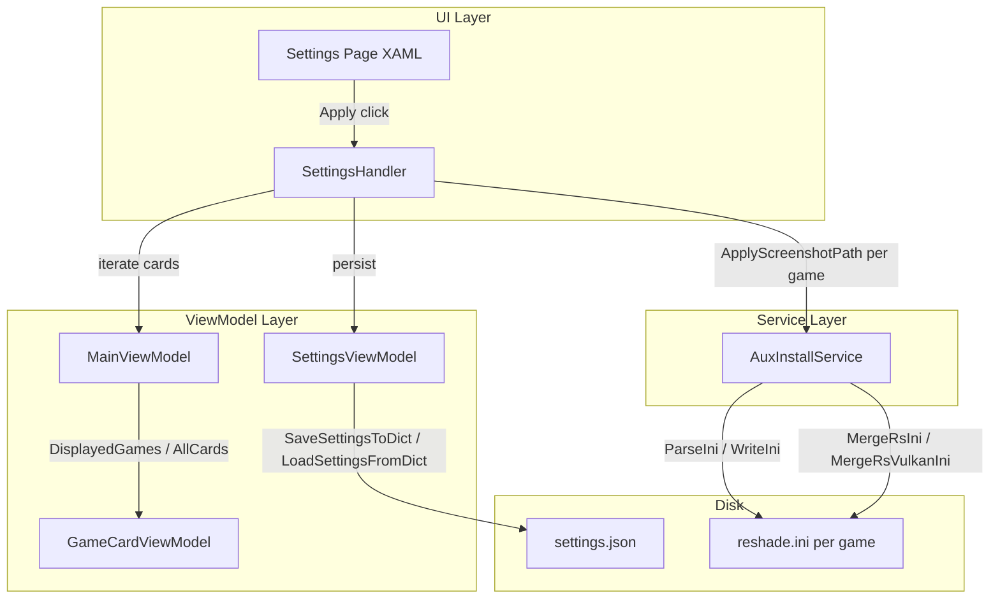

# Design Document: Screenshot Path Settings

## Overview

This feature adds a "Screenshots" section to the RHI Settings page that lets users configure a global screenshot save path for all managed reshade.ini files. Users type a directory path into a text box and click Apply to write a `[SCREENSHOT]` section with `SavePath=<directory>` into every deployed reshade.ini. An optional toggle appends the game name (as detected by RHI) as a subfolder, giving each game its own screenshot directory.

The implementation touches three layers:
1. **SettingsViewModel** — two new persisted properties (`ScreenshotPath`, `PerGameScreenshotFolders`)
2. **Settings page XAML** — a new bordered section with a TextBox, ToggleSwitch, and Apply button
3. **AuxInstallService** — a new static method to apply the `[SCREENSHOT]` section to a single reshade.ini, plus integration into `MergeRsIni`/`MergeRsVulkanIni`

## Architecture



Key design decisions:

- **Reuse existing `ParseIni`/`WriteIni`** — The `AuxInstallService` already has battle-tested INI parse/merge/write logic. The new `ApplyScreenshotPath` method uses the same `ParseIni` → mutate → `WriteIni` pipeline, only touching the `[SCREENSHOT]` section.
- **Static method on `AuxInstallService`** — Follows the pattern of `MergeRsIni`, `MergeRsVulkanIni`, `CopyRsIni`, etc. No new service class needed.
- **Settings persistence via `SettingsViewModel`** — Two new properties (`ScreenshotPath` string, `PerGameScreenshotFolders` bool) are added to `SaveSettingsToDict`/`LoadSettingsFromDict`, following the exact pattern of `AddonWatchFolder`, `UseCustomShaders`, etc.
- **Apply button handler in `SettingsHandler`** — Follows the existing pattern where `SettingsHandler` owns settings-page click handlers and delegates to `MainViewModel` for card iteration and `AuxInstallService` for file operations.
- **Invalid character sanitization** — A small static helper `SanitizeDirectoryName` strips characters invalid in Windows paths (`< > : " / | ? *`) from the game name subfolder. This is a pure function, easy to test.
- **Future deployments** — `MergeRsIni` and `MergeRsVulkanIni` are modified to call `ApplyScreenshotPath` after the existing merge, so newly deployed INIs automatically include the screenshot path if configured.

## Components and Interfaces

### 1. `SettingsViewModel` — New Properties

Two new `[ObservableProperty]` fields added to the existing `SettingsViewModel`:

```csharp
[ObservableProperty] private string _screenshotPath = "";
[ObservableProperty] private bool _perGameScreenshotFolders;
```

`LoadSettingsFromDict` reads `"ScreenshotPath"` and `"PerGameScreenshotFolders"` keys. `SaveSettingsToDict` writes them. This follows the exact pattern of `AddonWatchFolder` and `UseCustomShaders`.

### 2. `AuxInstallService` — New Static Methods

```csharp
/// <summary>
/// Writes or updates the [SCREENSHOT] section in the given reshade.ini file,
/// setting SavePath to the specified value. All other sections/keys are preserved.
/// </summary>
public static void ApplyScreenshotPath(string iniFilePath, string savePath)

/// <summary>
/// Strips characters that are invalid in Windows directory names from the input.
/// Invalid chars: &lt; &gt; : " / | ? *
/// </summary>
public static string SanitizeDirectoryName(string name)
```

`ApplyScreenshotPath` calls `ParseIni` on the file, ensures a `[SCREENSHOT]` section exists, sets `SavePath=<value>`, then calls `WriteIni`. If the section already exists, only the `SavePath` key is updated — other keys in `[SCREENSHOT]` are preserved.

`SanitizeDirectoryName` is a pure function that removes `< > : " / | ? *` from a string. Used when constructing per-game subfolder paths.

### 3. `SettingsHandler` — New Click Handler

```csharp
public void ApplyScreenshotPath_Click(object sender, RoutedEventArgs e)
```

This method:
1. Reads the screenshot path from the TextBox and the toggle state.
2. If the path is empty, clears persisted settings and returns (no INI modifications).
3. Persists the path and toggle state via `SettingsViewModel` → `SaveSettingsPublic()`.
4. Iterates all game cards via `MainViewModel.AllCards` (or `DisplayedGames` — needs access to the full list).
5. For each card with a non-empty `InstallPath` and an existing `reshade.ini`:
   - Constructs the `SavePath` value (base path, or base + `\` + sanitized game name if toggle is on).
   - Calls `AuxInstallService.ApplyScreenshotPath(iniPath, savePath)`.
   - Increments a counter.
6. Shows a confirmation message (e.g., via `InfoBar` or `ContentDialog`) with the count of updated files.

### 4. Settings Page XAML — New Screenshots Section

A new `<Border>` section added to the Settings panel `<StackPanel>`, following the existing pattern (e.g., "Addon Watch Folder" section). Placed after the "Custom Shaders" section and before "Full Refresh".

```xml
<!-- ── Screenshots ─────────────────────────────────────────── -->
<Border Background="{StaticResource SurfaceRaisedBrush}" CornerRadius="10" Padding="20,16"
        BorderBrush="{StaticResource BorderSubtleBrush}" BorderThickness="1">
    <StackPanel Spacing="8">
        <TextBlock Text="Screenshots" FontSize="14" FontWeight="SemiBold"
                   Foreground="{StaticResource TextPrimaryBrush}"/>
        <TextBlock TextWrapping="Wrap" FontSize="11"
                   Foreground="{StaticResource InlineDescriptionBrush}" LineHeight="18"
                   Text="Set a screenshot save path that will be written to all managed reshade.ini files."/>
        <TextBox x:Name="ScreenshotPathBox" x:FieldModifier="internal"
                 PlaceholderText="D:\Screenshots"
                 FontSize="12"
                 Background="{StaticResource SurfaceInputBrush}"
                 Foreground="{StaticResource TextSecondaryBrush}"
                 BorderBrush="{StaticResource BorderSubtleBrush}"/>
        <ToggleSwitch x:Name="PerGameScreenshotToggle" x:FieldModifier="internal"
                      Header="Per-Game Subfolder"
                      OnContent="Enabled — each game gets its own subfolder"
                      OffContent="Disabled — all screenshots in one folder"
                      Foreground="{StaticResource TextTertiaryBrush}" FontSize="12"/>
        <Button x:Name="ApplyScreenshotPathBtn"
                Content="Apply to All Games"
                Click="ApplyScreenshotPath_Click"
                Background="{StaticResource AccentBlueBgBrush}"
                Foreground="{StaticResource AccentBlueBrush}"
                BorderBrush="{StaticResource AccentBlueBorderBrush}" BorderThickness="1"
                CornerRadius="8" Padding="12,7" FontSize="12"
                HorizontalAlignment="Stretch"/>
    </StackPanel>
</Border>
```

### 5. Integration with MergeRsIni / MergeRsVulkanIni

After the existing merge logic in both `MergeRsIni` and `MergeRsVulkanIni`, a check is added:

```csharp
// After WriteIni(gamePath, gameIni):
var screenshotPath = GetConfiguredScreenshotPath();
if (!string.IsNullOrEmpty(screenshotPath))
    ApplyScreenshotPath(gamePath, screenshotPath);
```

To avoid coupling `AuxInstallService` to `SettingsViewModel`, the screenshot path is passed as an optional parameter to `MergeRsIni`/`MergeRsVulkanIni`:

```csharp
public static void MergeRsIni(string gameDir, string? screenshotSavePath = null)
public static void MergeRsVulkanIni(string gameDir, string? gameName = null, string? screenshotSavePath = null)
```

When `screenshotSavePath` is non-null, the method calls `ApplyScreenshotPath` on the merged file. Callers that want screenshot path integration pass the value; existing callers that don't pass it get the current behavior unchanged.

## Data Models

### Settings Persistence (settings.json)

Two new keys added to the flat `Dictionary<string, string>`:

| Key | Type | Default | Description |
|-----|------|---------|-------------|
| `ScreenshotPath` | string | `""` | Absolute directory path for screenshots |
| `PerGameScreenshotFolders` | string (`"true"`/`"false"`) | `"false"` | Whether to append game name as subfolder |

### INI Section Format

The `[SCREENSHOT]` section written to reshade.ini:

```ini
[SCREENSHOT]
SavePath=D:\Screenshots\Game Name
```

When per-game folders are disabled:
```ini
[SCREENSHOT]
SavePath=D:\Screenshots
```

The `SavePath` value uses backslash separators (Windows convention). No trailing backslash.


## Correctness Properties

*A property is a characteristic or behavior that should hold true across all valid executions of a system — essentially, a formal statement about what the system should do. Properties serve as the bridge between human-readable specifications and machine-verifiable correctness guarantees.*

### Property 1: Screenshot settings round-trip

*For any* string `path` and any boolean `perGame`, setting `ScreenshotPath = path` and `PerGameScreenshotFolders = perGame` on a `SettingsViewModel`, calling `SaveSettingsToDict`, then calling `LoadSettingsFromDict` on a fresh `SettingsViewModel` should produce the same `ScreenshotPath` and `PerGameScreenshotFolders` values.

**Validates: Requirements 2.3, 3.2, 5.1, 5.3**

### Property 2: ApplyScreenshotPath writes correct SavePath

*For any* valid INI file content and any non-empty screenshot path string, after calling `ApplyScreenshotPath(iniFile, savePath)`, parsing the resulting INI should yield a `[SCREENSHOT]` section containing `SavePath` equal to the provided path string.

**Validates: Requirements 4.2, 6.1**

### Property 3: Per-game path construction

*For any* non-empty base path and any game name string, when per-game folders are enabled, the constructed `SavePath` should equal `basePath + "\" + SanitizeDirectoryName(gameName)`.

**Validates: Requirements 4.3, 7.1, 7.2**

### Property 4: SanitizeDirectoryName removes exactly invalid characters

*For any* input string, `SanitizeDirectoryName` should return a string that contains no characters from the set `< > : " / | ? *`, and every character in the output should appear in the input in the same relative order. Characters not in the invalid set should be preserved exactly.

**Validates: Requirements 7.3**

### Property 5: Other INI sections preserved after screenshot path apply

*For any* valid INI file content with arbitrary sections and keys, after calling `ApplyScreenshotPath`, all sections other than `[SCREENSHOT]` should have identical keys and values as before the call. Keys within `[SCREENSHOT]` other than `SavePath` should also be preserved.

**Validates: Requirements 4.6, 6.4**

### Property 6: Screenshot section idempotence

*For any* valid INI file content (with or without an existing `[SCREENSHOT]` section), after calling `ApplyScreenshotPath`, the resulting INI should contain exactly one `[SCREENSHOT]` section. Calling `ApplyScreenshotPath` a second time with a different path should still result in exactly one `[SCREENSHOT]` section with the new path.

**Validates: Requirements 6.2, 6.3**

### Property 7: MergeRsIni includes screenshot path when configured

*For any* valid INI template content, any valid game INI content, and any non-empty screenshot save path, after calling `MergeRsIni(gameDir, screenshotSavePath)`, the resulting reshade.ini should contain a `[SCREENSHOT]` section with `SavePath` equal to the provided path.

**Validates: Requirements 8.1, 8.2**

## Error Handling

| Scenario | Handling |
|----------|----------|
| `reshade.ini` is locked by another process | `ApplyScreenshotPath` will throw `IOException`. The Apply handler catches it, logs via `CrashReporter`, and reports the failure count to the user. |
| Game folder no longer exists | The Apply handler checks `Directory.Exists(card.InstallPath)` before attempting to read/write. Skipped silently. |
| `reshade.ini` is malformed (no valid sections) | `ParseIni` handles this gracefully — it returns an empty dictionary, and `ApplyScreenshotPath` adds the `[SCREENSHOT]` section to it. |
| Screenshot path contains invalid path characters | The path is written as-is to the INI `SavePath` value. ReShade handles path validation on its end. RHI does not validate the base path — it's the user's responsibility to enter a valid directory. |
| Game name is entirely invalid characters | `SanitizeDirectoryName` returns an empty string. The Apply handler should skip games where the sanitized name is empty to avoid writing a trailing backslash path. |
| Settings file is corrupted or missing | `LoadSettingsFile` returns an empty dictionary. `ScreenshotPath` defaults to `""` and `PerGameScreenshotFolders` defaults to `false`. |

## Testing Strategy

### Property-Based Tests (FsCheck + xUnit)

Each correctness property is implemented as a single FsCheck property test with a minimum of 100 iterations. Tests use the existing `FsCheck.Xunit` (v2.16.6) infrastructure already in the project.

| Test Class | Property | Tag |
|------------|----------|-----|
| `ScreenshotSettingsRoundTripPropertyTests` | Property 1 | Feature: screenshot-path-settings, Property 1: Screenshot settings round-trip |
| `ApplyScreenshotPathPropertyTests` | Property 2 | Feature: screenshot-path-settings, Property 2: ApplyScreenshotPath writes correct SavePath |
| `PerGamePathConstructionPropertyTests` | Property 3 | Feature: screenshot-path-settings, Property 3: Per-game path construction |
| `SanitizeDirectoryNamePropertyTests` | Property 4 | Feature: screenshot-path-settings, Property 4: SanitizeDirectoryName removes exactly invalid characters |
| `ScreenshotIniPreservationPropertyTests` | Property 5 | Feature: screenshot-path-settings, Property 5: Other INI sections preserved |
| `ScreenshotSectionIdempotencePropertyTests` | Property 6 | Feature: screenshot-path-settings, Property 6: Screenshot section idempotence |
| `MergeRsIniScreenshotPropertyTests` | Property 7 | Feature: screenshot-path-settings, Property 7: MergeRsIni includes screenshot path |

Each property test must:
- Use `[Property(MaxTest = 100)]` attribute
- Include a comment referencing the design property number and text
- Use `Prop.ForAll` with appropriate `Arb` generators

### Unit Tests

Unit tests complement property tests for specific examples and edge cases:

- Default `PerGameScreenshotFolders` is `false` on fresh `SettingsViewModel` (Req 3.1)
- Empty path Apply clears persisted settings (Req 5.2)
- Empty path Apply does not modify any INI file (Req 4.4, 4.5)
- Game name that is entirely invalid characters is skipped (edge case)
- `SanitizeDirectoryName` with known inputs (e.g., `Game: The "Sequel"` → `Game The Sequel`)
