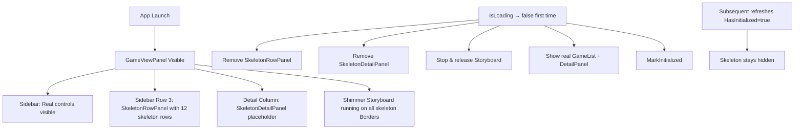

# Design Document: Skeleton Loading Screen

## Overview

This feature replaces the existing `LoadingPanel` (centered ProgressRing + text) with a skeleton loading screen that mimics the real `GameViewPanel` layout. On launch, the `GameViewPanel` is shown immediately with skeleton placeholders in the game list and detail panel areas, while the real search box, filter chips, and count area remain visible. A shimmer animation pulses the skeleton elements until `IsLoading` transitions to `false`, at which point the skeletons are removed and real data appears.

The key architectural change is that `GameViewPanel` becomes `Visible` on launch (instead of `Collapsed`), and `LoadingPanel` is permanently hidden. Skeleton placeholders are injected programmatically into the `GameList` area and the `DetailPanel` area, then cleaned up on the first `IsLoading → false` transition.

## Architecture



The skeleton system is entirely code-behind driven. No new UserControls or ViewModels are needed. A new partial class file `MainWindow.Skeleton.cs` encapsulates all skeleton creation, animation, and teardown logic.

### Component Interaction

1. `MainWindow.xaml` — Add a named `StackPanel` (`SkeletonRowPanel`) overlaying `GameList` in sidebar Row 3, and a named `StackPanel` (`SkeletonDetailPanel`) overlaying the detail `ScrollViewer` in Column 1. Both start `Visible`.
2. `MainWindow.Skeleton.cs` — New partial class file that:
   - Populates `SkeletonRowPanel` with 12 skeleton row `Border` elements
   - Populates `SkeletonDetailPanel` with header, badge, and component table placeholders
   - Creates and starts a single `Storyboard` with `ColorAnimation` targeting all skeleton `Border.Background` brushes
   - Provides `RemoveSkeletons()` to stop the storyboard, clear children, and collapse both panels
3. `MainWindow.UISync.cs` — Modified `IsLoading` handler: on initial boot, instead of toggling `LoadingPanel`/`GameViewPanel` visibility, it calls `RemoveSkeletons()` when loading completes.
4. `DarkTheme.xaml` — Two new color resources for skeleton shimmer range.
5. `ResourceKeys.cs` — Two new constants for the skeleton brush keys.

## Components and Interfaces

### MainWindow.Skeleton.cs (new file)

```csharp
public sealed partial class MainWindow
{
    private Storyboard? _shimmerStoryboard;

    /// <summary>
    /// Called once during window initialization to populate skeleton placeholders
    /// and start the shimmer animation.
    /// </summary>
    internal void InitializeSkeletons()

    /// <summary>
    /// Stops the shimmer animation, clears skeleton children, and collapses
    /// both skeleton panels. Called on the first IsLoading → false transition.
    /// </summary>
    internal void RemoveSkeletons()

    /// <summary>
    /// Creates a single skeleton row Border matching the game card DataTemplate layout:
    /// 14x14 icon rect + flexible-width name rect + 8px badge circle.
    /// </summary>
    private static Border CreateSkeletonRow(SolidColorBrush fillBrush)

    /// <summary>
    /// Populates the detail skeleton panel with header, badge row, and
    /// component table placeholders.
    /// </summary>
    private void PopulateSkeletonDetailPanel(SolidColorBrush fillBrush)

    /// <summary>
    /// Creates the Storyboard with ColorAnimation instances targeting each
    /// skeleton Border's Background.Color property.
    /// </summary>
    private Storyboard CreateShimmerStoryboard(List<Border> targets, Color fromColor, Color toColor)
}
```

### XAML Changes to MainWindow.xaml

In the sidebar Grid (Row 3), add a `StackPanel` that overlays the `GameList`:

```xml
<!-- Skeleton rows overlay (removed programmatically after first load) -->
<StackPanel x:Name="SkeletonRowPanel" Grid.Row="3" Spacing="4" Padding="4"
            Visibility="Visible"/>
```

In the detail column (Column 1), add a `StackPanel` that overlays the `ScrollViewer`:

```xml
<!-- Skeleton detail panel overlay (removed programmatically after first load) -->
<StackPanel x:Name="SkeletonDetailPanel" Grid.Column="1" Spacing="16"
            Padding="24,18,24,24" Visibility="Visible"/>
```

### DarkTheme.xaml Additions

```xml
<!-- Skeleton shimmer colors -->
<Color x:Key="SkeletonBase">#FF1A2028</Color>
<Color x:Key="SkeletonHighlight">#FF252D38</Color>

<SolidColorBrush x:Key="SkeletonBaseBrush" Color="{StaticResource SkeletonBase}"/>
<SolidColorBrush x:Key="SkeletonHighlightBrush" Color="{StaticResource SkeletonHighlight}"/>
```

These sit between `SurfaceRaised` (#FF181D23) and `SurfaceOverlay` (#FF1E242C), providing a subtle pulse that is visible against the sidebar and base backgrounds without being distracting.

### ResourceKeys.cs Additions

```csharp
public const string SkeletonBase = "SkeletonBase";
public const string SkeletonHighlight = "SkeletonHighlight";
public const string SkeletonBaseBrush = "SkeletonBaseBrush";
public const string SkeletonHighlightBrush = "SkeletonHighlightBrush";
```

### MainWindow.UISync.cs Modifications

The `IsLoading` case in `OnViewModelChanged` changes from:

```csharp
// Before (current):
LoadingPanel.Visibility = loading ? Visibility.Visible : Visibility.Collapsed;
GameViewPanel.Visibility = loading ? Visibility.Collapsed : Visibility.Visible;
```

To:

```csharp
// After (skeleton):
if (!loading)
{
    RemoveSkeletons();
    GameViewPanel.Visibility = Visibility.Visible; // already visible, but ensure
}
// LoadingPanel stays Collapsed always (or removed from XAML)
```

The `LoadingPanel` is set to `Visibility="Collapsed"` in XAML (or removed entirely). `GameViewPanel` starts as `Visibility="Visible"`.

### Skeleton Row Structure

Each skeleton row mirrors the real `GameCardViewModel` DataTemplate:

```
┌─────────────────────────────────────────────────┐
│ [14×14 rect]  [████████████████████]  [8px ●]   │
│   icon area      name placeholder     badge     │
│   Padding="8,6"  ColumnSpacing="6"              │
└─────────────────────────────────────────────────┘
```

- Outer `Border`: `CornerRadius="6"`, `Padding="8,6"`, `Background=SkeletonBaseBrush`
- Inner `Grid` with 3 columns: `Auto | * | Auto`, `ColumnSpacing="6"`
  - Column 0: `Border` 14×14, `CornerRadius="2"`, `Background=SkeletonBaseBrush`
  - Column 1: `Border` `Height="12"`, `CornerRadius="4"`, `Background=SkeletonBaseBrush`
  - Column 2: `Ellipse` 8×8, `Fill=SkeletonBaseBrush`

### Skeleton Detail Panel Structure

```
┌──────────────────────────────────────────────────────┐
│ [████████████████████████]          ← header (H=20)  │
│ [████] [████] [████]                ← badge row      │
│                                                      │
│ ┌──────────────────────────────────────────────────┐ │
│ │ Components                                       │ │
│ │ [████] [████] [██████████████████] [██] [██]     │ │
│ │ [████] [████] [██████████████████] [██] [██]     │ │
│ │ [████] [████] [██████████████████] [██] [██]     │ │
│ └──────────────────────────────────────────────────┘ │
└──────────────────────────────────────────────────────┘
```

- Header: `Border` `Width="280"`, `Height="20"`, `CornerRadius="4"`, `HorizontalAlignment="Left"`
- Badge row: `StackPanel Orientation="Horizontal" Spacing="8"` with 3 `Border` elements (`Width="60"`, `Height="20"`, `CornerRadius="5"`)
- Component table: `Border` with `CornerRadius="12"`, `Background=SurfaceComponentTableBrush`, `Padding="16,14"` containing:
  - "Components" text header (real `TextBlock`, not skeleton)
  - 3 skeleton rows matching the 5-column grid: `120 | 80 | * | 36 | 36` with `ColumnSpacing="8"`, each column filled with a `Border` placeholder of `Height="32"`, `CornerRadius="8"`

### Shimmer Animation

A single `Storyboard` with one `ColorAnimation` per skeleton `Border`:

```csharp
var animation = new ColorAnimation
{
    From = skeletonBaseColor,      // #FF1A2028
    To = skeletonHighlightColor,   // #FF252D38
    Duration = new Duration(TimeSpan.FromSeconds(1.5)),
    AutoReverse = true,
    RepeatBehavior = RepeatBehavior.Forever,
};
Storyboard.SetTarget(animation, border);
Storyboard.SetTargetProperty(animation, "(Border.Background).(SolidColorBrush.Color)");
```

All animations share the same timing so the shimmer pulses in unison. The storyboard is started in `InitializeSkeletons()` and stopped/nulled in `RemoveSkeletons()`.

### Transition Flow

1. `MainWindow` constructor calls `InitializeSkeletons()` after `InitializeComponent()`
2. `GameViewPanel.Visibility = Visible` in XAML (not Collapsed)
3. `LoadingPanel.Visibility = Collapsed` in XAML
4. Real search box, filter chips, count area are visible and functional (but produce no results since data hasn't loaded)
5. `GameList` is behind `SkeletonRowPanel` (both in Row 3; skeleton panel has higher z-order or is placed after GameList)
6. `DetailPanel` is behind `SkeletonDetailPanel` (skeleton panel overlays in Column 1)
7. Status bar continues to show `StatusText` / `SubStatusText` updates
8. When `IsLoading → false` (first time): `RemoveSkeletons()` collapses skeleton panels, stops storyboard, reveals real content
9. `ViewModel.MarkInitialized()` is called — subsequent refreshes skip skeleton logic entirely

## Data Models

No new data models are required. The skeleton system is purely UI-layer and does not interact with any ViewModel properties beyond the existing `IsLoading` and `HasInitialized` flags.

### Resource Additions

| Resource Key | Type | Value | Purpose |
|---|---|---|---|
| `SkeletonBase` | Color | `#FF1A2028` | Dark tone for skeleton fill (resting state) |
| `SkeletonHighlight` | Color | `#FF252D38` | Light tone for skeleton fill (shimmer peak) |
| `SkeletonBaseBrush` | SolidColorBrush | `SkeletonBase` | XAML-bindable brush for skeleton elements |
| `SkeletonHighlightBrush` | SolidColorBrush | `SkeletonHighlight` | Target color for shimmer animation |

### Constants

| Constant | Value | Purpose |
|---|---|---|
| Skeleton row count | 12 | Number of skeleton rows in sidebar (fills ~400px visible area) |
| Shimmer duration | 1.5s | Full cycle time (dark → light → dark) |
| Skeleton row icon size | 14×14 | Matches real game card icon |
| Skeleton row badge size | 8×8 | Matches real update badge ellipse |
| Skeleton row padding | 8,6 | Matches real game card padding |
| Skeleton row corner radius | 6 | Matches real game card corner radius |
| Skeleton row spacing | 4 | Matches GameList item spacing |


## Correctness Properties

*A property is a characteristic or behavior that should hold true across all valid executions of a system — essentially, a formal statement about what the system should do. Properties serve as the bridge between human-readable specifications and machine-verifiable correctness guarantees.*

The prework analysis identified five consolidated testable properties after eliminating redundancy. Several acceptance criteria (1.2, 5.4, 6.1, 6.2, 7.1–7.4) are not testable as properties because they concern static XAML layout, dispatcher timing, or existing ViewModel behavior unrelated to the skeleton feature.

### Property 1: Visibility state mapping is consistent

*For any* combination of `(isLoading: bool, hasInitialized: bool, currentPage: AppPage)`, the computed visibility states of `LoadingPanel`, `GameViewPanel`, `SkeletonRowPanel`, and `SkeletonDetailPanel` should match the expected mapping:
- When `currentPage == Settings`: all four are `Collapsed` (settings panel shown instead)
- When `isLoading == true && hasInitialized == false`: `LoadingPanel = Collapsed`, `GameViewPanel = Visible`, `SkeletonRowPanel = Visible`, `SkeletonDetailPanel = Visible`
- When `isLoading == false`: `LoadingPanel = Collapsed`, `GameViewPanel = Visible`, `SkeletonRowPanel = Collapsed`, `SkeletonDetailPanel = Collapsed`
- When `isLoading == true && hasInitialized == true` (silent refresh): `LoadingPanel = Collapsed`, `GameViewPanel = Visible`, `SkeletonRowPanel = Collapsed`, `SkeletonDetailPanel = Collapsed`

**Validates: Requirements 1.1, 5.5, 6.3**

### Property 2: Skeleton row structure matches game card template

*For any* skeleton row created by `CreateSkeletonRow`, the resulting `Border` should have: `CornerRadius == 6`, `Padding == (8,6,8,6)`, and contain a `Grid` with `ColumnSpacing == 6` and exactly 3 children where the first child is a 14×14 element, the second child has `Height == 12`, and the third child is an 8×8 `Ellipse`.

**Validates: Requirements 2.1, 2.2**

### Property 3: Skeleton detail panel contains all required sections

*For any* skeleton detail panel produced by `PopulateSkeletonDetailPanel`, the panel should contain: (a) a header placeholder with `Height >= 16`, (b) a horizontal stack of at least 3 badge placeholders, (c) a component table `Border` with `CornerRadius == 12` containing at least 2 row `Grid` elements each with 5 columns matching widths `(120, 80, *, 36, 36)`, and (d) the outer panel should have `Padding == (24,18,24,24)` and `Spacing == 16`.

**Validates: Requirements 3.1, 3.2, 3.3, 3.4**

### Property 4: Shimmer storyboard is correctly configured per target

*For any* non-empty list of `Border` targets, the `Storyboard` produced by `CreateShimmerStoryboard` should contain exactly one `ColorAnimation` per target, and each animation should have `AutoReverse == true`, `RepeatBehavior == RepeatBehavior.Forever`, and `Duration` between 1.0 and 2.0 seconds (inclusive).

**Validates: Requirements 4.1, 4.2, 4.3**

### Property 5: Skeleton cleanup is complete

*For any* initial state where `SkeletonRowPanel` contains N > 0 children and `SkeletonDetailPanel` contains M > 0 children and `_shimmerStoryboard` is non-null, after calling `RemoveSkeletons()`, `SkeletonRowPanel.Children.Count == 0`, `SkeletonDetailPanel.Children.Count == 0`, both panels have `Visibility == Collapsed`, and `_shimmerStoryboard == null`.

**Validates: Requirements 5.1, 5.2, 5.3**

## Error Handling

### Storyboard Failures

If `Storyboard.Begin()` throws (e.g., due to a WinUI threading issue), catch the exception and log it via `CrashReporter.Log()`. The skeleton placeholders will still be visible but static (no shimmer). This is a graceful degradation — the user still sees the layout structure.

### RemoveSkeletons Called Multiple Times

`RemoveSkeletons()` must be idempotent. If called when skeletons are already removed (panels empty, storyboard null), it should be a no-op. Guard with a null check on `_shimmerStoryboard` and a `Children.Count > 0` check.

### Storyboard Stop Failures

If `Storyboard.Stop()` throws during cleanup, catch the exception, log it, null out the reference anyway, and proceed with clearing children. The skeleton panels must always be collapsed regardless of storyboard state.

### Missing Theme Resources

If `SkeletonBaseBrush` or `SkeletonHighlightBrush` cannot be resolved from the resource dictionary (e.g., theme file not merged), fall back to hardcoded `SolidColorBrush` instances with the same color values. Log a warning.

## Testing Strategy

### Unit Tests (xUnit)

Unit tests cover specific examples and edge cases:

- Verify that the skeleton row count constant is within the [8, 15] range (Requirement 2.3)
- Verify that the shimmer colors `#FF1A2028` and `#FF252D38` are within the expected dark theme range (Requirement 4.4)
- Verify that `RemoveSkeletons()` is idempotent (calling it twice does not throw)
- Verify the visibility state mapping for the specific case of `(isLoading=true, hasInitialized=false, currentPage=Games)` produces the expected skeleton-visible state

### Property-Based Tests (FsCheck + xUnit)

The project uses FsCheck for property-based testing. Each property test must run a minimum of 10 iterations and reference its design document property.

Since the skeleton system involves WinUI UI elements that require a dispatcher thread, the property tests should target the pure logic functions extracted from the UI layer:

1. **Visibility state function**: Extract the visibility computation into a pure static method `ComputeVisibilityState(bool isLoading, bool hasInitialized, AppPage currentPage)` that returns a record of visibility values. This is directly testable with FsCheck-generated inputs.

2. **Skeleton row structure validation**: `CreateSkeletonRow` returns a `Border` — the structural assertions can be run on the returned object. FsCheck generates arbitrary `SolidColorBrush` colors to verify the structure is consistent regardless of input color.

3. **Skeleton detail panel structure validation**: Similar to row validation, verify structural invariants of the detail panel output.

4. **Storyboard configuration**: `CreateShimmerStoryboard` takes a list of `Border` targets — FsCheck generates lists of varying lengths (1–50) and verifies the animation count and configuration properties.

5. **Cleanup completeness**: Create skeleton panels with FsCheck-generated child counts, call `RemoveSkeletons()`, verify all invariants hold.

Each test must be tagged with a comment:
```
// Feature: skeleton-loading-screen, Property {N}: {property_text}
```

### Test Configuration

- Minimum 10 iterations per property test
- FsCheck `Arbitrary` generators for: `AppPage` enum, `SolidColorBrush` with random colors, `Border` lists of varying lengths
- Each correctness property is implemented by a single property-based test
- Property-based testing library: **FsCheck** (already in use by the test project)
