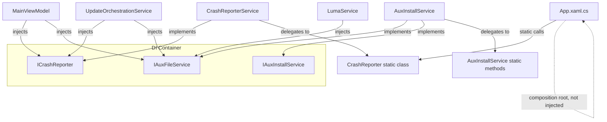

# Design Document: Static Service Interfaces

## Overview

This design wraps the static surface area of `CrashReporter` and `AuxInstallService` behind injectable interfaces (`ICrashReporter` and `IAuxFileService`), registers them as singletons in the existing `Microsoft.Extensions.DependencyInjection` container, and migrates DI-resolved consumers to use constructor injection instead of static calls.

The refactoring is purely structural — no runtime behaviour changes. The existing static methods remain available so that non-DI contexts (App.xaml.cs composition root, test setup code, static helpers) continue to compile and work unchanged.

### Key Design Decisions

1. **Thin wrapper pattern for CrashReporter**: Because `CrashReporter` is a `static class`, we cannot make it implement an interface directly. A lightweight `CrashReporterService` class implements `ICrashReporter` and delegates every call to the static methods. This avoids rewriting the crash reporter internals.

2. **IAuxFileService on AuxInstallService directly**: Unlike CrashReporter, `AuxInstallService` is already an instantiable class. We add `IAuxFileService` as a second interface on the same class, with instance methods that delegate to the existing static methods. This avoids creating a separate wrapper class and keeps the same singleton instance for both `IAuxInstallService` and `IAuxFileService`.

3. **Constants stay static**: `TypeDc`, `TypeReShade`, `RsStagingDir`, `InisDir`, etc. remain as `public const` / `public static readonly` on `AuxInstallService`. They are environment-derived or compile-time values that don't vary between implementations and are heavily used in test setup code.

4. **WriteCrashReport signature adaptation**: The interface exposes the full `WriteCrashReport(string source, Exception? ex, bool isTerminating = false, string? note = null)` signature matching the actual static method, not the simplified version in the requirements doc.

## Architecture



### Registration Flow

In `App.xaml.cs`, after the existing service registrations:

```csharp
services.AddSingleton<ICrashReporter, CrashReporterService>();
services.AddSingleton<IAuxFileService>(sp => sp.GetRequiredService<IAuxInstallService>() as AuxInstallService
    ?? throw new InvalidOperationException("IAuxInstallService must be AuxInstallService"));
```

The `IAuxFileService` registration reuses the same `AuxInstallService` singleton already registered for `IAuxInstallService`, satisfying Requirement 6.3.

## Components and Interfaces

### ICrashReporter Interface

File: `RenoDXCommander/Services/ICrashReporter.cs`

```csharp
namespace RenoDXCommander.Services;

public interface ICrashReporter
{
    void Log(string message);
    void WriteCrashReport(string source, Exception? ex, bool isTerminating = false, string? note = null);
    bool VerboseLogging { get; set; }
}
```

### CrashReporterService Class

File: `RenoDXCommander/Services/CrashReporterService.cs`

```csharp
namespace RenoDXCommander.Services;

public class CrashReporterService : ICrashReporter
{
    public void Log(string message) => CrashReporter.Log(message);

    public void WriteCrashReport(string source, Exception? ex, bool isTerminating = false, string? note = null)
        => CrashReporter.WriteCrashReport(source, ex, isTerminating, note);

    public bool VerboseLogging
    {
        get => CrashReporter.VerboseLogging;
        set => CrashReporter.VerboseLogging = value;
    }
}
```

### IAuxFileService Interface

File: `RenoDXCommander/Services/IAuxFileService.cs`

Contains instance-method declarations matching each static method to be wrapped:

```csharp
namespace RenoDXCommander.Services;

public interface IAuxFileService
{
    void SyncReShadeToDisplayCommander();
    bool EnsureReShadeStaging();
    AuxInstallService.DxgiFileType IdentifyDxgiFile(string filePath);
    AuxInstallService.WinmmFileType IdentifyWinmmFile(string filePath);
    bool BackupForeignDll(string dllPath);
    void RestoreForeignDll(string dllPath);
    bool IsReShadeFileStrict(string filePath);
    bool IsDcFileStrict(string filePath);
    bool IsReShadeFile(string filePath);
    void EnsureInisDir();
    void MergeRsIni(string gameDir);
    void MergeRsVulkanIni(string gameDir);
    void CopyRsIni(string gameDir);
    void CopyRsPresetIniIfPresent(string gameDir);
    void CopyDcIni(string gameDir);
    string? ReadInstalledVersion(string installPath, string fileName);
    bool CheckReShadeUpdateLocal(Models.AuxInstalledRecord record);
}
```

Note: The enum types `DxgiFileType` and `WinmmFileType` remain nested in `AuxInstallService` since they are used by both the static and instance paths and moving them would be a larger refactor outside scope.

### AuxInstallService Instance Method Additions

Each `IAuxFileService` method is a one-line delegation to the corresponding static method:

```csharp
// Added to AuxInstallService class body:
void IAuxFileService.SyncReShadeToDisplayCommander() => SyncReShadeToDisplayCommander();
bool IAuxFileService.EnsureReShadeStaging() => EnsureReShadeStaging();
AuxInstallService.DxgiFileType IAuxFileService.IdentifyDxgiFile(string filePath) => IdentifyDxgiFile(filePath);
// ... etc for all 17 methods
```

Using explicit interface implementation keeps the instance methods from colliding with the existing static methods of the same name.

## Data Models

No new data models are introduced. The existing `AuxInstalledRecord` model is referenced by `IAuxFileService.CheckReShadeUpdateLocal` but is not modified.

### Files Created

| File | Purpose |
|------|---------|
| `Services/ICrashReporter.cs` | Interface for crash reporting |
| `Services/CrashReporterService.cs` | Wrapper delegating to static CrashReporter |
| `Services/IAuxFileService.cs` | Interface for static file operations |

### Files Modified

| File | Change |
|------|--------|
| `Services/AuxInstallService.cs` | Add `: IAuxFileService` and explicit interface implementations |
| `App.xaml.cs` | Register `ICrashReporter` and `IAuxFileService` in DI container |
| `ViewModels/MainViewModel.cs` | Inject `ICrashReporter` + `IAuxFileService`, replace static calls |
| `Services/UpdateOrchestrationService.cs` | Inject `ICrashReporter` + `IAuxFileService`, replace static calls |
| `Services/LumaService.cs` | Inject `IAuxFileService`, replace static calls |
| `MainWindow.xaml.cs` | Inject `ICrashReporter`, replace static calls |
| `DragDropHandler.cs` | Inject `ICrashReporter`, replace static calls |
| `OverridesFlyoutBuilder.cs` | Inject `ICrashReporter`, replace static calls |
| `WindowStateManager.cs` | Inject `ICrashReporter`, replace static calls |


## Correctness Properties

*A property is a characteristic or behavior that should hold true across all valid executions of a system — essentially, a formal statement about what the system should do. Properties serve as the bridge between human-readable specifications and machine-verifiable correctness guarantees.*

### Property 1: CrashReporterService.Log delegation preserves breadcrumbs

*For any* non-null string message, calling `Log(message)` on a `CrashReporterService` instance should produce the same breadcrumb entry as calling `CrashReporter.Log(message)` directly — i.e. the message appears in the breadcrumb trail and session log identically regardless of which call path is used.

**Validates: Requirements 2.2, 8.1**

### Property 2: VerboseLogging round-trip through wrapper

*For any* boolean value, setting `VerboseLogging` on a `CrashReporterService` instance and then reading `CrashReporter.VerboseLogging` (or vice versa) should return the same value. The wrapper and the static property must always be in sync.

**Validates: Requirements 2.4**

### Property 3: IAuxFileService delegation equivalence

*For any* valid file path argument, calling an `IAuxFileService` instance method on `AuxInstallService` (e.g. `IdentifyDxgiFile`, `IsReShadeFileStrict`, `IsReShadeFile`, `IsDcFileStrict`) should return the same result as calling the corresponding static method with the same argument. The instance methods are pure delegations.

**Validates: Requirements 4.2, 8.2**

## Error Handling

This refactoring introduces no new error paths. All error handling is preserved as-is:

- **CrashReporterService**: Delegates directly to `CrashReporter` static methods which already swallow their own exceptions (the reporter must never cause a secondary crash). The wrapper adds no try/catch of its own.
- **IAuxFileService methods**: Each delegates to the existing static method which already has its own exception handling (logging failures via `CrashReporter.Log` and returning safe defaults like `false` or `null`).
- **DI resolution**: If `ICrashReporter` or `IAuxFileService` cannot be resolved, the standard `InvalidOperationException` from `GetRequiredService<T>()` propagates — same behaviour as all other services in the container.

## Testing Strategy

### Testing Framework

The project already uses **xUnit** + **FsCheck.Xunit** (v2.16.6) for property-based testing. All new tests will use the same stack.

### Property-Based Tests

Each correctness property above maps to a single `[Property]` test method with a minimum of 100 iterations (FsCheck default). Each test is tagged with a comment referencing the design property.

| Property | Test Method | What It Generates |
|----------|-------------|-------------------|
| Property 1 | `CrashReporterService_Log_delegation` | Random non-null strings |
| Property 2 | `VerboseLogging_roundtrip_through_wrapper` | Random booleans |
| Property 3 | `AuxFileService_delegation_equivalence` | Random file paths (existing and non-existing) |

Tag format: `// Feature: static-service-interfaces, Property {N}: {title}`

### Unit Tests (Examples & Edge Cases)

Unit tests cover the specific examples and structural checks that are not suited to property-based testing:

- **ICrashReporter does not declare Register**: Reflection check that the interface has no `Register` method (Req 1.4).
- **IAuxFileService does not declare IAuxInstallService methods**: Reflection check that `InstallDcAsync`, `InstallReShadeAsync`, `Uninstall` are absent (Req 3.3).
- **IAuxFileService does not declare constant/path members**: Reflection check that `TypeDc`, `RsStagingDir`, etc. are not on the interface (Req 5.3).
- **DI container resolves ICrashReporter as CrashReporterService**: Integration test (Req 6.1).
- **DI container resolves IAuxFileService as AuxInstallService**: Integration test (Req 6.2).
- **Same singleton for IAuxInstallService and IAuxFileService**: `ReferenceEquals` check (Req 6.3).

### Existing Tests

All existing tests that reference `CrashReporter` or `AuxInstallService` static members directly must continue to compile and pass without modification (Req 8.3). The static members are not removed, so no test changes are needed.
