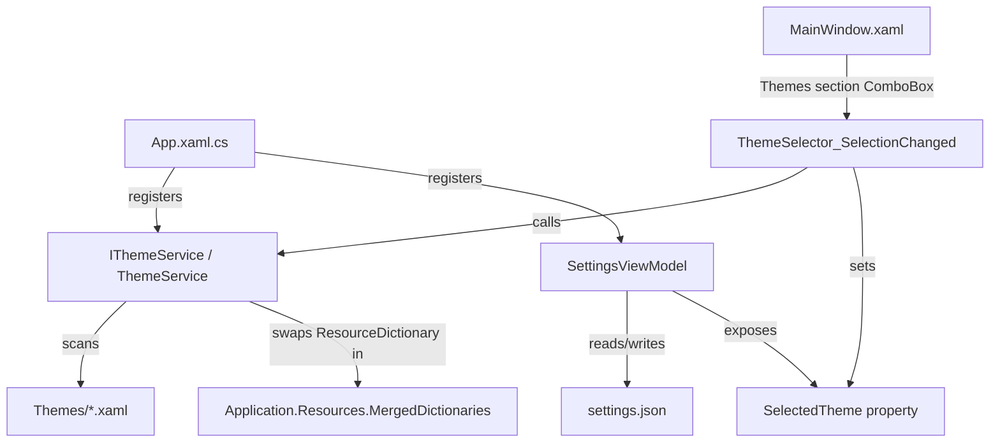

# Design Document: UI Themes

## Overview

This design adds a theme selection system to RenoDXCommander. The app currently ships with a single dark theme (`Themes/DarkTheme.xaml`) loaded via `App.xaml` MergedDictionaries. This feature introduces:

1. A `ThemeService` that discovers `.xaml` theme files in the `Themes/` folder, loads them, and swaps the active `ResourceDictionary` at runtime.
2. A `SelectedTheme` property on `SettingsViewModel` for persistence.
3. A "Themes" section in the settings panel (between Preferences and Crash Logs) with a `ComboBox` for theme selection.

Theme switching works by replacing the theme `ResourceDictionary` entry in `Application.Current.Resources.MergedDictionaries` at runtime. Because all UI elements bind to `{StaticResource}` brush keys defined in the theme dictionary, WinUI 3 re-resolves them when the dictionary is swapped, updating the entire UI without restart.

## Architecture



### Startup Flow

1. `App.OnLaunched` → DI resolves `IThemeService` (singleton).
2. `ThemeService` constructor scans `Themes/` folder, builds the available theme list.
3. `SettingsViewModel.LoadSettingsFromDict` reads `"Theme"` key from settings dict. If missing or invalid, defaults to `"Default"`.
4. `ThemeService.ApplyTheme(name)` is called before `MainWindow` is activated, replacing the theme `ResourceDictionary` in `MergedDictionaries`.

### Runtime Theme Switch

1. User selects a theme in the ComboBox.
2. `ThemeSelector_SelectionChanged` handler calls `ThemeService.ApplyTheme(name)`.
3. `ThemeService` finds the matching `ResourceDictionary`, replaces the old theme entry in `MergedDictionaries[1]` (index 1, after `XamlControlsResources`).
4. Handler sets `SettingsViewModel.SelectedTheme = name`, which triggers save via `SettingsChanged` callback.

## Components and Interfaces

### IThemeService

```csharp
public interface IThemeService
{
    /// <summary>Available theme display names (e.g. "Default", "Ocean").</summary>
    IReadOnlyList<string> AvailableThemes { get; }

    /// <summary>The currently applied theme name.</summary>
    string CurrentTheme { get; }

    /// <summary>
    /// Applies the named theme by swapping the ResourceDictionary.
    /// Returns true on success, false if the theme was not found or failed to load
    /// (falls back to Default in that case).
    /// </summary>
    bool ApplyTheme(string themeName);
}
```

### ThemeService

- Registered as singleton in DI (`App.xaml.cs`).
- Constructor receives no injected dependencies — uses `Assembly.GetExecutingAssembly()` base path to locate `Themes/` folder.
- `DiscoverThemes()`: Scans `Themes/*.xaml`, builds a `Dictionary<string, string>` mapping display name → file path.
  - `DarkTheme.xaml` → display name `"Default"`.
  - Other files: strip `.xaml` extension, strip trailing `"Theme"` if present. E.g. `OceanTheme.xaml` → `"Ocean"`, `Solarized.xaml` → `"Solarized"`.
- `ApplyTheme(string)`: Loads the XAML file as a `ResourceDictionary`, finds the existing theme dictionary in `MergedDictionaries` (by tracking the current index), replaces it. Wraps in try/catch — on failure, logs via `CrashReporter.Log` and falls back to Default.

### SettingsViewModel Changes

- New property: `[ObservableProperty] private string _selectedTheme = "Default";`
- `LoadSettingsFromDict`: reads `"Theme"` key.
- `SaveSettingsToDict`: writes `"Theme"` key.

### MainWindow.xaml Changes

- New "Themes" `Border` section inserted between the Preferences section and the Crash & Error Logs section.
- Contains a `TextBlock` heading ("Themes") and a `ComboBox` (`x:Name="ThemeSelector"`).
- `ComboBox.ItemsSource` is set programmatically in `SettingsButton_Click` from `IThemeService.AvailableThemes`.
- `ComboBox.SelectedItem` is synced to `SettingsViewModel.SelectedTheme`.

### MainWindow.xaml.cs Changes

- `SettingsButton_Click`: populates `ThemeSelector.ItemsSource` and sets `SelectedItem`.
- New handler `ThemeSelector_SelectionChanged`: calls `ThemeService.ApplyTheme()` and updates `SettingsViewModel.SelectedTheme`.

### App.xaml.cs Changes

- Register `IThemeService` / `ThemeService` as singleton in DI.
- In `OnLaunched`, after creating `MainWindow`, call `ThemeService.ApplyTheme(settings.SelectedTheme)` before `_window.Activate()`.

## Data Models

### Settings File Schema (additions)

The existing `settings.json` dictionary gains one new key:

| Key | Type | Default | Description |
|---|---|---|---|
| `"Theme"` | `string` | `"Default"` | Display name of the selected theme |

### Theme Name Mapping

| File Name | Display Name |
|---|---|
| `DarkTheme.xaml` | `Default` |
| `{Name}Theme.xaml` | `{Name}` |
| `{Name}.xaml` | `{Name}` |


## Correctness Properties

*A property is a characteristic or behavior that should hold true across all valid executions of a system — essentially, a formal statement about what the system should do. Properties serve as the bridge between human-readable specifications and machine-verifiable correctness guarantees.*

### Property 1: Theme discovery returns all valid themes

*For any* set of `.xaml` files in the `Themes/` folder, the theme service's available themes list should contain exactly one entry per valid `.xaml` file, with display names derived from the file names.

**Validates: Requirements 2.1, 6.1**

### Property 2: Default is always first

*For any* set of discovered themes (where `DarkTheme.xaml` exists), the first element of the available themes list should always be `"Default"`.

**Validates: Requirements 2.2**

### Property 3: Theme name derivation

*For any* filename string ending in `.xaml`, the display name should equal the filename with the `.xaml` extension removed and a trailing `"Theme"` suffix stripped (if present), except `DarkTheme.xaml` which always maps to `"Default"`.

**Validates: Requirements 6.2**

### Property 4: Theme setting persistence round-trip

*For any* valid theme name string, writing it to the settings dictionary via `SaveSettingsToDict` and then reading it back via `LoadSettingsFromDict` should produce the same theme name.

**Validates: Requirements 4.1, 4.2**

### Property 5: Invalid theme name falls back to Default

*For any* theme name string that is not present in the available themes list (including empty/null), applying that theme should result in `"Default"` being the active theme.

**Validates: Requirements 3.1, 4.4**

### Property 6: Applying a valid theme swaps the ResourceDictionary

*For any* valid theme name from the available themes list, calling `ApplyTheme` should result in the application's `MergedDictionaries` containing the `ResourceDictionary` corresponding to that theme (and not the previous theme's dictionary).

**Validates: Requirements 2.3, 5.1**

## Error Handling

| Scenario | Behavior |
|---|---|
| Theme `.xaml` file fails to parse | `ThemeService` catches the exception, logs via `CrashReporter.Log`, excludes the theme from `AvailableThemes`. |
| Persisted theme name not found in available themes | `ApplyTheme` falls back to `"Default"`, updates `SettingsViewModel.SelectedTheme` to `"Default"`, saves. |
| `Themes/` folder missing or empty | `ThemeService` returns `AvailableThemes` with only `"Default"` (loaded from the already-merged `DarkTheme.xaml` in `App.xaml`). |
| `ApplyTheme` called with null/empty | Treated as invalid name → falls back to Default. |
| Settings file missing or corrupt | Existing `SettingsViewModel.LoadSettingsFile` already returns empty dict → `SelectedTheme` defaults to `"Default"`. |

## Testing Strategy

### Unit Tests (xUnit)

- Verify `"Default"` maps to `DarkTheme.xaml` specifically (example test for Requirement 3.2).
- Verify the Themes section heading text is `"Themes"` (example test for Requirement 1.2).
- Verify that when settings panel is opened, the ComboBox selected item matches `SettingsViewModel.SelectedTheme` (example test for Requirement 2.4).
- Verify corrupt `.xaml` files are skipped and logged (edge case for Requirement 6.3).

### Property-Based Tests (FsCheck.Xunit)

The project already uses `FsCheck.Xunit` (v2.16.6). Each property test below maps to a design property and must run a minimum of 100 iterations.

- **Property 1 test**: Generate random sets of filenames ending in `.xaml`, feed to discovery logic, assert output count and names match expectations.
  Tag: `Feature: ui-themes, Property 1: Theme discovery returns all valid themes`

- **Property 2 test**: Generate random sets of theme filenames (always including `DarkTheme.xaml`), assert first element is `"Default"`.
  Tag: `Feature: ui-themes, Property 2: Default is always first`

- **Property 3 test**: Generate random filename strings with `.xaml` extension, apply the name derivation function, assert the rules (strip `.xaml`, strip trailing `Theme`, special-case `DarkTheme`).
  Tag: `Feature: ui-themes, Property 3: Theme name derivation`

- **Property 4 test**: Generate random non-empty theme name strings, write to settings dict via `SaveSettingsToDict`, read back via `LoadSettingsFromDict`, assert equality.
  Tag: `Feature: ui-themes, Property 4: Theme setting persistence round-trip`

- **Property 5 test**: Generate random strings that are NOT in the available themes list, call `ApplyTheme`, assert current theme is `"Default"`.
  Tag: `Feature: ui-themes, Property 5: Invalid theme name falls back to Default`

- **Property 6 test**: For each valid theme name from the available list, call `ApplyTheme`, assert the `MergedDictionaries` contains the expected `ResourceDictionary`.
  Tag: `Feature: ui-themes, Property 6: Applying a valid theme swaps the ResourceDictionary`

Each property-based test must be implemented as a single `[Property]` method using FsCheck.Xunit, with `MaxTest = 100` minimum. Each test must include a comment referencing its design property number and tag.
