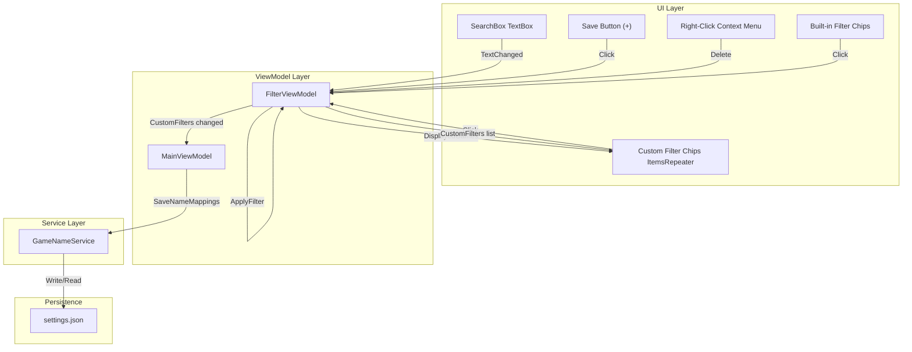

# Design Document: Universal Search Filters

## Overview

This feature extends the RHI application's search and filtering system in two ways:

1. **Universal keyword search**: The existing search bar (which only matches `GameName` and `Maintainer`) is expanded to match across all meaningful `GameCardViewModel` properties — Source, EngineHint, GraphicsApi, bitness, Mod details, LumaMod details, and VulkanRenderingPath.

2. **Custom filter chips**: Users can save any search query as a named chip that appears in the sidebar alongside the built-in filter chips (Detected, Installed, Favourites, etc.). Custom chips persist across sessions via the existing JSON settings file and can be deleted via right-click context menu.

### Key Design Decisions

- **Search logic stays in `FilterViewModel.ApplyFilter()`** — the existing method already handles search + filter combination. We extend its search matching, not replace it.
- **Custom filters are stored as a simple `List<CustomFilter>` on `FilterViewModel`** — each entry is a name + query pair. No complex data structures needed.
- **Persistence piggybacks on the existing `GameNameService.SaveNameMappings()` pattern** — custom filters serialize as a JSON array under a new `"CustomFilters"` key in the settings file.
- **Custom filter chips are dynamically generated in XAML** — rendered via an `ItemsRepeater` or programmatic generation in the sidebar, below the built-in chip rows.

## Architecture



### Data Flow

1. **Search**: User types in SearchBox → `FilterViewModel.SearchQuery` setter fires → `ApplyFilter()` matches against all searchable properties.
2. **Save**: User clicks "+" → Naming dialog opens → On confirm, `FilterViewModel.AddCustomFilter(name, query)` → persists via `SaveNameMappings()` → UI rebuilds custom chip area.
3. **Activate custom filter**: User clicks a custom chip → `FilterViewModel.ActivateCustomFilter(name)` → sets `SearchQuery` to stored query → `ApplyFilter()` runs.
4. **Delete**: User right-clicks custom chip → context menu "Delete" → `FilterViewModel.RemoveCustomFilter(name)` → persists → UI removes chip.
5. **Load on startup**: `LoadNameMappings()` reads `"CustomFilters"` key → `FilterViewModel.CustomFilters` populated → chips rendered.

## Components and Interfaces

### Modified: `FilterViewModel`

```csharp
public partial class FilterViewModel : ObservableObject
{
    // NEW: Custom filter storage
    [ObservableProperty] private ObservableCollection<CustomFilter> _customFilters = new();
    [ObservableProperty] private string? _activeCustomFilterName;

    // NEW: Callback for persistence (set by MainViewModel, same pattern as FilterModeChanged)
    public Action? CustomFiltersChanged { get; set; }

    // NEW: Add a custom filter
    public bool AddCustomFilter(string name, string query);

    // NEW: Remove a custom filter by name
    public void RemoveCustomFilter(string name);

    // NEW: Activate a custom filter chip
    public void ActivateCustomFilter(string name);

    // NEW: Deactivate custom filter (when user manually edits search)
    public void DeactivateCustomFilter();

    // NEW: Check for duplicate name
    public bool CustomFilterNameExists(string name);

    // MODIFIED: ApplyFilter() — expand search matching to all properties
    public void ApplyFilter();
}
```

### Modified: `ApplyFilter()` Search Logic

The current search match:
```csharp
var matchSearch = string.IsNullOrEmpty(query)
    || c.GameName.Contains(query, StringComparison.OrdinalIgnoreCase)
    || c.Maintainer.Contains(query, StringComparison.OrdinalIgnoreCase);
```

Becomes:
```csharp
var matchSearch = string.IsNullOrEmpty(query) || MatchesUniversalSearch(c, query);
```

Where `MatchesUniversalSearch` is a new static/internal method:
```csharp
internal static bool MatchesUniversalSearch(GameCardViewModel card, string query)
{
    return card.GameName.Contains(query, StringComparison.OrdinalIgnoreCase)
        || card.Maintainer.Contains(query, StringComparison.OrdinalIgnoreCase)
        || card.Source.Contains(query, StringComparison.OrdinalIgnoreCase)
        || card.EngineHint.Contains(query, StringComparison.OrdinalIgnoreCase)
        || card.GraphicsApi.ToString().Contains(query, StringComparison.OrdinalIgnoreCase)
        || (card.Is32Bit ? "32-bit" : "64-bit").Contains(query, StringComparison.OrdinalIgnoreCase)
        || (card.Mod?.Name?.Contains(query, StringComparison.OrdinalIgnoreCase) == true)
        || (card.Mod?.Maintainer?.Contains(query, StringComparison.OrdinalIgnoreCase) == true)
        || (card.LumaMod?.Name?.Contains(query, StringComparison.OrdinalIgnoreCase) == true)
        || (card.LumaMod?.Author?.Contains(query, StringComparison.OrdinalIgnoreCase) == true)
        || card.VulkanRenderingPath.Contains(query, StringComparison.OrdinalIgnoreCase);
}
```

### New: `CustomFilter` Model

```csharp
namespace RenoDXCommander.Models;

public class CustomFilter
{
    public string Name { get; set; } = "";
    public string Query { get; set; } = "";
}
```

### Modified: `GameNameService`

- `SaveNameMappings()`: Add serialization of `CustomFilters` list under key `"CustomFilters"`.
- `LoadNameMappings()`: Deserialize `"CustomFilters"` key and pass to `FilterViewModel`.

### Modified: `MainWindow.xaml` Sidebar

- Add a Save button ("+") inside or adjacent to the SearchBox area, visibility bound to whether the search query is non-empty.
- Add an `ItemsRepeater` or `StackPanel` below the built-in chip rows for custom filter chips.
- Custom chips get a `RightTapped` handler that shows a `MenuFlyout` with "Delete".

### Modified: `MainWindow.Events.cs`

- `SaveFilterButton_Click`: Opens a `ContentDialog` (naming dialog) → calls `FilterViewModel.AddCustomFilter()`.
- `CustomFilterChip_Click`: Calls `FilterViewModel.ActivateCustomFilter()`.
- `CustomFilterDelete_Click`: Calls `FilterViewModel.RemoveCustomFilter()`.
- `SearchBox_TextChanged`: Extended to call `FilterViewModel.DeactivateCustomFilter()` when text diverges from active custom filter query.

## Data Models

### `CustomFilter`

| Property | Type     | Description                              |
|----------|----------|------------------------------------------|
| `Name`   | `string` | User-provided display name for the chip  |
| `Query`  | `string` | The search query string to apply         |

### Settings File Schema Addition

The existing `settings.json` dictionary gains one new key:

```json
{
  "CustomFilters": "[{\"Name\":\"DX11 Games\",\"Query\":\"dx11\"},{\"Name\":\"Steam Unreal\",\"Query\":\"steam\"}]"
}
```

This follows the same pattern as other settings: the value is a JSON-serialized string inside the outer dictionary.

### Searchable Properties Map

| GameCardViewModel Property | Search String Representation         |
|----------------------------|--------------------------------------|
| `GameName`                 | Direct string                        |
| `Maintainer`               | Direct string                        |
| `Source`                   | Direct string (e.g., "Steam", "GOG") |
| `EngineHint`               | Direct string (e.g., "Unreal 5")     |
| `GraphicsApi`              | Enum `.ToString()` (e.g., "DirectX11") |
| `Is32Bit`                  | `"32-bit"` if true, `"64-bit"` if false |
| `Mod.Name`                 | Nullable, direct string              |
| `Mod.Maintainer`           | Nullable, direct string              |
| `LumaMod.Name`             | Nullable, direct string              |
| `LumaMod.Author`           | Nullable, direct string              |
| `VulkanRenderingPath`      | Direct string (e.g., "Vulkan", "DirectX") |


## Correctness Properties

*A property is a characteristic or behavior that should hold true across all valid executions of a system — essentially, a formal statement about what the system should do. Properties serve as the bridge between human-readable specifications and machine-verifiable correctness guarantees.*

### Property 1: Universal search produces correct subset

*For any* list of game cards and *for any* non-empty search query, `ApplyFilter()` (with "Detected" filter active) should return exactly the set of non-hidden cards where `MatchesUniversalSearch(card, query)` is true — meaning the query is a case-insensitive substring of at least one of: GameName, Maintainer, Source, EngineHint, GraphicsApi.ToString(), "32-bit"/"64-bit" based on Is32Bit, Mod.Name, Mod.Maintainer, LumaMod.Name, LumaMod.Author, or VulkanRenderingPath. No matching card should be excluded, and no non-matching card should be included.

**Validates: Requirements 1.1, 1.2, 1.3, 1.7**

### Property 2: Search and filter intersection

*For any* list of game cards, *for any* search query, and *for any* valid active filter combination, `ApplyFilter()` should return only cards that satisfy both the universal search match AND the active filter criteria. The result set must equal the intersection of "cards matching search" and "cards matching filter."

**Validates: Requirements 2.1**

### Property 3: Save button visibility matches query state

*For any* string, the save button should be visible/enabled if and only if the string is non-empty after trimming (i.e., contains at least one non-whitespace character). For all strings composed entirely of whitespace (including the empty string), the save button should be hidden/disabled.

**Validates: Requirements 3.1, 3.2**

### Property 4: AddCustomFilter correctness

*For any* existing list of custom filters, *for any* candidate name and query: `AddCustomFilter(name, query)` should succeed (return true and add the filter) if and only if the name is non-empty and no existing custom filter has the same name (case-insensitive). If the name is empty or duplicates an existing name, the method should return false and the list should remain unchanged.

**Validates: Requirements 3.4, 3.5, 3.6**

### Property 5: ActivateCustomFilter sets SearchQuery

*For any* custom filter in the list, calling `ActivateCustomFilter(name)` should set `SearchQuery` to the stored query string of that filter and set `ActiveCustomFilterName` to the filter's name.

**Validates: Requirements 4.2**

### Property 6: Manual search edit deactivates custom filter

*For any* active custom filter, if `SearchQuery` is changed to a value different from the active custom filter's stored query, then `ActiveCustomFilterName` should become null (the custom filter chip deactivates).

**Validates: Requirements 4.5**

### Property 7: RemoveCustomFilter correctness

*For any* list of custom filters and *for any* filter name present in that list, calling `RemoveCustomFilter(name)` should result in the list no longer containing a filter with that name, and all other filters should remain unchanged.

**Validates: Requirements 5.2**

### Property 8: Delete active custom filter falls back to Detected

*For any* active custom filter, if that filter is deleted via `RemoveCustomFilter`, then `SearchQuery` should be cleared to empty, `ActiveCustomFilterName` should be null, and the active filter set should contain "Detected".

**Validates: Requirements 5.4**

### Property 9: Custom filter serialization round-trip

*For any* valid list of `CustomFilter` objects (each with a non-empty name and a query string), serializing the list to JSON and then deserializing it back should produce an equivalent list with the same names and queries in the same order.

**Validates: Requirements 6.4**

## Error Handling

| Scenario | Handling |
|----------|----------|
| Settings file missing `"CustomFilters"` key | Initialize with empty list, no error shown |
| `"CustomFilters"` value is malformed JSON | Catch `JsonException`, initialize with empty list, log warning via `CrashReporter` |
| Duplicate custom filter name on save | `AddCustomFilter` returns false; UI shows validation message in the naming dialog |
| Empty/whitespace name on save | `AddCustomFilter` returns false; dialog prevents confirmation |
| Null properties on GameCardViewModel during search | `MatchesUniversalSearch` uses null-conditional operators (`?.`) for nullable properties (Mod, LumaMod) to avoid NullReferenceException |
| Right-click on built-in chip | No context menu attached to built-in chips; only custom chip elements get the `RightTapped` handler |
| Custom filter query references properties that no longer exist | Search is substring-based, so stale queries simply return no matches — no crash |

## Testing Strategy

### Property-Based Testing

- **Library**: FsCheck 2.16.6 with FsCheck.Xunit (already in the test project)
- **Minimum iterations**: 10 per property (`[Property(MaxTest = 10)]`)
- **Tag format**: `Feature: universal-search-filters, Property {N}: {title}`

Each correctness property (1–9) maps to a single `[Property]` test method. Generators will produce:
- Random `GameCardViewModel` instances with varied property values across all searchable fields (Source, EngineHint, GraphicsApi enum values, Is32Bit, Mod/LumaMod with random names, VulkanRenderingPath)
- Random search query strings (including substrings of known property values, random strings, empty/whitespace strings)
- Random `CustomFilter` lists with varied names and queries
- Random filter mode combinations (exclusive and combinable filters)

### Unit Testing

Unit tests complement property tests for specific examples and edge cases:
- **Example**: Searching "dx11" returns cards with `GraphicsApi == DirectX11` (Requirement 1.5)
- **Example**: Searching "steam" returns cards with Source containing "steam" (Requirement 1.6)
- **Edge case**: Empty/whitespace search returns all non-hidden cards (Requirement 1.4)
- **Edge case**: Malformed JSON in settings file results in empty custom filter list (Requirement 6.3)
- **Edge case**: Clearing search while filters active shows filter-only results (Requirement 2.2)
- **Integration**: Loading settings with custom filters populates the FilterViewModel correctly (Requirement 6.2)

### Test Organization

- `FilterUniversalSearchPropertyTests.cs` — Properties 1, 2
- `CustomFilterManagementPropertyTests.cs` — Properties 3, 4, 5, 6, 7, 8
- `CustomFilterRoundTripPropertyTests.cs` — Property 9
- `UniversalSearchUnitTests.cs` — Example and edge-case tests for Requirements 1.4, 1.5, 1.6, 2.2, 6.2, 6.3
