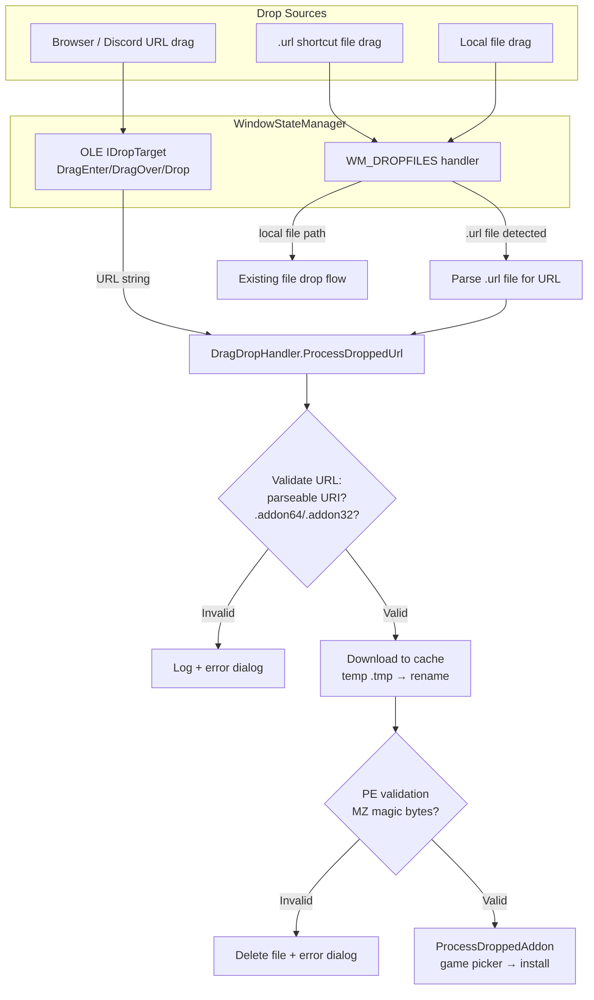

# Design Document: URL Drag-and-Drop Install

## Overview

This feature extends RHI's existing drag-and-drop infrastructure to accept URLs (from Discord, browsers, etc.) pointing to `.addon64`/`.addon32` files. Currently, `WindowStateManager` intercepts `WM_DROPFILES` and routes local file paths to `DragDropHandler`. However, `WM_DROPFILES` only delivers file paths — dragging a URL from a browser or Discord delivers text data via OLE drag-and-drop, which requires implementing `IDropTarget`.

The design adds two URL ingestion paths:

1. **OLE IDropTarget** — Registers the HWND as an OLE drop target to receive `CF_UNICODETEXT` / `CF_TEXT` data containing URLs dragged from browsers and Discord.
2. **`.url` shortcut file handling** — Extends the existing `WM_DROPFILES` handler to detect `.url` files, parse the URL from inside, and route it to the URL processing flow.

Once a URL is captured, the flow is: validate URL → extract filename → download to cache → PE-validate → route to existing `ProcessDroppedAddon`.

## Architecture



### Design Decisions

1. **OLE IDropTarget over WinUI DragDrop**: WinUI 3's managed drag-drop APIs don't reliably receive text data from external apps (Discord, browsers) in unpackaged scenarios. Win32 OLE `IDropTarget` via `RegisterDragDrop` is the proven approach for receiving `CF_UNICODETEXT` from cross-process drops.

2. **Reuse existing download/validation patterns**: The download-to-cache, PE validation (`HasPeSignature`), and temp-file-then-rename patterns already exist in `ModInstallService`. The new code in `DragDropHandler` will replicate these patterns using its own `HttpClient` rather than coupling to `ModInstallService.InstallAsync` (which expects a `GameMod` object and game context that aren't available at URL-drop time).

3. **Local file path takes priority**: When a drop contains both file paths and text (some apps provide both), the existing `WM_DROPFILES` / file-based flow takes priority. OLE `IDropTarget.Drop` checks for `CF_HDROP` first, falling back to `CF_UNICODETEXT`.

4. **WindowStateManager owns OLE registration**: Since `WindowStateManager` already owns the HWND and WndProc subclass, it's the natural place to implement `IDropTarget` and call `RegisterDragDrop`/`RevokeDragDrop`.

## Components and Interfaces

### New: `OleDropTarget` (inner class or nested in WindowStateManager)

Implements the COM `IDropTarget` interface to receive OLE drag-and-drop data.

```csharp
[ComVisible(true)]
internal class OleDropTarget : IDropTarget
{
    private readonly WindowStateManager _owner;

    // IDropTarget methods
    int DragEnter(IDataObject pDataObj, uint grfKeyState, POINTL pt, ref uint pdwEffect);
    int DragOver(uint grfKeyState, POINTL pt, ref uint pdwEffect);
    int DragLeave();
    int Drop(IDataObject pDataObj, uint grfKeyState, POINTL pt, ref uint pdwEffect);
}
```

Key behavior:
- `DragEnter` / `DragOver`: Check if the data object contains `CF_UNICODETEXT` or `CF_HDROP`. Set `DROPEFFECT_COPY` if so, `DROPEFFECT_NONE` otherwise.
- `Drop`: Extract text from `CF_UNICODETEXT`. If it looks like a URL with an addon extension, route to `DragDropHandler.ProcessDroppedUrl`. If `CF_HDROP` is present, extract file paths and route through existing `HandleWin32Drop` logic.
- `DragLeave`: No-op cleanup.

### New P/Invoke declarations in `NativeInterop`

```csharp
// OLE drag-and-drop registration
[DllImport("ole32.dll")] static extern int RegisterDragDrop(IntPtr hwnd, IDropTarget pDropTarget);
[DllImport("ole32.dll")] static extern int RevokeDragDrop(IntPtr hwnd);
[DllImport("ole32.dll")] static extern int OleInitialize(IntPtr pvReserved);

// COM IDropTarget interface
[ComImport, Guid("00000122-0000-0000-C000-000000000046"), InterfaceType(ComInterfaceType.InterfaceIsIUnknown)]
internal interface IDropTarget { ... }

// IDataObject for reading drop data
[ComImport, Guid("0000010e-0000-0000-C000-000000000046"), InterfaceType(ComInterfaceType.InterfaceIsIUnknown)]
internal interface IDataObject { ... }

// FORMATETC, STGMEDIUM structs for clipboard format negotiation
```

### Modified: `WindowStateManager`

- `EnableDragAccept()` → also calls `OleInitialize` and `RegisterDragDrop` with the `OleDropTarget` instance.
- Window close / cleanup → calls `RevokeDragDrop`.
- Existing `WM_DROPFILES` handler extended: when a `.url` file is detected, parse it and route to `DragDropHandler.ProcessDroppedUrl`.

### Modified: `DragDropHandler`

New public method:

```csharp
/// <summary>
/// Processes a URL dropped onto the window. Validates the URL, downloads the addon
/// to the cache, PE-validates it, then routes to ProcessDroppedAddon.
/// </summary>
public async Task ProcessDroppedUrl(string url);
```

New static helper:

```csharp
/// <summary>
/// Extracts the filename from a URL path component, stripping query params and fragments.
/// Returns null if the URL is not parseable or has no path filename.
/// </summary>
public static string? ExtractFileNameFromUrl(string url);
```

### Modified: `NativeInterop`

Add OLE-related P/Invoke declarations and COM interface definitions.

## Data Models

No new data models are required. The feature reuses existing types:

- `InstalledModRecord` — unchanged, used after install completes
- `GameCardViewModel` — unchanged, used in game picker dialog
- The download cache directory (`%LocalAppData%\RHI\downloads\`) is reused as-is

### URL Flow Data

| Stage | Data | Type |
|-------|------|------|
| OLE Drop | Raw text from clipboard | `string` (CF_UNICODETEXT) |
| URL Validation | Parsed URI | `System.Uri` |
| Filename Extraction | Addon filename | `string` (e.g. `renodx-crimsondesert.addon64`) |
| Download | Temp file path | `string` (`{cache}/{filename}.tmp`) |
| PE Validation | Cached file path | `string` (`{cache}/{filename}`) |
| Install | Routed to `ProcessDroppedAddon` | `string` (file path) |

### `.url` Shortcut File Format

Windows `.url` shortcut files are INI-format:
```ini
[InternetShortcut]
URL=https://cdn.discordapp.com/attachments/.../renodx-crimsondesert.addon64?ex=...
```

The parser reads lines looking for `URL=` under `[InternetShortcut]`.

## Correctness Properties

*A property is a characteristic or behavior that should hold true across all valid executions of a system — essentially, a formal statement about what the system should do. Properties serve as the bridge between human-readable specifications and machine-verifiable correctness guarantees.*

### Property 1: URL filename extraction correctness

*For any* URL string containing a path with a filename segment (possibly followed by query parameters `?...`, fragment identifiers `#...`, and/or URL-encoded characters like `%20`), `ExtractFileNameFromUrl` shall return the decoded filename from the last path segment with no query string or fragment content.

**Validates: Requirements 2.1, 7.1, 7.2, 7.3**

### Property 2: Addon URL acceptance is determined by extension

*For any* parseable URL, the URL is accepted for download processing if and only if the extracted filename ends with `.addon64` or `.addon32` (case-insensitive). URLs with any other extension or no extension are rejected.

**Validates: Requirements 2.2, 2.3**

### Property 3: Extracted filename produces valid filesystem path

*For all* valid addon URLs, extracting the filename via `ExtractFileNameFromUrl` and combining it with any valid directory path shall produce a filesystem path whose extension is `.addon64` or `.addon32`.

**Validates: Requirements 7.4**

### Property 4: PE signature detection

*For any* byte array of length ≥ 2, `HasPeSignature` returns true if and only if the first two bytes are `0x4D` (`M`) and `0x5A` (`Z`). For byte arrays of length < 2, it returns false.

**Validates: Requirements 4.1**

### Property 5: .url shortcut file parsing round-trip

*For any* URL string, writing it into a `.url` shortcut file in the standard INI format (`[InternetShortcut]\nURL={url}`) and then parsing it with the `.url` file reader shall return the original URL string.

**Validates: Requirements 1.2**

## Error Handling

| Scenario | Handling |
|----------|----------|
| Unparseable URL (not a valid URI) | Log error, show brief error dialog, discard drop |
| URL with non-addon extension | Log with filename/extension info, show error dialog explaining only `.addon64`/`.addon32` accepted |
| Network error during download | Catch `HttpRequestException` / timeout, delete `.tmp` file, show error dialog with message |
| HTTP non-success status (4xx/5xx) | Delete `.tmp` file, show error dialog with status code |
| Downloaded file fails PE validation | Delete cached file, show error dialog: "Downloaded file is not a valid addon binary" |
| `.url` file has no `URL=` line | Log warning, skip file (don't show error — user may have dropped a non-addon shortcut) |
| OLE `RegisterDragDrop` fails | Log error, fall back to `WM_DROPFILES`-only mode (graceful degradation) |
| `RevokeDragDrop` fails on cleanup | Log warning, continue shutdown (non-fatal) |

All errors are logged via `ICrashReporter.Log` with `[DragDropHandler.ProcessDroppedUrl]` or `[WindowStateManager]` prefixes for consistency with existing logging patterns.

Temp files (`.tmp`) are always cleaned up in `finally` blocks to avoid leaving partial downloads in the cache directory.

## Testing Strategy

### Unit Tests

Unit tests cover specific examples and edge cases:

- `ExtractFileNameFromUrl` with a Discord CDN URL (`https://cdn.discordapp.com/attachments/.../renodx-crimsondesert.addon64?ex=abc&is=def`) → returns `renodx-crimsondesert.addon64`
- `ExtractFileNameFromUrl` with a plain URL (no query params) → returns filename
- `ExtractFileNameFromUrl` with `null`, empty string, or garbage → returns `null`
- `ExtractFileNameFromUrl` with URL-encoded spaces (`renodx%20test.addon64`) → returns `renodx test.addon64`
- `.url` file parsing with missing `[InternetShortcut]` section → returns `null`
- `.url` file parsing with empty `URL=` value → returns `null`
- URL validation rejects `.exe`, `.dll`, `.zip` extensions
- URL validation accepts `.addon64` and `.addon32` (case-insensitive: `.ADDON64`, `.Addon32`)
- PE validation with 0-byte file → returns false
- PE validation with 1-byte file → returns false
- OLE drop priority: when both `CF_HDROP` and `CF_UNICODETEXT` are present, file path is preferred

### Property-Based Tests

Property-based tests use a PBT library (e.g. **FsCheck** via `FsCheck.Xunit` or **CsCheck** for C#) with minimum 100 iterations per property. Each test references its design property.

- **Feature: url-drag-drop-install, Property 1: URL filename extraction correctness** — Generate random filenames (with addon extensions), embed them in random URL structures with random query params and fragments, verify extraction returns the original filename.
- **Feature: url-drag-drop-install, Property 2: Addon URL acceptance is determined by extension** — Generate random URLs with random extensions, verify acceptance matches extension check.
- **Feature: url-drag-drop-install, Property 3: Extracted filename produces valid filesystem path** — Generate random addon URLs, extract filename, combine with a directory, verify the resulting path has the correct extension.
- **Feature: url-drag-drop-install, Property 4: PE signature detection** — Generate random byte arrays, verify `HasPeSignature` returns true iff first two bytes are `M` and `Z`.
- **Feature: url-drag-drop-install, Property 5: .url shortcut file parsing round-trip** — Generate random URL strings, write to `.url` format, parse back, verify round-trip equality.

### Integration Tests

Integration tests (manual or semi-automated) cover the end-to-end flows that can't be unit-tested:

- Drag a Discord CDN URL onto the window → download starts, progress shown, game picker appears
- Drag a `.url` shortcut file → URL extracted, same flow as above
- Drag a non-addon URL → error dialog shown
- Drag a local `.addon64` file alongside a URL → local file processed, URL ignored
- Download a URL that returns an HTML error page → PE validation catches it, error shown
