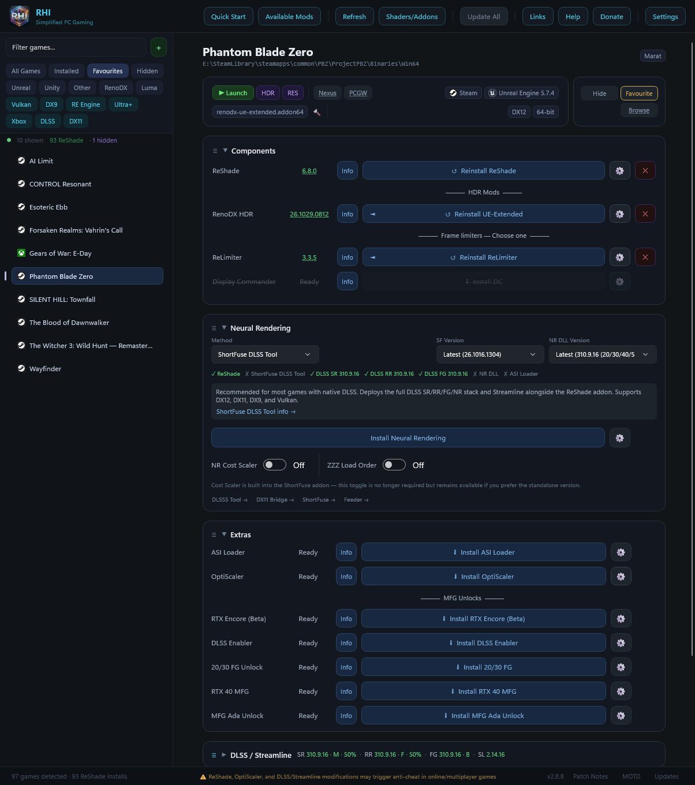

# RHI — ReShade HDR Installer

**HDR mods, ReShade, DLSS and NVIDIA driver settings for your whole PC game library, from one window.**

RHI finds your games across eight storefronts, then installs, updates and removes ReShade, RenoDX and Luma HDR mods, frame limiters, DLSS/Streamline files, OptiScaler, Neural Rendering tools and more, with per-game control over every one of them.

**[Download the latest release](https://github.com/RankFTW/RHI/releases/latest)** · **[Detailed Guide](docs/DETAILED_GUIDE.md)** · **[Discord](https://discord.gg/ultraplace)**

> **Single-player only.** ReShade with addon support, OptiScaler and DLSS/Streamline changes can trigger anti-cheat in online games. Uninstall them before playing multiplayer.

---

## HDR for every game

- **[RenoDX](https://github.com/clshortfuse/renodx)**: finds and installs the right HDR mod for each game, and keeps it updated. Games without a dedicated mod get a generic one:
  - **Unreal Engine 4/5**: UE-Extended, with `reshade.ini` and `Engine.ini` configured for you.
  - **Unity**: the generic Unity addon (32-bit and 64-bit).
- **[Luma Framework](https://github.com/Filoppi/Luma-Framework)**: named Luma mods, plus generic Luma for DX11 Unreal Engine games. Engine.ini keys, launch arguments and TAA settings from the Luma wiki are applied on install. DX9 Luma games get dgVoodoo2 automatically.
- **RTX HDR and Windows Auto HDR**: enable either per game from the RenoDX ⚙ menu. RTX HDR settings (peak brightness, contrast, saturation, middle grey, debanding) are written straight to the game's NVIDIA profile.
- **[DXVK + Lilium HDR](https://github.com/EndlesslyFlowering/dxvk)**: scRGB HDR for DX8–DX11 games, with presets from "Safest" to "Experimental".
- **DOF Fix**: recommended for Unreal Engine 5.0–5.6 games.
- **Available Mods**: one searchable list of every game with a RenoDX, Luma or Ultra+ mod.

## ReShade, fully managed

RHI replaces the ReShade installer.

- Picks the right DLL name for each game from its graphics API and bitness (`dxgi.dll`, `d3d9.dll`, `d3d8.dll`, `opengl32.dll`), or use your own name per game.
- Per-game channels: **Stable**, **Nightly**, **Custom** (your own DLL), **No Addons** and **Legacy** (pick an older version).
- Vulkan games use ReShade's global Vulkan layer.
- Warns before overwriting another tool's DLL (DXVK, Special K, ENB) and backs up what it replaces.
- Keeps `reshade.ini` set up: hotkeys, screenshot folder, peak brightness and effect list style, applied to one game or all of them. Lock any game's ini to stop RHI touching it.
- **56 shader packs** (Lilium HDR, crosire, PumboAutoHDR, MaxG2D, RenoFX, UltraShade, iMMERSE, qUINT, SweetFX and many more). Pick packs or single `.fx` files, globally or per game. Save selections as profiles and share them as a zip.
- **Addon manager**: the official ReShade addon list plus extras, globally or per game, and your own `.addon64`/`.addon32` files.
- **ReShade presets**: deploy presets to any game, along with the shaders they need.

## DLSS and Streamline

- Swap **Super Resolution, Ray Reconstruction, Frame Generation, Neural Rendering** and **Streamline** versions per game from a dropdown. Originals are backed up and can be restored at any time.
- Set **presets** (including the DLSS 4.5 transformer presets L and M) and **render scale** (33–100%, or DLAA) in the NVIDIA driver profile. You don't need NVIDIA Profile Inspector.
- **NVIDIA Override**: turn on the driver's "use latest DLL" override per component.
- **Defaults + Quick Apply**: choose your preferred versions and presets once, then apply them to any game in one click.
- **Batch Deploy**: push versions and presets to many games at once.
- **Auto-update**: optionally move games to the newest DLSS or Streamline release as soon as it's available.

## Neural Rendering (DLSS 5)

A Neural Rendering section on every game installs one of four methods, and recommends the right one for the game:

- **ShortFuse DLSS Tool**: for most games with native DLSS (DX9, DX11, DX12, Vulkan).
- **DLSS5 Tool**: for DX12 games with native DLSS.
- **DLSS5 Tool + DX11 Bridge**: for DX11 and Vulkan games with native DLSS.
- **DLSS5 Feeder**: for games without DLSS, including OpenGL, DX9 and 32-bit games.

Pin versions of each tool and of `nvngx_dlssnr.dll`, and optionally add the **NR Cost Scaler** to run the neural model at reduced cost.

## Frame generation and upscaling extras

- **[OptiScaler](https://github.com/optiscaler/OptiScaler)**: Stable, Nightly (with build pinning), DLSS NR and F5 DLSSNR variants. Upscaler, frame generation, Reflex, preset and Neural Rendering settings are all set from a menu that writes `OptiScaler.ini` for you. GPU-specific ini templates for NVIDIA, AMD and Intel. OptiPatcher included.
- **Multi Frame Generation**: set Fixed or Dynamic MFG (2x–6x) and a target frame rate on RTX 50 Series.
- **MFG unlocks for older cards**: RTX 40 MFG, MFG Ada Unlock, 20/30 FG Unlock, RTX Encore (beta) and DLSS Enabler.
- **[Ultimate ASI Loader](https://github.com/ThirteenAG/Ultimate-ASI-Loader)** and **[dgVoodoo2](https://github.com/dege-diosg/dgVoodoo2)** with a filename picker.

## Frame limiters

Choose one per game:

- **[ReLimiter](https://github.com/RankFTW/ReLimiter)**: frame pacing limiter with an on-screen display, VRR caps and DLSS hooks.
- **[Display Commander](https://github.com/pmnoxx/display-commander)**: alternative limiter with display tools.

Both support 32-bit and 64-bit games, and installing either one turns off the driver frame limiter for that game.

## NVIDIA driver settings

Written directly to the driver, so you don't need NVIDIA App or Profile Inspector.

- **Per game**: VSync, Tear Control, Low Latency, Smooth Motion (RTX 40+), Power Mode, G-Sync, ReBAR (enable, mode and size).
- **Global**: Shader Cache Size and Pre-Compile, G-Sync and G-Sync Mode, FPS Limit, Preferred Refresh Rate, VSync, Power Mode, ReBAR.
- **Digital Vibrance** per display, reapplied every time RHI starts.
- **DLDSR Control**: save and switch DLDSR factor setups without opening NVIDIA Control Panel.
- **Back up and restore** your per-game profiles, for example after a driver reinstall.
- **Output colour**: colour depth (8/10/12 bpc) and dynamic range per display.

## Everyday conveniences

- **Update All**: updates ReShade, RenoDX, ReLimiter, Display Commander, OptiScaler, RE Framework, DXVK, Luma and DOF Fix across your library. You choose what's included, globally or per game. **Automatic Updates** can install them in the background.
- **Game launch**: launch from RHI, the tray, the taskbar jump list or a desktop shortcut. Custom exe and arguments per game.
- **HDR and resolution auto-toggle**: turn Windows HDR on and switch resolution when a game starts, and switch both back when it closes. Global or per game, on the monitors you choose.
- **Drag and drop**: drop a game exe, addon, archive, Luma mod, ReShade preset or link onto the window.
- **Links per game**: Nexus Mods, PCGamingWiki, ultrawide fixes and Ultra+.
- **RE Framework** for RE Engine games, **Ryubing** emulator support, and **custom game filters**.
- **Remote manifest**: new game support and fixes reach everyone without waiting for an app update.

---

## Supported stores

Steam · Epic Games · GOG · EA App · Ubisoft Connect · Xbox / Game Pass · Battle.net · Rockstar

Not detected? Click **+** next to the search box, or drag the game's `.exe` onto the window.

## Requirements

- Windows 10 or 11 (64-bit)
- [.NET 8 Desktop Runtime](https://dotnet.microsoft.com/download/dotnet/8.0). The installer adds the Windows App Runtime if it's missing.
- An NVIDIA GPU for the DLSS preset, driver and Neural Rendering features. ReShade, RenoDX, Luma and OptiScaler work on any GPU.
- **Admin Mode** (Settings → General → Admin Mode) for per-game driver settings, ReBAR, DLDSR Control and the DLSS on-screen indicator.
- **Recommended: a GitHub token.** Without one, GitHub allows 60 requests an hour, which can make downloads and update checks fail. Add a free token with no permissions under Settings → Accounts & Data → GitHub token to raise the limit to 5,000.

---

## Third-party components

RHI downloads these from their official sources. All credit goes to their authors.

| Component | Author |
|---|---|
| [ReShade](https://reshade.me) | crosire |
| [RenoDX](https://github.com/clshortfuse/renodx) | clshortfuse & contributors |
| [RenoDX UE-Extended](https://github.com/marat569/renodx) | Marat |
| [RenoDX Unity](https://github.com/NotVoosh/renodx-unity) | NotVoosh |
| [Luma Framework](https://github.com/Filoppi/Luma-Framework) | Pumbo (Filoppi) & contributors |
| [ReLimiter](https://github.com/RankFTW/ReLimiter) | RankFTW |
| [Display Commander](https://github.com/pmnoxx/display-commander) | pmnoxx |
| [RE Framework](https://github.com/praydog/REFramework-nightly) | praydog |
| [OptiScaler](https://github.com/optiscaler/OptiScaler) | OptiScaler contributors |
| [OptiScaler DLSS NR fork](https://github.com/wilsjo2/OptiScaler-DLSSNR-PreSR-Multipass) | wilsjo2 |
| [OptiScaler F5 DLSSNR fork](https://github.com/janblade/OptiScaler-F5-DLSSNR-Multipass) | janblade |
| [DXVK](https://github.com/doitsujin/dxvk) | doitsujin & contributors |
| [DXVK HDR-mod](https://github.com/EndlesslyFlowering/dxvk) | EndlesslyFlowering (Lilium) |
| [dgVoodoo2](https://github.com/dege-diosg/dgVoodoo2) | Dege |
| [Ultimate ASI Loader](https://github.com/ThirteenAG/Ultimate-ASI-Loader) | ThirteenAG |
| [DLSS5 Feeder](https://github.com/jlrouzies-fr/DLSS5-Feeder) | jlrouzies-fr |
| [DLSS5 DX11 Bridge](https://github.com/NIGos/dlss5-bridge) | NIGos |
| [RTX 40 MFG Unlock](https://github.com/dashdogy/RTX40MFG-Unlock) | dashdogy |
| [MFG Ada Unlock](https://github.com/mavismmg/MFGAdaUnlock-RenoDx) | mavismmg |
| [20/30 FG Unlock](https://github.com/sdli1995/dlssg_for_sm86) | sdli1995 |
| [RTX Encore](https://github.com/SilyNoMeta/rtx-encore) | SilyNoMeta |
| [7-Zip](https://www.7-zip.org/) | Igor Pavlov |

Shader packs are the work of their respective authors; each pack links to its source in the shader picker. Game data comes from [PCGamingWiki](https://www.pcgamingwiki.com) and the [HDR Gaming Database](https://github.com/KoKlusz/HDR-Gaming-Database).
