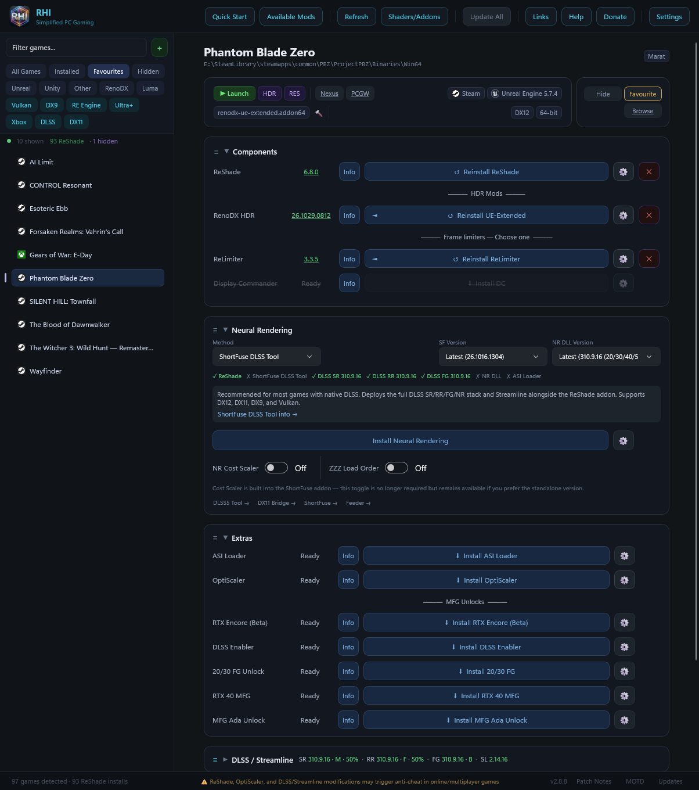

# RHI — ReShade HDR Installer

**HDR, ReShade, DLSS and NVIDIA driver settings for your whole PC game library, from one window.**

RHI finds your games on eight storefronts, then installs, updates and removes the mods that make them look and run better. One click per game, with everything backed up and reversible.

**[Download the latest release](https://github.com/RankFTW/RHI/releases/latest)** · **[Detailed Guide](docs/DETAILED_GUIDE.md)** · **[Discord](https://discord.gg/ultraplace)**

> **Single-player only.** ReShade with addon support, OptiScaler, frame generation mods and DLSS/Streamline changes can trigger anti-cheat in online games. Uninstall them before playing multiplayer.

## Why RHI

- **HDR in a minute.** Pick a game, click Install twice. RHI finds the right RenoDX or Luma mod, installs ReShade under the right name and keeps both updated.
- **No more tool juggling.** It replaces the ReShade installer, DLSS Swapper, NVIDIA Profile Inspector and a folder of downloaded mods.
- **Safe to try.** RHI backs up what it replaces, warns before touching another tool's files, and removes cleanly.
- **Per-game control.** Every setting can be set once for all games and changed for any one of them.
- **Always current.** New game support and fixes arrive through a remote manifest, without waiting for an app update.

---

## What it does

### HDR for every game

- **[RenoDX](https://github.com/clshortfuse/renodx)**: hundreds of game-specific HDR mods, matched automatically. Unreal Engine, Unity and Source engine games without their own mod get a generic one, set up for you.
- **[Luma Framework](https://github.com/Filoppi/Luma-Framework)**: named Luma mods, plus generic Luma for DX11 Unreal Engine games.
- **RTX HDR and Windows Auto HDR**: switch either on per game and tune it without opening the NVIDIA App.
- **[DXVK + Lilium HDR](https://github.com/EndlesslyFlowering/dxvk)**: scRGB HDR for DX8 to DX11 games.
- **Available Mods**: one searchable list of every game with a RenoDX, Luma or Ultra+ mod.

### ReShade, fully managed

- The right DLL name for every game's graphics API, or your own.
- Stable, Nightly, Legacy, No Addons or your own build, per game. Vulkan games handled too.
- **57 shader packs**, an addon manager and ReShade presets, for all games or just one. Save shader selections as profiles and share them.
- Your hotkeys, screenshot folder and peak brightness written to every game.

### DLSS, Streamline and Neural Rendering

- Swap **Super Resolution, Ray Reconstruction, Frame Generation and Streamline** versions per game. Originals are always restorable.
- Set **presets** (including the DLSS 4.5 presets L and M) and **render scale** straight in the driver profile.
- **Quick Apply** your favourite setup to a game in one click, or **Batch deploy** it to many.
- **Neural Rendering (DLSS 5)** on almost any game, with five methods and the right one picked for you: GITC Uplift, ShortFuse DLSS Tool, DLSS5 Tool (with optional foveated rendering), DX11 Bridge and DLSS5 Feeder.

### Frame generation for any card

- **Multi Frame Generation** (2x to 6x, fixed or dynamic) on RTX 50.
- **HSF** and **RTX Encore**: frame generation in games that don't have it.
- **Universal MFG Unlocker, MFG Unlock, 20/30 FG Unlock and DLSS Enabler**: multi frame generation on RTX 20, 30 and 40, and on AMD and Intel cards.
- **[OptiScaler](https://github.com/optiscaler/OptiScaler)**: Stable, Nightly, Neural Rendering forks and your own builds, with ready-made presets and every ini setting in a searchable menu.

### NVIDIA driver settings, without the NVIDIA App

- **Per game**: VSync, Low Latency, Smooth Motion, G-Sync, FPS limit, ReBAR, LOD bias and texture filtering.
- **Global**: shader cache and **Compile shaders now**, G-SYNC on each monitor, DLDSR setups, digital vibrance, output colour depth, and RTX Video Super Resolution and HDR.
- **Monitors**: resolution, refresh rate and HDR for every connected display.
- Back up and restore your profiles after a driver reinstall.

### Frame limiters and smoother motion

- **[ReLimiter](https://github.com/RankFTW/ReLimiter)** or **[Display Commander](https://github.com/pmnoxx/display-commander)**: one per game, with VRR-aware caps.
- **BFI Presenter**: black frame insertion for sharper motion.
- **Experimental**: FrameWarp reprojection, URTI ray-traced reflections and CRCGI global illumination.

### A launcher you'll want to use

- **Three layouts**: Classic+, Tabs, and **Spotlight** with cover art, banners and full controller support (Xbox, PlayStation and Steam controllers).
- **RHI overlay**: press Alt + ` in a game for your achievements, screenshots, playtime, notes and mod setup. Nothing is installed into the game.
- **Display modes**: save a Monitor setup and a TV setup, and switch a game (or every game) between them in one click.
- **HDR and resolution switching** when a game starts, and back when it closes.
- **Collections**, Steam-style search, Steam and Xbox achievements, colour themes, and interface scaling from 50% to 200%.
- **Update All**, optional automatic updates, and **backup and restore** that carries your whole setup to a new PC.

Everything is covered step by step in the **[Detailed Guide](docs/DETAILED_GUIDE.md)**.

---

## Supported stores

Steam · Epic Games · GOG · EA App · Ubisoft Connect · Xbox / Game Pass · Battle.net · Rockstar

Game not detected? Add its folder in Settings, click **+** next to the search box, or drag the game's `.exe` onto the window.

## Requirements

- Windows 10 or 11 (64-bit) and the [.NET 8 Desktop Runtime](https://dotnet.microsoft.com/download/dotnet/8.0). If the Windows App Runtime 2.5 is missing, RHI says so and offers the download.
- An NVIDIA card for DLSS presets, driver settings and Neural Rendering. ReShade, RenoDX, Luma and OptiScaler work on any card.
- **Recommended: a free GitHub token** (no permissions needed). Without one GitHub allows 60 requests an hour, which can make downloads and update checks fail. Add it in Settings → Accounts & Data.

---

## Credits

RHI installs other people's work. All credit goes to their authors.

Third-party components

| Component | Author |
|---|---|
| [ReShade](https://reshade.me) | crosire |
| [RenoDX](https://github.com/clshortfuse/renodx) | clshortfuse & contributors |
| [RenoDX UE-Extended](https://github.com/marat569/renodx) | Marat |
| [RenoDX Unity](https://github.com/NotVoosh/renodx-unity) | NotVoosh |
| [Luma Framework](https://github.com/Filoppi/Luma-Framework) | Pumbo (Filoppi) & contributors |
| [ReLimiter](https://github.com/RankFTW/ReLimiter) | RankFTW |
| [Display Commander](https://github.com/pmnoxx/display-commander) | pmnoxx |
| [RE Framework](https://github.com/praydog/REFramework-nightly) | praydog |
| [OptiScaler](https://github.com/optiscaler/OptiScaler) | OptiScaler contributors |
| [OptiScaler DLSS NR fork](https://github.com/wilsjo2/OptiScaler-DLSSNR-PreSR-Multipass) | wilsjo2 |
| [OptiScaler F5 DLSSNR fork](https://github.com/janblade/OptiScaler-F5-DLSSNR-Multipass) | janblade |
| [OptiScaler Feeder NR fork](https://github.com/jlrouzies-fr/OptiScaler-DLSSNR-PreSR-Multipass) | jlrouzies-fr |
| [OptiScaler Venom](https://github.com/LorenzoKy/Optiscaler-Venom) | LorenzoKy |
| [OptiScaler NR PreSR MFG](https://github.com/ShyVortex/OptiScaler-NR-PreSR-MFG) | ShyVortex |
| [OpenNR OptiScaler](https://github.com/MatheusFerreiraS/OpenNR-OptiScaler) | MatheusFerreiraS |
| [ANR FG](https://github.com/apex-compute/ANR) | Apex Compute |
| [DXVK](https://github.com/doitsujin/dxvk) | doitsujin & contributors |
| [DXVK HDR-mod](https://github.com/EndlesslyFlowering/dxvk) | EndlesslyFlowering (Lilium) |
| [dgVoodoo2](https://github.com/dege-diosg/dgVoodoo2) | Dege |
| [Ultimate ASI Loader](https://github.com/ThirteenAG/Ultimate-ASI-Loader) | ThirteenAG |
| [GITC Uplift](https://github.com/ghostinthecamera/GITC-Uplift) | ghostinthecamera |
| [DLSS5 Feeder](https://github.com/jlrouzies-fr/DLSS5-Feeder) | jlrouzies-fr |
| [DLSS5 DX11 Bridge](https://github.com/NIGos/dlss5-bridge) | NIGos |
| [FoveatedDLSS5](https://github.com/maximedgoulet/FoveatedDLSS5) | maximedgoulet |
| [DLSSNR Cost Scaler](https://github.com/xenmods/DLSSNR-Cost-Scaler) | xenmods |
| [HSF](https://github.com/Capt-Hunter/HSF) | Capt-Hunter |
| [RTX Encore](https://github.com/SilyNoMeta/rtx-encore) | SilyNoMeta |
| [Universal MFG Unlocker](https://github.com/dashdogy/MFG-Unlocker) | dashdogy |
| [MFG Unlock](https://github.com/mavismmg/MFGAdaUnlock-RenoDx) | mavismmg |
| [20/30 FG Unlock](https://github.com/sdli1995/dlssg_for_sm86) | sdli1995 |
| [BFI Presenter](https://github.com/artzox/BFI-Presenter) | artzox |
| [URTI](https://github.com/Skynizz/URTI) | Skynizz |
| [CRCGI](https://github.com/FlibbertigibbetLollygagger/CRCGI-Compensated-Radiance-Cascade-SSGI) | FlibbertigibbetLollygagger |
| [FrameWarp (XPAR)](https://github.com/xPoiler/Reshade-Asynchronous-Reprojection) | xPoiler |
| [iMMERSE](https://github.com/martymcmodding/iMMERSE) | Marty McFly |
| [7-Zip](https://www.7-zip.org/) | Igor Pavlov |

Shader packs are the work of their respective authors; each pack links to its source in the shader picker. RHI's database of RenoDX mods was made by Scrungus. Game data comes from [PCGamingWiki](https://www.pcgamingwiki.com) and the [HDR Gaming Database](https://github.com/KoKlusz/HDR-Gaming-Database), and extra artwork from [SteamGridDB](https://www.steamgriddb.com).
