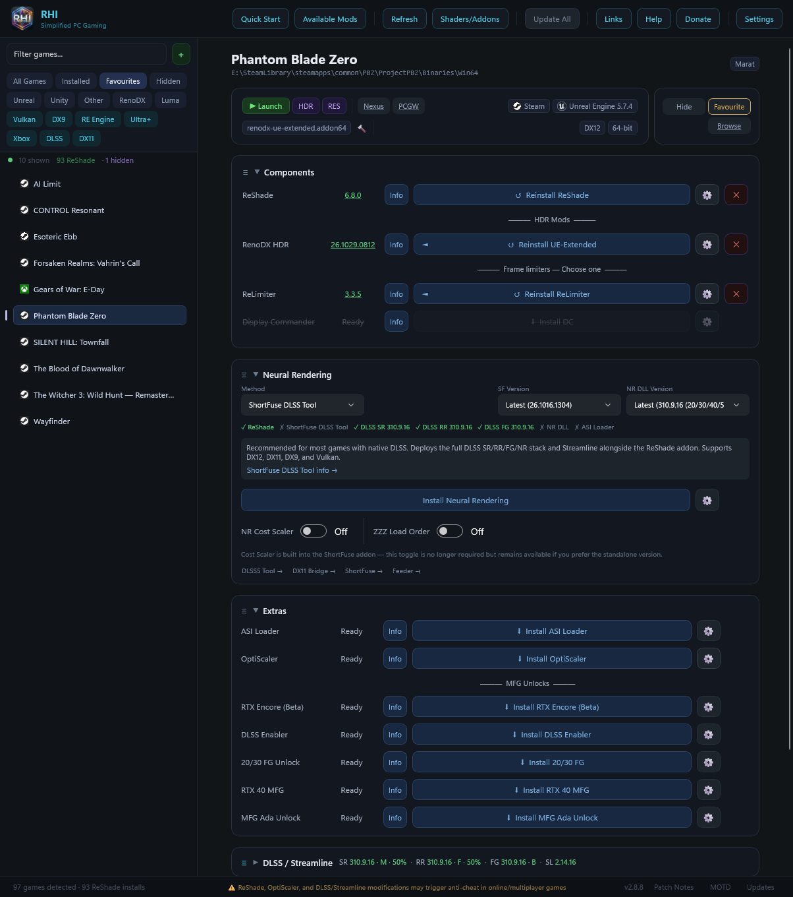

# RHI — Detailed Guide

This guide covers every feature in RHI (ReShade HDR Installer) as of version 2.9.6.2. For a short overview, see the [README](../README.md). For help, join the [Discord](https://discord.gg/ultraplace).

> **Single-player only.** ReShade with addon support, OptiScaler, frame generation mods and DLSS/Streamline changes can trigger anti-cheat in online games. Uninstall them before playing multiplayer.

**New to RHI?** Read [Part 1](#part-1-getting-started), then come back to the rest when you need it. Each part stands on its own.

---

## Contents

**[Part 1: Getting started](#part-1-getting-started)**
- [Requirements](#requirements) · [Installing RHI](#installing-rhi) · [First launch](#first-launch) · [Add a GitHub token](#add-a-github-token-recommended) · [Your first game, step by step](#your-first-game-step-by-step)

**[Part 2: Finding your way around](#part-2-finding-your-way-around)**
- [Layouts](#layouts) · [Top bar](#top-bar) · [Game list and search](#game-list-and-search) · [The game page](#the-game-page) · [Game settings ⚙](#game-settings-) · [Spotlight](#spotlight-layout) · [Collections](#game-collections) · [Controller](#controller-support) · [Colours and sizes](#colours-and-sizes) · [Status bar](#status-bar)

**[Part 3: Your game library](#part-3-your-game-library)**
- [Supported stores](#supported-stores) · [Engine and graphics API detection](#engine-detection) · [Adding games](#adding-a-game-manually) · [Custom game folders](#custom-game-folders) · [Removing, renaming, hiding](#removing-a-game-from-rhi) · [Moving a game](#when-a-game-moves)

**[Part 4: ReShade and HDR mods](#part-4-reshade-and-hdr-mods)**
- [Components](#components) · [ReShade](#reshade) · [RenoDX](#renodx) · [RTX HDR and Auto HDR](#rtx-hdr-and-auto-hdr) · [Luma Framework](#luma-framework) · [RE Framework](#re-framework) · [DOF Fix](#dof-fix) · [Frame limiters](#frame-limiters)

**[Part 5: Shaders, addons and presets](#part-5-shaders-addons-and-presets)**
- [Shader packs](#shader-packs) · [ReShade addons](#reshade-addons) · [ReShade presets](#reshade-presets)

**[Part 6: DLSS and NVIDIA settings](#part-6-dlss-and-nvidia-settings)**
- [DLSS / Streamline](#dlss--streamline) · [Neural Rendering (DLSS 5)](#neural-rendering-dlss-5) · [Driver Settings](#driver-settings) · [Multi Frame Generation](#multi-frame-generation-rtx-50-series)

**[Part 7: Extras](#part-7-extras)**
- [What's in Extras](#whats-in-extras) · [OptiScaler](#optiscaler) · [Frame generation tools](#frame-generation-tools) · [BFI Presenter](#bfi-presenter) · [DXVK and dgVoodoo2](#dxvk-and-dgvoodoo2)

**[Part 8: Experimental](#part-8-experimental)**
- [URTI](#urti-ray-traced-reflections) · [CRCGI](#crcgi-global-illumination) · [FrameWarp](#framewarp-reprojection)

**[Part 9: Playing your games](#part-9-playing-your-games)**
- [Launching](#launching-games) · [HDR and resolution switching](#hdr-auto-toggle) · [Display modes](#display-modes-monitor--tv) · [RHI overlay](#rhi-overlay) · [Screenshots](#screenshots) · [Achievements](#achievements) · [Tray and jump list](#system-tray-and-jump-list)

**[Part 10: The Settings page](#part-10-the-settings-page)**

**[Part 11: Updates, backups and maintenance](#part-11-updates-backups-and-maintenance)**
- [Update All](#update-all) · [Automatic checks](#automatic-and-background-checks) · [App and beta updates](#app-updates) · [Backup and restore](#backup-and-restore) · [Where Game Overrides went, and Management](#where-game-overrides-went)

**[Part 12: More ways to install](#part-12-more-ways-to-install)**
- [Drag and drop](#drag-and-drop) · [Addon watch folder](#addon-watch-folder) · [Vulkan games](#vulkan-games) · [Ryubing](#ryubing-nintendo-switch-emulator) · [Game links](#links-nexus-pcgamingwiki-uw-fix-ultra)

**[Part 13: Reference](#part-13-reference)**
- [Remote data](#remote-data) · [Where RHI keeps its files](#data-storage-and-logs) · [Troubleshooting](#troubleshooting) · [Third-party components](#third-party-components)

---

# Part 1: Getting started

## Requirements

- Windows 10 (version 1809 or later) or Windows 11, 64-bit.
- The [.NET 8 Desktop Runtime](https://dotnet.microsoft.com/download/dotnet/8.0). The installer doesn't install it.
- The Windows App Runtime 2.5. If it's missing or damaged, RHI says so when it starts and offers to open the [download](https://aka.ms/windowsappsdk/2.5/latest/windowsappruntimeinstall-x64.exe).
- An NVIDIA graphics card for DLSS presets, driver settings and Neural Rendering. ReShade, RenoDX, Luma and OptiScaler work on any card.

## Installing RHI

1. Download the installer from the [latest release](https://github.com/RankFTW/RHI/releases/latest) and run it.
2. Start RHI from the Start menu (or the desktop icon, if you ticked it).

Uninstalling RHI from Windows also removes Admin Mode and deletes RHI's data folder (`%LOCALAPPDATA%\RHI\`), including your settings. Mods already in your games stay there. If you plan to reinstall, make a [backup](#backup-and-restore) first.

## First launch

The first time RHI starts, a **Welcome to RHI** window asks three things:

1. **How should RHI handle ReShade?**
   - **Manage it for me** (recommended): RHI installs and updates ReShade in each game with the right DLL name, and keeps your shader packs in every game. Shaders already in a game folder are backed up first.
   - **I'll manage it myself**: for a hand-tuned ReShade setup. RHI won't install, update or change ReShade or shaders in your games.
2. **Add a GitHub token** (recommended, optional): see [below](#add-a-github-token-recommended). Paste it and click **Check and save**.
3. **Coming from another PC, or a reformat?** Click **Choose a backup...** to restore an RHI backup, or **Don't restore**. See [Backup and restore](#backup-and-restore).

Click **Get started**. RHI then scans your library. Later launches show your library straight away and rescan in the background. You can change all three choices later in Settings.

## Add a GitHub token (recommended)

Most of what RHI downloads comes from GitHub. Without a token, GitHub allows 60 requests an hour, and once they're used up, downloads and update checks fail until the hour resets. A token raises the limit to 5,000.

1. Go to [github.com/settings/tokens](https://github.com/settings/tokens) and choose **Generate new token (classic)**. Any name and expiry will do. Leave every box unticked; the token needs no permissions.
2. Copy the token (it starts with `ghp_` or `github_pat_`).
3. In RHI, open **Settings → Accounts & Data → GitHub token**, paste it into **Token** and click **Save**.

RHI checks the token, stores it in `%LOCALAPPDATA%\RHI\github_api.txt` and uses it straight away. **Remove** deletes it. The token is only ever sent to `api.github.com`, and it isn't included in backups. If GitHub stops accepting it (it expired or was revoked), RHI tells you in a pop-up with a link to make a new one.

## Your first game, step by step

This sets up HDR in one game. It takes about a minute.

1. **Pick the game** in the list on the left (or its cover in Spotlight). Type in the search box to find it.
2. **Install ReShade.** In **Components**, click **Install** on the ReShade row. RHI picks the right file name for the game.
3. **Install the HDR mod.** Click **Install** on the **RenoDX HDR** row (or **Luma**, if the game has a Luma mod). If the install button shows **◄**, click **Info** first: it has notes for this game.
4. **Optional: add a frame limiter.** Click **Install** on **ReLimiter** or **Display Commander**.
5. **Launch the game** with **▶ Launch**. Turn HDR on in the game's settings if it has an HDR option. Press **Home** in the game to open ReShade and adjust the mod.

Things to know:

- A purple **Update** label means a newer version is available. **Update All** on the top bar updates everything at once.
- Each row's **✕** removes that component, and RHI puts back anything it replaced.
- **Help → Quick Start** shows a short walkthrough inside RHI.

---

# Part 2: Finding your way around

## Layouts

RHI has three layouts. Switch with **Classic+ | Tabs | Spotlight** on the top bar. Every setting is available in every layout, and RHI remembers the one you used last.

| Layout | What it looks like |
|---|---|
| **Classic+** (default) | The game list on the left and the selected game's page on the right, as one long page of collapsible sections. |
| **Tabs** | The same game list, with the game page shown as an Overview and one tab per section. |
| **Spotlight** | Game artwork across the top, your games as a shelf of covers, and sections that slide in from the side. Works with a controller. See [Spotlight layout](#spotlight-layout). |

Settings, About and Quick Start open as full pages. Click the **Settings** cog again, or the RHI logo, to go back to your games. The window remembers its size, position and maximised state. Its minimum size is 1220 × 800.

## Top bar

| Item | What it does |
|---|---|
| **RHI** logo | Goes back to your games from Settings, About or Quick Start. |
| **Available Mods** | A searchable list of every supported game with **RenoDX**, **Luma** and **Ultra+** columns. ✓ = complete, 🔨 = in progress, ✗ = none. Click a tick to open that mod's page. Type `RenoDX`, `Luma` or `Ultra+` at the start of the search to show only that type (for example `luma dead`). A green **New** badge appears when new mods have arrived since you last looked. |
| **Shaders & Addons** | **Global Shaders** (the shader pack picker) and **Global Addons** (the addon picker). |
| **Checked … ago** | When RHI last checked for updates. |
| Refresh button | Rescans your library, fully rescans the selected game, fetches the latest mod information and checks for component updates. |
| **Update All** | Updates installed components across your library, with a count of the games that have updates. Shows **All up to date** when there's nothing to do. See [Update All](#update-all). |
| **Classic+ \| Tabs \| Spotlight** | Switches layout. |
| **Help** | Quick Start, Guide, Discord · RenoDX Wiki, Luma Wiki, RHI GitHub, ReLimiter GitHub · Patch notes, Message of the day, Update log, About, Donate ("Support the Mod Authors": the authors whose work RHI installs, with Ko-fi and Patreon buttons). |
| Settings cog | Opens the [Settings page](#part-10-the-settings-page). Click it again to go back. |

**Patch notes (What's New)** list every version down the left; click one to read its notes. After an update, the notes start with what changed since the version you had. The search box finds a word across every version. The arrow hides the version list, and **+** / **−** change the text size.

## Game list and search

The list on the left is used by Classic+ and Tabs. Spotlight shows the same games as covers.

- **Search box**: filters as you type, by game name, store, engine, graphics API, bitness, and mod name or author. Name search works much like Steam's:
  - Punctuation and spaces are ignored: `fear` finds F.E.A.R., `spiderman` finds Marvel's Spider-Man.
  - Words in any order: `batman lego` finds LEGO Batman.
  - Initials: `gta`, `rdr2`, `ff7`, `hl2`; `mw3` finds Call of Duty: Modern Warfare III.
  - Roman numerals as numbers: `gta 3` finds Grand Theft Auto III.
  - Small typos are fine: `resident eviaa` still finds Resident Evil.
  - Stores, engines and APIs match whole words only: type `steam`, `unreal`, `dx12` or `vulkan` to list those games. Keywords such as `DLSS`, `Frame Generation`, `32-bit`, `UW Fix` and `Ultra+` work too.
- **+** buttons next to the search box:
  - The green **+** adds a game by hand (see [Adding a game manually](#adding-a-game-manually)).
  - A second **+** appears while you're searching: it saves the search as a named chip under Filters. Click the chip to toggle it; right-click it to delete it.
- **Collections**: your [game collections](#game-collections) as buttons above the list.
- **All | Installed | Favourites | Hidden**: picks one view. Installed means games with ReShade installed. Hidden games only appear under Hidden.
- **Filters**: the **Unreal**, **Unity**, **Other**, **RenoDX** and **Luma** filters and your saved searches. Shows **Filters (N)** while any are on.
- A count line: games shown, games with ReShade, and hidden games.
- Each row shows the store icon and name, a **green dot** when a component has an update, and turns **green** while a game launched through RHI is running.
- **Double-click** a game to launch it.
- **Right-click** a game for its menu:
  - **Open Folder**, **Favourite**, **Hide** / **Show**
  - **Add to collection**
  - **Display mode** (when [display modes](#display-modes-monitor--tv) are on)
  - **Game notes…**
  - **Artwork** (Spotlight only)
  - **Discussion / Instructions** and **View Notes** (when the mod has them)
  - **Create Desktop Shortcut**
- **Select several games** with Ctrl or Shift click (Classic+ and Tabs), then right-click to add them all to a collection or remove them from one.

## The game page

### Header

- The game's name, with the **Game settings** cog right after it (see [below](#game-settings-)).
- Install path, store and engine tags, graphics API and 32/64-bit tags, and mod author badges (click one to open the author's Ko-fi page where known). A Graphics API you set yourself shows as **(override)**, and a **Launch args** tag appears when launch arguments are set.
- **▶ Launch**, then the **HDR** and **RES** buttons (labelled **HDR on launch** and **Resolution switch** in Tabs and Spotlight). Purple means on. See [HDR auto-toggle](#hdr-auto-toggle).
- The [display mode](#display-modes-monitor--tv) switch, when display modes are on.
- Link buttons, shown when a page exists for the game: Nexus Mods, PCGamingWiki, ultrawide fix and Ultra+.
- **Hide/Show**, **Favourite**, **Config** (opens the game's config folder, where RHI can find it) and **Browse** (opens the game folder).
- Click the engine tag on a game whose Unreal version is unclear to switch between "Unreal Engine" and "Unreal Engine 5" (this controls [DOF Fix](#dof-fix)).

### Sections

In Classic+ the page has eight sections:

| Section | What's in it | Covered in |
|---|---|---|
| **Components** | ReShade, HDR mods, DOF Fix and frame limiters | [Part 4](#part-4-reshade-and-hdr-mods) |
| **Neural Rendering** | DLSS 5 tools | [Part 6](#neural-rendering-dlss-5) |
| **DLSS / Streamline** | DLSS versions, presets and render scale | [Part 6](#dlss--streamline) |
| **Driver Settings** | Per-game NVIDIA driver settings | [Part 6](#driver-settings) |
| **Experimental** | New features still being tested | [Part 8](#part-8-experimental) |
| **Management** | Install folder, remove and report tools | [Part 11](#management) |
| **Extras** | ASI Loader, OptiScaler, frame generation tools, BFI Presenter, DXVK and dgVoodoo2 | [Part 7](#part-7-extras) |

- Click a heading to collapse or expand its section.
- Drag the **≡** handle to reorder sections.
- A collapsed section shows a one-line summary, such as installed versions.

**Tabs** shows the same content as tabs, always in this order: **Overview**, Extras, DLSS / Streamline, Driver Settings, Neural Rendering, Experimental, Management. The Overview has a card for each component and an **At a glance** tile for every other tab. RHI remembers the tab you were on.

**Extras** has a **Detailed | Compact** switch in Tabs and Spotlight. Compact shows just each item's name, status and buttons; hover a name for its details.

### Component ⚙ menus

Every component row has a **⚙** with that component's settings for this game. In Classic+ it opens as a dialog, in Tabs right under the row, and in Spotlight in the side panel. Each ⚙ ends with an **Update All** row (**Include** / **Exclude**) that decides whether Update All touches that component in this game.

## Game settings ⚙

The cog beside a game's name, in every layout. It holds settings that apply to this game only.

| Group | Setting | What it does |
|---|---|---|
| **Game** | **Game name** | Type a new name and press Enter. **Reset** goes back to the detected name. Your settings move with the game. |
| | **Bitness** | Auto, 32-bit or 64-bit. Changing it uninstalls the game's components first, so they can be reinstalled with the right files. |
| | **Graphics API** | Auto, DirectX8 to DirectX12, Vulkan or OpenGL. Use it when a game supports more than one API or RHI detected the wrong one. Switching between DirectX and Vulkan changes how ReShade is installed. |
| **Launching** | **Launch executable** | The exe to start instead of the detected one. **Browse** to pick it. **Reset launch options** clears it and the arguments. |
| | **Launch arguments** | Command-line arguments used when you launch from RHI. Saves when you press Enter. |
| | **Block Steam updates** | Steam games only. Makes the game's Steam app manifest read-only so Steam can't update the game, which keeps mods working until they're updated. Turn it off to let Steam update again. |
| **Overlay and display** | **RHI overlay** | Turns the [RHI overlay](#rhi-overlay) off for this game. Its hotkey then goes to the game. |
| | **Display modes** | **Choose...** opens this game's [display mode](#display-modes-monitor--tv) settings. |
| **Reset** | **Reset this game's settings** | Click **Reset** twice. Resets the name, bitness, Graphics API, ReShade channel, shaders and addons, DLL names, launch options, Update All choices, DXVK, DLSS presets and display mode, and turns the overlay back on. The HDR and RES buttons and your screenshot folder aren't affected. |

## Spotlight layout

Spotlight is built around the game you've picked.

- **Banner**: the game's artwork across the top, with its name, tags, links, Launch button and the HDR / Resolution toggles. With [achievements](#achievements) turned on, your progress and recent unlocks show under the Launch button.
- **Buttons beside the game's name**: the picture button opens the game's [screenshots](#screenshots), and the cog opens [Game settings](#game-settings-).
- **Cover shelf**: your games as a row of covers, with the search box, your collections, the filter button and the All / Installed / Favourites / Hidden switch. Scroll with the mouse wheel, or hold the left button and drag. Click a cover to select the game, double-click to launch it, right-click for the game menu. A game with an update shows a purple **Update** label.
- **Filters**: the button beside the view switch opens the engine, mod and saved-search filters in a small pop-up.
- **Game list options** (the cog by the game counts): **Covers below the game page** moves the covers, search and filters under the game page. **No background** gives them the page colour instead of their own panel.
- **What's installed**: a tile for ReShade, the HDR mod, RE Framework, DOF Fix and the frame limiter, with versions. Click any tile to open the component cards.
- **Tune this game**: a tile for every other section with its summary. Click one and it slides in from the right.
- **Side panel**: the arrows at the top move to the previous or next section without closing it. Drag the panel's left edge to make it wider or narrower (double-click to reset). A component's ⚙ opens in the same panel, with a back button. Click outside it or ✕ to close.
- **Resizing**: drag the banner's bottom edge, or the edge of the cover strip, to change their size. Double-click an edge to reset it.

### Artwork

RHI picks the first of these that exists for each game:

1. An image you chose yourself.
2. The cover and banner you set for the game in your Steam library (including non-Steam games you added to Steam).
3. Steam's store artwork.
4. The top-rated image on SteamGridDB (needs your own free API key).

To choose your own:

1. Right-click a cover or the banner and open **Artwork**.
2. Pick **Set custom cover...** or **Set custom banner...** to use an image file, or **Browse covers...** / **Browse banners...** to pick one from SteamGridDB.
3. **Use Steam cover** / **Use Steam banner** puts Steam's back.

For SteamGridDB, get a free key and paste it into Settings → Accounts & Data → **Artwork** → **SteamGridDB API key**. The two artwork sources can be turned off in the same card.

## Game collections

Collections are your own lists of games, like Racing or Souls-likes. They work in every layout, and a game can be in as many as you like.

**Add a game to a collection**

1. Right-click the game (X on a controller) and choose **Add to collection**.
2. Tick a collection, or pick **New collection…**.

**Show a collection**: your collections are buttons above the game list (beside the search box in Spotlight). Click one to show only its games; click it again to show everything.

**Manage collections**: click **Manage** (after **+ Collection**), or right-click a collection. In the window:

- On the left: **New**, **Rename**, **Move up**, **Move down** and **Delete**. Deleting a collection never removes any games.
- On the right: tick games in or out, with a search box and an **In collection** / **All games** switch. **Add all** and **Remove all** apply to everything the search finds.
- Games RHI no longer finds are listed so you can tidy them away.

**Several games at once** (Classic+ and Tabs): select them with Ctrl or Shift click, right-click one, then **Add to collection** or **Remove from collection**.

## Controller support

In Spotlight you can use an Xbox, PlayStation or Steam controller. PlayStation controllers (DualShock 4, DualSense and DualSense Edge, over USB or Bluetooth) work with nothing extra to install. Steam Controllers work by USB or wireless dongle; this is still a work in progress.

| Button | What it does |
|---|---|
| D-pad / left stick | Move around |
| A (✕) | Select. On a cover, moves to its Launch button |
| B (○) | Back: closes a menu, dropdown, dialog, the side panel or Settings |
| Y (△) | Launch the game |
| X (□) | Open the game menu (on a collection button: the collection's menu) |
| LB / RB (L1 / R1) | Previous / next game. In the side panel or Settings, previous / next section |
| LT / RT (L2 / R2) | Skip 10 games back / on (hold to keep going) |
| View (Share / Create) | Open or close Filters |
| Menu (Options) | Open or close Settings |
| Right stick | Scroll |
| Left stick click | Switch between All, Installed and Favourites |
| Right stick click | On the game list with collections: the next collection. Otherwise: back to the game's cover |

- The focused item gets a blue outline, and button hints in the bottom bar show what each button does where you are.
- Dropdowns open on the current choice; A picks, B closes without changing anything. Left and Right change a slider. Text boxes can't be typed into with the controller.
- When a game you started from RHI closes, RHI comes back to the front with the game's cover selected.
- The controller only works while RHI is the active window, so it never does anything in RHI while you're playing.
- Turn it off in Settings → General → Windows and Admin Mode → **Controller support**.

## Colours and sizes

All in Settings → General → **Appearance**.

**Colour theme**: pick **Default**, **OLED Black**, **Midnight Blue**, **Ember**, **Forest**, **Kiro**, **Slate**, **High Contrast** or **Colour-blind Friendly**. RHI changes colour straight away. Colour-blind Friendly swaps the green, purple, amber and red status colours for blue, pink, yellow and orange.

**Your own colours**:

1. Set **Theme** to **Custom**.
2. Click **Start from a theme...** to begin from a built-in one.
3. Change the colours under **Look** (background, panels, text, accent, buttons) and **Status colours** (installed, update available, warning, error). A small preview of a game page shows the result, and RHI warns you if text would be hard to read.
4. **Share theme** copies your theme as a line of text (`RHI-THEME:...`). **Import theme...** applies a code someone shared. **Reset to default** undoes your changes.

**Sizes**, each from 50% to 200% in 5% steps:

- **Interface size**: makes everything in RHI smaller or larger without changing Windows' scaling, for TVs and high-DPI screens. You can also hold **Ctrl** and turn the mouse wheel anywhere in RHI.
- **Top bar size**: the top bar on its own. You can also drag its bottom edge.
- **Game list size** (Classic+ and Tabs): the list's text, rows and width together. You can also drag its right edge.

Double-click an edge to reset its size.

## Status bar

- **Left**: what RHI is doing, or when it last checked for updates and when the next check runs.
- **Centre**: an anti-cheat reminder (controller hints take its place while you use a controller).
- **Right**:
  - **N new games found in your custom folders · Review**, when RHI has found games in your [custom game folders](#custom-game-folders).
  - The **version number**. Click it to check for an app update.
  - **Patch Notes**, **MOTD** (shows the message of the day again) and **Updates** (a dated history of every component update, with old → new versions).

---

# Part 3: Your game library

## Supported stores

| Store | How it's detected |
|---|---|
| Steam | `libraryfolders.vdf` and the app manifests in every library folder |
| Epic Games | The launcher's manifests and install list |
| GOG | Registry |
| EA App | Install records |
| Ubisoft Connect | Registry and install folders. Ubisoft games use their folder name (for example `Watch_Dogs2`) |
| Xbox / Game Pass | The games the Xbox app lists |
| Battle.net | Install records |
| Rockstar | Install records |

Every launch shows your saved library first, then rescans the stores and merges in new games. Games that disappear from a scan (for example on a disconnected drive) stay in the list. If one store fails, the others are still scanned.

## Engine detection

RHI identifies the engine from the game's files:

- **Unreal Engine**: UE4/UE5 folder layout, with the version read from the game's files where possible. UE1 to UE3 games show as **Unreal (Legacy)**.
- **Unity**: `UnityPlayer.dll` and Unity data folders.
- **RE Engine**: RE Engine data files.
- **Other**: anything else. RHI then uses PCGamingWiki data or its remote manifest to label the engine where it can (Frostbite, REDengine, Source and so on).

## Graphics API detection

RHI reads each game's executable to find its graphics API and bitness. Tags: **DX8**, **DX9**, **DX10**, **DX11**, **DX12**, **VLK** (Vulkan) and **OGL** (OpenGL), combined when a game uses more than one (`DX11/12`). Unity games are read from their `boot.config`. When the executable can't be read, RHI uses PCGamingWiki data.

The API decides the ReShade file name, whether DXVK and generic Luma are offered, and which Neural Rendering methods suit the game. If it's wrong, set **Graphics API** in the [Game settings ⚙](#game-settings-).

## Adding a game manually

1. Click the green **+** next to the search box and choose the game's `.exe`. Or drag the `.exe` onto the window.
2. Give it a name and click **Add Game**.

Manually added games show the store **Manual**. The new game opens straight away.

## Custom game folders

For DRM-free and other non-store games, tell RHI where you keep them.

1. Open Settings → Tools & Maintenance → **Game library**.
2. Click **Add folder** and pick the folder you keep games in. Each folder inside it is treated as a game. You can also add a single game's folder.
3. When RHI finds new games, **N new games found in your custom folders · Review** appears in the status bar. Click **Review**.
4. Tick the games to add, fix any names and check the exe. RHI picks the most likely exe and says **Check the exe** when more than one looks like the game.
5. Click **Add selected**. **Ignore selected** stops those games being offered again; **Not now** closes the list.

RHI checks the folders when it starts, on Refresh and when you click **Scan now**. Games are never added without asking. **Forget ignored games** lets ignored games be offered again.

## Removing a game from RHI

**Management → Remove from RHI** takes a game out of every list, including Hidden, and it doesn't come back when RHI scans your games.

- If components are installed, tick **Also uninstall all RHI-managed components from game folder** to remove them. Otherwise they stay in the game folder and RHI stops updating them.
- To bring a game back: Settings → Tools & Maintenance → **Game library** → **Removed games**, then **Restore**.
- A game you added yourself is deleted instead; add it again to get it back.

## Renaming, hiding and favourites

- **Rename**: [Game settings ⚙](#game-settings-) → **Game name**, then press Enter. Your settings move with the game.
- **Hide** and **Favourite**: the header buttons or the right-click menu. Saved per game and store.
- Some multi-game folders are split into separate entries by RHI's remote manifest.

## When a game moves

- **Management → Change install folder** points RHI at the right folder. **Reset install folder** goes back to the one RHI detected.
- After either, RHI offers to move the game's mods, settings and presets to the new folder. When RHI corrects a folder itself, it moves them automatically. Nothing is moved while the game is running.
- **Game Pass games** installed to an Xbox games folder (the Xbox app's default) use that folder, which doesn't change when the game updates, so installed mods stay recognised. RHI can't write inside `C:\Program Files\WindowsApps\`.

---

# Part 4: ReShade and HDR mods

## Components

The **Components** section lists, in order:

- **RE Framework** (RE Engine games only)
- **ReShade**
- **HDR Mods**: **RenoDX HDR** and **Luma** (when a Luma mod exists)
- **Recommended**: **DOF Fix** (eligible Unreal Engine 5 games)
- **Frame limiters — Choose one**: **ReLimiter** and **Display Commander**

### Row controls

Each row has a status label, **Info**, an install button, **⚙** (settings) and **✕** (uninstall).

- **Status**: the installed version in green (click it to open the release page), a purple **Update** when one is available, or **Ready** when not installed. Choices you've made for the component (a ReShade channel, a DLL name, left out of Update All) show beside it.
- **Install button**: **Install**, **Reinstall**, **Update** (purple), **Installing...** or **⚠ ReShade required**.
- **Info**: blue when there's information for this game. A **◄** on the install button means Info has notes worth reading first.

### What needs what

- RenoDX, Luma, ReLimiter, Display Commander and DOF Fix need ReShade.
- On RE Engine games, install RE Framework before ReShade.
- ReLimiter and Display Commander can't both be installed in one game.
- On ReShade's **No Addons** channel, RenoDX, ReLimiter and Display Commander aren't available.

## ReShade

RHI replaces the ReShade installer. It downloads ReShade with addon support from reshade.me, and the Nightly build from ReShade's GitHub builds.

### File name

RHI names the ReShade DLL from the game's API and bitness:

| Game API | ReShade file |
|---|---|
| DX10 / DX11 / DX12 | `dxgi.dll` |
| DX9 | `d3d9.dll` |
| DX8 | `d3d8.dll` |
| OpenGL | `opengl32.dll` |
| Vulkan | ReShade's shared Vulkan layer (see [Vulkan games](#vulkan-games)) |

- Some games get a different name from RHI's manifest when their mod needs it (for example `dinput8.dll` in 007 First Light).
- To choose your own, use ReShade ⚙ → **Setup** → **ReShade DLL name**.
- If OptiScaler or Display Commander already uses ReShade's name, RHI installs ReShade as `ReShade64.dll` / `ReShade32.dll` so they can load it.
- If the game folder already has a file with that name that isn't ReShade (DXVK, Special K, ENB, another mod), RHI warns you and asks before replacing it. Anything it replaces is backed up and put back on uninstall.

### ReShade ⚙

| Group | Setting | What it does |
|---|---|---|
| **Setup** | **Graphics API** | The same setting as in Game settings ⚙. |
| | **ReShade channel** | See the table below. |
| | **ReShade DLL name** | The file name ReShade uses in this game. Not for Vulkan games. |
| | **Load ReShade as ASI** | Renames ReShade to `ReShade64.asi` / `ReShade32.asi` so an ASI loader loads it. RHI doesn't install an ASI loader for you; add one from [Extras](#part-7-extras). Not for Vulkan games. |
| **Shaders and addons** | **Shaders** | Global, Custom, Select or Off. See [Per-game shaders](#per-game-shaders). |
| | **Addons** | Global, Select or Off. See [Per-game addons](#per-game-addons). |
| | **Select ReShade Preset** | Copies preset files to the game. See [ReShade presets](#reshade-presets). |
| **Hotkeys** | **Overlay Key**, **Screenshot Key** | This game's keys. Click **Apply** after setting each. |
| **Updates** | **Update All** | Include or Exclude this game's ReShade. |
| | **Keep ReShade.ini updated** | **No** means RHI never changes this game's `reshade.ini`, on install, update or any "write to all games" button. |
| **Files** | **Deploy ReShade.ini** | Merges RHI's template into the game's ini, with your hotkeys, screenshot folder and peak brightness. Settings only in the game's ini are kept. |
| | **Deploy ReShadePreset.ini** | Copies `%LOCALAPPDATA%\RHI\inis\ReShadePreset.ini` to the game. |
| | **Open ReShade.ini**, **Open ReShade.log**, **Copy ReShade.log** | |

### ReShade channel

| Channel | What it does |
|---|---|
| **Stable** (default) | The latest release with addon support. |
| **Nightly** | The latest development build. Only downloaded again when it changes. |
| **Custom** | Your own ReShade DLL. Put it in `%LOCALAPPDATA%\RHI\Custom\ReShade\` and choose it in the dialog. If you replace the file, RHI redeploys it on the next refresh or update check. |
| **No Addons** | Standard ReShade without addon support. Switching removes addon ReShade, RenoDX, ReLimiter and Display Commander. Shaders still work. |
| **Legacy...** | Pick an older version. Legacy games are left out of ReShade updates. |
| **Legacy No Addons...** | Pick an older version without add-on support. Like No Addons, it removes RenoDX, ReLimiter and Display Commander from the game; like Legacy, the game is left out of ReShade updates. Not offered for Vulkan games. |

Games whose anti-cheat blocks addon ReShade get **No Addons** automatically, once (currently HELLDIVERS 2). If you switch such a game back, your choice stays.

### Settings for every game

In **Settings → ReShade & RenoDX → Keys, screenshots and brightness**:

- **Overlay key** (Home by default) and **Screenshot key** (Print Screen).
- **Screenshot folder**, and **Folder per game** to give each game its own subfolder.
- **Effect list style**: Tabs or Tree.
- **Built-in add-ons**: RHI turns ReShade's own Generic Depth and Effect Runtime Sync add-ons off by default. **Enabled** keeps them on (depth-based shaders need Generic Depth).
- **ReShade menu position**: **Left** or **Right** docks ReShade's menu on that side of the screen in every game; **ReShade default** leaves each game's layout alone. A game where you undocked the menu or arranged it another way keeps your layout.
- **Write these to all games** applies the above everywhere now.
- **Peak brightness**: your display's peak in nits (type it or click **Auto**). RHI writes it to RenoDX's presets on install, update and ini deploy. The ⚙ chooses whether that happens automatically and which presets (1, 2, 3) get it. **Write peak brightness to all games** writes it everywhere now.

The "write to all games" buttons skip hidden games and games with **Keep ReShade.ini updated** set to No. The `reshade.ini` template lives in `%LOCALAPPDATA%\RHI\inis\`; you can edit it and RHI won't overwrite your changes.

## RenoDX

[RenoDX](https://github.com/clshortfuse/renodx) mods replace a game's tonemapping to give true HDR output. They load as ReShade addons.

### How a game gets its mod

RHI matches each game by name against its database of RenoDX mods (the **RHI Database**; you can switch to the **RenoDX Wiki** in Settings → Accounts & Data → **Mod data source**).

When a game has no mod of its own:

| Game | Fallback |
|---|---|
| Unreal Engine 4/5 | **UE Extended** (Marat's addon). Games with native HDR get **UE Extended Native HDR**. |
| Unity | **Generic Unity** (NotVoosh's addon). RHI also writes per-game settings from the database. |
| Source engine (games in the Source list) | **Generic Source Engine**. See [Source engine games](#source-engine-games). |

- Some mods are hosted outside GitHub. For these the button reads **Download from Nexus** (or Discord) and opens the page. After downloading, drop the file on RHI.
- The ✓ or 🔨 next to the installed addon name shows whether the mod is complete or still in progress.
- **Wrong mod, or none?** Open RenoDX ⚙ → **Mod matching** and type the exact mod name in **Wiki mod name**. To stop a game matching at all, set **Wiki lookup** to **Ignore wiki**.

### RenoDX ⚙

Rows appear only when they apply to the game.

| Group | Setting | What it does |
|---|---|---|
| (top) | **UE-Extended** | Switches between UE-Extended and the generic Unreal addon. |
| | **Max Nits** (with **Auto**) | Peak brightness for this game only, written to every RenoDX preset in its `reshade.ini`. |
| | **Engine.ini HDR** | Writes Engine.ini HDR settings for Unreal games without an in-game HDR option. Turn it off for SDR. |
| | **LUT Update Every Frame** | |
| | **Upgrade Path** | HDR / Off or SDR / On, for mods that have it. |
| **Compatibility** | The mod's compatibility settings | Dropdowns for the RenoDX compatibility keys in this game's `reshade.ini` (swapchain proxy, encoding, format and so on). Run the game once with RenoDX installed to generate them. |
| **Presets** | **Export Presets**, **Import Presets** | Saves this game's RenoDX presets to `RHI-RenoDX-Preset.txt` in the game folder and copies them to the clipboard, or restores them. |
| **RTX HDR**, **Auto HDR** | **Enable RTX HDR**, **Enable Auto HDR** | See [RTX HDR and Auto HDR](#rtx-hdr-and-auto-hdr). |
| **Mod matching** | **Wiki mod name**, **Wiki lookup** | See above. |
| **Updates** | **Update All** | Include or Exclude this game's RenoDX. |

### UE-Extended setup

When UE-Extended is installed, RHI:

- adds the `[renodx]` keys it needs to `reshade.ini` (only missing keys; yours are kept);
- writes the HDR keys to the game's `Engine.ini` and makes the file read-only so the game doesn't overwrite it.

Turning UE-Extended off removes these changes.

### Source engine games

RenoDX's Source engine mod installs in one click for the games in the Source list (Half-Life 2, Portal, Portal 2, Left 4 Dead 2, Team Fortress 2, Garry's Mod and more). These games show a **Source Engine** tag.

1. Click **Install** on the RenoDX row. A dialog explains the setup first.
2. RHI installs ReShade as `d3d9.dll`, DXVK loaded through ReShade, and the `reshade.ini` and `dxvk.conf` settings, in the right folder (`bin` for 32-bit games, the main folder for 64-bit; Garry's Mod gets both).
3. RHI adds `-insecure` to the game's launch arguments in RHI. **This turns VAC off, so don't join VAC-secured servers while the mod is installed.** If you start the game from Steam, add `-insecure` to its launch options there too.
4. In the game, set **High Dynamic Range** to **Full** in the advanced video settings.

Uninstalling removes all of it. While the mod is installed, the separate [DXVK](#dxvk) row isn't offered, since the mod brings its own.

### Batman: Arkham City

boostedwarr's RenoDX mod, with DLAA and FSR anti-aliasing, installs from the RenoDX row. RHI adds the DLSS and FSR files it needs and sets the game's launcher options for it (DirectX 11, MSAA and FXAA off, Depth of Field on). A pop-up before the install explains what to do in the game. Uninstalling removes everything RHI added; the launcher options stay as they are.

## RTX HDR and Auto HDR

Both are alternatives to a RenoDX mod, so turning either on **uninstalls RenoDX** for that game. Only one of the two can be on at a time. Both are in the RenoDX ⚙.

### RTX HDR

NVIDIA's driver-level SDR-to-HDR conversion. It needs an NVIDIA RTX card and the NVIDIA App with its overlay and Game Filters enabled.

1. Open RenoDX ⚙ and set **Enable RTX HDR** to **On**. RHI writes starting values to the game's NVIDIA profile, using your global peak brightness.
2. The install button becomes **Configure RTX HDR**. Click it for the settings:
   - **Peak Brightness**: 400 to 2000 nits.
   - **Contrast**: −100 to +100, with Gamma 2.0 / 2.2 / 2.4 shortcuts.
   - **Middle Grey**: 10 to 100, or **Auto**.
   - **Saturation**: −100 to +100.
   - **Debanding**: none, low or high, plus indicator modes. Needs Admin Mode.
   - **Save as Default** / **Set Default** keep and reuse your preferred values.

Turning RTX HDR off removes its settings from the profile.

### Auto HDR

Windows 11 Auto HDR, forced on for this game. It works on any graphics card, even with Windows' global Auto HDR setting off.

1. Open RenoDX ⚙ and set **Enable Auto HDR** to **On**.
2. The install button becomes **Configure Auto HDR**, with a **Brightness** slider from 0 (no boost) to 100.

Changes take effect the next time the game starts.

## Luma Framework

[Luma](https://github.com/Filoppi/Luma-Framework) mods rebuild a game's rendering for HDR, often with DLSS support added.

**Which games get Luma**

- **Named mods** from the Luma wiki, GitHub releases and Nexus Mods. Nexus-only mods show **Get on Nexus Mods**.
- **Generic Luma** for DX11 Unreal Engine games (including Legacy Unreal). UE5 games only get it if you set their Graphics API to DirectX11. Games the Luma wiki marks as incompatible are skipped.

**Installing**: click **Install Luma** (ReShade must be installed). RHI:

1. Extracts the mod into the game folder. If that would replace OptiScaler, DXVK, Special K or ENB, it asks first and keeps a backup.
2. Deploys its newest `nvngx_dlss.dll`, backing up the game's own.
3. Sets up ReShade and `reshade.ini` for Luma.
4. Installs dgVoodoo2 on DX9 games that need it.
5. For generic Luma: applies the Engine.ini keys and launch arguments from the Luma wiki, plus TAA settings.

The version shows as **Build N**. A Luma mod installed by dropping an archive can't be reinstalled automatically: drop the archive onto the window again.

**Luma ⚙** (Unreal Engine games): **HDR on First Boot** (Default / Off / On) and **TAA Settings** (Off / On).

**Luma with RenoDX**: normally a game uses one or the other. Generic Luma games, and games RHI's manifest marks as compatible, can have both.

**Uninstalling** removes Luma's files, restores the original `nvngx_dlss.dll`, and removes the launch argument and Engine.ini keys it added. ReShade and your own shaders stay.

## RE Framework

For RE Engine games (Resident Evil, Monster Hunter, Devil May Cry, Street Fighter 6 and others), [RE Framework](https://github.com/praydog/REFramework-nightly) is installed as `dinput8.dll` and must be installed before ReShade. RHI downloads the nightly build and keeps it updated.

- If another mod already uses `dinput8.dll` in the game, RHI tells you instead of overwriting it.
- On some games with OptiScaler installed, RHI switches RE Framework to the PD-Upscaler build.
- **⚙ → Files → Delete _storage_ folder** clears RE Framework's saved data for the game.

## DOF Fix

A fix for the depth of field in Unreal Engine 5.0 to 5.6 games. It appears under **Recommended** for 64-bit UE 5.0 to 5.6 games and any game RHI's manifest adds. It needs ReShade and is included in Update All. **Info** shows its release notes.

If a game's engine tag just says "Unreal Engine", click the tag to mark it as Unreal Engine 5 and make DOF Fix available.

## Frame limiters

Two ReShade-addon frame limiters sit under **Frame limiters — Choose one**. Both:

- need ReShade with addon support;
- support 32-bit and 64-bit games;
- are kept updated and included in Update All;
- turn off the NVIDIA driver frame limit for that game when installed (uninstalling restores the global setting).

### ReLimiter

[ReLimiter](https://github.com/RankFTW/ReLimiter) is a frame pacing limiter with an on-screen display.

**v3 and v4**

- On an NVIDIA card, every game gets **ReLimiter v4**. v4 is only tested in 64-bit DirectX 12 games, so the ⚙ says when it's untested in a game; pick v3 there if it doesn't work well.
- PCs without an NVIDIA card stay on the last v3 release.
- When a game moves between v3 and v4, it gets a fresh `relimiter.ini` from your template, and the old file is kept as a backup beside it.
- Installing v4 warns you first when Dynamic Multi Frame Generation is on in the game's driver settings, and shows one notice when a frame generation mod from Extras is installed (they aren't guaranteed to work together).

**ReLimiter ⚙**

| Group | Setting | What it does |
|---|---|---|
| **Version** | **Version** | **Automatic** (recommended), **v4 (latest)**, **v3 (final)** or any release. A game on a picked release is left out of updates until you choose Automatic again. Your settings are kept. |
| **Frame Limiter** | **Target FPS** | **Auto VRR** (follows your display's VRR range), a VRR cap for a common refresh rate, or **Custom...** (20 to 1000). |
| **Compatibility** | **DLSS Hooks** | Shows DLSS information on the on-screen display. Turn it off if a game crashes. |
| **Updates** | **Update All** | Include or Exclude. |
| **Files** | **Deploy relimiter.ini**, **Open relimiter.ini**, **Open ReLimiter log**, **Copy ReLimiter log** | |

**Settings for every game** (Settings → Components → ReLimiter):

- **Overlay key** (F12 by default), plus keys for **Previous OSD preset**, **Next OSD preset**, **Move OSD**, **Blackout other monitors** and **OLED Care**.
- **Target FPS**, **Shared presets** (all games share one on-screen display presets file) and **DLSS hooks**.
- **Pacing preference (v4)**: Lower latency, Balanced or Smoother. The same setting as in ReLimiter v4's own overlay.
- **PC Latency (PCL)**: v4 can show NVIDIA PC Latency on its overlay. Click **Allow PCL...**, accept the administrator prompt, then sign out of Windows and back in. It's done once for your Windows account.
- **Write to all ReLimiter games** puts these settings in every game with ReLimiter now.
- **Save to global relimiter.ini** saves them for new installs only, leaving games that already have ReLimiter as they are.

### Display Commander

[Display Commander](https://github.com/pmnoxx/display-commander) is an alternative limiter with display tools. It installs as `zzz_display_commander.addon64` / `.addon32` with `DisplayCommander.ini`.

**Display Commander ⚙** (change these with the game closed):

| Group | Settings |
|---|---|
| **Setup** | **DLL name** |
| **Frame Rate** | **FPS Limit**, **FPS Limiter Mode** (Display Commander's own limiter or NVIDIA Reflex), **Inject Reflex**, **Window Mode** |
| **Reflex** | **Auto Configure Reflex**, **Enable Reflex Sleep Mode**, **Use Reflex Markers**, **Generate Reflex Markers** |
| **Other** | **Win+Up grace time** |
| **Updates** | **Update All** |
| **Files** | **Deploy DisplayCommander.ini**, **Open DisplayCommander.ini** |

---

# Part 5: Shaders, addons and presets

## Shader packs

RHI manages 57 ReShade shader packs. 50 are built in, and RHI's remote manifest adds the rest without an app update.

| Category | Packs |
|---|---|
| **Essential** | Lilium HDR Shaders (needed for most HDR tools) |
| **Recommended** | crosire reshade-shaders, PumboAutoHDR, MaxG2D Simple HDR Shaders, clshortfuse ReShade shaders, RenoFX HDR Toolkit, UltraShade |
| **Extra** | Everything else, including iMMERSE, qUINT, METEOR, SweetFX, OtisFX, prod80, CorgiFX, ZenteonFX, Zenteon+, BaBa Shaders, SD Shaders, CShade, CRT-Royale, VRToolkit, GShade-Shaders, QD-OLED APL Fixer, LumaBoost, Glamarye Fast Effects and more |

### Choose which shaders every game gets

1. First decide how RHI handles shaders, in **Settings → ReShade & RenoDX → Shaders and addons → Shaders**:
   - **RHI Managed**: RHI deploys your selected packs to every game.
   - **Custom**: RHI deploys only your own shaders.
   - **Off**: RHI doesn't deploy shaders unless a game has its own setting.
2. Click **Shaders & Addons → Global Shaders** on the top bar.
3. Tick the packs you want. Packs are cards with their full description; a selected pack is highlighted, and the card says **Downloaded** or **Downloads on deploy**.
4. To pick single effects, click **Show N shaders** on a card and tick individual `.fx` files. Packs a shader depends on are selected automatically.
5. Click **Deploy**. Only new or changed files are copied to your games.

**Download all shaders** (Settings, On by default) downloads every pack at startup so installs are instant. Turn it off to download packs only when needed.

### Shader profiles

The **Profiles** panel in the picker saves named selections:

- **New**, **Save**, rename and delete.
- **Export** zips the profile and copies it to the clipboard, ready to paste into Discord. **Import** loads one.
- **Open Custom Folder** opens your own shaders folder.

### Per-game shaders

ReShade ⚙ → **Shaders and addons** → **Shaders**:

| Mode | Effect |
|---|---|
| **Global** | Follows the setting for every game. |
| **Custom** | Only your own shaders. |
| **Select** | Opens the picker for this game only. You can load a profile here. |
| **Off** | No shaders for this game. |

Per-game **Custom** and **Select** still work when the global setting is Off. Shaders that a component needs (GITC Uplift, HSF, URTI, CRCGI, FrameWarp, DLSS5 Feeder) are added on top of your choice and never change it.

### Your own shaders

Put shaders in `%LOCALAPPDATA%\RHI\reshade\Custom\Shaders\` and textures in `%LOCALAPPDATA%\RHI\reshade\Custom\Textures\`. Subfolders are kept. They show under **Custom Shaders** in the picker.

## ReShade addons

### Choose addons for every game

1. Click **Shaders & Addons → Global Addons** on the top bar.
2. Tick the addons you want. The list is the official ReShade addon list plus extras added by RHI: RenoDX DevKit, DLSS Fix, ReShade HDR Metadata, RenoDX Upgrade, Depth3D Cursor Add-on, ReShade Screenshot Discord Fix and REST (ReshadeEffectShaderToggler). Each entry links to its page.
3. Click **Deploy**.

Addons that can't be used together are blocked with a message telling you which one to turn off first. Tools RHI manages elsewhere (Neural Rendering methods, MFG Unlock, BFI Presenter) aren't in this list.

### Per-game addons

ReShade ⚙ → **Shaders and addons** → **Addons**: **Global**, **Select** (pick addons for this game only) or **Off**. Not available on the No Addons channel.

### Your own addons

Put `.addon64` / `.addon32` files in `%LOCALAPPDATA%\RHI\Custom\Addons\`. They appear under **Custom Addons** in both pickers.

### Where addons go

Addons are copied to the game folder, or to the folder set as `AddonPath` in the game's `reshade.ini`. RHI only removes files it installed. Updated addons are refreshed in your games at startup.

## ReShade presets

1. Put preset `.ini` files in `%LOCALAPPDATA%\RHI\inis\reshade-presets\`. Or just drop a preset onto the RHI window: RHI checks it's a ReShade preset, saves it and asks which game gets it.
2. For one game: ReShade ⚙ → **Shaders and addons** → **Select ReShade Preset**. Tick presets and click **Deploy**.
3. RHI then offers to install the shaders and textures the preset needs.

For many games at once: Settings → Tools & Maintenance → **Deploy to many games** → **ReShade preset**.

---

# Part 6: DLSS and NVIDIA settings

## DLSS / Streamline

The **DLSS / Streamline** section manages a game's DLSS and Streamline files and its DLSS driver settings. It shows content once RHI has found DLSS or Streamline files in the game.

RHI scans the game folder in the background and remembers the result. If you've added DLSS to a game or the section is missing, select the game and click the Refresh button, which rescans that game fully.

### Columns

| Column | File | Controls |
|---|---|---|
| **DLSS Super Resolution** | `nvngx_dlss.dll` | Version, Preset, Render Scale |
| **Ray Reconstruction** | `nvngx_dlssd.dll` | Version, Preset, Render Scale |
| **Frame Generation** | `nvngx_dlssg.dll` | Version, Preset, **Multi Frame Gen** |
| **Neural Rendering** | `nvngx_dlssnr.dll` | Version, Preset |
| **Streamline** | `sl.*.dll` | Version, **Quick Apply**, **Restore DLSS/SL** |

A component the game doesn't have shows **None**.

### Change a DLSS version

1. Open the **Version** dropdown in the column you want.
2. Pick one of:
   - **Default (x.x.x)**: the version the game shipped with. Choosing it restores the original file.
   - Any listed version, newest first. It downloads when you pick it.
   - **Custom**: your own DLL from `%LOCALAPPDATA%\RHI\Custom\DLSS\` (or `Custom\Streamline\`).
   - **NVIDIA Override** (Super Resolution, Ray Reconstruction, Frame Generation): tells the driver to load its own newest DLL. This is the same as the DLSS override in the NVIDIA App.

Good to know:

- The first time RHI replaces a file, it keeps the original. Streamline originals are zipped to `%LOCALAPPDATA%\RHI\StreamlineBackups\`; if that backup can't be made, the swap is refused.
- Streamline is swapped as a set: only the `sl.*.dll` files the game already has are replaced.
- DLSS 1.x Super Resolution and Streamline can't be swapped (they're incompatible with newer versions).
- Files another RHI component installed or still uses (OptiScaler, RTX Encore, a Neural Rendering method) are left alone by Default and Restore.
- If RHI can't write to the folder (the game is running, or access is denied), it shows **Couldn't change DLSS files** and puts things back as they were.

### Presets

Written to the game's NVIDIA driver profile. They work without other tools and don't need admin.

| Component | Options |
|---|---|
| Super Resolution | Default, E and F (CNN), J and K (first-generation transformer, DLSS 4), L and M (second-generation transformer, DLSS 4.5), NVIDIA Recommended |
| Ray Reconstruction | Default, D and E (first-generation transformer), F (second-generation transformer), NVIDIA Recommended |
| Frame Generation | Default, A, B, C, NVIDIA Recommended |
| Neural Rendering | Default, A, B, NVIDIA Recommended |

**Default** removes the override, so the game uses the driver's default. New presets can arrive through RHI's remote manifest without an app update.

### Render Scale

Super Resolution and Ray Reconstruction: **Off** (the game decides), 100% DLAA, 99% DLAA Alt, 88% DLAA Lite, 77% Ultra Quality, 75% Quality+, 67% Quality, 58% Balanced, 50% Performance, 45% Performance−, 33% Ultra Perf, or **Custom** (type 33 to 100 and press Enter).

### Quick Apply and Restore

- **Quick Apply** applies your DLSS defaults to this game in one click. Set them first in Settings → DLSS / Streamline → **Configure defaults**. It skips components the game doesn't have.
- **Restore DLSS/SL** puts back every original DLL, resets presets and render scales to Default, clears Multi Frame Generation settings and turns off NVIDIA Override.

### NVIDIA profiles

RHI finds the game's NVIDIA driver profile by name, then by its executables. Where NVIDIA has two profiles with nearly the same name, RHI asks the driver which one the game uses. If there's no profile, RHI creates one the first time you change a setting.

## Neural Rendering (DLSS 5)

The **Neural Rendering** section installs DLSS 5 neural rendering tools. Installing any method also installs ReShade if it isn't there.

### Install a method

1. Open the game's **Neural Rendering** section. RHI has already picked the method that suits the game; methods that can't work in it are greyed out.
2. Change **Method** if you want a different one.
3. Set the options you want (versions, NR Cost Scaler, Foveated).
4. Click **Install Neural Rendering** (or **Install Feeder Addon**).

**✕** removes the method. Switching methods removes the old one first.

### Methods

| Method | For | What it installs |
|---|---|---|
| **[GITC Uplift](https://github.com/ghostinthecamera/GITC-Uplift)** | Almost any game on an RTX card, with or without DLSS: DX9 to DX12, Vulkan and OpenGL, 64-bit and 32-bit | The Uplift addon, its 64-bit helper, the NR DLL (in its own `GITC-Uplift` folder) and its shaders |
| **ShortFuse DLSS Tool** | Most games with native DLSS (DX9, DX11, DX12, Vulkan; 64-bit) | ShortFuse's DLSS addon plus the full DLSS and Streamline set |
| **DLSS5 Tool** | DX12 games with native DLSS (64-bit) | The DLSS5 Tool addon; upgrades DLSS to the newest version and adds the NR DLL |
| **DLSS5 Tool + DX11 Bridge** | DX11 and Vulkan games with native DLSS (64-bit) | As DLSS5 Tool, plus the bridge addon |
| **DLSS5 Feeder** | Games without DLSS, including OpenGL, DX9 and 32-bit games | The Feeder addon (and its 64-bit host for 32-bit games), DLSS5 Tool, the NR and DLSS DLLs and Feeder's shader. Feeder is added to the game's ReShade preset alongside your other effects. DX9 games also get dgVoodoo2 |

**Which one RHI picks**: GITC Uplift for 64-bit DX11, DX12 and Vulkan games without DLSS; DLSS5 Feeder for other games without DLSS (32-bit, OpenGL, DX9); DLSS5 Tool + DX11 Bridge for DX11 and Vulkan games with DLSS; ShortFuse DLSS Tool otherwise. A game where you've already picked or installed a method keeps it.

### Using GITC Uplift

1. Install it, then start the game.
2. Open ReShade (Home) and go to the **GITC Uplift** tab.
3. Turn Neural Rendering on. **From Uplift 2.0 it starts off every time the game starts.** You can set an on/off key instead: Settings → Components → **GITC Uplift** → **NR on/off key**, then **Write key to all Uplift games**.
4. Choose a **Look**, use **Keep faces** to keep characters' faces true to the original, and lower **Resolution** for more speed.

In games without DLSS, Uplift gets its motion vectors from iMMERSE Launchpad, which RHI installs and turns on. In games with DLSS it uses the game's own; turn on the **iMMERSE Launchpad** toggle in the Neural Rendering section if those look wrong.

### Using DLSS5 Feeder

Press **Alt+C** in the game for Feeder's menu. New installs use the motion vectors built into Feeder; a game that already used LumeniteFX keeps it.

### Versions

- **Uplift Version**, **SF Version**, **DLSS5 Tool Version**, **Feeder Version** and **Bridge Version** (as relevant): **Latest** (kept updated) or a pinned release.
- **NR DLL Version**: Latest or a specific `nvngx_dlssnr.dll` build. The list has NVIDIA's original 310.9.16 and the modified "310.9.16 (20/30/40/50)" build, which is the default.

Changing a version while installed swaps just that file.

### Options

- **NR Cost Scaler** (Off by default): also installs a proxy that runs the neural model at reduced cost (75% by default). Set it before installing; it's locked while a method is installed. ShortFuse DLSS Tool has this built in, and it isn't offered with GITC Uplift.
- **ZZZ Load Order** (ShortFuse only): renames the addon so it loads last.
- **Foveated** (DLSS5 Tool and DLSS5 Tool + DX11 Bridge, Off by default): installs [FoveatedDLSS5](https://github.com/maximedgoulet/FoveatedDLSS5) instead of the stock addon. Neural Rendering runs at full resolution in the centre of the screen, at lower resolution around it, and not at all at the edges. The author measured about 65% more fps, most on ultrawide screens. It's a pre-release built on an older DLSS5 Tool. Turn on foveation and set the zones in the addon's settings in the ReShade overlay.
- **ShortFuse ⚙ → Auto-configure ReShade for FrameGen** (Off by default): sets ReShade up to load through ASI Loader with Streamline hooks. Not needed on ShortFuse v0.54 or later.

RHI tracks shared files such as `nvngx_dlssnr.dll`, so removing one tool doesn't delete a file another tool still uses.

## Driver Settings

The **Driver Settings** section changes this game's NVIDIA profile. Changes apply as soon as you pick them. **It needs [Admin Mode](#windows-and-admin-mode)**: without it, the section is dimmed and says so.

| Group | Settings |
|---|---|
| **VSync** | **Mode** (the global value, App Controlled, Force Off, Force On, Fast Sync), **Tear Control** (Standard / Adaptive), **Low Latency** (Off / On / Ultra) |
| **ReBAR** | **Enable** (Auto / Off / On), **Mode** (Standard / Optimized), **Size Limit** (512MB to 4GB). Mode and size need Enable = On |
| **Smooth Motion** (RTX 40 and newer) | **Enable**, **Allowed APIs**, **Flip Pacing**. Turning it on sets Allowed APIs to All and locks Low Latency to Ultra; turning it off restores your previous Low Latency |
| **Other** | **Power Mode**, **G-Sync** (Enabled / Disabled), **FPS Limit** (the global limit, Off, a VRR cap or Custom) |
| **Texture Filtering** | **LOD Bias**, **Anisotropic Filtering** (App Controlled, 2x to 16x), **Quality** (Default, High Quality, Quality, Performance, High Performance) |

- **LOD Bias**: a negative bias sharpens the blurry textures some games' DLSS leaves behind. The list marks a starting value for each DLSS mode (for example −0.625 for DLSS Quality). RHI also turns on the driver setting that DirectX 10, 11 and 12 games need for the bias to work.
- **Restore Defaults** resets this game's whole NVIDIA profile (presets, render scale, MFG, overrides and driver settings) and restores its original DLSS/Streamline files. It asks first and can't be undone.

Defaults for every game are in [Settings → Driver Settings](#driver-settings-for-every-game).

## Multi Frame Generation (RTX 50 Series)

1. In the game's DLSS / Streamline section, click **Multi Frame Gen** at the bottom of the Frame Generation column. (The game needs a DLSS Frame Generation DLL.)
2. A notice explains that MFG needs an RTX 50 Series card, with driver 572.16 or newer for Fixed and 595.97 or newer for Dynamic. Tick **Don't show this warning again** to skip it next time.
3. Set **FG Mode**: Default, **Fixed** or **Dynamic**.
4. Set **Frame Count**: 2x to 6x (Fixed), or up to 2x to 6x (Dynamic).
5. For Dynamic, set **Target Frame Rate**: Off, Max Refresh Rate, a VRR cap or Custom (20 to 1000).

Changes apply as you make them. Defaults for Dynamic MFG are in Settings → DLSS / Streamline → **Multi frame generation (RTX 50)**.

For RTX 20, 30 and 40 Series cards, see the [frame generation tools](#frame-generation-tools) in Extras.

---

# Part 7: Extras

## What's in Extras

| Group | Tools |
|---|---|
| (top) | **ASI Loader**, **OptiScaler** |
| **Frame Gen for Any Game** | **HSF**, **RTX Encore** |
| **Games With DLSS Frame Gen** | **DLSS Enabler**, **Universal MFG Unlocker**, **MFG Unlock**, **20/30 FG Unlock** |
| **Motion Clarity** | **BFI Presenter** |
| **API Upgrades** | **DXVK**, **dgVoodoo2** |

Hover a row's name for what it does and which graphics cards, games and APIs it supports. When something can't be installed, its button says why.

**File names.** Several of these load by taking a system DLL's name. When you install one, RHI asks which name to use. Names already used by ReShade, OptiScaler, Display Commander, ASI Loader or another extra are greyed out, with what's using them. If the game already has a file with that name, RHI backs it up and restores it on uninstall.

**Running alongside ASI Loader.** When ASI Loader is installed, the name lists also offer a **Hooked** version of its name (for example `versionHooked.dll` when ASI Loader is `version.dll`). ASI Loader loads that file, so both run.

**Tools that don't work together** can't be installed in the same game. The install button reads **Remove X first**:

- OptiScaler with DLSS Enabler or RTX Encore.
- Only one of DLSS Enabler, Universal MFG Unlocker, MFG Unlock and 20/30 FG Unlock.
- RTX Encore with any of those four.
- HSF with DLSS Enabler or 20/30 FG Unlock.

**Warnings before installing**

- **Anti-cheat**: Universal MFG Unlocker, MFG Unlock and 20/30 FG Unlock warn first in a game on RHI's anti-cheat list. HSF and DXVK are blocked in those games.
- **Closed source**: RTX Encore, 20/30 FG Unlock and ANR FG tell you first that their authors publish only the DLL, not the code. You decide whether to go ahead.

**ASI Loader** ([Ultimate ASI Loader](https://github.com/ThirteenAG/Ultimate-ASI-Loader)) loads `.asi` plugins. Click **Install ASI Loader** and pick a name; recommended names are marked. If the chosen name already exists in the game, the existing file is kept as `<name>Hooked.dll` and still loaded.

## OptiScaler

[OptiScaler](https://github.com/optiscaler/OptiScaler) lets a game's DLSS, FSR or XeSS inputs drive a different upscaler (FSR 3/4, XeSS, DLSS), and can add or replace frame generation. It's for 64-bit games only.

### Before your first install

Set these once in **Settings → Components → OptiScaler**:

- **GPU type**: NVIDIA, AMD or Intel.
- **DLSS inputs** (AMD and Intel): whether the game's DLSS inputs should be used.
- **Overlay key** for OptiScaler's menu (Insert by default).
- **Default version**: used when you install OptiScaler in a game you haven't picked a version for.

GPU type and DLSS inputs choose which ini template new installs get.

### Install OptiScaler in a game

1. Click **⚙** on the OptiScaler row and pick **OptiScaler Version** (see the table below). Skip this to use your default.
2. Optionally set **DLL name** in the ⚙ (`dxgi.dll` by default, `winmm.dll` in Vulkan games).
3. Click **Install**. RHI:
   - copies OptiScaler into the game, backing up any file it replaces;
   - writes `OptiScaler.ini` from your template, with ReShade and ASI plugin loading on and your overlay key;
   - copies RHI's newest DLSS, Ray Reconstruction and Frame Generation DLLs into the game (originals backed up);
   - installs **OptiPatcher**, which is kept updated.
4. Open the ⚙ again to set the upscaler and frame generation, or pick a preset.

If ReShade uses the same file name, RHI renames ReShade to `ReShade64.dll` and OptiScaler loads it. Uninstalling OptiScaler gives ReShade its normal name back.

### Versions

| Version | What it is |
|---|---|
| **Stable** | The official release. |
| **Nightly** | The daily build. **Nightly Build** picks "Latest (auto-update)" or pins a recent build. |
| **DLSS NR** | Community fork with DLSS Neural Rendering. Also installs `nvngx_dlssnr.dll`. |
| **F5 DLSSNR** | janblade's multi-pass Neural Rendering fork. |
| **Feeder NR**, **NR PreSR MFG**, **OpenNR**, **Venom** | Community forks. RHI keeps them updated like the others; more can arrive through the remote manifest. |
| **Custom builds** | Builds you add yourself. See [below](#custom-optiscaler-builds). |

- Changing the version uninstalls the current one; click Install for the new one.
- **Release**: keep a game on an older release, or leave it on **Latest (auto-update)**. Pinned games aren't updated.
- **Version line**: shows the installed and latest versions. **Check now** asks GitHub straight away, and **Update** installs it, keeping your settings.
- **Remove old Nightly builds** (Settings → Components → OptiScaler, Off by default): each Nightly build takes 200 to 300 MB. Turn this on to delete old ones automatically.

### OptiScaler ⚙

Settings are written straight into the game's `OptiScaler.ini`. Until OptiScaler is installed, only the version and DLL name can be changed.

| Part | What's there |
|---|---|
| **Presets** | Ready-made setups: **Real DLSS FG**, **DLSS Enabler FG**, **UMFG XeFG** (XeSS frame generation up to 6x through Universal MFG Unlocker; DirectX 12, not on Stable) and **ANR FG** (Apex Neural Rendering frame generation, beta; needs Nightly or a build based on it, and a game with DLSS frame generation). Plus four slots of your own: **Save** stores the current settings, and a slot applies them to any game. |
| Main settings | **OptiScaler Version**, **Upscaler API**, **Upscaler**, **Framerate Limit**, **DXGI Spoofing** (Auto, True or False; try False if a game misbehaves) and **DLL name**. |
| **Frame Generation** | FG Enabled, Streamline/DLSS Enabler and its version, FG Input, FG Output, FG Nvngx Override (also lists custom providers such as ANR FG), HUD Fix and Reflex options. Nightly, DLSS NR, F5 and builds based on them. |
| **Additional Settings** | DLSS SR Preset, DLSS RR Preset, Render Scale, Disable Flip Metering. |
| **Engine.ini** (Unreal games) | Dilated Motion Vectors, FSR Crash Fix, FSR-FG Swapchain, Upscaler Plugin. |
| **Neural Rendering** (NR builds) | NR Runtime version, NR Enabled, Run Before SR, Passes, Working Scale, Apply to Finished Picture. |
| **Update All** | Include or Exclude. |
| **All Settings** | Every setting in the game's `OptiScaler.ini`, with the options that build lists. Pick a section or search; hover a setting for its description. Nothing is written until you press **Apply**, and the old ini is backed up first. |
| **Save ini...** / **Load saved ini...** | Save the game's ini under any name, then load it into any game. The game keeps using it after a reinstall or update. |
| **Replace with a fresh copy...** | Replaces the game's ini with a fresh copy of your template (asks first). |

Changes you apply are saved for the game and written again when OptiScaler is reinstalled, updated or switched to another version.

### Custom OptiScaler builds

1. Open **Settings → Components → Custom OptiScaler builds**.
2. Add the build:
   - **Add link**: paste a direct download link (a GitHub release file, a Discord attachment via right-click › Copy Link, or anywhere else).
   - **Add file**: a zip, 7z or rar with a build in it, or just an `OptiScaler.dll`.
   - **Add folder**: a folder with an unpacked build.
   - Or drag the file onto RHI.
3. Tick **DLSS NR DLL** if it's a Neural Rendering fork, so RHI also installs NVIDIA's NR DLL and shows the Neural Rendering settings.
4. Pick the build as the version in a game's OptiScaler ⚙, or as your Default version.

RHI never updates custom builds. When a new version comes out, use **Replace** on the build and RHI offers to update the games that use it. Only add builds from people you trust.

### Templates and uninstalling

RHI ships 12 ini templates (NVIDIA, AMD/Intel with DLSS inputs, and AMD/Intel without, for Stable, Nightly, DLSS NR and F5) in `%LOCALAPPDATA%\RHI\inis\`. Edit them freely; RHI never overwrites them.

Uninstalling removes everything OptiScaler installed and restores the originals, including DLSS files. Other mods' files in its `plugins` folder are left alone.

## Frame generation tools

### Which one do I need?

| Your situation | Use |
|---|---|
| RTX 50 and the game has DLSS Frame Generation | Nothing from Extras: use [Multi Frame Gen](#multi-frame-generation-rtx-50-series) |
| The game has **no** frame generation | **HSF** (RTX cards) or **RTX Encore** |
| RTX 40 and you want 3x or more | **Universal MFG Unlocker** or **MFG Unlock** |
| RTX 20 or 30 and the game's DLSS Frame Generation is greyed out | **20/30 FG Unlock**, **Universal MFG Unlocker** or **MFG Unlock** |
| AMD, Intel or GTX card, DirectX 12 game with DLSS Frame Generation | **DLSS Enabler**, or OptiScaler |

### HSF

[HSF](https://github.com/Capt-Hunter/HSF) (Hunter's Sloppy Frames, by Capt-Hunter) is a ReShade addon that adds DLSS frame generation, up to 6x, to games that don't have it.

- **Needs**: an RTX 40 or newer card (RTX 20 and 30 through Universal MFG Unlocker), ReShade with addon support, and a DirectX 9, 11, 12 or Vulkan game (Vulkan: 64-bit only). Not for OpenGL, games with DXVK installed, or games with online anti-cheat.

**Install and use**

1. Click **Install** on the HSF row.
2. RHI asks whether to add **Universal MFG Unlocker** too. RTX 20, 30 and 40 cards need it; on every card, HSF's XeMFG engine needs it for 3x to 6x.
3. RHI installs the addon, HSF's Streamline and frame generation files, `HSF.ini`, its shader and iMMERSE LaunchPad, and turns ReShade's Generic Depth add-on on for the game. DirectX 12 games are set up before the first launch, so there's no restart.
4. In the game, open ReShade (Home), go to the **HSF** tab, turn **FRAME GEN** on and pick the multiplier.

**HSF ⚙**: the installed version, **Frame generation engine** (**DLSS-G** or **XeMFG**, Intel's frame generation; applies at the next game start), the DirectX 12 setup, in-game **Keys** (frame gen on/off, multiplier, overlay on/off) and **iMMERSE LaunchPad** on or off. Keys for every game are in Settings → Components → **HSF**.

**Test builds**: drop an HSF build's zip on RHI and pick the game. RHI installs it like a release, keeps your settings, and leaves it in place until the next HSF release.

RHI keeps HSF updated in the games it installed it in, carrying your settings over.

### RTX Encore

[RTX Encore](https://github.com/SilyNoMeta/rtx-encore) adds frame generation (2x to 6x), Smooth Motion and Neural Rendering on RTX 20, 30 and 40 cards, in DirectX 11, 12 and Vulkan games with or without DLSS. No ReShade needed. It's closed source.

1. Click **Install** and pick a DLL name. RHI lists the recommended name for the game first.
2. In games without DLSS, RHI adds the NVIDIA files RTX Encore needs (never over the game's own), and removes them with it.
3. Set it up in its ⚙ before launching, or in its in-game menu (Insert).

**RTX Encore ⚙**: six named **preset** slots shared by all games (**Save current**, **Apply**), then Frame generation, XeFG, **Games without DLSS**, Upscaling, Smooth Motion, Neural Rendering and Compatibility. Settings are saved to the game's `rtx-encore.jsonc`.

RTX Encore warns when ReShade is installed as `dxgi.dll`, where its in-game menu may not open.

### DLSS Enabler

Multi frame generation (2x to 6x) on any DirectX 12 graphics card (NVIDIA GTX and RTX, AMD, Intel Arc) in DirectX 12 games that have DLSS Frame Generation. OptiScaler includes it, so it isn't offered while OptiScaler is installed.

- In game: **~** opens its menu, **Insert** the OptiScaler menu built into it, **Ctrl+1** to **Ctrl+6** switch the multiplier.
- **⚙**: its frame generation and overlay settings, saved to `dlss-enabler.ini`. Change them with the game closed.

### Universal MFG Unlocker

[Universal MFG Unlocker](https://github.com/dashdogy/MFG-Unlocker) (formerly RTX 40 MFG Unlock) gives DLSS Multi Frame Generation, up to 6x, to RTX 20, 30 and 40 cards in games with DLSS Frame Generation, plus XeSS frame generation (XeMFG). DirectX 12 and Vulkan.

- With OptiScaler Nightly, F5 or DLSS NR installed, it goes in as an OptiScaler plugin with no name to pick. Stable OptiScaler isn't supported by the mod.
- Press **Backspace** in the game for its menu.
- **⚙**: XeSS frame generation, **RTX Hair** (RTX 30 and 40) and **DLSS 5**.

### MFG Unlock

[MFG Unlock](https://github.com/mavismmg/MFGAdaUnlock-RenoDx) (formerly MFG Ada Unlock) is a ReShade addon: DLSS multi frame generation (3x to 6x) on RTX 40, DLSS frame generation on RTX 20 and 30 (experimental), and XeSS multi frame generation on RTX 20 to 50. 64-bit DirectX 12 games (Vulkan experimental). Needs ReShade with addon support.

- **⚙ → Frame generation**: the method (DLSS-G or the XeMFG modes) and **Add frame generation** (experimental), which adds frame generation to games that have DLSS upscaling but none of their own.
- **⚙ → DLSS 5**: runs NVIDIA's DLSS 5 neural rendering in DirectX 12 and Vulkan games. RHI puts `nvngx_dlssnr.dll` beside the game's exe for it. Restart the game once after turning it on; **Ctrl+F8** then turns it on and off in the game.

### 20/30 FG Unlock

[20/30 FG Unlock](https://github.com/sdli1995/dlssg_for_sm86) turns on a game's greyed-out DLSS Frame Generation on RTX 20 and 30 (RTX 40 and 50 work too). DirectX 12 only. It needs NVIDIA driver R580 or newer and Hardware-accelerated GPU scheduling turned on in Windows. It's closed source.

- Start with `version.dll`; if frame generation doesn't appear in the game, try the next name.
- **⚙**: Frame Generation on/off, Engine (DLSS or XeSS), Max Frames (2X to 6X), Preset, Speed Tier, Super Resolution and Log detail. Settings are kept when the mod updates.

## BFI Presenter

[BFI Presenter](https://github.com/artzox/BFI-Presenter) by artzox adds black frame insertion for sharper motion on fixed-refresh displays. It flickers by design. It installs per game, from **Extras → Motion Clarity**.

- **Needs**: a fixed refresh rate (G-SYNC / VRR off) and no frame limiter. DirectX 9, 11 and 12 and OpenGL games use a ReShade addon; Vulkan and DXVK games use a Vulkan layer.

1. Click **Install**. RHI picks the right version for the game.
2. Open its **⚙**. **This game's setup** lists anything in the way, each with a one-click **Fix** (G-SYNC off, vertical sync on, no frame rate limit, maximum performance).
3. Set **Strobe** and the other options in the ⚙.

**GPU priority**: giving the presenter realtime GPU priority stops flicker in GPU-heavy moments. Click **Allow for my account** (one administrator prompt, then sign out of Windows and back in), then set **Presenter GPU priority**.

## DXVK and dgVoodoo2

### DXVK

[DXVK](https://github.com/doitsujin/dxvk) runs DX8 to DX11 games through Vulkan. Combined with Lilium's HDR fork, it gives older games scRGB HDR output.

- Offered under **Extras → API Upgrades** on DX8, DX9, DX10 and DX11 games that don't also use DX12 or Vulkan.
- Blocked in games on RHI's anti-cheat list.
- Not offered while RenoDX's [Source engine mod](#source-engine-games) is installed.

**DXVK ⚙**:

- **Variant**: **Lilium HDR** (default), **Development** or **Stable**.
- **Lilium Preset**: from **Safest** (very compatible) to **Experimental** (better HDR, more likely to cause issues).
- **Deploy dxvk.conf**.
- **Prefer DXGI Swapchain** and **DXVK as Native**: NVIDIA present-method settings.

When DXVK is installed, ReShade moves to the Vulkan layer and the game's API tag changes (for example `DX9 / VLK`). **✕** restores ReShade and the original API. Close the game before uninstalling.

### dgVoodoo2

[dgVoodoo2](https://github.com/dege-diosg/dgVoodoo2) runs DX9 games through DX11. It's offered on DX9 games and installed automatically by Luma and DLSS5 Feeder where needed. Its ⚙ has a **Version** picker.

---

# Part 8: Experimental

The **Experimental** section holds features that are new and not fully tested. Expect rough edges, and remove an item if a game misbehaves. Each one says what it needs before you install it, and removes cleanly. All three are **single player only** and are blocked in games on RHI's anti-cheat list. Close the game before installing or removing one.

## URTI (ray-traced reflections)

[URTI](https://github.com/Skynizz/URTI) by Skynizz adds ray-traced reflections to DirectX 12 games that don't have them: puddles, wet streets, windows and polished floors.

- **Needs**: a 64-bit DirectX 12 game, ReShade 6.8 or newer with addon support, and a ray tracing card (NVIDIA RTX 20 or newer, AMD RX 6000 or newer).
- **Only tested in Red Dead Redemption 2 so far.** It doesn't draw while HSF is in the same game; RHI warns you.

1. Open **Experimental → Ray Tracing** and click **Install** on URTI. RHI installs it and switches it on.
2. Start the game. **F7** turns the reflections on and off.
3. Its **⚙** has URTI's settings, with **Use RHI's profile** to go back to the recommended values.

## CRCGI (global illumination)

[CRCGI](https://github.com/FlibbertigibbetLollygagger/CRCGI-Compensated-Radiance-Cascade-SSGI) by FlibbertigibbetLollygagger adds bounced light and soft contact shadows: light from lit surfaces spills onto everything around them. It's a ReShade effect with an addon that hands it the game's own buffers, so it leaves the UI and fog alone.

- **Needs**: ReShade with addon support, and a DirectX 10, 11 or 12, Vulkan or OpenGL game, 32 or 64-bit. DirectX 9 games need DXVK installed first.

1. Open **Experimental → Global Illumination** and click **Install** on CRCGI. RHI sets it up and turns it on.
2. Its **⚙** has the main settings: **Light** (strength, shadows, bounce, sky light) and **Quality and speed**. For games the author has a preset for (Batman: Arkham Knight, The Witcher 3), **Use the author's preset** applies it. **Reset to CRCGI's defaults** undoes your changes.
3. Everything else is in ReShade's overlay, under **CRCGI v2**.

## FrameWarp (reprojection)

[FrameWarp](https://github.com/xPoiler/Reshade-Asynchronous-Reprojection) (XPAR) by xPoiler makes turning and moving feel as smooth as your display's refresh rate, whatever frame rate the game runs at. On every refresh it re-projects the game's newest frame to where the camera is now, and its own frame generation keeps moving characters smooth too.

- **Needs**: a 64-bit DirectX 11, DirectX 12 or Vulkan game and ReShade with addon support. Uses the game's DLSS or FSR when it has them.
- **In its way**: any frame rate limiter (ReLimiter, Display Commander or the NVIDIA limit), GPU scheduling being off, or a missing Visual C++ runtime. RHI warns you about each before installing, and can turn the NVIDIA limit off for the game.

1. Open **Experimental → Reprojection** and click **Install** on FrameWarp.
2. Read the warnings, then **Install anyway**.
3. For Unreal Engine games with DLSS, RHI adds two launch options to the game's launch arguments in RHI. If you start the game from Steam, copy them into Steam's launch options too (the ⚙ has **Copy launch options**).
4. Run the game in a **borderless window** and use the **XPAR** tab in ReShade's overlay.

On NVIDIA cards its ⚙ can also add **NVIDIA Latewarp** (Reflex 2 Frame Warp).

---

# Part 9: Playing your games

## Launching games

**Ways to launch**: **▶ Launch**, double-clicking a game, **Y** on a controller, the tray menu, the taskbar jump list, or a desktop shortcut made with **Create Desktop Shortcut** (right-click a game). Shortcuts launch through RHI, so HDR and resolution switching still happen.

**How RHI starts a game.** It uses the first of these that applies:

1. Your **Launch executable** from [Game settings ⚙](#game-settings-).
2. An exe set by RHI's remote manifest.
3. **Steam**: through Steam, so its overlay and playtime tracking work.
4. **Epic**: through the Epic Games Launcher. When you've set launch arguments or a launch exe, RHI starts the launcher in the background first, then the game's exe.
5. **Xbox / Game Pass**: through the app's Windows entry.
6. Otherwise, the largest `.exe` in the game folder (ignoring uninstallers, crash reporters and launchers).

While the game is running, its row is green.

## HDR auto-toggle

Turns Windows HDR on when a game starts and off when it closes.

- **For every game**: Settings → Display & HDR → **Windows HDR**. The ⚙ beside it chooses which monitors switch; with none ticked, only the primary monitor does.
- **For one game**: the **HDR** button next to Launch (purple = on). It overrides the global setting.

RHI remembers the games it started, so if you refresh or restart RHI while one is running, HDR and resolution still go back when it closes. If a game closed while RHI wasn't open, RHI switches them back the next time it starts. With more than one game running, they go back only when the last one closes.

## Resolution auto-toggle

Switches to a target resolution when a game starts and back when it closes.

- **For every game**: Settings → Display & HDR → **Change resolution** (⚙ for monitors) and **Resolution**.
- **For one game**: the **RES** button next to HDR.

Don't use the buttons? Hide them with **HDR button on game pages** and **Resolution button on game pages** in the same Settings card. A game's own choice still applies when you launch it.

## Display modes (Monitor / TV)

A display mode is a saved set of the settings RHI applies to a game. Switch between them to move a game from your monitor to your TV, or to try different setups. Modes don't change your display themselves.

### Set it up

1. Open Settings → Display & HDR → **Display modes** and set **Show on game pages** to **On**.
2. RHI starts with two modes, **Monitor** and **TV**. Use **Add mode** for more (up to 6), and **Rename**, **Move up**, **Move down** or **Delete** to organise them.
3. Click **Edit...** on a mode and set its values, for example DLDSR on, DLSS preset M at 50% and HDR on. A mode only needs the values that differ; anything it has no value for uses the game's normal value.

### Use it

- The mode switch appears on each game's page, and in the game's right-click menu under **Display mode**.
- Click a mode to switch the game to it. Click the active mode again (or pick **Off**) to go back to your global settings.
- **Switch all games** (in the Settings card) puts every game in one mode at once, or turns every game's mode off.
- **Custom mode for one game**: click the ⚙ beside a game's mode switch, then **Create custom mode**. Tick the settings it changes and set their values.

### What a mode can change

- RenoDX peak, game and UI brightness, and RTX HDR peak brightness.
- ReLimiter, Display Commander and NVIDIA driver frame rate caps.
- DLSS frame generation (off, 2x to 6x or dynamic), and DLSS Super Resolution and Ray Reconstruction presets and render scales.
- The ReShade preset, the ReShade overlay and screenshot keys, and the ReLimiter OSD key.
- When you launch from RHI: Windows HDR, which display gets HDR, the resolution and the launch arguments.

Values stored in the game's files are written as soon as you switch, so they also apply when you start the game from Steam. A game's mode can't be switched while the game is running.

## RHI overlay

The RHI overlay is a full-screen RHI page you open over a game, like the Steam overlay. Nothing is installed into the game: it's a window of RHI's own, so it works with any game and any graphics API. RHI has to be running (the tray is fine).

### Turn it on

It's off by default. Open Settings → **Overlay & Achievements** → **RHI overlay** and set **RHI overlay** to **On**. The same card changes the hotkey and the controller shortcut.

### Open and close

- **Keyboard**: press **Alt + `** in the game. Press it again, or **Esc**, to go back.
- **Controller**: hold **View + Menu** (Share + Options on PlayStation) for half a second. Inside: D-pad to move, **A** to select, **B** to go back, **LB / RB** to jump between columns, right stick to scroll.
- It only opens over games in your RHI library, and closes by itself if you Alt+Tab away or the game exits.
- It works in borderless and windowed games and games using Windows' fullscreen optimisations. It can't show over true exclusive fullscreen; switch the game to borderless if nothing appears.
- To turn it off for one game, use [Game settings ⚙](#game-settings-) → **RHI overlay**.

### What it shows

| Section | What it shows |
|---|---|
| **Session and playtime** | How long you've been playing, your total playtime, whether Windows HDR is on for the game's monitor (with its peak brightness) and, on handhelds and laptops, the battery. Total playtime is Steam's own count for Steam games; for other games RHI counts the time the game is in front. |
| **Achievements** | Your Steam or Xbox achievements for the game, with search, unlock dates and rarity. Locked ones are sorted most-earned first. |
| **Screenshots** | The game's screenshots, newest first. Click one for a large view with **Previous** / **Next**, **Copy**, **Delete** (to the Recycle Bin), **Open** and **Show in folder**. New screenshots appear while the page is open. |
| **This game** | What RHI has installed in the game, with versions and any updates waiting, plus its DLSS and Streamline versions and the presets and render scale in its NVIDIA profile. |
| **Info and links** | **Your notes** for the game (saved as you type), the RenoDX and Luma notes, and links to Nexus Mods, PCGamingWiki, the ultrawide fix, Ultra+ and Discord. |

On wide screens there are three columns (game info, screenshots, achievements); narrower windows get two or one.

**Pause the game while open** (Settings, off by default, experimental): Windows can't stop a game reading the controller in the background, so the game also reacts to the buttons you press in the overlay. This option freezes the game until you go back. Use it with single-player games only.

**Game notes** can also be edited in RHI: right-click a game → **Game notes…**.

## Screenshots

In Spotlight, the picture button beside the game's name opens the game's screenshots in the side panel, newest first.

- Click a screenshot to open it. Right-click it to set it as the game's banner, copy it, show it in its folder or delete it (to the Recycle Bin).
- By default RHI shows the game's ReShade screenshots: from the folder in the game's `reshade.ini`, else your **Screenshot folder** in Settings, else the game folder. ReShade names screenshots after the game's exe, so in a shared folder only this game's are shown.

**Show screenshots from Steam, the NVIDIA App, Game Bar or another tool**

1. Open the game's Screenshots panel in Spotlight.
2. Click **Choose folder…** and pick the folder that tool saves this game's screenshots to.
3. RHI now shows every picture in that folder, here and in the RHI overlay.

Each game keeps its own folder. **Use default** goes back to ReShade's folder. HDR `.jxr` screenshots may not show a preview; use **Open**.

## Achievements

Spotlight and the RHI overlay can show your Steam and Xbox achievements for the selected game. Turn each store on in Settings → **Overlay & Achievements** → **Achievements**; both are off by default.

- In Spotlight, your progress, latest unlock and recent unlocks show under the Launch button. Click it for the full list, with unlock dates, rarity and search.
- **Show hidden** beside the search shows the name and description of hidden achievements you haven't unlocked yet (they may spoil the story).
- **Steam**: read from Steam's files on your PC, so no sign-in, API key or public profile is needed. A game shows its achievements once you've run it on this PC.
- **Xbox and Game Pass**: read from the Xbox app's data on your PC. If a game shows nothing, open its page in the Xbox app once.

## System tray and jump list

Settings → General → **Windows and Admin Mode**:

- **Close to tray**: closing the window hides RHI to the tray. Double-click the tray icon to reopen it.
- **Recent games in tray menu**: your last five launched games in the tray menu and the taskbar jump list.
- **Start with Windows**: starts RHI minimised to the tray when you sign in. Works with Admin Mode.

Starting RHI again while it's running brings the existing window to the front.

---

# Part 10: The Settings page

The Settings page is one scrolling page with nine sections.

- **Find a setting** (top left) searches every label, button and tooltip as you type, for example `hotkey`, `HDR` or `ReBAR`. Click a result to jump to it.
- Click a section name on the left to jump to it. Settings reopens at the section you used last.
- **Tabs** (beside the search box) shows one section at a time as tabs. Click it again for the full list.

## General

**Updates**

| Setting | What it does |
|---|---|
| **Check for updates** | Checks every component and the app straight away. The panel above it shows when the next automatic check runs and when the last one ran. |
| **Background checks** | **On** (default): checks after startup, then every hour with a [GitHub token](#add-a-github-token-recommended), or every 4 hours without one. **Minimal**: only refreshes RHI's data automatically; components are checked when you click Refresh, Update All or Check for updates. |
| **Get beta updates** | Off by default. Gets test builds of the next version early. You move to the full release when it's out, and turning it off never downgrades you. |
| **Components to check** | **Choose** picks which components Update All and update checks cover for every game: ReShade, RenoDX, ReLimiter, Display Commander, OptiScaler, RE Framework. |
| **Automatic updates → Components** | Off by default. On: component updates are installed in the background. Games that are running are updated after they close. |
| **Automatic updates → DLSS**, **Streamline** | Off by default. When a new version is released, games on the previous newest version are moved to it. Games where you chose an older version are left alone. |

RHI's own updates are never installed without asking.

### Windows and Admin Mode

| Setting | What it does |
|---|---|
| **Close to tray**, **Recent games in tray menu**, **Start with Windows** | See [System tray and jump list](#system-tray-and-jump-list). |
| **Admin Mode** | RHI starts as administrator without a prompt each time (through a scheduled task called "RHI Admin Mode"). Needed for per-game Driver Settings, ReBAR, the DLSS indicator, RTX HDR debanding, DLDSR and restarting the driver. Turning it on or off asks for permission once and takes effect after RHI restarts. |
| **Drop Helper** | On by default; only used in Admin Mode. Lets you drag files from Discord and browsers onto RHI while it runs as administrator. Needs a restart to take effect. |
| **Controller support** | On by default. See [Controller support](#controller-support). |

**Appearance**: colour theme and sizes. See [Colours and sizes](#colours-and-sizes).

## Accounts & Data

- **GitHub token**: see [Add a GitHub token](#add-a-github-token-recommended).
- **Mod data source**: **RHI Database** (default) or **RenoDX Wiki**. Changing it refreshes the library.
- **Artwork**: **Use my Steam library artwork**, **Fill in missing artwork from SteamGridDB** and your **SteamGridDB API key** (with a link to get a free one). See [Artwork](#artwork).

## ReShade & RenoDX

Defaults for every game using ReShade. Each game can still change these in its own ReShade ⚙.

- **Keys, screenshots and brightness**: see [Settings for every game](#settings-for-every-game).
- **Shaders and addons**: **Shaders** (see [Shader packs](#choose-which-shaders-every-game-gets)), **Download all shaders** and **Addon watch folder** (see [Addon watch folder](#addon-watch-folder)).

## Display & HDR

**Display**

- **When a game starts**: **Windows HDR**, **Change resolution** and the target **Resolution**, plus the two options that hide the HDR and Resolution buttons on game pages. See [HDR auto-toggle](#hdr-auto-toggle).
- **Output colour** (NVIDIA displays): pick a monitor, set **Colour depth** (8, 10 or 12 bpc) and **Dynamic range** (Full or Limited), then click **Apply**.
- **Digital vibrance** (**Adjust**): per-monitor saturation, reapplied every time RHI starts.

**DLDSR**: switch NVIDIA DLDSR setups without opening NVIDIA Control Panel. Needs Admin Mode.

1. In NVIDIA Control Panel, set the DSR factors you want (Manage 3D Settings → DSR – Factors).
2. In RHI, click **Capture current** and name the state (for example "2.25x only").
3. Repeat for each setup you want, including one with DLDSR off.
4. Later, pick a state under **Saved state** and click **Apply**. **Smoothness** has its own slider and **Set** button.

Applying restarts the graphics driver: the screen goes black for about 15 seconds, and GPU overclocks and undervolts (MSI Afterburner, the NVIDIA App's tuning) are reset, so reapply them afterwards. The **i** button has step-by-step help.

**Monitors**: every connected monitor, with its **Resolution**, **Refresh rate** and **HDR** switch. Changes apply straight away. After a resolution or refresh rate change, click **Keep** within 15 seconds or it goes back by itself, so a monitor that goes blank fixes itself.

**RTX Video**: the NVIDIA App's video settings, for videos in browsers and video players (not games). Needs the NVIDIA App and an RTX card.

- **Super Resolution**: Off, Auto or a fixed quality.
- **HDR**: on or off, with peak brightness, middle grey, contrast and saturation. Needs Windows HDR on.

**Display modes**: see [Display modes](#display-modes-monitor--tv).

## DLSS / Streamline settings

- **Defaults → Configure defaults**: your preferred version, preset and render scale for Super Resolution, Ray Reconstruction, Frame Generation and Neural Rendering, plus the Streamline version. Leave a column on **Default** to leave it unchanged. Used by Quick Apply and Batch deploy.
- **DLSS indicator**: shows DLSS information in games. Needs Admin Mode.
- **Multi frame generation (RTX 50)**: default **Max frames** and **Target FPS** for Dynamic Multi Frame Generation.
- **Batch deploy**: push versions and presets to many games at once.
  1. Click **Batch deploy** and tick the games.
  2. Choose the versions and presets.
  3. Click **Deploy**. Games already on the chosen version are skipped. **Restore** puts back the originals for the ticked games.

## Driver Settings (for every game)

NVIDIA driver defaults for every game. A game's own [Driver Settings](#driver-settings) section overrides these.

**Driver defaults**

- **VSync**, **Frame rate limit** (Off, a VRR cap or Custom; games with ReLimiter or Display Commander are set to Off so the limiters don't fight), **Preferred refresh rate** and **Power mode**.
- **G-Sync**, **G-Sync mode** (Off, Fullscreen only, Fullscreen/Windowed) and the **G-Sync indicator**.
- **G-SYNC on each monitor** (the ⚙ beside G-Sync): the same switch as in the NVIDIA App, which G-SYNC Compatible monitors that NVIDIA hasn't validated need before G-SYNC works on them.
  1. Click the ⚙ and set each monitor to **Allowed** or **Off**.
  2. Restart Windows, or click **Restart driver now** (needs Admin Mode; screens go black for a few seconds, and GPU overclocks are reset).
- **Shader cache size** (512MB up to Unlimited; default 16GB) and **Shader pre-compile**.
- **Compile shaders now**: runs NVIDIA's shader compiler straight away instead of waiting for your PC to be idle, so games stutter less the first time you play them after a driver update. It shows progress, takes a few minutes, and the same button stops it.
- **ReBAR** and **ReBAR size limit** (need Admin Mode).

**Profiles**

- **Create missing profiles**: creates NVIDIA profiles for library games that don't have one, so global settings apply to them.
- **Back up profiles** / **Restore profiles**: saves and restores your library games' NVIDIA settings (driver settings, DLSS presets, render scales, MFG, RTX HDR), for example after a driver reinstall.
- **Remove NVIDIA App override limits...**: stops the NVIDIA App resetting DLSS presets and versions on games it doesn't support. Run it again after a driver or NVIDIA App update.
- **Reset all game profiles** removes every per-game override and resets the global settings. **Clear shader cache** deletes NVIDIA's shader caches. Both ask first and can't be undone.

## Components

Defaults for each component. Each game's ⚙ overrides these.

- **ReLimiter**: see [ReLimiter](#relimiter).
- **OptiScaler**: see [Before your first install](#before-your-first-install).
- **GITC Uplift**: **NR on/off key** and **Write key to all Uplift games**.
- **HSF**: its three in-game keys and **Write keys to all HSF games**.
- **Custom OptiScaler builds**: see [Custom OptiScaler builds](#custom-optiscaler-builds).

## Overlay & Achievements

- **RHI overlay**: **RHI overlay** (off by default), **Controller (hold View + Menu)**, **Hotkey** (click the box and press a key with Ctrl or Alt; Backspace puts back Alt + `) and **Pause the game while open**. The line under the card says when another program already uses the key. See [RHI overlay](#rhi-overlay).
- **Achievements**: **Steam** and **Xbox**, both off by default. See [Achievements](#achievements).

## Tools & Maintenance

- **Game library**: your [custom game folders](#custom-game-folders), and **Removed games** with **Restore** for each.
- **Backup and restore**: see [Backup and restore](#backup-and-restore).
- **Deploy to many games**: deploy `ReShade.ini`, `relimiter.ini`, `DisplayCommander.ini` or `OptiScaler.ini` to many games at once, or a **ReShade preset**.
- **Folders and logs**: **RHI data**, **Downloads**, **Custom**, **Logs**, **Copy logs** (zips your logs and copies them to the clipboard to paste into Discord; logs hide your Windows username and account IDs) and **Export game data** (zips your library's detection data for sharing).
- **Troubleshooting**:
  - **Full refresh**: clears RHI's caches and rescans everything from scratch. Use it when something looks out of date.
  - **Purge staging files**: deletes cached downloads to free space. They download again when needed.

---

# Part 11: Updates, backups and maintenance

## Update All

**Update All** on the top bar updates installed components across your library, in this order: ReShade, RenoDX, ReLimiter, Display Commander, OptiScaler, RE Framework, DXVK, Luma and DOF Fix.

**Leave something out**

- For every game: Settings → General → **Components to check** → **Choose**.
- For one game: the component's ⚙ → **Update All** → **Exclude**.

**Always skipped**: hidden games, Legacy and Custom ReShade, a ReLimiter version you picked, pinned OptiScaler builds and releases, custom OptiScaler builds, and files that belong to another tool.

Good to know:

- ReShade is reinstalled in every ReShade game. The other components are only updated where there's an update.
- Vulkan games share one ReShade; if one Vulkan game is excluded, the shared copy isn't updated.

## Automatic and background checks

- With **Background checks** on, RHI checks a few minutes after startup and then every hour with a GitHub token (every 4 hours without one).
- Shader packs, addons, and the Extras and Experimental tools (HSF, GITC Uplift, the MFG unlockers, RTX Encore, BFI Presenter, URTI, CRCGI, FrameWarp) aren't part of Update All. RHI keeps them updated itself, at startup and at each check.
- With **Automatic updates → Components** on, component updates are installed without asking. Games that are running are updated after they close.
- Every component update is listed in the **Updates** window (status bar, or Help → Update log).

DXVK and Universal MFG Unlocker download only when a game uses them or you install them, since antivirus programs often flag them as false positives. If an antivirus deletes a file straight after RHI downloads it, RHI tells you and explains how to add an exclusion.

## App updates

RHI checks for a new version at startup, at each background check, on **Check for updates**, and when you click the version number.

1. When an update is found, click **Update Now** (or **Later**).
2. A small progress window shows while it installs. Windows asks for permission unless Admin Mode is on.
3. RHI reopens and shows What's New. Your install folder and shortcuts stay as they were.

**Beta updates**: turn on **Get beta updates** in Settings → General → Updates to get test builds early.

## GitHub rate limit

Without a token, GitHub allows 60 requests an hour. When that runs out, downloads and checks fail for the rest of the hour. RHI saves requests by remembering what it has already checked, but adding a [GitHub token](#add-a-github-token-recommended) is the fix.

## Backup and restore

Reformatting or moving to a new PC? RHI can bring everything with it.

### Set up backups

1. Open Settings → Tools & Maintenance → **Backup and restore**.
2. Click **Choose folder...** and pick a folder that survives a reformat: another drive, OneDrive or a USB stick.
3. Set **Automatic backups** to **On**. RHI then backs up at most once a day, only when something changed, and keeps the newest 5. **Back up now** makes one straight away.

### Restore

1. On a fresh install, click **Choose a backup...** on the welcome window. On an existing install, use **Restore from a backup...** in the same Settings card.
2. RHI restarts and scans your games.
3. A **Restore your games** list shows what was installed in each game, all ticked. Untick anything you don't want, then click **Restore**. RHI reinstalls it all with your settings.

### What's in a backup

| Included | Not included |
|---|---|
| RHI's settings and every per-game choice | Your GitHub token and API keys |
| Your presets, saved inis, custom builds, custom shaders and addons, and custom artwork | Downloads RHI can get again |
| Which components were installed in each game: ReShade, DXVK, RE Framework, RenoDX, Luma, ReLimiter, Display Commander, DOF Fix, OptiScaler | Extras such as HSF, RTX Encore and the MFG unlockers, and DLSS / Streamline swaps: set them up again from each game's page (their settings are kept) |
| Each game's settings files (ReShade, ReLimiter, Display Commander, OptiScaler, HSF, DXVK) and its ReShade preset | |
| Your NVIDIA driver settings | |
| Game notes, playtime and collections | |

Settings replaced by a restore are kept in `%LOCALAPPDATA%\RHI\Backups\`.

## Where Game Overrides went

The **Game Overrides** section was removed in RHI 2.9.6.3. Every setting it had is in one of these places:

| Setting | Where it is |
|---|---|
| Game name, Bitness, Graphics API, Launch executable and arguments, Reset | [Game settings ⚙](#game-settings-) |
| Wiki mod name, Wiki lookup | RenoDX ⚙ → **Mod matching** |
| ReShade channel, ReShade DLL name, Shaders, Addons, Select ReShade Preset | [ReShade ⚙](#reshade-) |
| Display Commander and OptiScaler DLL names | Their own ⚙ |
| Update inclusion | The **Update All** row in each component's ⚙ |

## Management

| Button | What it does |
|---|---|
| **Change install folder** | Points RHI at the correct game folder. See [When a game moves](#when-a-game-moves). |
| **Reset install folder** | Goes back to the folder RHI detected. Not for games you added yourself. |
| **Remove from RHI** | Removes the game from every list. See [Removing a game from RHI](#removing-a-game-from-rhi). |
| **Copy Report** | Builds a report of this game's detection and install state for bug reports. RHI asks you to correct any wrong values first, lets you add a description, then copies the report to the clipboard. |

---

# Part 12: More ways to install

## Drag and drop

Drop any of these onto the RHI window:

| You drop | RHI does |
|---|---|
| A game `.exe` | Asks for a name and adds the game |
| `.addon64` / `.addon32` / `.addon` | Asks which game, confirms, then installs it. Luma addons go through the Luma install |
| A Luma `.zip` / `.7z` | Installs the Luma mod |
| An HSF build's zip | Asks which game and installs it as a test build |
| An archive with an `OptiScaler.dll` in it | Offers to add it as a custom OptiScaler build |
| Another archive (`.zip`, `.7z`, `.rar`, `.tar`, `.gz` and more) | Extracts it and installs the RenoDX or Luma addons inside |
| A ReShade preset `.ini` | Saves it, deploys it to a game and offers to install its shaders |
| A link from a browser or Discord | Downloads the addon or archive it points to, then handles the file. RHI shows that it's downloading, and says why if it fails (for example an expired Discord link) |

When RHI runs as administrator, Windows blocks drops from apps such as Discord; the **Drop Helper** setting works around this.

## Addon watch folder

RHI watches a folder (your **Downloads** folder by default; change it in Settings → ReShade & RenoDX → Shaders and addons) for new RenoDX addons (`renodx-*.addon64` / `.addon32`) and archives with "renodx" or "luma" in the name, and offers to install them. Addon files and Luma archives are removed after a successful install; other archives are left where they are.

Double-clicking a `renodx-*.addon64` or `.addon32` file in Explorer opens it in RHI and starts the install.

## Vulkan games

Vulkan games use ReShade's Vulkan layer, installed once in `C:\ProgramData\ReShade\` (this needs administrator permission; RHI asks). After that, each Vulkan game gets its own `reshade.ini` and shaders, and its status shows **(Vulkan)**.

- All Vulkan games share the one layer, so changing the ReShade channel on one Vulkan game applies to all of them, after you confirm.
- Vulkan games show when a ReShade update is available, and Update All updates them.
- For games that support both DirectX and Vulkan, set **Graphics API** in [Game settings ⚙](#game-settings-) to the one you play with.

## Ryubing (Nintendo Switch emulator)

Drag `Ryujinx.exe` onto the window to add Ryubing. It's treated as a Vulkan game. Installing RenoDX on it installs the RenoDX addons for every supported Switch game at once (shown as "Ryubing (9 games)").

## Links: Nexus, PCGamingWiki, UW Fix, Ultra+

Buttons in the game header, shown when a page exists:

- **Nexus Mods**: the game's Nexus Mods page.
- **PCGamingWiki**: the game's page. RHI's PCGamingWiki data also fills in engine, API and config folder information when it can't detect them.
- **Ultrawide fix**: a fix from Lyall, RoseTheFlower or p1xel8ted.
- **Ultra+**: the game's page on The Ultra Place.

Search `UW Fix` or `Ultra+` to list games that have one.

---

# Part 13: Reference

## Remote data

RHI downloads a few files from its GitHub repository so fixes reach everyone without an app update:

- **Manifest**: game name fixes, install path and engine/API overrides, notes and install warnings, launch fixes, Engine.ini settings, extra shader and addon packs, OptiScaler forks, NVIDIA profile fixes, the anti-cheat list and feature switches. If it can't be downloaded, RHI uses the last copy.
- **DLSS manifest**: the DLSS and Streamline versions offered in the dropdowns.
- **OptiScaler presets**: the ready-made presets in the OptiScaler ⚙.
- **PCGamingWiki data**: engine, API and config information for more than 55,000 games.
- **Message of the day**: shown once per new message, and again from the **MOTD** button or Help → Message of the day.

## Data storage and logs

Everything RHI stores is in `%LOCALAPPDATA%\RHI\`:

| Path | Contents |
|---|---|
| `settings.json` | All settings and per-game choices, including collections, display modes and themes |
| `game_library.json` | Detected, manual, hidden and favourite games |
| `installed.json`, `aux_installed.json`, `luma_installed.json`, `reframework_installed.json`, `dxvk_installed.json` | What RHI installed where |
| `game_journal.json` | Your game notes and RHI's playtime count |
| `update_log.json` | The Updates history |
| `shader_profiles.json`, `os_presets.json`, `rtx_encore_presets.json` | Your shader profiles, OptiScaler preset slots and RTX Encore presets |
| `nvidia_profiles_backup.json` | NVIDIA profile backup |
| `github_api.txt`, `steamgriddb_api.txt` | Your GitHub token and SteamGridDB key |
| `artwork\` | Spotlight artwork, and your custom covers and banners (`artwork\custom\`) |
| `inis\` | ini templates (reshade.ini, relimiter.ini, OptiScaler templates and so on) and `reshade-presets\` |
| `Custom\` | Your own ReShade DLLs, DLSS/Streamline DLLs and addons |
| `reshade\Custom\` | Your own shaders and textures |
| `optiscaler-custom\`, `optiscaler\saved-inis\` | Your custom OptiScaler builds and saved inis |
| `Backups\`, `StreamlineBackups\` | Settings replaced by a restore, and original Streamline files |
| `logs\` | Session logs and crash reports (the last 10 of each) |
| `downloads\` and staging folders | Cached downloads (safe to delete with Purge staging files) |

Settings and install records keep a `.bak` copy and are recovered automatically if a file is damaged.

If RHI's window ever stops responding, RHI restarts itself and reopens the game you had selected.

## Troubleshooting

| Problem | Fix |
|---|---|
| Downloads or update checks failing | Add a [GitHub token](#add-a-github-token-recommended). |
| Game not detected | Add its folder under Settings → Tools & Maintenance → **Game library**, click the green **+** next to the search box, or drag the game's exe onto the window. |
| Antivirus deleted a download | RHI tells you when this happens. Add an exclusion for `%LOCALAPPDATA%\RHI\` in your antivirus, then install again. |
| "Game folder not found" when installing | The game was moved or reinstalled. Click the Refresh button to find the new folder, or use Management → **Change install folder**. |
| Wrong RenoDX mod matched | RenoDX ⚙ → **Mod matching** → **Wiki mod name**. |
| ReShade doesn't load | Check the install folder is the one with the game's exe. Check **Graphics API** in Game settings ⚙. Try a different **ReShade DLL name** in ReShade ⚙ → Setup. |
| Game crashes with OptiScaler and ReShade | Give ReShade a different name (for example `d3d12.dll`) in ReShade ⚙ → Setup. |
| UE-Extended shows no HDR | Turn HDR on in the game's own settings, or turn on **Engine.ini HDR** in the RenoDX ⚙ for games without an HDR option. |
| Driver Settings or DLDSR greyed out | Turn on **Admin Mode** in Settings → General. |
| DLSS section missing or out of date | Select the game and click the Refresh button. If that doesn't help: Settings → Tools & Maintenance → **Full refresh**. |
| "Couldn't change DLSS files" | Close the game and try again. |
| RHI overlay doesn't open | Turn it on in Settings → Overlay & Achievements. Check the game isn't in exclusive fullscreen, and that the overlay isn't off for that game in Game settings ⚙. |
| G-SYNC not working on a G-SYNC Compatible monitor | Settings → Driver Settings → the ⚙ beside **G-Sync**, allow it on the monitor, then restart Windows. |
| Need disk space | Settings → Tools & Maintenance → **Purge staging files**. |
| Reporting a problem | **Copy logs** (Settings → Tools & Maintenance) and **Copy Report** (Management), then paste into [Discord](https://discord.gg/ultraplace). |

## Third-Party Components

RHI downloads these from their official sources. All credit goes to their authors.

| Component | Author | Licence |
|---|---|---|
| [ReShade](https://reshade.me) | crosire | [BSD 3-Clause](https://github.com/crosire/reshade/blob/main/LICENSE.md) |
| [RenoDX](https://github.com/clshortfuse/renodx) | clshortfuse & contributors | [MIT](https://github.com/clshortfuse/renodx/blob/main/LICENSE) |
| [RenoDX UE-Extended](https://github.com/marat569/renodx) | Marat | See repository |
| [RenoDX Unity](https://github.com/NotVoosh/renodx-unity) | NotVoosh | See repository |
| [Luma Framework](https://github.com/Filoppi/Luma-Framework) | Pumbo (Filoppi) & contributors | Source-available |
| [ReLimiter](https://github.com/RankFTW/ReLimiter) | RankFTW | Source-available |
| [Display Commander](https://github.com/pmnoxx/display-commander) | pmnoxx | [GPL-3](https://github.com/pmnoxx/display-commander/blob/main/LICENSE) |
| [RE Framework](https://github.com/praydog/REFramework-nightly) | praydog | [MIT](https://github.com/praydog/REFramework/blob/master/LICENSE) |
| [OptiScaler](https://github.com/optiscaler/OptiScaler) and [OptiPatcher](https://github.com/optiscaler/OptiPatcher) | OptiScaler contributors | See repository |
| [OptiScaler DLSS NR fork](https://github.com/wilsjo2/OptiScaler-DLSSNR-PreSR-Multipass) | wilsjo2 | See repository |
| [OptiScaler F5 DLSSNR fork](https://github.com/janblade/OptiScaler-F5-DLSSNR-Multipass) | janblade | See repository |
| [OptiScaler Feeder NR fork](https://github.com/jlrouzies-fr/OptiScaler-DLSSNR-PreSR-Multipass) | jlrouzies-fr | See repository |
| [OptiScaler Venom](https://github.com/LorenzoKy/Optiscaler-Venom) | LorenzoKy | See repository |
| [OptiScaler NR PreSR MFG](https://github.com/ShyVortex/OptiScaler-NR-PreSR-MFG) | ShyVortex | See repository |
| [OpenNR OptiScaler](https://github.com/MatheusFerreiraS/OpenNR-OptiScaler) | MatheusFerreiraS | See repository |
| [ANR FG](https://github.com/apex-compute/ANR) | Apex Compute | Closed source |
| [DXVK](https://github.com/doitsujin/dxvk) | doitsujin & contributors | [Zlib](https://github.com/doitsujin/dxvk/blob/master/LICENSE) |
| [DXVK HDR-mod](https://github.com/EndlesslyFlowering/dxvk) | EndlesslyFlowering (Lilium) | [Zlib](https://github.com/EndlesslyFlowering/dxvk/blob/HDR-mod/LICENSE) |
| [dgVoodoo2](https://github.com/dege-diosg/dgVoodoo2) | Dege | Freeware |
| [Ultimate ASI Loader](https://github.com/ThirteenAG/Ultimate-ASI-Loader) | ThirteenAG | See repository |
| [GITC Uplift](https://github.com/ghostinthecamera/GITC-Uplift) | ghostinthecamera | See repository |
| [DLSS5 Feeder](https://github.com/jlrouzies-fr/DLSS5-Feeder) | jlrouzies-fr | See repository |
| [DLSS5 DX11 Bridge](https://github.com/NIGos/dlss5-bridge) | NIGos | See repository |
| [FoveatedDLSS5](https://github.com/maximedgoulet/FoveatedDLSS5) | maximedgoulet | See repository |
| [DLSSNR Cost Scaler](https://github.com/xenmods/DLSSNR-Cost-Scaler) | xenmods | See repository |
| [HSF](https://github.com/Capt-Hunter/HSF) | Capt-Hunter | See repository |
| [RTX Encore](https://github.com/SilyNoMeta/rtx-encore) | SilyNoMeta | Closed source |
| [Universal MFG Unlocker](https://github.com/dashdogy/MFG-Unlocker) | dashdogy | See repository |
| [MFG Unlock](https://github.com/mavismmg/MFGAdaUnlock-RenoDx) | mavismmg | See repository |
| [20/30 FG Unlock](https://github.com/sdli1995/dlssg_for_sm86) | sdli1995 | Closed source |
| [BFI Presenter](https://github.com/artzox/BFI-Presenter) | artzox | See repository |
| [URTI](https://github.com/Skynizz/URTI) | Skynizz | See repository |
| [CRCGI](https://github.com/FlibbertigibbetLollygagger/CRCGI-Compensated-Radiance-Cascade-SSGI) | FlibbertigibbetLollygagger | See repository |
| [FrameWarp (XPAR)](https://github.com/xPoiler/Reshade-Asynchronous-Reprojection) | xPoiler | See repository |
| [iMMERSE](https://github.com/martymcmodding/iMMERSE) (Launchpad) | Marty McFly | See repository |
| [7-Zip](https://www.7-zip.org/) | Igor Pavlov | [LGPL-2.1 / BSD-3-Clause](https://www.7-zip.org/license.txt) |

NVIDIA DLSS and Streamline files are NVIDIA's. Shader packs are the work of their authors; each pack links to its source in the shader picker. RHI's database of RenoDX mods was made by Scrungus. Game data comes from [PCGamingWiki](https://www.pcgamingwiki.com) and the [HDR Gaming Database](https://github.com/KoKlusz/HDR-Gaming-Database), and extra artwork from [SteamGridDB](https://www.steamgriddb.com).
